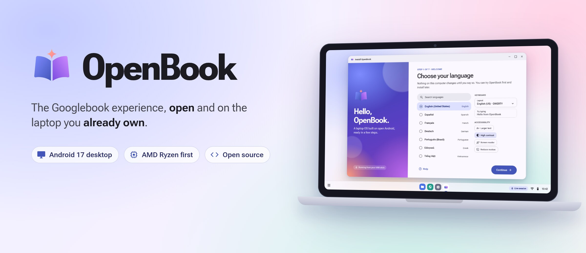
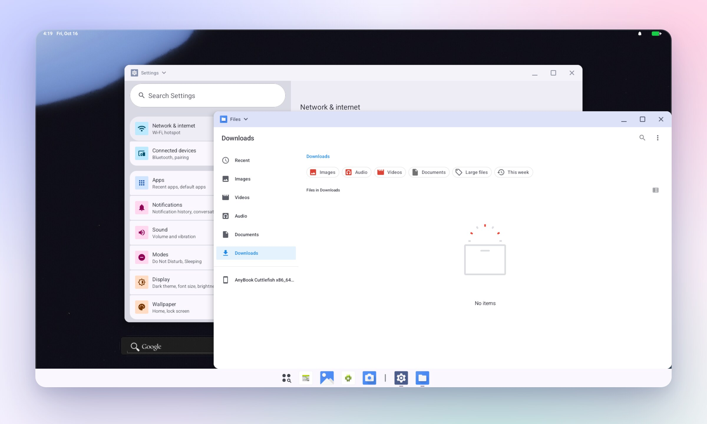
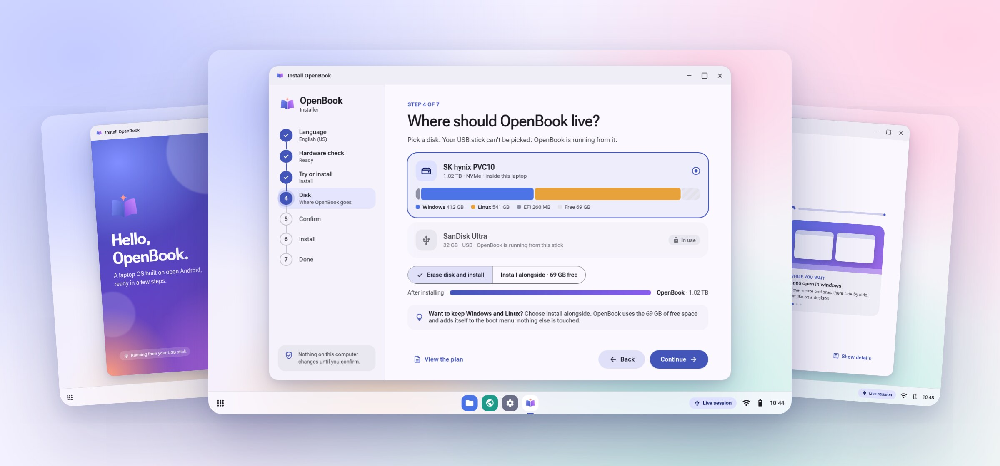
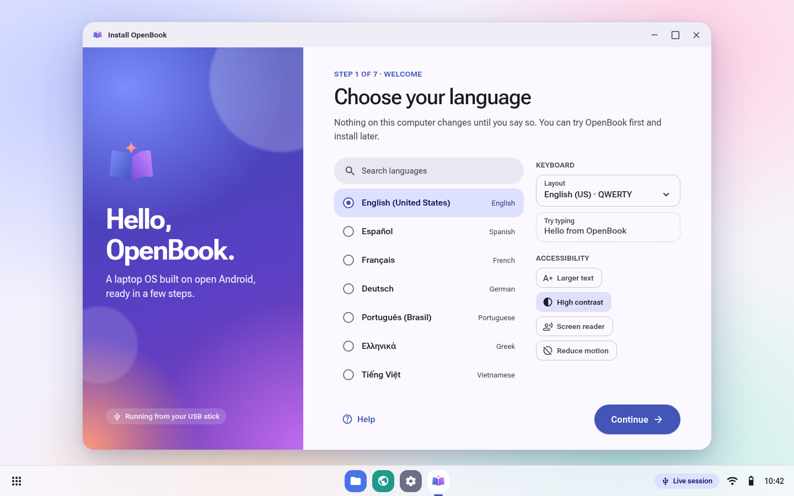
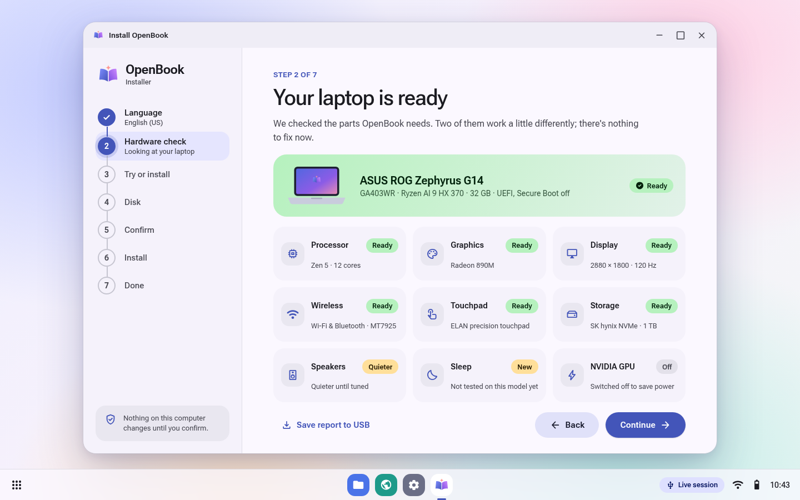
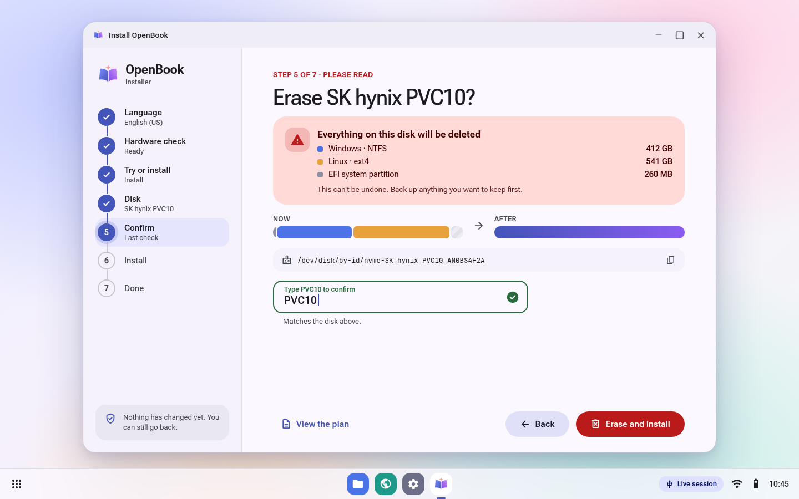
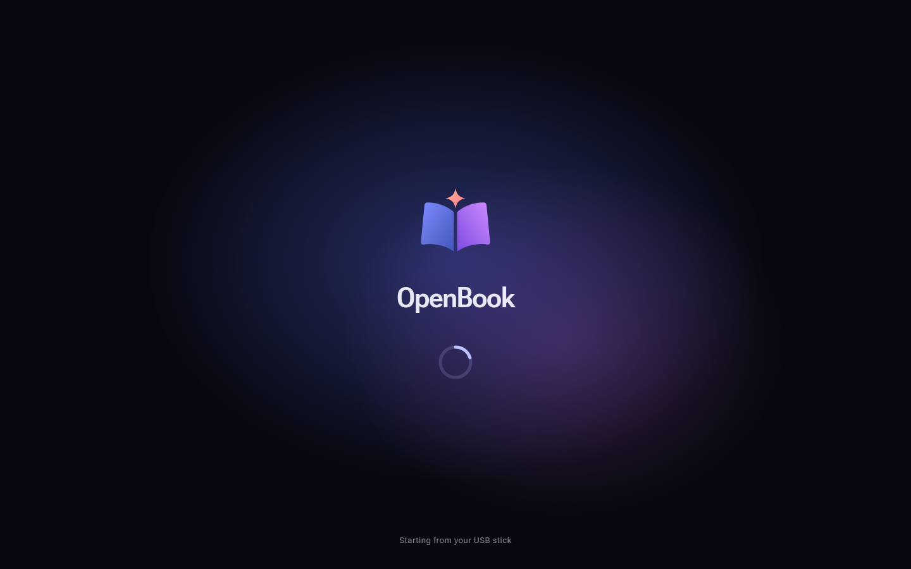
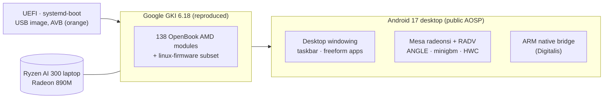

<div align="center">

<picture>
  <source media="(prefers-color-scheme: dark)" srcset="assets/readme/hero-dark.jpg">
  
</picture>

<br>

[](docs/STATUS.md) [](docs/aosp-desktop.md) [](docs/kernel.md) [](docs/graphics-amd.md) [-1B1B21?style=flat-square&logo=asus&logoColor=white)](docs/HARDWARE.md) [](#license-and-legal)

**[Status](#status)** · **[Screenshots](#screenshots)** · **[Hardware](#hardware)** · **[How it works](#how-it-works)** · **[Build it](#build-it)** · **[Docs](#documentation)**

</div>

<br>

**OpenBook** brings the Googlebook experience to laptops Google doesn't make. Googlebook is Google's new Android-based laptop OS. OpenBook gives you its desktop Android: apps in resizable windows and a taskbar. It is built entirely from **public AOSP 17 source and open drivers**. The first target is AMD Ryzen. Other Intel laptops and NVIDIA come later.

> [!NOTE]
> **OpenBook is in early development.**
> - **Works today:** our Android 17 desktop build runs in a VM on an AMD GPU.
> - **Proven on real hardware:** our kernel, drivers and firmware [booted on an ASUS ROG Zephyrus G14](evidence/2026-10-16-g14-hwcheck/SUMMARY.md).
> - **Not yet:** the full desktop on that laptop's screen. The installer screens below are **design renders**, not a shipping installer.

<br>

## Highlights

<table>
<tr>
<td width="33%" valign="top">
<br>
<b>A real Android desktop</b><br>
<sub>Android 17 with freeform windows, a pinned taskbar and a desktop status bar. It uses the same desktop configuration as Google's AOSP Desktop image, built from public source.</sub>
</td>
<td width="33%" valign="top">
<br>
<b>AMD-first hardware support</b><br>
<sub>Google's own GKI 6.18 kernel, rebuilt from source with an identical config and kernel interface, plus 138 open AMD vendor modules: Radeon graphics, Wi-Fi 7, the touchpad, the NPU and power management.</sub>
</td>
<td width="33%" valign="top">
<br>
<b>ARM apps on x86</b><br>
<sub>A repeatable compatibility harness for ARM-only apps. The open, Apache-2.0 Digitalis bridge is being ported to Android 17 as our redistributable translator.</sub>
</td>
</tr>
<tr>
<td width="33%" valign="top">
<br>
<b>Try it from a USB stick</b><br>
<sub>One image and a quiet boot. A seven-step installer that never touches a disk until you type its name. <i>In design.</i></sub>
</td>
<td width="33%" valign="top">
<br>
<b>Open, and honest about it</b><br>
<sub>Open-source components only. No Google images, GMS or vendor blobs, and every claim is backed by logs in <code>evidence/</code>.</sub>
</td>
<td width="33%" valign="top">
<br>
<b>Tested on real hardware</b><br>
<sub>Automated QEMU boot matrices today. Next, a Multica test agent running on the laptop itself, verifying each milestone on the device.</sub>
</td>
</tr>
</table>

## Screenshots

### Running today: our Android 17 desktop build

<picture>
  <source media="(prefers-color-scheme: dark)" srcset="assets/readme/desktop-dark.jpg">
  
</picture>

<sub>A real, unedited screenshot from 2026-10-16: <code>anybook_cf_x86_64_pc</code> running in Cuttlefish and rendered on a Radeon 610M through RADV, with 0% janky frames. Evidence: <a href="evidence/2026-10-16-desktop/"><code>evidence/2026-10-16-desktop/</code></a>.</sub>

### The installer: design

<picture>
  <source media="(prefers-color-scheme: dark)" srcset="assets/readme/showcase-dark.jpg">
  
</picture>

<sub>High-fidelity design renders (Material 3 Expressive) of the recommended installer, an Android app in the live session. Hardware values are sample data. Full set and rationale: <a href="docs/installer-design/png/gallery.png">gallery</a> · <a href="docs/installer.md"><code>docs/installer.md</code></a>.</sub>

<table>
<tr>
<td><br><sub><b>1 · Welcome.</b> Language, keyboard test, and accessibility from the first screen.</sub></td>
<td><br><sub><b>2 · Hardware check.</b> One verdict, plus a tile per component.</sub></td>
</tr>
<tr>
<td><br><sub><b>5 · Confirm.</b> Before-and-after view. You type the disk's name to enable the button.</sub></td>
<td><br><sub><b>Boot.</b> The menu stays hidden. The laptop's logo hands straight over to OpenBook.</sub></td>
</tr>
</table>

## Status

| | Milestone | State |
|:-:|---|---|
| ✅ | **M0** Research, baselines, image analysis | Done. See [`docs/RESEARCH.md`](docs/RESEARCH.md) |
| ✅ | **M1** Our Android 17 build boots in a VM | `boot_completed` in 17–29 s ([evidence](evidence/2026-10-16-aosp/)) |
| ✅ | **M2** Desktop windowing and GPU graphics in a VM | Matches Google's desktop image; RADV on an AMD iGPU |
| 🚧 | **M3** OpenBook kernel on real hardware | **First boot on the G14:** 235 modules loaded, 0 failed |
| 🚧 | **M4** AMD graphics stack | Built and passing on a Radeon 610M; the G14 run is next |
| 🚧 | **M6** ARM app compatibility | 13 of 16 ARM-only apps run; open bridge being ported to Android 17 |
| 🚧 | **M8** USB installer | Design and boot-chain prototype done ([`docs/installer.md`](docs/installer.md)) |
| ⏳ | **M5** Desktop, input and power on the laptop | Next, with the G14 product build |
| ⏳ | **M7** Performance and parity | Later |

> [!TIP]
> **Milestone, 2026-10-16: first boot on real hardware.** Our UEFI boot chain, GKI kernel and drivers ran on an ASUS ROG Zephyrus G14 (Ryzen AI 9 HX 370) from a USB stick. The following all came up:
> - Radeon 890M graphics (amdgpu, DCN 3.5)
> - MediaTek Wi-Fi 7 and Bluetooth
> - the ELAN touchpad and the keyboard
> - the XDNA 2 NPU
> - battery, USB-C and USB4
>
> Nothing was written to the laptop's disk. [Read the report →](evidence/2026-10-16-g14-hwcheck/SUMMARY.md)

The live tracker, decisions and next steps are in [`docs/STATUS.md`](docs/STATUS.md). The full plan and ranked risks are in [`docs/PLAN.md`](docs/PLAN.md).

## Hardware

**First target: ASUS ROG Zephyrus G14 (2025, GA403WR).** It has a Ryzen AI 9 HX 370 (Zen 5), Radeon 890M, MediaTek MT7925 and a 2880×1800 OLED.

| Component | On the G14 today | Notes |
|---|---|---|
| Radeon 890M (gfx1150) | ✅ Driver up: SMU, DCN 3.5, eDP with PSR | The Android display stack arrives with the G14 product build |
| Wi-Fi 7 / Bluetooth (MT7925) | ✅ `wlan0` and `hci0` up | `regulatory.db` added in check v2 |
| Touchpad, keyboard, lid | ✅ Detected | ELAN I2C HID over pinctrl-amd |
| XDNA 2 NPU | ✅ `accel0` | Userspace later |
| Battery, USB-C, USB4 | ✅ Detected | s2idle test ready (check v2) |
| Audio (ALC285 + CS35L56) | 🚧 Codec found | Speaker amps not yet exercised |
| NVIDIA RTX 50 dGPU | ⏸ Kept off by design | Research track in [`docs/nvidia.md`](docs/nvidia.md) |

The full driver and firmware map is in [`docs/HARDWARE.md`](docs/HARDWARE.md). **Other laptops:** run [`scripts/hw-inventory.sh`](scripts/hw-inventory.sh). It is read-only and redacts serial numbers, and its output is how we plan support for a new machine.

## How it works



- **Kernel:** the unmodified Android GKI that Googlebook ships, rebuilt by us, plus AMD vendor modules built against its interface ([`docs/kernel.md`](docs/kernel.md)).
- **Graphics:** Mesa radeonsi and RADV, built for Android with ACO and no LLVM. A boot-time probe picks the AMD drivers on hardware and the virtual GPU in a VM ([`docs/graphics-amd.md`](docs/graphics-amd.md)).
- **Desktop:** a reusable `device/anybook/common/desktop` configuration matching Google's AOSP Desktop image ([`docs/aosp-desktop.md`](docs/aosp-desktop.md)).
- **Boot:** a raw GPT USB image with systemd-boot and A/B slots. Android finds its partitions by the boot disk's UUID ([`docs/installer.md`](docs/installer.md)).

## Build it

**Needs:** Linux x86_64 with KVM and Docker, but no root. Plan for about 64 GB of RAM (an Android build peaks around 41 GiB), about 600 GB of disk, and a Radeon or NVIDIA GPU for accelerated VM graphics.

```bash
git clone https://github.com/Mhsbrian/OpenBook && cd OpenBook

# 1 · Android 17 sources (pinned android-latest-release) and the build container
docker build -t anybook-aosp -f tools/Dockerfile.aosp \
  --build-arg UID=$(id -u) --build-arg GID=$(id -g) tools/
scripts/aosp-docker.sh -d anybook-aosp-sync /repo/scripts/aosp-sync.sh all
docker wait anybook-aosp-sync

# 2 · Mesa for Android (radeonsi + RADV), staged into the tree
docker build -t anybook-mesa-android -f tools/Dockerfile.mesa-android tools/
scripts/mesa-android-build.sh fetch deps setup build install verify -- upstream
scripts/graphics-amd-stage-mesa.sh

# 3 · Build the OpenBook desktop product and boot it in a VM on your GPU
AOSP_JOBS=32 scripts/aosp-docker.sh -d anybook-aosp-build \
  /repo/scripts/aosp-build.sh anybook_cf_x86_64_pc-cp2a-userdebug
docker wait anybook-aosp-build
CF_GPU=amd CF_GPU_MODE=gfxstream_guest_angle CF_DEVICE=anybook_vsoc_x86_64 \
  scripts/cf-boot.sh
```

The full, tested steps, including the kernel, the hardware-check stick and the installer prototype, are in [`docs/BUILD.md`](docs/BUILD.md).

<details>
<summary><b>Try the hardware check on your own laptop</b></summary>
<br>

`scripts/installer/make-hwcheck-stick.sh` builds `openbook-hwcheck-<date>.img`. Flash it to a USB stick and boot from it. It loads OpenBook's kernel, drivers and firmware, writes a report and the kernel log to the stick, and powers off. **It never writes to the laptop's disks.** The script only creates image files; flashing a stick is a separate step you do yourself. Details are in [`docs/installer.md`](docs/installer.md) §2.7.

</details>

## Documentation

| Area | Docs |
|---|---|
| **Start here** | [`PLAN`](docs/PLAN.md) · [`STATUS`](docs/STATUS.md) · [`RESEARCH`](docs/RESEARCH.md) · [`BUILD`](docs/BUILD.md) |
| **Hardware** | [`HARDWARE`](docs/HARDWARE.md) · [`nvidia`](docs/nvidia.md) |
| **Android** | [`aosp-build`](docs/aosp-build.md) · [`aosp-desktop`](docs/aosp-desktop.md) |
| **Kernel and graphics** | [`kernel`](docs/kernel.md) · [`mesa`](docs/mesa.md) · [`graphics-amd`](docs/graphics-amd.md) |
| **ARM apps** | [`COMPAT-MATRIX`](docs/COMPAT-MATRIX.md) · [`compat-harness`](docs/compat-harness.md) · [`digitalis`](docs/digitalis.md) |
| **Installer** | [`installer`](docs/installer.md) · [design gallery](docs/installer-design/png/gallery.png) |

<details>
<summary><b>Repository layout</b></summary>

```text
device/anybook/   AOSP device tree: desktop config, AMD graphics, VM product
kernel/           kernel patches, vendor-module build, G14 module lists, firmware rules
aosp/patches/     patches to AOSP projects (e.g. minigbm amdgpu)
manifests/        pinned repo manifests
scripts/          build, boot, test, inventory and installer tools
tools/            toolbox Dockerfiles
assets/           brand mark, README art and its sources
docs/             plan, status, research and topic docs
evidence/         logs, screenshots and reports for every milestone
```

</details>

## How we work

Every change lands as a pull request with evidence, such as boot logs, test output or screenshots, in [`evidence/`](evidence/). Claims without logs are labelled as hypotheses. Work is planned as epics and tracked on Multica.

From M3 onward, a milestone only counts once it has been reproduced on the laptop itself. Hardware safety comes first: nothing touches a physical disk or firmware without explicit confirmation that names the exact device.

## License and legal

- **License:** a project license has not been chosen yet; Apache-2.0 is proposed.
- **Third-party components** keep their own licenses: AOSP (Apache-2.0), the Linux kernel (GPL-2.0), Mesa (MIT), linux-firmware (per-file licenses) and Digitalis (Apache-2.0).
- **No proprietary files:** OpenBook does not ship or redistribute Google Mobile Services, Googlebook OS images or proprietary vendor blobs. It does not bypass Play Integrity, DRM or verified boot on devices you don't own.
- **Trademarks:** OpenBook is an independent project, not affiliated with or endorsed by Google, ASUS, AMD or NVIDIA. Googlebook, Android and Chrome are trademarks of Google LLC, and other names belong to their owners.

<details>
<summary><b>About the name</b></summary>
<br>

The project was called **AnyBook** until 2026-10-16, and the old `Mhsbrian/AnyBook` URL redirects here. Build identifiers still use the old name until one coordinated rename. That covers `device/anybook/`, the `anybook_*` products, the kernel's `//devices/anybook` and the `anybook-*` Docker images. `evidence/` keeps whatever name was in use at the time. The installer already uses OpenBook throughout.

</details>

<div align="center">
<br>

<br>
<sub>OpenBook · open desktop Android for the laptop you already own</sub>
</div>
