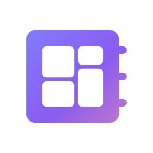
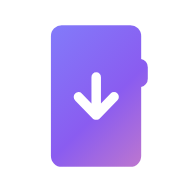
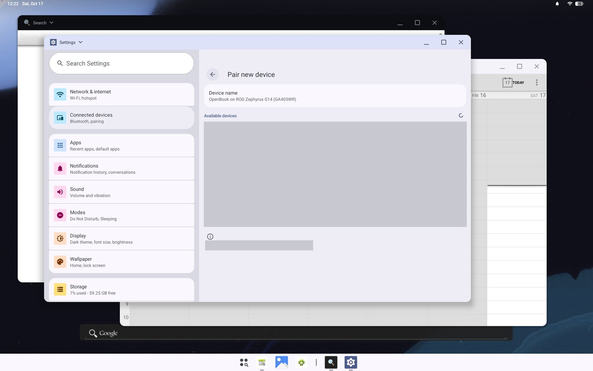
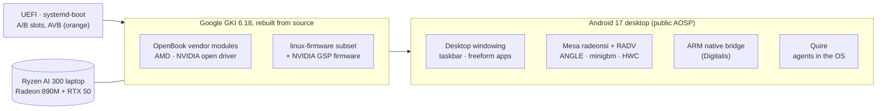

<div align="center">

<picture>
  <source media="(prefers-color-scheme: dark)" srcset="assets/readme/hero-dark.jpg">
  
</picture>

<br>

[](docs/STATUS.md) [](docs/aosp-desktop.md) [](docs/kernel.md) [](docs/graphics-amd.md) [](docs/nvidia-open.md) [-1B1B21?style=flat-square&logo=asus&logoColor=white)](docs/HARDWARE.md) [](#license-and-legal)

**[Status](#status)** · **[Screenshots](#screenshots)** · **[Hardware](#hardware)** · **[How it works](#how-it-works)** · **[Build it](#build-it)** · **[Docs](#documentation)**

</div>

<br>

**OpenBook** brings the Googlebook experience to laptops Google doesn't make. Googlebook is Google's new Android-based laptop OS. OpenBook gives you its desktop Android: apps in resizable windows and a taskbar. It is built from **public AOSP 17 source and open drivers**. The first target is an AMD Ryzen laptop with an NVIDIA GPU beside it. Intel laptops come later.

> [!NOTE]
> **OpenBook is in early development.**
> - **Works today:** our Android 17 desktop runs on an ASUS ROG Zephyrus G14 at 120 fps. It was [installed on the laptop's own drive](evidence/2026-10-18-g14-installer/) by our installer, and it updated itself over Wi-Fi into a spare slot, with automatic rollback.
> - **New, 2026-10-30:** NVIDIA's open kernel driver. The laptop's RTX GPU now has a driver and powers itself off when idle. [What that covers →](docs/nvidia-open.md)
> - **Not yet:** apps rendering on the NVIDIA GPU, the deepest sleep state (S0i3), and a public image. Since 2026-10-23 the G14 has run our sibling image based on Google's own Googlebook OS. That image shares this kernel and vendor layer, and much of the hardware evidence below comes from it.

<br>

## Highlights

<table>
<tr>
<td width="33%" valign="top">
<br>
<b>A real Android desktop</b><br>
<sub>Android 17 with freeform windows, a pinned taskbar and a desktop status bar, at 120 fps on the G14's panel. It uses the same desktop configuration as Google's AOSP Desktop image, built from public source.</sub>
</td>
<td width="33%" valign="top">
<br>
<b>The Googlebook look</b><br>
<sub>Google Sans, circular icons, background blur, 84 of Googlebook's desktop features turned on, a clean desktop, and OpenBook's own wallpapers, boot animation, sounds and pointer. A nine-page first-run setup, with no account needed.</sub>
</td>
<td width="33%" valign="top">
<br>
<b>AMD-first hardware support</b><br>
<sub>Google's GKI 6.18 kernel, rebuilt from source, plus open vendor modules for the Radeon GPU, Wi-Fi 7, the touchpad, the NPU and power management.</sub>
</td>
</tr>
<tr>
<td width="33%" valign="top">
<br>
<b>NVIDIA, the open way</b><br>
<sub>NVIDIA's open kernel driver (615.78.08) for the RTX 5070 Ti Laptop GPU, with its GSP firmware. It loads after boot and powers the GPU off when idle, while the desktop stays on the Radeon. <i>Apps on the RTX: next.</i></sub>
</td>
<td width="33%" valign="top">
<br>
<b>Install from a USB stick</b><br>
<sub>A wizard that never touches a disk until you type its name. It installs on a whole disk or alongside Windows, survives power cuts at six points, and adds its own firmware boot entry.</sub>
</td>
<td width="33%" valign="top">
<br>
<b>Safe updates over Wi-Fi</b><br>
<sub>A/B system slots. An update goes into the spare slot. A slot that fails to boot three times rolls back on its own, and an interrupted update resumes. Your apps, settings, files and PIN stay put.</sub>
</td>
</tr>
<tr>
<td width="33%" valign="top">
<br>
<b>ARM apps on x86</b><br>
<sub>The open, Apache-2.0 Digitalis bridge, ported to Android 17 and built from source. It runs 14 of 16 ARM-only test apps, and ARM64 Chromium renders on the G14. Bring Google's apps yourself, or use the microG option.</sub>
</td>
<td width="33%" valign="top">
<br>
<b>Quire, your agents in the OS</b><br>
<sub>Summon a note from anywhere and talk to your own coding agents, running in the laptop's Linux environment. They know they are OpenBook's assistant and can operate the laptop, asking first before anything destructive.</sub>
</td>
<td width="33%" valign="top">
<br>
<b>Open, and honest about it</b><br>
<sub>Open-source code throughout, with no Google images and no GMS. Firmware ships unmodified under its own licences. Every claim is backed by logs in <code>evidence/</code>, and anything unproven is labelled.</sub>
</td>
</tr>
</table>

## Screenshots

### On the G14, from our own build



<sub>A real screenshot that the G14 took of its own panel (<code>screencap</code>, 2880×1800, scaled to 1440×900) on 2026-10-17, from the <code>anal178c</code> live stick's "save logs" boot. The list of nearby Bluetooth devices is blanked for privacy; nothing else is edited. In the same session the normal boot, with SELinux enforcing, reached the desktop in 28 s. Evidence: <a href="evidence/2026-10-17-g14-desktop/g14-anal178c/SUMMARY.md"><code>evidence/2026-10-17-g14-desktop/g14-anal178c/</code></a>.</sub>

### In a VM: our Android 17 desktop build

<picture>
  <source media="(prefers-color-scheme: dark)" srcset="assets/readme/desktop-dark.jpg">
  
</picture>

<sub>A real, unedited screenshot from 2026-10-16: <code>anybook_cf_x86_64_pc</code> running in Cuttlefish and rendered on a Radeon 610M through RADV, with 0% janky frames. Evidence: <a href="evidence/2026-10-16-desktop/"><code>evidence/2026-10-16-desktop/</code></a>.</sub>

### The installer: design

<picture>
  <source media="(prefers-color-scheme: dark)" srcset="assets/readme/showcase-dark.jpg">
  
</picture>

<sub>High-fidelity design renders (Material 3 Expressive) of the recommended installer, an Android app in the live session. Hardware values are sample data. Full set and rationale: <a href="docs/installer-design/png/gallery.png">gallery</a> · <a href="docs/installer.md"><code>docs/installer.md</code></a>.</sub>

<table>
<tr>
<td><br><sub><b>1 · Welcome.</b> Language, keyboard test, and accessibility from the first screen.</sub></td>
<td><br><sub><b>2 · Hardware check.</b> One verdict, plus a tile per component.</sub></td>
</tr>
<tr>
<td><br><sub><b>5 · Confirm.</b> Before-and-after view. You type the disk's name to enable the button.</sub></td>
<td><br><sub><b>Boot.</b> The menu stays hidden. The laptop's logo hands straight over to OpenBook.</sub></td>
</tr>
</table>

## Status

| | Milestone | State |
|:-:|---|---|
| ✅ | **M0** Research, baselines, image analysis | Done. See [`docs/RESEARCH.md`](docs/RESEARCH.md) |
| ✅ | **M1** Our Android 17 build boots in a VM | `boot_completed` in 17–29 s ([evidence](evidence/2026-10-16-aosp/)) |
| ✅ | **M2** Desktop windowing and GPU graphics in a VM | Matches Google's desktop image; RADV on an AMD iGPU |
| ✅ | **M3** OpenBook kernel on real hardware | **Installed on the G14's internal NVMe** (2026-10-18), booting our kernel to the desktop with SELinux enforcing. On the live stick, 235 modules loaded with 0 failures ([evidence](evidence/2026-10-18-g14-installed-adb/)) |
| ✅ | **M8** USB installer | **The installer put OpenBook on the G14.** In a VM it passes 79/79 end-to-end checks: a whole disk; alongside Windows with Windows untouched; power cuts at six points; reinstall. Updates then arrive over Wi-Fi into the spare A/B slot: 55/55 update and rollback checks in a VM, and every later build reached the G14 this way ([`docs/INSTALL.md`](docs/INSTALL.md), [`docs/adb-debug.md`](docs/adb-debug.md)) |
| 🚧 | **M4** AMD graphics stack | **120 fps on the G14:** 959 of 959 frames on time after a composer fix. Conformance on the Radeon 890M: Vulkan 1.4 passes 45,220 dEQP cases with 5 failures; GLES on ANGLE and radeonsi has 0 failures. Fixed on the laptop: Photos crashing the display. Open: rendering into Android hardware buffers |
| 🚧 | **M5** Desktop, input and power on the laptop | On the G14: desktop, touchpad, keyboard, Wi-Fi with internet, Bluetooth pairing, battery health and lid sleep/wake. Deep sleep (S0i3) is under investigation. The lid guard and the S0i3 diagnostics module from the sibling image are now in OpenBook's kernel, not yet enabled here |
| 🚧 | **M6** ARM app compatibility | The open Digitalis bridge, built from source: 14 of 16 ARM-only test apps run, and **ARM64 Chromium renders on the G14** without stalling app starts ([evidence](evidence/2026-10-19-armfix1-g14/)) |
| 🚧 | **M7** Performance and parity | **The Googlebook look on the G14:** Google Sans, circular icons, blur, Googlebook's desktop flags, OpenBook's wallpapers, boot animation and sounds, and the first-run setup. Google apps: the microG option ([installed on the G14](evidence/2026-10-19-microg-g14/)) or your own package at install time. Benchmarks later |
| 🚧 | **NVIDIA** dGPU | **NVIDIA's open kernel driver and GSP firmware are in the image** (2026-10-30). On the G14 the driver loads, binds the RTX, and powers it off when idle and through sleep. Graphics modes (Eco/Hybrid) are designed and in the vendor layer, with firmware writes off. Next: apps on the RTX ([`docs/nvidia-open.md`](docs/nvidia-open.md)) |
| 🚧 | **Quire** Agents in the OS | **On the G14 since 2026-10-19:** the note, consent, a live mirror of what an agent does, agents in the Linux environment, and agents that can drive the whole laptop and confirm only destructive actions ([evidence](evidence/2026-10-19-quire-g14/)). Next: voice |

> [!TIP]
> **2026-10-30: NVIDIA joins OpenBook.** OpenBook and its sibling Googlebook-based image now build **one kernel and one vendor layer**. NVIDIA's open driver, its GSP firmware and the graphics-mode switcher come to OpenBook from the work done there. On the G14, NVIDIA's driver holds the RTX in its deepest power state whenever no app needs it. [Read how it works →](docs/nvidia-open.md)
>
> **2026-10-18: installed on the G14.** The installer put OpenBook on the laptop's internal drive. Every OpenBook build after that reached it over Wi-Fi as an A/B update: the 120 fps composer fix, Quire, the Photos fix and the ARM64 Chromium fix. Each one booted, was marked good, and kept the owner's apps, settings and files. [Read the report →](evidence/2026-10-19-armfix1-g14/)
>
> **2026-10-17: the Android desktop on real hardware.** Our build reached the desktop on the G14's own panel from a USB stick, **with SELinux enforcing**, in 28 s. [Read the report →](evidence/2026-10-17-g14-desktop/g14-anal176s/SUMMARY.md)

The live tracker, decisions and next steps are in [`docs/STATUS.md`](docs/STATUS.md). The full plan and ranked risks are in [`docs/PLAN.md`](docs/PLAN.md).

## Hardware

**First target: ASUS ROG Zephyrus G14 (2025, GA403WR).** It has a Ryzen AI 9 HX 370 (Zen 5), Radeon 890M, an NVIDIA RTX 5070 Ti Laptop GPU, MediaTek MT7925 and a 2880×1800 120 Hz OLED.

| Component | On the G14 today | Notes |
|---|---|---|
| Radeon 890M (gfx1150) | ✅ amdgpu drives the panel at **120 Hz** (959/959 frames on time); the desktop renders on ANGLE/RADV with 0 dropped frames; dEQP: Vulkan 1.4 45,220 pass / 5 fail, GLES 0 fail | Composition runs on the GPU and stays on the Radeon even with NVIDIA's driver loaded. Open: rendering into Android hardware buffers; a GPU hang resets the whole GPU and restarts the UI |
| NVIDIA RTX 5070 Ti Laptop (GB205) | ✅ NVIDIA's open driver 615.78.08 loads after boot, binds the GPU, and holds it in D3cold whenever it is idle, including across sleep | Shown with this kernel and vendor layer on the sibling image. Apps on the RTX, Ultimate mode and HDMI come later ([`docs/nvidia-open.md`](docs/nvidia-open.md)) |
| Wi-Fi 7 / Bluetooth (MT7925) | ✅ Android Wi-Fi with internet (5 GHz, 160 MHz); Bluetooth pairs, A2DP with LDAC | 🚧 Bluetooth audio under SELinux enforcing: connects with no crash; sound still to be heard |
| Touchpad, keyboard, lid | ✅ Pointer and keyboard work; closing the lid sleeps and opening it wakes | 🚧 Touchpad feel: a scroll start can read as two fingers, and tap-and-drag doesn't work yet. The lid guard (a lid-closed sleep that wakes itself) is in the kernel, not yet enabled here |
| XDNA 2 NPU | ✅ `accel0` | Userspace later |
| Battery, USB-C, USB4 | ✅ Battery charge and health reach Android (88.7 %, GOOD) | OpenBook's health HAL, checked on the G14 |
| CPU power and sleep | ✅ amd-pstate-epp switches modes with the screen and app launches; Android's own sleep and wake work | 🚧 Deepest idle (S0i3) not reached yet. The PSP is ruled out; a diagnostics module (`openbook_sleep_diag`) is in the image to find the blocker |
| Audio (ALC285 + CS35L56) | ✅ Speakers and microphone work through ALSA | 🚧 Android's audio path: the codec-paced HAL and the SELinux fixes are in; G14 listening check next |
| Webcam (UVC) | 🧪 Android's UVC camera provider is in the image | Brought over from the sibling image; not yet checked on OpenBook |

The full driver and firmware map is in [`docs/HARDWARE.md`](docs/HARDWARE.md). **Other laptops:** run [`scripts/hw-inventory.sh`](scripts/hw-inventory.sh). It is read-only and redacts serial numbers, and its output is how we plan support for a new machine.

## How it works



- **Kernel:** Google's GKI 6.18 rebuilt from source, plus vendor modules built against its interface. To serve NVIDIA's driver, the vendor symbol list is wider (61 symbols, no existing export changed), and one owner-approved exception to Google's symbol denylist lets the RTX power off when idle ([`docs/kernel.md`](docs/kernel.md), [`docs/nvidia-open.md`](docs/nvidia-open.md)).
- **Graphics:** Mesa radeonsi and RADV, built for Android with ACO and no LLVM. A boot-time probe picks the GPU that drives the panel, and the composer and allocator are pinned to it ([`docs/graphics-amd.md`](docs/graphics-amd.md), [`docs/nvidia-graphics-modes.md`](docs/nvidia-graphics-modes.md)).
- **Desktop:** a reusable `device/anybook/common/desktop` configuration matching Google's AOSP Desktop image, with the Googlebook look on top ([`docs/aosp-desktop.md`](docs/aosp-desktop.md), [`docs/googlebook-ui.md`](docs/googlebook-ui.md)).
- **Boot and updates:** a raw GPT image with systemd-boot and A/B slots. `openbook-bootsync` keeps the boot menu in step with the slots, so a failed update rolls back by itself ([`docs/installer.md`](docs/installer.md), [`docs/adb-debug.md`](docs/adb-debug.md)).
- **Shared with the sibling track:** `kernel/` and most of `device/` are identical to the Googlebook-based image's. A fix made for one goes to the other with `git format-patch` / `git am`.

## Build it

**Needs:** Linux x86_64 with KVM and Docker, but no root. Plan for about 64 GB of RAM (an Android build peaks around 41 GiB), about 600 GB of disk, and a Radeon or NVIDIA GPU for accelerated VM graphics.

```bash
git clone https://github.com/Mhsbrian/OpenBook && cd OpenBook

# 1 · Android 17 sources (pinned android-latest-release) and the build container
docker build -t anybook-aosp -f tools/Dockerfile.aosp \
  --build-arg UID=$(id -u) --build-arg GID=$(id -g) tools/
scripts/aosp-docker.sh -d anybook-aosp-sync /repo/scripts/aosp-sync.sh all
docker wait anybook-aosp-sync

# 2 · Mesa for Android (radeonsi + RADV), staged into the tree
docker build -t anybook-mesa-android -f tools/Dockerfile.mesa-android tools/
scripts/mesa-android-build.sh fetch deps setup build install verify -- upstream
scripts/graphics-amd-stage-mesa.sh

# 3 · Build the OpenBook desktop product and boot it in a VM on your GPU
AOSP_JOBS=32 scripts/aosp-docker.sh -d anybook-aosp-build \
  /repo/scripts/aosp-build.sh anybook_cf_x86_64_pc-cp2a-userdebug
docker wait anybook-aosp-build
CF_GPU=amd CF_GPU_MODE=gfxstream_guest_angle CF_DEVICE=anybook_vsoc_x86_64 \
  scripts/cf-boot.sh
```

The full, tested steps, including the kernel, the hardware-check stick and the installer, are in [`docs/BUILD.md`](docs/BUILD.md).

<details>
<summary><b>Build the G14 image, with NVIDIA's driver</b></summary>
<br>

```bash
scripts/kernel-g14-package.sh                      # the G14 kernel: AMD modules and NVIDIA's open driver (Kleaf)
python3 scripts/kernel-nvidia-open-firmware.py \
  --pin kernel/firmware/anybook-nvidia-open.tsv \
  --run NVIDIA-Linux-x86_64-615.78.08.run --out ~/anybook/kernel/nvidia-open-firmware
G14_NVIDIA_FIRMWARE=~/anybook/kernel/nvidia-open-firmware scripts/g14-stage-kernel.sh <dist>
scripts/aosp-docker.sh -d anybook-aosp-build /repo/scripts/aosp-build.sh anybook_g14_x86_64-cp2a-userdebug
scripts/g14-image.sh                               # a USB-ready disk image; writing a stick is your own step
```

Every image and firmware file is checked against its pin, and staging refuses NVIDIA's driver without its firmware. NVIDIA's firmware is used under its licence's own-use terms, so **an image built this way is for your own use** ([`docs/nvidia-open.md`](docs/nvidia-open.md)).

</details>

<details>
<summary><b>Try the hardware check on your own laptop</b></summary>
<br>

`scripts/installer/make-hwcheck-stick.sh` builds `openbook-hwcheck-<date>.img`. Flash it to a USB stick and boot from it. It loads OpenBook's kernel, drivers and firmware, writes a report and the kernel log to the stick, and powers off. **It never writes to the laptop's disks.** The script only creates image files; flashing a stick is a separate step you do yourself. Details are in [`docs/installer.md`](docs/installer.md) §2.7.

</details>

## Documentation

| Area | Docs |
|---|---|
| **Start here** | [`PLAN`](docs/PLAN.md) · [`STATUS`](docs/STATUS.md) · [`RESEARCH`](docs/RESEARCH.md) · [`BUILD`](docs/BUILD.md) |
| **Hardware** | [`HARDWARE`](docs/HARDWARE.md) · [`g14-product`](docs/g14-product.md) · [`power-input`](docs/power-input.md) · [`adb-debug`](docs/adb-debug.md) |
| **NVIDIA** | [`nvidia-open`](docs/nvidia-open.md) · [`nvidia-graphics-modes`](docs/nvidia-graphics-modes.md) · [`nvidia`](docs/nvidia.md) (research) |
| **Android** | [`aosp-build`](docs/aosp-build.md) · [`aosp-desktop`](docs/aosp-desktop.md) · [`googlebook-ui`](docs/googlebook-ui.md) · [`googlebook-flags`](docs/googlebook-flags.md) · [`setup`](docs/setup.md) · [`gapps`](docs/gapps.md) |
| **Kernel and graphics** | [`kernel`](docs/kernel.md) · [`mesa`](docs/mesa.md) · [`graphics-amd`](docs/graphics-amd.md) |
| **ARM apps** | [`COMPAT-MATRIX`](docs/COMPAT-MATRIX.md) · [`compat-harness`](docs/compat-harness.md) · [`digitalis`](docs/digitalis.md) |
| **Install and update** | [`INSTALL`](docs/INSTALL.md) · [`installer`](docs/installer.md) · [design gallery](docs/installer-design/png/gallery.png) |
| **Agents (Quire)** | [`quire`](docs/quire.md) · [`quire-design`](docs/quire-design.md) · [`quire-howto`](docs/quire-howto.md) · [`quired`](quire/quired/) |

<details>
<summary><b>Repository layout</b></summary>

```text
device/anybook/   AOSP device tree: desktop config, AMD graphics, graphics modes, G14 and VM products
kernel/           kernel patches, vendor-module builds (AMD, NVIDIA), G14 module lists, firmware pins
aosp/patches/     patches to AOSP projects (e.g. minigbm, drm_hwcomposer)
manifests/        pinned repo manifests
scripts/          build, boot, test, inventory and installer tools
tools/            toolbox Dockerfiles
assets/           brand mark, README art and its sources
quire/quired/     Quire's harness host: runs the person's coding agents over ACP
docs/             plan, status, research and topic docs
evidence/         logs, screenshots and reports for every milestone
```

`kernel/` and most of `device/anybook/` are shared, byte for byte, with the sibling Googlebook-based repository. [`docs/nvidia-open.md`](docs/nvidia-open.md) lists what is shared.

</details>

## How we work

Every change lands as a pull request with evidence, such as boot logs, test output or screenshots, in [`evidence/`](evidence/). Claims without logs are labelled as hypotheses. Work is planned as epics and tracked on Multica.

From M3 onward, a milestone only counts once it has been reproduced on the laptop itself. Hardware safety comes first: nothing touches a physical disk or firmware without explicit confirmation that names the exact device.

## License and legal

- **License:** a project license has not been chosen yet; Apache-2.0 is proposed.
- **Third-party components** keep their own licenses: AOSP (Apache-2.0), the Linux kernel (GPL-2.0), NVIDIA's open kernel modules (MIT/GPL-2.0), Mesa (MIT), Digitalis (Apache-2.0), microG (Apache-2.0, an optional add-on) and linux-firmware (per-file licenses).
- **Firmware:** the files from linux-firmware ship unmodified under their own licenses. NVIDIA's GSP firmware ships unmodified from NVIDIA's driver package, under the NVIDIA Driver License Agreement's **own-use terms**, so OpenBook images that include it are for private use.
- **No Google software:** OpenBook does not ship or redistribute Google Mobile Services or Googlebook OS images. It does not bypass Play Integrity, DRM or verified boot on devices you don't own.
- **Trademarks:** OpenBook is an independent project, not affiliated with or endorsed by Google, ASUS, AMD or NVIDIA. Googlebook, Android and Chrome are trademarks of Google LLC, and other names belong to their owners.

<details>
<summary><b>About the name</b></summary>
<br>

The project was called **AnyBook** until 2026-10-16, and the old `Mhsbrian/AnyBook` URL redirects here. Build identifiers still use the old name until one coordinated rename. That covers `device/anybook/`, the `anybook_*` products, the kernel's `//devices/anybook` and the `anybook-*` Docker images. `evidence/` keeps whatever name was in use at the time. The installer already uses OpenBook throughout.

</details>

<div align="center">
<br>

<br>
<sub>OpenBook · open desktop Android for the laptop you already own</sub>
</div>
