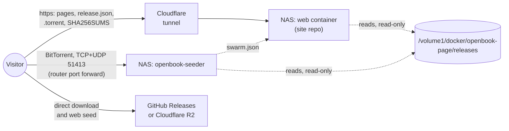

# Releasing an OpenBook image (openbook.page)

How a built live USB image becomes a download on openbook.page: the file format, the torrent, the mirrors, the
seeder on the NAS, the record the website reads, and the gates that keep anything unready off the site. ANAL-320.

> [!IMPORTANT]
> **Nothing is published yet.** Every OpenBook image so far fails at least four of the gates in §7. The tooling
> here runs end to end on real images (evidence in `evidence/2026-10-31-release-pipeline/`), but it never
> uploads anything. Publishing is the owner's step, after the release checklist in [`INSTALL.md`](INSTALL.md) §9.

## 1. What people download

**One file: `openbook-<version>-x86_64-live.img.xz`.** It is the live USB image from
`scripts/installer-image.sh`, compressed with xz. It is not an ISO, and it should not become one. Android boots from
named GPT partitions on the stick (`boot_a`, `vendor_boot_a`, `super`, `userdata`), and `openbook-live-init` grows
`userdata` to fill the stick on the first boot. An ISO 9660 image can't carry those partitions. Multi-image boot
tools such as Ventoy loop-mount an image instead of writing it, so Android would not find its partitions on the
stick (a reasoned expectation, not tested). Raspberry Pi OS and Home Assistant OS ship images the same way.

Every common USB writer reads `.img.xz` directly and decompresses as it writes: balenaEtcher, Rufus, Raspberry Pi
Imager, GNOME Disks and Fedora Media Writer. On the command line:
`xz -dc openbook-….img.xz | sudo dd of=/dev/disk/by-id/<the stick> bs=4M conv=fsync status=progress`.

### Compression, measured

The `anal191i` live image of 2026-10-18 (2,989,490,176 bytes, 1.43 GB of it data) on a 32-thread Ryzen, 2026-10-31
(`evidence/2026-10-31-release-pipeline/compress-bench.log`):

| Format | Bytes | Of the image | Compress | Decompress, all cores / 1 core |
|---|---:|---:|---:|---:|
| `.img` (raw) | 2,989,490,176 | 100 % | | |
| xz -6, multi-threaded | 928,998,704 | 31.1 % | 22.4 s | 1.2 s / 18.5 s |
| **xz -9, multi-threaded** | **885,136,268** | **29.6 %** | 92.9 s | 3.4 s / 18.7 s |
| xz -9e, multi-threaded | 885,241,264 | 29.6 % | 94.8 s | 3.4 s / 18.2 s |
| zstd -19 --long=27 | 921,911,918 | 30.8 % | 56.7 s | 1.5 s |
| zstd -10 --long=27 | 992,348,196 | 33.2 % | not timed | |

**Decision: xz -9, multi-threaded (15 independent blocks).** It is the smallest: 44 MB (4.7 %) under xz -6, at
70 s more once per release. Every writer reads it. Decompression costs at most 19 s on one core, well under the
time a USB stick takes to write 3 GB. xz -9e gains nothing. zstd decompresses faster, but not every writer reads
it, and a second format would split the swarm. **One format means one torrent and one swarm.**

The image itself is already tight. `mklive.py` repacks `super` from 8.6 GB down to its 1.43 GB of content, and the
1 GiB blank `userdata` compresses to almost nothing. Further savings would come from the build, not the packaging.
A `user` build drops debugging tools (release gate 4). Changing EROFS compression trades boot and app-start speed
for size, and would need measuring first. Neither has been measured.

## 2. The release folder

`scripts/release/make-release.sh --image <live>.img --version <V> [--mirror URL]… [--sign-key KEY]` writes
`<data dir>/release/out/<V>/`:

| File | What it is |
|---|---|
| `openbook-<V>-x86_64-live.img.xz` | the image, xz -9. It is decompressed again and checked against the build record's sha256 before it is kept |
| `openbook-<V>-x86_64-live.img.xz.torrent` | hybrid BitTorrent v1 + v2, 1 MiB pieces (845 for 0.9 GB), with web seeds and trackers (§3) |
| `SHA256SUMS` | the `.img.xz`, the `.torrent`, and the decompressed `.img` |
| `SHA256SUMS.sig`, `openbook-release.pub` | with `--sign-key`: an `ssh-keygen -Y sign` signature, namespace `openbook-release`, verified as soon as it is made |
| `release.json` | the record the website reads (§5), including the gates (§7) |

The script first checks the image against its build record (`<label>.build.json`). It refuses an image that carries
NVIDIA's GSP firmware: its file names are visible in the raw image, and the 2026-10-30 G14 image is caught this way
(`evidence/…/nvidia-refusal.txt`). `--private` is for the owner's own-use images. It writes the `.img.xz` and the
checksums only: no torrent and no mirrors.

**Checking a download** (this goes on the site's verify page):

```bash
echo 'release@openbook.page namespaces="openbook-release" <contents of openbook-release.pub>' > allowed_signers
ssh-keygen -Y verify -f allowed_signers -I release@openbook.page -n openbook-release -s SHA256SUMS.sig < SHA256SUMS
sha256sum -c --ignore-missing SHA256SUMS
```

On Windows: `Get-FileHash openbook-<V>-x86_64-live.img.xz`, compared with the line in `SHA256SUMS`.

## 3. The torrent

`scripts/release/mktorrent.py` uses the Python standard library only, and is deterministic: the same file, name,
piece size, URLs and epoch give the same bytes.

- **Hybrid v1 + v2 (BEP 3 + BEP 52).** v1 clients see an ordinary torrent. v2 clients also check every 16 KiB block
  against a SHA-256 merkle tree. It is one file, so it needs no padding. Transmission 4.1.2 reads the v1 half and
  ignores `file tree`. libtorrent (qBittorrent, Deluge) uses both halves.
- **Web seeds (BEP 19)** are the `--mirror` URLs. A download completes even with no peers at all. `url-list` sits
  outside the info dictionary, so adding or changing mirrors later changes the `.torrent` file but not the info hash
  or the swarm.
- **Trackers:** `udp://tracker.opentrackr.org:1337`, `udp://open.stealth.si:80` and `udp://tracker.torrent.eu.org:451`,
  one tier each, plus DHT and PEX. All three answered on 2026-10-31 (`scripts/release/tracker-probe.py`). Run the
  probe again before each release.
- **Magnet:** both hashes (`btih` and `btmh`), `dn`, `xl`, `tr` and `ws`.

**Checked against libtorrent 2.0.11** (`scripts/release/torrent-test.sh`, 78/78). There are ten edge-case sizes
around the block, the piece and powers of two, plus the real 885 MB release file. Every one loads in libtorrent,
and each has the same v1 and v2 info hashes as libtorrent's own hybrid torrent of the same file. A recheck finds
every piece (845/845 for the real file), and one flipped byte fails exactly one piece.

## 4. Hosting: three paths, each for what it does well



| Path | Carries | Why this way |
|---|---|---|
| **openbook.page** via cloudflared to the NAS (`192.168.50.236:6666`) | the site, `index.json`, `release.json`, `.torrent`, `SHA256SUMS(.sig)`, `swarm.json` | small files, which suit the tunnel and the CDN |
| **BitTorrent** from `openbook-seeder` on the NAS | the image, peer to peer | the NAS seeds without a CDN in the middle, and every downloader adds bandwidth |
| **HTTP mirror**: a GitHub Release on `Mhsbrian/OpenBook` (or R2 at `dl.openbook.page`) | the direct-download button, and the torrent's web seed | keeps the 0.9 GB file off the tunnel (below) |

**Keep the `.img.xz` off the Cloudflare tunnel.** Cloudflare's terms say a non-Enterprise plan should serve video
and other large files from a Cloudflare product built for them, such as R2 or Stream, not through the CDN in front
of your own server ([Cloudflare, 2023 terms update](https://blog.cloudflare.com/updated-tos/);
[delivering videos with Cloudflare](https://developers.cloudflare.com/fundamentals/reference/policies-compliances/delivering-videos-with-cloudflare/)).
Cloudflare also caches files only up to 512 MB on Free, Pro and Business
([default cache behaviour](https://developers.cloudflare.com/cache/about/default-cache-behavior)). An 885 MB
image would never be cached, and every download would come up the home connection. All checked 2026-10-31.

**The mirror.** The choice of mirror is the owner's.
- **GitHub Releases** (recommended): no new account, files up to 2 GiB each, and no bandwidth limit
  ([GitHub docs](https://docs.github.com/en/repositories/releasing-projects-on-github/about-releases), 2026-10-31).
  A download URL redirects (302) to GitHub's file storage. The swarm test checks that libtorrent follows such a
  redirect for a web seed.
- **Cloudflare R2** behind `dl.openbook.page`: no egress fees, and it is the Cloudflare product meant for large
  files. It needs an R2 subscription on the account. Pass `--mirror https://dl.openbook.page/<V>/`.

**The seeder** (`tools/release/seeder/`, image `openbook-seeder`):
- Alpine 3.24 with Transmission 4.1.2. It runs as uid 10001 on a read-only root file system, with every capability
  dropped and `no-new-privileges`. The releases folder is mounted read-only.
- Its RPC listens on the container's own loopback, so nothing outside the container can reach it. UPnP and LAN
  discovery are off. **The peer port (51413 TCP and UDP) is the only thing the stack exposes.** Forward it on the
  router to the NAS, and allow it in DSM's firewall. cloudflared carries HTTP(S) only. Without the port forward the
  seeder can still connect out to peers, and the web seed still finishes every download, but the NAS gives the swarm
  far less.
- It seeds a release only when that release's `release.json` says `"public": true`. It stops seeding a release
  that is removed or no longer public, and never touches the release's data.
- Every `SYNC_SECONDS` it writes `/status/swarm.json` (`openbook-swarm/1`): per torrent, its state, peer counts,
  upload rate and total uploaded. It never includes peer addresses. The website can mount it read-only for a live
  "seeding" line.
- `SEED_UP_KBPS` caps upload to protect the home connection (0 means no cap). It has a built-in health check.
- Deploy it with [`compose.example.yml`](../tools/release/seeder/compose.example.yml), which builds from this
  repository's git URL, or copy the folder into the site repo. Rebuild monthly with `docker compose build --pull`:
  Transmission faces the internet.

**On the NAS:**

```text
/volume1/docker/openbook-page/releases/
  index.json                  scripts/release/release-index.py: public releases only, newest first
  <V>/release.json  <V>/SHA256SUMS  <V>/SHA256SUMS.sig  <V>/openbook-release.pub
  <V>/openbook-<V>-x86_64-live.img.xz  <V>/openbook-<V>-x86_64-live.img.xz.torrent
```

The web container should serve only `*.json`, `*.torrent`, `SHA256SUMS*` and `*.pub` from this folder. The image is
there for the seeder alone.

## 5. What the website reads (`openbook-release/1`)

`releases/index.json` (`openbook-releases/1`) has `latest` (the newest public version per channel) and `releases`
(summaries, newest first). Each `releases/<V>/release.json` contains:

| Field | Use on the site |
|---|---|
| `version`, `channel` (`preview`, `stable`), `date` | the headline and the release list |
| `public`, `audience`, `gates`, `blocking`, `waived` | show a download only when `public` is true. Otherwise show "not released yet", not a broken button |
| `artifacts[0].file`, `.bytes`, `.sha256` | the file name, its size (885 MB), and the checksum to copy |
| `artifacts[0].urls` | the direct-download button (the mirror) |
| `artifacts[0].torrent.url`, `.magnet`, `.infohash_v1`, `.infohash_v2` | the torrent button, the magnet link, and the info hashes for the verify page |
| `artifacts[0].image.bytes`, `.stick_min_gb`, `.install_min_gb` | "needs a 4 GB USB stick; installs on 64 GB" |
| `checksums.url`, `checksums.signature.public_key` | the verify page (§2) |
| `build.fingerprint`, `build.kernel`, `hardware` | "what's inside", and a link to the hardware status |

`evidence/2026-10-31-release-pipeline/release-0.0.0-test.anal191i/release.json` is a real record to build the page
against. It is unpublished on purpose (§7), and its signature is from a throwaway test key, not an OpenBook key.

## 6. Tests

| Script | What it proves | Result, 2026-10-31 |
|---|---|---|
| `scripts/release/torrent-test.sh [FILE PIECE_KIB]` | our torrents equal libtorrent's own, and libtorrent's recheck passes (§3) | 78/78 |
| `scripts/release/swarm-test.sh [RELEASE_DIR]` | on an isolated Docker network: the seeder refuses an unpublished release. A libtorrent client gets the whole 885 MB image from the web seed alone, through a 302 like GitHub's (2.0 s), and then from the Transmission seeder alone (8.0 s, 110 MB/s; local network, so the times say little about the internet). Both match the sha256. `swarm.json` counts the upload, the health check passes, and the seeder can write neither the releases nor its own root | 9/9 |
| `scripts/release/tracker-probe.py` | the default trackers answer a BEP 15 connect request | 3/3 |
| `make-release.sh` on the NVIDIA image | refuses it, exits 1, and writes nothing | refused |

Not tested: a download from the internet through the router's port forward, and the seeder on the Synology itself.
Both need the deployed stack. A client behind NAT reaching the NAS is also untested.

## 7. Publish gates (in `release.json`)

| Gate | Passes when | Can be waived |
|---|---|---|
| `no_nvidia_firmware` | the image carries none of NVIDIA's GSP firmware ([`nvidia-open.md`](nvidia-open.md): own-use terms) | **no.** The script refuses such an image unless it is `--private` |
| `firmware_licences` | every firmware file ships with its licence | no |
| `release_keys` | the build is not signed with AOSP's public test keys | `--waive release_keys`, recorded in the release, for an openly labelled developer preview |
| `user_build` | a `user` build, not `userdebug` | `--waive user_build`, recorded the same way |
| `checksums_signed` | `SHA256SUMS.sig` exists, signed with the OpenBook release key | no |
| `source_offer` | `--source-url` points to the GPL/LGPL source for this exact build (INSTALL.md §9, item 7) | **no** |
| `owner_approved` | `--owner-approved`: the owner signed off the checklist | no |

`public` is true only when every gate passes or is waived. The seeder and `release-index.py` both enforce it, so an
unready image can't reach the site or the swarm even if its folder is copied to the NAS.

Today's images, `anal191i` and later, fail `release_keys`, `user_build`, `source_offer` and `owner_approved`.
Images from 2026-10-30 on also fail `no_nvidia_firmware`. A public image needs a G14 product variant without
NVIDIA's firmware. With the modules but not the firmware, the RTX would stay unbound, and the open question is
whether runtime D3 still powers it off. That has to be designed and measured before the variant exists.

## 8. Publishing, once the gates pass (the owner's steps)

```bash
# 1. the release folder (the mirror URL is baked into the torrent as its web seed)
scripts/release/make-release.sh --image ~/anybook/installer/out/<label>.img --version <V> --channel preview \
  --mirror https://github.com/Mhsbrian/OpenBook/releases/download/v<V>/ \
  --sign-key ~/.ssh/openbook-release --source-url <source bundle URL> --owner-approved
scripts/release/tracker-probe.py
scripts/release/swarm-test.sh ~/anybook/release/out/<V>
# 2. the mirror
gh release create v<V> --repo Mhsbrian/OpenBook --prerelease --title "OpenBook <V>" --notes-file <notes> \
  ~/anybook/release/out/<V>/{openbook-<V>-x86_64-live.img.xz,openbook-<V>-x86_64-live.img.xz.torrent,SHA256SUMS,SHA256SUMS.sig,openbook-release.pub}
# 3. the NAS: the folder, then the index (the seeder picks it up within SYNC_SECONDS)
rsync -a ~/anybook/release/out/<V>/ <nas>:/volume1/docker/openbook-page/releases/<V>/
scripts/release/release-index.py ~/anybook/release/out     # lists public releases only
rsync -a ~/anybook/release/out/index.json <nas>:/volume1/docker/openbook-page/releases/
```

The release key is an ed25519 ssh key with a passphrase, kept by the owner and backed up offline. It is separate
from the AVB key (INSTALL.md §9, item 9). Its public half goes in this repository and on the site's verify page.
