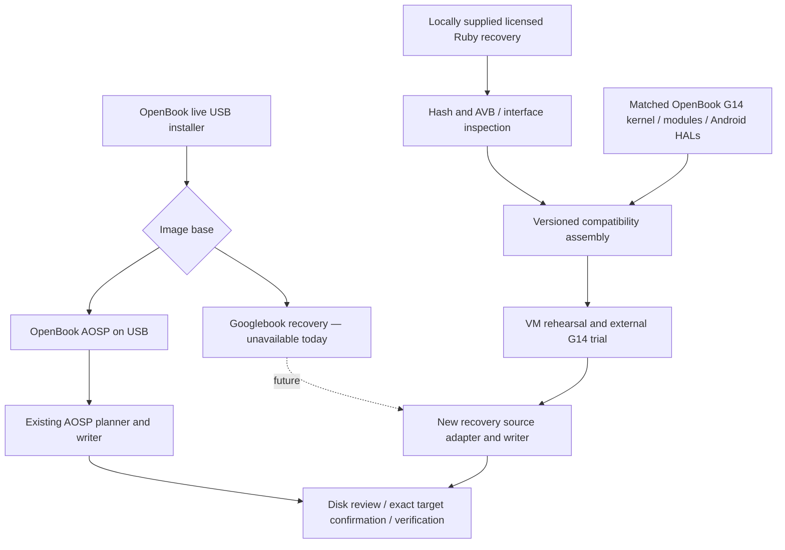

# Googlebook recovery as an OpenBook image base

Reviewed **2026-10-19**, ANAL-228. OpenBook baseline: `0664d66`.
GBRUNCH source reviewed: [`a8936fd33e50efda3f1b36e332ab30b67b709ab1`](https://github.com/danbyumagic/gbrunch/tree/a8936fd33e50efda3f1b36e332ab30b67b709ab1).
Target: the owner's **ASUS GA403WR, Ryzen AI 9 HX 370, Radeon 890M
`1002:150e`**. Keep the NVIDIA GPU off for initial bring-up. See `HARDWARE.md`
for the measured inventory, including the corrected board and GPU identity.

## Decision and what this change delivers

**Pursue a separate Googlebook recovery base alongside OpenBook AOSP.** GBRUNCH
provides credible examples of recovery preservation, local vendor assembly and
software security integration. OpenBook supplies a substantially more developed
AMD Android stack. Combining them is plausible, but a working G14 Googlebook
desktop has **not** been demonstrated. Copying our vendor image over Ruby's vendor
is not a validated integration.

This change implements the first installer boundary:

- The live wizard now goes from Try/Install to **Choose your image base**, then
  disk selection. OpenBook AOSP is the default. Googlebook can be selected to
  inspect its status; Continue is disabled with a plain explanation.
- The daemon and CLI accept `image_base: "openbook-aosp"`. Explicit unsupported
  identifiers return `image_base_unavailable`. Apply recomputes this gate and
  the plan hash. A manifest explicitly naming another base is refused.
- Existing requests and sticks without the field retain the AOSP behavior.
  Newly built sticks declare `image_base: "openbook-aosp"`. This marker is a
  routing guard, not a signature or proof of provenance.
- A host-side, read-only preflight identifies a locally supplied Ruby raw/ZIP
  against pinned hashes. Its report always says `installable: false`.

There is no Google recovery download, import service, compatibility image builder
or recovery disk writer in this change. No Google payload or derived vendor image
is distributed. No USB or laptop was flashed. This is a review and tested
foundation, **not a bootable Googlebook release**.

## Current primary-source facts

Google describes Googlebook as an Android-based laptop experience in its
[launch announcement](https://blog.google/products-and-platforms/devices/googlebook/pre-order-googlebook/)
(checked 2026-10-19). That announcement does not establish a public source release
of the complete shipping OS or permission to redistribute its recovery.

Google's [production recovery manifest](https://dl.google.com/dl/edgedl/device/recovery/production_recovery.json),
read on 2026-10-19, lists Lenovo Googlebook 15 / `ruby`, stable build
`16452207_CL3B.260622.271.R1`, updated 2026-10-05. The recovery URL is
`https://dl.google.com/device/recovery/ruby-user/16452207/recovery.zip`.
The recorded ZIP MD5 is `0567fe2ed0dd1c1753b383a6b3dbfe81`, and raw size is
19,069,493,760 bytes. The manifest's `zipfilesize: 1` is unusable as a real ZIP
size; do not allocate or validate from it. Strong SHA-256 pins in
`config/image-bases/googlebook-ruby.json` come from the reviewed GBRUNCH assembler,
**not a Google-signed digest manifest**. The preflight is byte identification,
not AVB signature validation or licensing verification.

Google's [additional terms](https://www.google.com/chrome/terms/) now name
GooglebookOS in the title (last modified 2025-09-30). They incorporate the
[Google terms](https://policies.google.com/terms) (effective 2026-07-30), which
describe a personal, non-assignable software license and restrictions on copying,
modifying and distributing software, subject to applicable law and separate
open-source licenses. Google's [recovery instructions](https://support.google.com/googlebook/answer/17452429?hl=en)
describe restoring a Googlebook. Checked 2026-10-19: these pages do not establish
an explicit grant for transferring this proprietary recovery to a G14. This is
an unresolved permission question, not a conclusion about all interoperability
research. The existing M0 research authorization covers the retained-file hash
checks here; a local-only builder does not itself settle subsequent use rights.

OpenBook previously reproduced Ruby's public GKI sources at
[`3938c8d97142`](https://android.googlesource.com/kernel/common/+/3938c8d97142d5cf31543aa96f864a2cf832dda0)
using `manifests/kernel/gbos-16302624.xml`. Our existing evidence ties the shipping
kernel to public CI build 16302624 (`docs/kernel.md`, 2026-10-15). This establishes
public kernel provenance, not public source for Google's desktop apps/services.

## What GBRUNCH actually does

| Area | Source inspected | Finding and consequence |
|---|---|---|
| Recovery input | `tools/assemble_external_lab.py`, `assemble_native_android.py` | Pinned URL, ZIP and raw SHA-256; raw/ZIP inputs. Keep the original local and immutable. |
| Boot packaging | `assemble_native_android.py`, `googlebook_boot_menu.py` | Reads v4 boot images and selected vendor ramdisk fragments, constructs a separate EFI/GRUB boot environment and appended compatibility/vendor/log partitions. These are Ruby-specific assumptions. |
| Partition preservation | Native assembler, `toolkit/validation/VALIDATION.md` | A QCOW2 view backs original non-EFI partition bytes with the recovery. Output changes EFI/GPT and adds `GBRUNCH`, `GBVENDOR`, `GBLOG`. Original *file* preservation and unchanged system bytes do not mean an unmodified runtime. |
| Vendor and policy | `native_vendor_in_vm.py`, `build_vendor_view.py`, `REPORT.md` | Locally reconstructs EROFS vendor and patches policy/service views; software KeyMint/Gatekeeper replace board-dependent services. Runtime masks and scoped memfd rules matter as much as drivers. |
| Graphics | `AMD.md`, native vendor tools | Intel success reuses the stock Xe driver and Intel Android graphics. The AMD path still needs an Android allocator, renderer and composer integration. SwiftShader VM work does not supply AMD acceleration. |
| Disk writer | `tools/dualboot_installer.py` | Requires supported GPT/512-byte-sector geometry and free space, rechecks identity/GPT, preserves existing partitions, verifies writes and retains GPT backups. It has its own layout and GRUB assumptions; it is not our install engine's source format. |
| USB toolbox | `toolkit/BUILD.md`, runtime and validation records | A separate Debian/XFCE environment prepares a local recovery. QEMU validates toolbox and disk operations; dummy partition tests cannot prove Android desktop boot. |
| Portability | `prepare_recovery.py`, assembler dependencies, test runners | Some research scripts depend on untracked/private `evidence/` inputs and development paths. Asset preparation is staged. Several integrity checks use Python `assert`; a production adapter must use unconditional checks and must not rely on assertions surviving `python -O`. |

Upstream reports physical desktop/graphics/Wi-Fi success on **one Intel HP Envy**.
Sound and webcam remain incomplete there. Automatic Google updates and physical
internal installation are unvalidated. These are upstream reports, not new tests
performed on the HP by OpenBook.

The [AMD investigation](https://github.com/danbyumagic/gbrunch/blob/a8936fd33e50efda3f1b36e332ab30b67b709ab1/AMD.md)
and its `docs/amd/replacement-smoke-result.json` are explicit: a separate kernel
boots in QEMU TCG and admits 13 AMDGPU dependencies, but firmware is not packaged,
Android graphics is not built, and neither Android boot nor physical AMD graphics
was tested. The report finds 131 stock export names missing from 937 driver
imports. Its remaining 470 original module filenames without a replacement do
not mean 470 required runtime failures; the required dependency inventory is
still missing. We reran **17 AMD unit checks and 5 boot-menu checks**, all passing.
We did not rerun its private-fixture UEFI or kernel build tests.

## What OpenBook contributes, and what cannot simply be transplanted

| OpenBook component | Existing evidence | Integration needed for Ruby |
|---|---|---|
| Kernel, AMD modules and firmware | G14 boot/module logs; `docs/kernel.md`, `g14-product.md` | Ship the kernel, system modules and vendor modules as one matched build. Check all needed original modules for symbols, CRCs, namespaces and signature admission. |
| Radeon stack | Android radeonsi/RADV, minigbm AMD backend, ANGLE, drm_hwcomposer; G14 dEQP and current YV12 fix | Audit Ruby's allocator/mapper/composer AIDL/HIDL versions, native-handle and metadata ABI, linker namespaces and APEX selection; rebuild to match. Include Mesa patch 0005. |
| Audio/radios/input/power | Existing G14 evidence and product configuration | Port HAL manifests, init, permissions and policy per service; test Wi-Fi, Bluetooth, audio routing, touchpad, brightness and suspend against the Google framework. |
| Boot/install safeguards | PARTUUID isolation, typed target confirmation, plan digest and readback; existing QEMU suites | Add an independent recovery source adapter and writer/layout. Preserve these safeguards and USB-vs-NVMe isolation. |
| A/B updates | OpenBook update and fallback tests | Do not point Google's stock updater at our layout. Re-import each new recovery, audit the new compatibility tuple, rehearse failure/rollback, then promote. |
| ARM applications | Digitalis and G14 evidence | Google may already select a native bridge. Inventory it and its permissions first; never install two bridges or promise Play Integrity. |
| Quire, Folio and framework changes | AOSP product evidence | Framework patches and platform-signed apps are not portable overlays. Quire's platform hooks, signing and consent model need separate work; a stock Google base does not inherit them automatically. |

Ruby already reached first-stage mounts and about 30 services on our Ryzen 7950X
under KVM, then stopped at keystore2/Trusty/GSC (`COMPAT-MATRIX.md`, 2026-10-15).
There were no SIGILLs in that observed boot segment. GBRUNCH needed GFNI,
VPCLMULQDQ and AVX-VNNI emulation for its **TCG** research. That does not prove
all Ruby binaries run on every Ryzen. Inventory actual CPUID features, then test
boot and representative apps on the HX 370; do not generalize from the VM.

Our kernel work already demonstrated that Google's protected GKI modules can be
rejected by our kernel despite matching KMI CRCs, because the signing key differs.
The [GKI versioning rules](https://source.android.com/docs/core/architecture/kernel/gki-versioning)
(checked 2026-10-19) explain the KMI identity; a common `6.18` version is not
sufficient. Prefer OpenBook's coherent Kleaf output and expanded symbol list
over adopting GBRUNCH's experimental removal of export protection wholesale.

## Proposed architecture



Initially build the compatibility artifact **on the Linux build host**, locally
from the user's permitted recovery. Preserve Google system/product/system_ext
bytes, retain the original recovery, and construct a separate vendor/runtime
view. Preserve hashes for both originals and changed views. A release tuple
must bind recovery build/hash, board profile/PCI IDs, kernel/modules, firmware,
HALs, policy and validation evidence. A successful hash preflight alone must
never enable the Googlebook card.

The current installer runs inside Android, whereas GBRUNCH's builder expects
Linux, QEMU and filesystem tools. Its Python scripts cannot simply become an
Android button handler. The first usable option should consume a previously
prepared, validated **local** compatibility artifact. A later on-USB builder
needs a distinct Linux maintenance environment or audited worker, storage and
resumable progress; do not mount or repartition the running Android boot source.

The recovery layout includes many partitions our AOSP plan does not have. Our
engine's fixed seed and partition arrays must be audited before accommodating
that layout. Use a distinct recovery source schema that old AOSP engines reject;
never relabel a recovery as `openbook-install-source/1`. Changing the `super` payload alone is insufficient: GPT, bootconfig,
AVB chains, userdata, recovery/security partitions and update behavior differ.
Whole-drive and alongside installation require separate tests. Never advertise
Windows preservation based only on source-code similarity.

## Ranked blockers and completion gates

| Priority | Gate | Evidence required to proceed |
|---|---|---|
| P0 | Permission to use recovery on this G14 | Applicable permission/terms for this use; download availability and GBRUNCH's MIT license do not grant proprietary image rights. No redistribution. |
| P0 | Security/vendor startup | Ruby framework and vendor [VINTF](https://source.android.com/docs/core/architecture/vintf) reconciliation; enforcing boot, software KeyMint/Gatekeeper/shared-secret operation, PIN enrollment/reboot/unlock and userdata decision. |
| P0 | Coherent AMD boot/graphics | Complete required module admission, firmware loading, correct AMD allocator/mapper/composer, SurfaceFlinger plus EGL/Vulkan pixel tests on 890M. |
| P1 | Recovery source and disk transaction | Pinned source contract, target identity checks, retained originals, fail-closed parser, readback, interrupted-write and rollback tests; the AOSP writer must refuse recovery sources. |
| P1 | G14 functionality | External USB boot logs, repeatable desktop, Wi-Fi/BT/audio/input/display/power checks. Laptop-specific suspend and NVIDIA power behavior remain independent gates. |
| P1 | Updates and feature claims | Recovery-version compatibility check and fallback; separate verification of login, Play apps, Chrome, Linux VM and phone/AI services. No attestation spoofing. |

Preserved system bytes do not retain Google's original trust chain for a changed
boot/vendor environment. GBRUNCH currently uses software security and unencrypted
userdata. Treat that as a laboratory limitation, not an acceptable silent default
for a daily-use installer. Android's [boot-state guidance](https://source.android.com/docs/security/features/verifiedboot/boot-flow)
(updated 2026-09-30, checked 2026-10-19) distinguishes unlocked/orange from verified
green. Show the actual state. Do not claim stock AVB, hardware-backed keys, device
certification, DRM access or automatic OTA merely because Google apps launch.

## Implementation sequence after this groundwork

1. Resolve recovery-use permission. On the host, inspect the pinned recovery's
   boot, modules, HAL/VINTF/APEX and policy interfaces without modifying it.
2. Assemble a separate compatibility image with matched OpenBook kernel/modules
   and the minimum software security services. QEMU goal: enforcing shell,
   service registration, persistent disposable userdata and reboot/unlock.
3. Bring up Ruby's framework on the OpenBook Radeon stack. A software-rendered VM
   desktop is an intermediate check; only an external G14 trial proves 890M
   graphics. Preserve separate logs and known-good images.
4. Add the recovery adapter to the host builder and installer. Test GPT and power
   cuts with regular-file fixtures before enabling any physical write path.
5. Enable **Experimental Googlebook OS** only for the validated tuple. The wizard
   then shows local recovery selection, build/hash status, preparation progress,
   hardware limitations, disk review and typed confirmation. Keep AOSP the default.
6. Add radios/audio/power/apps, update/rollback and the compatibility matrix.
   Internal installation requires explicit confirmation of the exact disk.

GBRUNCH's original code/documentation is MIT licensed, while bundled upstream
components retain separate notices. This patch imports no GBRUNCH source. If an
adapter later reuses implementation code, retain its copyright/license and audit
every bundled dependency. Keep local recovery-derived artifacts outside Git and
release uploads. Our recommendation is to reuse its narrowly reviewed assembly
ideas and contribute AMD findings, without replacing OpenBook's existing installer
or promising Google's proprietary features before they have been tested.

## Commands and validation scope

```sh
# Only if you have permission to use the supplied recovery; no download occurs.
python3 scripts/installer/recovery-preflight.py --raw /path/to/local/recovery.bin
# Or: --zip /path/to/local/recovery.zip

# Open-source/synthetic checks, no Google image needed:
python3 scripts/installer/recovery-preflight-test.py -v
OUT=/tmp/ob-base-app device/anybook/common/installer/app/tools/compile-check.sh
scripts/installer/engine-host-build.sh /path/to/writable/installer/build/openbook-install
# Run image-base-test.py through inst-docker.sh; --run must name a new directory
# in the writable installer workspace. Input is an existing OpenBook live image.
```

See `evidence/2026-10-19-googlebook-base/SUMMARY.md` for actual results and their
limits. The unit suite uses synthetic payloads. Separately, read-only preflight
matched both raw and ZIP files retained by M0's local interoperability research;
no new recovery download or execution was performed. The
preflight has no profile override or install-enable flag. Its JSON schema is
deliberately different from `openbook-install-source/1`.
