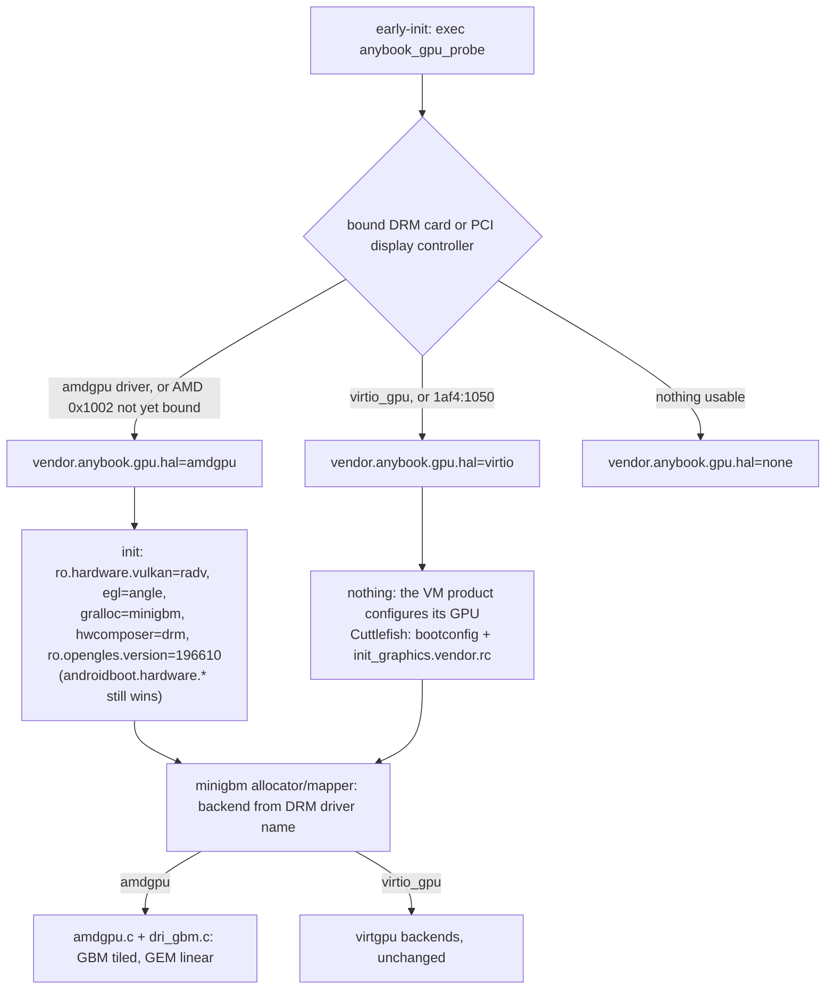

# AMD graphics in the AnyBook device tree

This covers ANAL-174, as of 2026-10-16. It builds on ANAL-173 (Mesa built with the NDK, `docs/mesa.md`) and ANAL-169 (the `anybook_cf_x86_64_pc` desktop product, `docs/aosp-desktop.md`). Evidence is in `evidence/2026-10-16-graphics-amd/`.

## Result

- `device/anybook/common/graphics-amd/` is a reusable product and board configuration. The bare-metal G14 product (ANAL-199) inherits it. It adds:
  - **Mesa 26.2.5** radeonsi (EGL/GLES) and RADV (Vulkan), using ACO and no LLVM, plus GBM. libelf is a shared library by default, and a switch links it statically.
  - **minigbm with an amdgpu backend.** Allocation goes through Mesa's GBM, and buffers fall back to linear when GBM is missing. This is a patch to AOSP's minigbm.
  - **drm_hwcomposer** and **ANGLE**.
  - The four `ro.hardware.*` properties, SELinux policy and an init `.rc`.
- **HAL selection happens at boot, not per product.** `anybook_gpu_probe` reads the DRM drivers and PCI IDs at early-init. On an AMD GPU it switches to radv/angle/minigbm/drm. minigbm picks its backend from the DRM driver name, `amdgpu` or `virtio_gpu`, inside one allocator.
- **The image builds.** `anybook_cf_x86_64_pc-cp2a-userdebug` builds in 3 min incrementally on top of ANAL-169's `out/`. Soong's sepolicy tests and the VINTF checks pass.
- **No VM regression.** Booting with `gfxstream_guest_angle` on the host's Radeon 610M:
  - `sys.boot_completed` comes 16–18 s after `cvd create` (ANAL-169: 17 s).
  - The desktop looks the same, with two freeform windows and the taskbar.
  - SurfaceFlinger reports the same renderer, `ANGLE (AMD, Vulkan 1.4.305 (Virtio-GPU GFXStream (AMD Radeon Graphics (RADV RAPHAEL_MENDOCINO))))`, and composes the same 11 layers.
  - Janky frames are 0 % and frame time is 5 ms at p50–p99, the same as ANAL-169.
  - The same 3 pre-existing AVC denials appear, and none come from this work.
  - The probe reports `hal=virtio`.
- **The AMD path, checked without target hardware:**
  - The image's own binaries ran on the build host's real AMD GPU (Radeon 610M, RDNA2) in a container: bionic, `vulkan.radv.so`, `libEGL_mesa.so` and the patched `libminigbm_gralloc.so`. There was no Android framework.
    - RADV created a device, and the GPU ran a 16 MiB `vkCmdFillBuffer` with 0 wrong words.
    - radeonsi GLES 3.2 cleared an FBO with 0 wrong pixels.
    - minigbm chose the `amdgpu` backend. It allocated 64 KiB-tiled (swizzle mode 27) and linear buffers, and both round-tripped through mappings.
  - The same minigbm code passed a Linux build test on that GPU: GPU-rendered content read back through a mapping in a second driver instance, and vice versa.
  - In the VM, RADV loads and `vkCreateInstance(1.3)` returns `VK_SUCCESS` with 0 devices. That is expected, because there is no AMD GPU in the VM.
  - The probe passes its unit tests. It picks `amdgpu` from the G14 inventory and from the build host's real sysfs, where the RTX 4090 is ignored. The `hal=amdgpu` init actions fire.
- **Not done:** nothing has run on the G14's Radeon 890M (gfx1150) yet. That needs the device gate (ANAL-176 boot, ANAL-177 dEQP/CTS).

## Layout

```
device/anybook/common/graphics-amd/
  graphics-amd.mk            product half: packages (Mesa, gralloc0, ANGLE, probe; platform HALs if wanted)
  BoardConfig.mk             board half: vendor sepolicy dirs
  Android.bp                 anybook_gpu_probe (vendor + host), anybook_gpu_probe_test (host unit test)
  init.anybook.graphics-amd.rc
  gpu_probe/                 probe source, tests, testdata/ (captures from real machines + synthetic cases)
  sepolicy/vendor/           probe domain, its property, SP-HAL labels for Mesa + gralloc0 (every product)
  sepolicy/platform/         allocator, mapper, drm_hwcomposer labels (products without Cuttlefish's)
device/anybook/cuttlefish/anybook_vsoc_x86_64/BoardConfig.mk   VM board: Cuttlefish's + graphics-amd policy
aosp/patches/external/minigbm/0001-ANYBOOK-amdgpu-...patch    minigbm amdgpu backend on GBM
vendor/anybook/mesa/         (AOSP tree only, never committed) Mesa prebuilts, staged by a script
```

- **New device directory.** `anybook_cf_x86_64_pc` now uses `PRODUCT_DEVICE := anybook_vsoc_x86_64`, because vendor sepolicy can only be added from a `BoardConfig.mk`. That file includes Cuttlefish's `vsoc_x86_64_only` board config unchanged.
  - The images now land in `out/target/product/anybook_vsoc_x86_64/`, so boot with `CF_DEVICE=anybook_vsoc_x86_64 scripts/cf-boot.sh`.
  - `ro.product.device` is `anybook_vsoc_x86_64`.
- **`ANYBOOK_GRAPHICS_PLATFORM_HALS`** defaults to on. It also installs the minigbm allocator and mapper, drm_hwcomposer, the Vulkan/GLES feature XMLs and `sepolicy/platform`.
  - Cuttlefish already packages and labels all of these (cf.gralloc, the ranchu and drm_hwcomposer composer APEXes, cf.vulkan). The VM product and board therefore set it to `false`.
  - The G14 product keeps it on. `sepolicy/platform` has not been built yet, because no product uses it so far (ANAL-199).

## How the HALs get picked



- **The probe** (`gpu_probe/`) lists `/sys/class/drm/card*`, following each card's `device` link up to its PCI function, and `/sys/bus/pci/devices/*` with class `0x03xxxx`.
  - A bound DRM card wins over a PCI device whose driver has not bound yet, and AMD wins over virtio-gpu. An AMD GPU claimed by `radeon` or `vfio-pci` does not count.
  - It publishes `vendor.anybook.gpu.{pci_id,driver,source,others,hal}`, with `hal` last. Its stdout goes to the kernel log.
  - In Cuttlefish it took 6 ms at 1.36 s: `anybook_gpu_probe: hal=virtio pci_id=1af4:1050 driver=virtio-pci source=drm`. Cuttlefish's 6.12 kernel parents `card0` on the PCI function, so the driver reads `virtio-pci`; the `1af4:1050` IDs still identify it.
- **Timing.** Property triggers run from `queue_property_triggers` onward, which is right after `late-init`'s own commands and before `early-fs`. The `ro.hardware.*` values are therefore in place before any HAL or SurfaceFlinger starts.
  - Cuttlefish sets the same properties at early-init from bootconfig. In the VM the `hal=amdgpu` actions never fire.
  - If they are forced to fire, init refuses them with "Read-only property was already set" (`vm/hal/manual-trigger.txt`).
- **Fallback GL.** ANGLE on RADV is the default, as on Google's desktop builds. radeonsi stays installed: `setprop persist.graphics.egl mesa` (read first by libEGL) or `androidboot.hardware.egl=mesa` switches to it.
- **Unknown GPUs** (`hal=none`, for example NVIDIA-only or Intel) are left alone. Products decide what to do with them (ANAL-186 for NVIDIA).

## Components and why

### Mesa: prebuilts from the pinned NDK build

- **Source.** `scripts/mesa-android-build.sh` (ANAL-173) builds upstream Mesa **26.2.5**. `scripts/graphics-amd-stage-mesa.sh` copies the result into `vendor/anybook/mesa/` in the AOSP tree.
  - The staging script generates an `Android.bp` with one `cc_prebuilt_library_shared` per library. Each library's `shared_libs` come from its `DT_NEEDED`, so Soong's ELF checks and the install graph follow the real dependencies.
  - It also writes `PROVENANCE.txt`: versions, the exact options and sha256 sums. The binaries are never committed.
- **Why not `external/mesa3d`.**
  - AOSP 17's `external/mesa3d` is Google's 26.1.0-devel. Its `Android.bp` files are generated by meson2hermetic and only build gfxstream, lavapipe, llvmpipe and zink, not radeonsi or RADV.
  - The generator is public at `github.com/gurchetansingh/mesonbuild`, branch `meson2hermetic`. It was checked on 2026-10-16, and its AOSP project configuration (`hermetic/android/aosp_mesa3d.toml` plus platform and dependency TOMLs) is in neither tree. Writing those for radeonsi and RADV is the way to an in-tree Soong build (follow-up).
  - Mesa's own `android/Android.mk` meson wrapper needs Kati, while this product builds Soong-only images.
- **What changed in the Mesa build for this issue** (all in `scripts/mesa-android-build.sh`):
  - **`-Dgbm=enabled`.** This produces `libgbm_mesa.so` (Mesa's own rename on Android ≥ 30, because minigbm owns `libgbm.so`) and its DRI backend `gbm/dri_gbm.so`.
  - **`--datadir=etc`.** libdrm_amdgpu's marketing-name table moves to `/vendor/etc/libdrm/amdgpu.ids`, because Soong cannot install into `/vendor/share`.
  - **`LIBELF=shared|static`.** The default is **shared**: libelf ships as `libelf_mesa.so` (LGPL-3.0+, its own SONAME). `static` links it into `libgallium_dri.so` as ANAL-173 did. This is the switch pending the owner's libelf decision.
  - **`libdrm_amdgpu` is renamed to `libdrm_amdgpu_mesa.so`.** AOSP's `external/libdrm` (2.4.124, too old for Mesa 26.2, which needs ≥ 2.4.133) owns that name and install path. The first build failed with "multiple rules generate …/libdrm_amdgpu.so". The libdrm core is AOSP's vendor `libdrm.so`, which has every libdrm symbol Mesa and libdrm_amdgpu 2.4.133 import (checked).
  - **`ANDROID_STRICT=true|false`** (default true, Mesa's default). With android-strict, **RADV reports Vulkan 1.1** on Android (`radv_instance.h`); with false it reports 1.4.
    - Google's Intel Googlebook ships newer Vulkan, so parity needs `false` plus CTS. That is an ANAL-177 decision.
    - `graphics-amd.mk` declares `vulkan.version-1_1` to match the current build.

### Gralloc: minigbm, amdgpu backend on GBM

- **The problem.** ChromeOS's `amdgpu.c` (in AOSP's minigbm, but never built: AOSP leaves `dri.c` out) reaches radeonsi through the DRI driver interface, `__driDriverGetExtensions_radeonsi`.
  - Mesa 24.3+ no longer exports it. Our `libgallium_dri.so` exports only the private `dri2_*`/`driCreateNewScreen3` ABI.
- **The patch** (`aosp/patches/external/minigbm/`, applied by `scripts/aosp-patches.sh` on top of the pinned revision, reproducible SHA):
  - **`dri_gbm.c`** implements the small `dri.h` interface on Mesa's public, stable **GBM** API instead. `amdgpu.c` keeps its format tables, linear GEM path and SDMA logic unchanged.
    - libgbm is `dlopen`ed `RTLD_LOCAL`. minigbm's own `gbm.h` uses different flag values from Mesa's (`GBM_BO_USE_PROTECTED`, `GBM_BO_IMPORT_FD_MODIFIER`), so Mesa's values are restated.
    - The GBM device sits on its own render-node fd, so its GEM handles never alias minigbm's. It is created on first use.
    - Imports only take a PRIME handle, so app processes, where the mapper and gralloc0 live, load the gallium driver only if they map a tiled buffer.
    - Each mapping of a tiled buffer imports its own GBM bo, so it never depends on the creating bo's lifetime. `drv_bo_release` runs before `drv_bo_mapping_destroy`, which bit `dri.c`'s design.
    - GBM has no modifier query, so tiled layouts are the driver's implicit choice (`DRM_FORMAT_MOD_INVALID`, with tiling in the kernel BO metadata), as Android-Generic's gbm_mesa backend does.
  - **`amdgpu.c`** falls back to **linear-only** when there is no DRI/GBM allocator, or when `debug.minigbm.amdgpu.linear_only=true`. `debug.*` is readable by every domain, so the mapper in apps sees the same value.
  - **The generic `libminigbm_gralloc`** gains the amdgpu backend. minigbm matches backends by DRM driver name, so in the VM the same allocator (Cuttlefish's `com.google.cf.gralloc` APEX, rebuilt from the patched source) still picks `virtgpu_virgl`. This was checked in the VM.
- **Compared with Android-Generic's `gbm_mesa`** (Apache-2.0, read for reference): the same idea. Theirs needs their patched minigbm backend API and a wrapper library built inside Mesa. Ours fits AOSP 17's minigbm as is and keeps the tested ChromeOS amdgpu logic.
- **Mesa's buffer queries.** The NDK build of Mesa has no IMapper backend (it needs libui), so Mesa's `cros` u_gralloc asks minigbm's gralloc0 module (`gralloc.minigbm`, `perform(GET_BUFFER_INFO)`). `ro.hardware.gralloc=minigbm` selects it.

### Composer and GLES

- **drm_hwcomposer** (`android.hardware.composer.hwc3-service.drm`) drives amdgpu's DC on the KMS node. The GKI has no simpledrm (`CONFIG_DRM_SIMPLEDRM` is not set), so amdgpu's card is the only one.
  - VM products keep their own composer APEXes: Cuttlefish already ships drm_hwcomposer next to ranchu and picks one through bootconfig.
  - VINTF rejects two `IComposer/default` declarations ("Conflicting FqInstance"), so a non-APEX copy cannot sit next to Cuttlefish's.
- **ANGLE** comes from `external/angle`: `/system/lib64/lib{EGL,GLESv1_CM,GLESv2}_angle.so`. AOSP 17 has no `packages/modules/ANGLE` (the ANGLE APEX); the issue named it, but it is not in the manifest.

### SELinux

`sepolicy/vendor` applies to every product:
- **Mesa and gralloc0.** The Mesa libraries, `gralloc.minigbm.so` and `amdgpu.ids` are labelled `same_process_hal_file`, because they load into app processes.
- **The probe.** It runs in its own domain `anybook_gpu_probe`, which reads `sysfs` and `sysfs_gpu` (Cuttlefish labels its virtio-gpu's IDs `sysfs_gpu`), sets `vendor_anybook_gpu_prop`, and writes to the kernel log (`kmsg_debug_device` on debuggable builds).

Two fixes came out of the first boot:
- **Dropped the `vendor.mesa.*` label.** Labelling it caused 17 BootAnimation denials. Mesa reads `debug.mesa.*` first, which every domain can read, so the label is gone (`vm/avc-compare.txt`).
- **Allowed the probe's kernel-log writes.** `stdio_to_kmsg` was denied on `/dev/kmsg_debug`.

## Verification

| Check | How | Result |
|---|---|---|
| Image builds | `scripts/aosp-build.sh anybook_cf_x86_64_pc-cp2a-userdebug droid anybook_gpu_probe_test anybook_gpu_probe` | exit 0, 3 min and 2 min incremental; sepolicy and VINTF checks pass (`build/`) |
| Files in the image | `image/amd-files.txt`, `vm/hal/ls-Z.txt` | all Mesa, minigbm, probe and rc files present, labels as intended |
| VM boot | `CF_GPU=amd CF_GPU_MODE=gfxstream_guest_angle CF_DEVICE=anybook_vsoc_x86_64 scripts/cf-boot.sh` | boot_completed +16–18 s (ANAL-169: +17 s) |
| VM rendering | `scripts/desktop-capture.sh` | same desktop and windows, renderer ANGLE → gfxstream → RADV (610M), 11 CLIENT layers (`vm/desktop/`) |
| VM performance | `scripts/cf-gfx-bench.sh` | 0 % janky, 5/5/5/5 ms (ANAL-169: identical) (`vm/bench/`) |
| VM SELinux | `dmesg \| grep avc` | the 3 denials ANAL-169 already had, 0 new (`vm/avc-compare.txt`) |
| Probe in the VM | kernel log, getprop | `hal=virtio`, 6 ms at early-init (`vm/probe-kernel-log.txt`, `vm/hal/props.txt`) |
| Probe logic | `anybook_gpu_probe_test` (host); the device binary on every fixture (`vm/hal/probe-from-fixtures.txt`); host binary on real sysfs | 3/3 tests pass; G14 → amdgpu, the G14 before amdgpu binds → amdgpu (pci), build host 610M + 4090 → amdgpu (others=nvidia), Cuttlefish → virtio, NVIDIA-only / radeon / no GPU → none |
| `hal=amdgpu` init actions | `setprop vendor.anybook.gpu.hal amdgpu` in the VM | the action runs all 5 setprops; refused because Cuttlefish set them first (`vm/hal/manual-trigger.txt`) |
| RADV in the VM | `mesa-smoke` (ANAL-173) | HAL opens, `vkCreateInstance(1.3)=VK_SUCCESS`, 0 devices (no AMD GPU) (`vm/hal/vm-mesa-smoke.txt`) |
| minigbm in the VM | `amd-android-hwtest` | backend `virtgpu_virgl`, not amdgpu (`vm/hal/vm-hwtest.txt`; its GPU-only map check is amdgpu-specific) |
| **Image's AMD stack on real AMD silicon** | `scripts/amd-android-hwtest.sh` (610M, RDNA2) | RADV device and GPU fill 0/4,194,304 wrong; radeonsi GLES 3.2 FBO 0 wrong; minigbm `amdgpu`, tiled (swizzle 27) and linear round trips 0 wrong (`hwtest/`) |
| minigbm amdgpu backend, GPU ↔ CPU | `scripts/minigbm-amdgpu-host-test.sh` (Linux, Mesa 26.2 radeonsi, 610M) | PASS: 10 usage cases, GPU-rendered content read back through a mapping in another driver instance, mapping written then sampled by the GPU, linear-only mode, lifetimes (`minigbm-host/`) |

**Limits of the host GPU checks.**
- The 610M is RDNA2 (gfx1036), while the G14 is RDNA3.5 (gfx1150).
- The container has no Android framework, binder or property service, so they exercise the drivers and the allocator code, not the HAL services.
- **HYPOTHESIS:** gfx1150 behaves the same. Mesa 26.2 supports it, but only the G14 can show it.

## Commands

```bash
scripts/mesa-android-build.sh fetch deps setup build install verify -- upstream   # LIBELF=shared, ANDROID_STRICT=true
scripts/graphics-amd-stage-mesa.sh                       # -> ~/anybook/aosp/src/vendor/anybook/mesa (+ PROVENANCE.txt)
AOSP_JOBS=24 scripts/aosp-docker.sh -d anybook-aosp-build /repo/scripts/aosp-build.sh anybook_cf_x86_64_pc-cp2a-userdebug
docker wait anybook-aosp-build                           # aosp-build.sh applies aosp/patches (scripts/aosp-patches.sh)
CF_GPU=amd CF_GPU_MODE=gfxstream_guest_angle CF_DEVICE=anybook_vsoc_x86_64 scripts/cf-boot.sh up && scripts/cf-boot.sh wait
scripts/amd-android-hwtest.sh                            # the image's AMD stack on this host's AMD GPU
scripts/minigbm-amdgpu-host-test.sh                      # minigbm amdgpu backend, Linux build, same GPU
scripts/gpu-probe-capture.sh > g14.txt                   # probe fixture from any Linux machine (POSIX sh, toybox too)
```

`scripts/aosp-patches.sh --export external/minigbm` writes edited commits back to `aosp/patches/`.

## Known gaps and next steps

1. **Run on the G14** (ANAL-176 boot, ANAL-177 dEQP/CTS):
   - RADV and radeonsi on gfx1150
   - drm_hwcomposer on DCN 3.5
   - the probe at early-init with amdgpu loaded from `vendor_dlkm`
   - scanout of GBM's implicit tiled layout. HYPOTHESIS: radeonsi picks no DCC for shared surfaces without modifiers; otherwise minigbm handles multi-plane layouts.
2. **The G14 product (ANAL-199)** inherits `graphics-amd.mk` with the platform HALs on. It needs `sepolicy/platform` built and probably a composer policy beyond Cuttlefish's.
3. **Vulkan 1.1 under android-strict.** Decide with CTS whether to ship `ANDROID_STRICT=false` (1.4).
4. **Explicit modifiers and DCC.** GBM cannot enumerate modifiers, so buffers use the driver's implicit layout. Querying modifiers through EGL (`eglQueryDmaBufModifiersEXT`) in the allocator would allow DCC-capable scanout layouts.
5. **YV12 on RDNA.** ChromeOS's `amdgpu.c` gives YV12 a chroma stride of 512 for a 640-pixel-wide image (its "bad strides" warning, `minigbm-host/test.log`). Android CTS YV12 tests may notice.
6. **An in-tree Soong build of Mesa** (meson2hermetic configs for radeonsi/RADV) would give Mesa the IMapper backend and drop the prebuilts.
7. **Licensing.** The staged libraries are MIT (Mesa, libdrm) plus LGPL-3.0+ (`libelf_mesa.so`, shared by default). Nothing is redistributed yet; see `docs/mesa.md` before shipping images.
