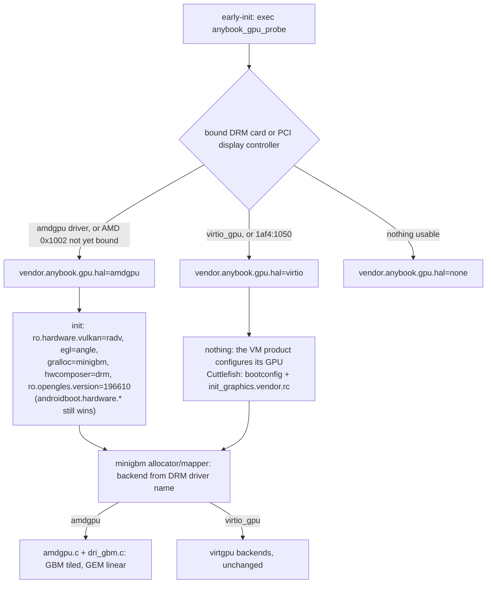
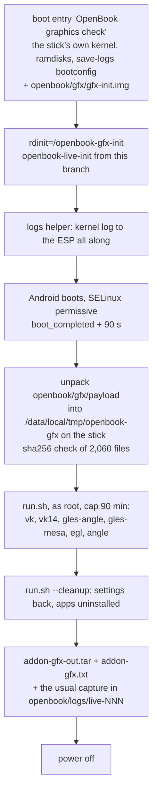

# AMD graphics in the OpenBook device tree

This covers ANAL-174, as of 2026-10-16; the last part, "dEQP and CTS on the G14", covers ANAL-177 (2026-10-17, with the G14's results). It builds on ANAL-173 (Mesa built with the NDK, `docs/mesa.md`) and ANAL-169 (the `anybook_cf_x86_64_pc` desktop product, `docs/aosp-desktop.md`). Evidence is in `evidence/2026-10-16-graphics-amd/`.

## Result

- `device/anybook/common/graphics-amd/` is a reusable product and board configuration. The bare-metal G14 product (ANAL-199) inherits it. It adds:
  - **Mesa 26.2.5** radeonsi (EGL/GLES) and RADV (Vulkan), using ACO and no LLVM, plus GBM. libelf is a shared library by default, and a switch links it statically.
  - **minigbm with an amdgpu backend.** Allocation goes through Mesa's GBM, and buffers fall back to linear when GBM is missing. This is a patch to AOSP's minigbm.
  - **drm_hwcomposer** and **ANGLE**.
  - The four `ro.hardware.*` properties, SELinux policy and an init `.rc`.
- **HAL selection happens at boot, not per product.** `anybook_gpu_probe` reads the DRM drivers and PCI IDs at early-init. On an AMD GPU it switches to radv/angle/minigbm/drm. minigbm picks its backend from the DRM driver name, `amdgpu` or `virtio_gpu`, inside one allocator.
- **The image builds.** `anybook_cf_x86_64_pc-cp2a-userdebug` builds in 3 min incrementally on top of ANAL-169's `out/`. Soong's sepolicy tests and the VINTF checks pass.
- **No VM regression.** Booting with `gfxstream_guest_angle` on the host's Radeon 610M:
  - `sys.boot_completed` comes 16–18 s after `cvd create` (ANAL-169: 17 s).
  - The desktop looks the same, with two freeform windows and the taskbar.
  - SurfaceFlinger reports the same renderer, `ANGLE (AMD, Vulkan 1.4.305 (Virtio-GPU GFXStream (AMD Radeon Graphics (RADV RAPHAEL_MENDOCINO))))`, and composes the same 11 layers.
  - Janky frames are 0 % and frame time is 5 ms at p50–p99, the same as ANAL-169.
  - The same 3 pre-existing AVC denials appear, and none come from this work.
  - The probe reports `hal=virtio`.
- **The AMD path, checked without target hardware:**
  - The image's own binaries ran on the build host's real AMD GPU (Radeon 610M, RDNA2) in a container: bionic, `vulkan.radv.so`, `libEGL_mesa.so` and the patched `libminigbm_gralloc.so`. There was no Android framework.
    - RADV created a device, and the GPU ran a 16 MiB `vkCmdFillBuffer` with 0 wrong words.
    - radeonsi GLES 3.2 cleared an FBO with 0 wrong pixels.
    - minigbm chose the `amdgpu` backend. It allocated 64 KiB-tiled (swizzle mode 27) and linear buffers, and both round-tripped through mappings.
  - The same minigbm code passed a Linux build test on that GPU: GPU-rendered content read back through a mapping in a second driver instance, and vice versa.
  - In the VM, RADV loads and `vkCreateInstance(1.3)` returns `VK_SUCCESS` with 0 devices. That is expected, because there is no AMD GPU in the VM.
  - The probe passes its unit tests. It picks `amdgpu` from the G14 inventory and from the build host's real sysfs, where the RTX 4090 is ignored. The `hal=amdgpu` init actions fire.
- **Not done:** nothing has run on the G14's Radeon 890M (gfx1150) yet. That needs the device gate (ANAL-176 boot, ANAL-177 dEQP/CTS).

## Layout

```
device/anybook/common/graphics-amd/
  graphics-amd.mk            product half: packages (Mesa, gralloc0, ANGLE, probe; platform HALs if wanted)
  BoardConfig.mk             board half: vendor sepolicy dirs
  Android.bp                 anybook_gpu_probe (vendor + host), anybook_gpu_probe_test (host unit test)
  init.anybook.graphics-amd.rc
  gpu_probe/                 probe source, tests, testdata/ (captures from real machines + synthetic cases)
  sepolicy/vendor/           probe domain, its property, SP-HAL labels for Mesa + gralloc0 (every product)
  sepolicy/platform/         allocator, mapper, drm_hwcomposer labels (products without Cuttlefish's)
device/anybook/cuttlefish/anybook_vsoc_x86_64/BoardConfig.mk   VM board: Cuttlefish's + graphics-amd policy
aosp/patches/external/minigbm/0001-ANYBOOK-amdgpu-...patch    minigbm amdgpu backend on GBM
vendor/anybook/mesa/         (AOSP tree only, never committed) Mesa prebuilts, staged by a script
```

- **New device directory.** `anybook_cf_x86_64_pc` now uses `PRODUCT_DEVICE := anybook_vsoc_x86_64`, because vendor sepolicy can only be added from a `BoardConfig.mk`. That file includes Cuttlefish's `vsoc_x86_64_only` board config unchanged.
  - The images now land in `out/target/product/anybook_vsoc_x86_64/`, so boot with `CF_DEVICE=anybook_vsoc_x86_64 scripts/cf-boot.sh`.
  - `ro.product.device` is `anybook_vsoc_x86_64`.
- **`ANYBOOK_GRAPHICS_PLATFORM_HALS`** defaults to on. It also installs the minigbm allocator and mapper, drm_hwcomposer, the Vulkan/GLES feature XMLs and `sepolicy/platform`.
  - Cuttlefish already packages and labels all of these (cf.gralloc, the ranchu and drm_hwcomposer composer APEXes, cf.vulkan). The VM product and board therefore set it to `false`.
  - The G14 product keeps it on. `sepolicy/platform` has not been built yet, because no product uses it so far (ANAL-199).

## How the HALs get picked



- **The probe** (`gpu_probe/`) lists `/sys/class/drm/card*`, following each card's `device` link up to its PCI function, and `/sys/bus/pci/devices/*` with class `0x03xxxx`.
  - A bound DRM card wins over a PCI device whose driver has not bound yet, and AMD wins over virtio-gpu. An AMD GPU claimed by `radeon` or `vfio-pci` does not count.
  - It publishes `vendor.anybook.gpu.{pci_id,driver,source,others,hal}`, with `hal` last. Its stdout goes to the kernel log.
  - In Cuttlefish it took 6 ms at 1.36 s: `anybook_gpu_probe: hal=virtio pci_id=1af4:1050 driver=virtio-pci source=drm`. Cuttlefish's 6.12 kernel parents `card0` on the PCI function, so the driver reads `virtio-pci`; the `1af4:1050` IDs still identify it.
- **Timing.** Property triggers run from `queue_property_triggers` onward, which is right after `late-init`'s own commands and before `early-fs`. The `ro.hardware.*` values are therefore in place before any HAL or SurfaceFlinger starts.
  - Cuttlefish sets the same properties at early-init from bootconfig. In the VM the `hal=amdgpu` actions never fire.
  - If they are forced to fire, init refuses them with "Read-only property was already set" (`vm/hal/manual-trigger.txt`).
- **Fallback GL.** ANGLE on RADV is the default, as on Google's desktop builds. radeonsi stays installed: `setprop persist.graphics.egl mesa` (read first by libEGL) or `androidboot.hardware.egl=mesa` switches to it.
- **Unknown GPUs** (`hal=none`, for example NVIDIA-only or Intel) are left alone. Products decide what to do with them (ANAL-186 for NVIDIA).

## Components and why

### Mesa: prebuilts from the pinned NDK build

- **Source.** `scripts/mesa-android-build.sh` (ANAL-173) builds upstream Mesa **26.2.5**. `scripts/graphics-amd-stage-mesa.sh` copies the result into `vendor/anybook/mesa/` in the AOSP tree.
  - The staging script generates an `Android.bp` with one `cc_prebuilt_library_shared` per library. Each library's `shared_libs` come from its `DT_NEEDED`, so Soong's ELF checks and the install graph follow the real dependencies.
  - It also writes `PROVENANCE.txt`: versions, the exact options and sha256 sums. The binaries are never committed.
- **Why not `external/mesa3d`.**
  - AOSP 17's `external/mesa3d` is Google's 26.1.0-devel. Its `Android.bp` files are generated by meson2hermetic and only build gfxstream, lavapipe, llvmpipe and zink, not radeonsi or RADV.
  - The generator is public at `github.com/gurchetansingh/mesonbuild`, branch `meson2hermetic`. It was checked on 2026-10-16, and its AOSP project configuration (`hermetic/android/aosp_mesa3d.toml` plus platform and dependency TOMLs) is in neither tree. Writing those for radeonsi and RADV is the way to an in-tree Soong build (follow-up).
  - Mesa's own `android/Android.mk` meson wrapper needs Kati, while this product builds Soong-only images.
- **What changed in the Mesa build for this issue** (all in `scripts/mesa-android-build.sh`):
  - **`-Dgbm=enabled`.** This produces `libgbm_mesa.so` (Mesa's own rename on Android ≥ 30, because minigbm owns `libgbm.so`) and its DRI backend `gbm/dri_gbm.so`.
  - **`--datadir=etc`.** libdrm_amdgpu's marketing-name table moves to `/vendor/etc/libdrm/amdgpu.ids`, because Soong cannot install into `/vendor/share`.
  - **`LIBELF=shared|static`.** The default is **shared**: libelf ships as `libelf_mesa.so` (LGPL-3.0+, its own SONAME). `static` links it into `libgallium_dri.so` as ANAL-173 did. This is the switch pending the owner's libelf decision.
  - **`libdrm_amdgpu` is renamed to `libdrm_amdgpu_mesa.so`.** AOSP's `external/libdrm` (2.4.124, too old for Mesa 26.2, which needs ≥ 2.4.133) owns that name and install path. The first build failed with "multiple rules generate …/libdrm_amdgpu.so". The libdrm core is AOSP's vendor `libdrm.so`, which has every libdrm symbol Mesa and libdrm_amdgpu 2.4.133 import (checked).
  - **`ANDROID_STRICT=true|false`** (default true, Mesa's default). With android-strict, **RADV reports Vulkan 1.1** on Android (`radv_instance.h`); with false it reports 1.4.
    - Google's Intel Googlebook ships newer Vulkan, so parity needs `false` plus CTS. That is an ANAL-177 decision.
    - `graphics-amd.mk` declares `vulkan.version-1_1` to match the current build.

### Gralloc: minigbm, amdgpu backend on GBM

- **The problem.** ChromeOS's `amdgpu.c` (in AOSP's minigbm, but never built: AOSP leaves `dri.c` out) reaches radeonsi through the DRI driver interface, `__driDriverGetExtensions_radeonsi`.
  - Mesa 24.3+ no longer exports it. Our `libgallium_dri.so` exports only the private `dri2_*`/`driCreateNewScreen3` ABI.
- **The patch** (`aosp/patches/external/minigbm/`, applied by `scripts/aosp-patches.sh` on top of the pinned revision, reproducible SHA):
  - **`dri_gbm.c`** implements the small `dri.h` interface on Mesa's public, stable **GBM** API instead. `amdgpu.c` keeps its format tables, linear GEM path and SDMA logic unchanged.
    - libgbm is `dlopen`ed `RTLD_LOCAL`. minigbm's own `gbm.h` uses different flag values from Mesa's (`GBM_BO_USE_PROTECTED`, `GBM_BO_IMPORT_FD_MODIFIER`), so Mesa's values are restated.
    - The GBM device sits on its own render-node fd, so its GEM handles never alias minigbm's. It is created on first use.
    - Imports only take a PRIME handle, so app processes, where the mapper and gralloc0 live, load the gallium driver only if they map a tiled buffer.
    - Each mapping of a tiled buffer imports its own GBM bo, so it never depends on the creating bo's lifetime. `drv_bo_release` runs before `drv_bo_mapping_destroy`, which bit `dri.c`'s design.
    - GBM has no modifier query, so tiled layouts are the driver's implicit choice (`DRM_FORMAT_MOD_INVALID`, with tiling in the kernel BO metadata), as Android-Generic's gbm_mesa backend does.
  - **`amdgpu.c`** falls back to **linear-only** when there is no DRI/GBM allocator, or when `debug.minigbm.amdgpu.linear_only=true`. `debug.*` is readable by every domain, so the mapper in apps sees the same value.
  - **The generic `libminigbm_gralloc`** gains the amdgpu backend. minigbm matches backends by DRM driver name, so in the VM the same allocator (Cuttlefish's `com.google.cf.gralloc` APEX, rebuilt from the patched source) still picks `virtgpu_virgl`. This was checked in the VM.
- **Compared with Android-Generic's `gbm_mesa`** (Apache-2.0, read for reference): the same idea. Theirs needs their patched minigbm backend API and a wrapper library built inside Mesa. Ours fits AOSP 17's minigbm as is and keeps the tested ChromeOS amdgpu logic.
- **Mesa's buffer queries.** The NDK build of Mesa has no IMapper backend (it needs libui), so Mesa's `cros` u_gralloc asks minigbm's gralloc0 module (`gralloc.minigbm`, `perform(GET_BUFFER_INFO)`). `ro.hardware.gralloc=minigbm` selects it.

### Composer and GLES

- **drm_hwcomposer** (`android.hardware.composer.hwc3-service.drm`) drives amdgpu's DC on the KMS node. The GKI has no simpledrm (`CONFIG_DRM_SIMPLEDRM` is not set), so amdgpu's card is the only one.
  - VM products keep their own composer APEXes: Cuttlefish already ships drm_hwcomposer next to ranchu and picks one through bootconfig.
  - VINTF rejects two `IComposer/default` declarations ("Conflicting FqInstance"), so a non-APEX copy cannot sit next to Cuttlefish's.
- **ANGLE** comes from `external/angle`: `/system/lib64/lib{EGL,GLESv1_CM,GLESv2}_angle.so`. AOSP 17 has no `packages/modules/ANGLE` (the ANGLE APEX); the issue named it, but it is not in the manifest.

### SELinux

`sepolicy/vendor` applies to every product:
- **Mesa and gralloc0.** The Mesa libraries, `gralloc.minigbm.so` and `amdgpu.ids` are labelled `same_process_hal_file`, because they load into app processes.
- **The probe.** It runs in its own domain `anybook_gpu_probe`, which reads `sysfs` and `sysfs_gpu` (Cuttlefish labels its virtio-gpu's IDs `sysfs_gpu`), sets `vendor_anybook_gpu_prop`, and writes to the kernel log (`kmsg_debug_device` on debuggable builds).

Two fixes came out of the first boot:
- **Dropped the `vendor.mesa.*` label.** Labelling it caused 17 BootAnimation denials. Mesa reads `debug.mesa.*` first, which every domain can read, so the label is gone (`vm/avc-compare.txt`).
- **Allowed the probe's kernel-log writes.** `stdio_to_kmsg` was denied on `/dev/kmsg_debug`.

## Verification

| Check | How | Result |
|---|---|---|
| Image builds | `scripts/aosp-build.sh anybook_cf_x86_64_pc-cp2a-userdebug droid anybook_gpu_probe_test anybook_gpu_probe` | exit 0, 3 min and 2 min incremental; sepolicy and VINTF checks pass (`build/`) |
| Files in the image | `image/amd-files.txt`, `vm/hal/ls-Z.txt` | all Mesa, minigbm, probe and rc files present, labels as intended |
| VM boot | `CF_GPU=amd CF_GPU_MODE=gfxstream_guest_angle CF_DEVICE=anybook_vsoc_x86_64 scripts/cf-boot.sh` | boot_completed +16–18 s (ANAL-169: +17 s) |
| VM rendering | `scripts/desktop-capture.sh` | same desktop and windows, renderer ANGLE → gfxstream → RADV (610M), 11 CLIENT layers (`vm/desktop/`) |
| VM performance | `scripts/cf-gfx-bench.sh` | 0 % janky, 5/5/5/5 ms (ANAL-169: identical) (`vm/bench/`) |
| VM SELinux | `dmesg \| grep avc` | the 3 denials ANAL-169 already had, 0 new (`vm/avc-compare.txt`) |
| Probe in the VM | kernel log, getprop | `hal=virtio`, 6 ms at early-init (`vm/probe-kernel-log.txt`, `vm/hal/props.txt`) |
| Probe logic | `anybook_gpu_probe_test` (host); the device binary on every fixture (`vm/hal/probe-from-fixtures.txt`); host binary on real sysfs | 3/3 tests pass; G14 → amdgpu, the G14 before amdgpu binds → amdgpu (pci), build host 610M + 4090 → amdgpu (others=nvidia), Cuttlefish → virtio, NVIDIA-only / radeon / no GPU → none |
| `hal=amdgpu` init actions | `setprop vendor.anybook.gpu.hal amdgpu` in the VM | the action runs all 5 setprops; refused because Cuttlefish set them first (`vm/hal/manual-trigger.txt`) |
| RADV in the VM | `mesa-smoke` (ANAL-173) | HAL opens, `vkCreateInstance(1.3)=VK_SUCCESS`, 0 devices (no AMD GPU) (`vm/hal/vm-mesa-smoke.txt`) |
| minigbm in the VM | `amd-android-hwtest` | backend `virtgpu_virgl`, not amdgpu (`vm/hal/vm-hwtest.txt`; its GPU-only map check is amdgpu-specific) |
| **Image's AMD stack on real AMD silicon** | `scripts/amd-android-hwtest.sh` (610M, RDNA2) | RADV device and GPU fill 0/4,194,304 wrong; radeonsi GLES 3.2 FBO 0 wrong; minigbm `amdgpu`, tiled (swizzle 27) and linear round trips 0 wrong (`hwtest/`) |
| minigbm amdgpu backend, GPU ↔ CPU | `scripts/minigbm-amdgpu-host-test.sh` (Linux, Mesa 26.2 radeonsi, 610M) | PASS: 10 usage cases, GPU-rendered content read back through a mapping in another driver instance, mapping written then sampled by the GPU, linear-only mode, lifetimes (`minigbm-host/`) |

**Limits of the host GPU checks.**
- The 610M is RDNA2 (gfx1036), while the G14 is RDNA3.5 (gfx1150).
- The container has no Android framework, binder or property service, so they exercise the drivers and the allocator code, not the HAL services.
- **HYPOTHESIS:** gfx1150 behaves the same. Mesa 26.2 supports it, but only the G14 can show it.

## Commands

```bash
scripts/mesa-android-build.sh fetch deps setup build install verify -- upstream   # LIBELF=shared, ANDROID_STRICT=true
scripts/graphics-amd-stage-mesa.sh                       # -> ~/anybook/aosp/src/vendor/anybook/mesa (+ PROVENANCE.txt)
AOSP_JOBS=24 scripts/aosp-docker.sh -d anybook-aosp-build /repo/scripts/aosp-build.sh anybook_cf_x86_64_pc-cp2a-userdebug
docker wait anybook-aosp-build                           # aosp-build.sh applies aosp/patches (scripts/aosp-patches.sh)
CF_GPU=amd CF_GPU_MODE=gfxstream_guest_angle CF_DEVICE=anybook_vsoc_x86_64 scripts/cf-boot.sh up && scripts/cf-boot.sh wait
scripts/amd-android-hwtest.sh                            # the image's AMD stack on this host's AMD GPU
scripts/minigbm-amdgpu-host-test.sh                      # minigbm amdgpu backend, Linux build, same GPU
scripts/gpu-probe-capture.sh > g14.txt                   # probe fixture from any Linux machine (POSIX sh, toybox too)
```

`scripts/aosp-patches.sh --export external/minigbm` writes edited commits back to `aosp/patches/`.

## Known gaps and next steps

1. **Run on the G14** (ANAL-176 boot, ANAL-177 dEQP/CTS). ANAL-176 found and fixed RADV's missing deferred swapchain bind (the G14's first-boot crash) and its layout for minigbm's modifier-less buffers, tested on the build host with `amd-android-hwtest.sh swapchain` (`docs/g14-desktop.md`). Still open:
   - RADV and radeonsi on gfx1150
   - drm_hwcomposer on DCN 3.5
   - the probe at early-init with amdgpu loaded from `vendor_dlkm`
   - scanout of GBM's implicit tiled layout. HYPOTHESIS: radeonsi picks no DCC for shared surfaces without modifiers; otherwise minigbm handles multi-plane layouts.
2. **The G14 product (ANAL-199)** inherits `graphics-amd.mk` with the platform HALs on. It needs `sepolicy/platform` built and probably a composer policy beyond Cuttlefish's.
3. **Vulkan 1.1 under android-strict: decided, 1.4** (ANAL-177, from the G14's dEQP run; "Vulkan 1.1 or 1.4" below). The default Mesa build is now non-strict, and the image declares whatever version the staged RADV reports.
4. **Explicit modifiers and DCC.** GBM cannot enumerate modifiers, so buffers use the driver's implicit layout. Querying modifiers through EGL (`eglQueryDmaBufModifiersEXT`) in the allocator would allow DCC-capable scanout layouts.
5. **YV12 on RDNA.** ChromeOS's `amdgpu.c` gives YV12 a chroma stride of 512 for a 640-pixel-wide image (its "bad strides" warning, `minigbm-host/test.log`). Android CTS YV12 tests may notice.
6. **An in-tree Soong build of Mesa** (meson2hermetic configs for radeonsi/RADV) would give Mesa the IMapper backend and drop the prebuilts.
7. **Licensing.** The staged libraries are MIT (Mesa, libdrm) plus LGPL-3.0+ (`libelf_mesa.so`, shared by default). Nothing is redistributed yet; see `docs/mesa.md` before shipping images.

## dEQP and CTS on the G14 (ANAL-177)

This part covers ANAL-177, as of 2026-10-17. Evidence is in `evidence/2026-10-17-graphics-cts/`.

### Status

- **Built and tested off the laptop:** a graphics check that runs dEQP (Vulkan, GLES 2/3/3.1, EGL) and ANGLE's end2end tests on the G14's own drivers, unattended, as an add-on for the owner's live stick. It needs no new image.
- **Pre-check on the build host's Radeon 610M** (gfx1036, RDNA2; a different GPU from the G14's gfx1150): the same case lists, binaries and drivers. Results are below and in `evidence/2026-10-17-graphics-cts/precheck-610m/`.
- **QEMU:** the add-on on a copy of `openbook-live-20261017-combined`, end to end. Every step ran, from the applier to the power-off, and every part that applies without an AMD GPU passed its 40-case quick list on SwiftShader.
- **Cuttlefish:** the two app parts with their full lists (`evidence/2026-10-17-graphics-cts/`).
- **Run on the G14** (2026-10-17, the owner's `anal176t` stick with the add-on, `live-002`): every part ran, in 834 s. Results are in the next subsection and `evidence/2026-10-17-graphics-cts/g14-anal176t/`.

### Results on the G14 (Radeon 890M, gfx1150)

The owner's `openbook-live-20261017-anal176t` stick, with the add-on `openbook-gfxcheck-20261017` (`dc8b8b9`).
- **Session:** booted from the "OpenBook graphics check" entry on AC power, `boot_completed` at 28 s. The add-on ran 834 s (12 jobs of 24 CPUs), and the laptop powered off by itself.
- **Driver identity:** the shipped RADV is the android-strict build (`vulkan.radv.so` `10ebe2a3…`, the same file as in the 610M pre-check). The renderer strings prove which driver each pass used:
  - `vk`: `AMD Radeon 890M Graphics (RADV STRIX1)`
  - `gles-angle`: `ANGLE (AMD, Vulkan 1.1.354 (AMD Radeon 890M Graphics (RADV STRIX1)…), radv-26.2.5)`
  - `gles-mesa`: `AMD Radeon 890M Graphics (radeonsi, strix1, ACO, DRM 3.64, …)`

| Part | Cases | Pass | Fail | Crash | Flake | Not supported | Time | amdgpu |
|---|---|---|---|---|---|---|---|---|
| `vk`, RADV 1.1 (android-strict, shipped) | 66,226 | 43,222 | 8 | 2 | 19 | 22,975 | 270 s | **1 GPU hang, full reset** |
| `vk14`, RADV 1.4 (non-strict) | 66,226 | **45,220** | 5 | 0 | 0 | 21,001 | 222 s | none |
| `gles-angle`, ANGLE on RADV 1.1 | 13,671 | 13,099 | 0 | 0 | 0 | 509 (+63 warnings) | 35 s | none |
| `gles-mesa`, radeonsi | 13,671 | 13,621 | 0 | 0 | 0 | 48 (+2 warnings) | 33 s | none |
| `egl`, dEQP app, window surfaces | 1,287 | 847 | 0 | 0 | 0 | 438 (+2 warnings) | 204 s | none |
| `angle`, ANGLE end2end (CTS helper app) | 2,364 | 1,814 | 2 | 0 | 0 | 329 skipped by ANGLE; 219 not in this build | 66 s | none |

**The GPU hang (`vk`, at 166 s of uptime, 38 s into the pass):**
- What the kernel logged:
  1. `ring gfx_0.0.0 timeout` in a `deqp-binary64` process.
  2. The per-queue reset failed: `MES failed to respond to msg=RESET`, `The CPFW hasn't support pipe reset yet`.
  3. amdgpu then did a full MODE2 GPU reset: `VRAM is lost due to GPU reset!`, `GPU reset(1) succeeded`, `device wedged, but recovered through reset`.
- What it did to the rest of the session:
  - All 12 dEQP processes in flight lost their device. 8 got `VK_ERROR_DEVICE_LOST` and 4 sat until deqp-runner's 60 s time-out. All 12 passed on retry (they are 12 of the 19 flakes).
  - So the guilty test cannot be pinned. The in-flight cases were ray-query sparse-binding, sparse image rebind, multi-queue timeline-semaphore, mipmap, GPL renderpass and instanced multiview draws (`g14-anal176t/ANALYSIS.md`).
  - The same cases then ran clean under 1.4, with no hang. HYPOTHESIS: a load-dependent hang (12 concurrent GPU clients), not a property of the 1.1 build.
  - The reset took Android's framework with it. SystemUI and SurfaceFlinger aborted on `EGL_CONTEXT_LOST`, and zygote restarted at 222 s (`sys.system_server.start_count` 3). The desktop came back, and the later parts, including both apps, ran normally.
- **Per-queue reset is missing.** With the CP and MES firmware we ship (linux-firmware `38c1a709`, 2026-10-16) and our 6.18 kernel, GC 11.5 has no working queue or pipe reset. So any app's GPU hang becomes a whole-GPU reset that restarts the Android UI. That is a robustness item for the kernel and firmware lane, not a dEQP result. What our kernel and firmware support, and what would improve it, is in `docs/kernel.md` (ANAL-198 follow-up, item 3).

**Failures, classified:**

| Case | 1.1 | 1.4 | What | Class |
|---|---|---|---|---|
| `api.copy_and_blit.copy_memory_indirect.size_12.*` (2) | Fail | Fail | "Error opening file!": dEQP opens `./vulkan/data/…` relative to its working directory, ignoring `--deqp-archive-dir`. The 610M lacks `VK_KHR_copy_memory_indirect`, so it never ran there | **Harness**, fixed: `run.sh` now runs from the archive directory |
| `info.device_extensions` | Fail | Fail | Mesa 26.2.5 advertises KHR extensions that Android 17's dEQP does not know (`VK_KHR_device_address_commands` first) | Mesa newer than the CTS; also on the 610M |
| `spirv_assembly.instruction.compute.opfma.fp64.vec4.rte.denorm_flush.float_controls` | Fail | Fail | Wrong result | RADV/ACO; also on the 610M (RDNA2) |
| `draw.renderpass.ahb.triangle_list` | Fail | Fail | Image comparison failed (difference 41,493 against a threshold of 0.053): rendering into an AHardwareBuffer | **Real, Android-specific:** the gralloc (minigbm) and RADV AHB path. The 610M container had no AHB |
| `api.info.format_properties.{g8_b8r8_2plane_420_unorm, g10x6…, g12x4…}` | Fail | Pass | Video decode/encode format bits without the video extensions | android-strict only, as on the 610M |
| `fragment_shading_rate…transfer_queue_concurent…` | Crash | Pass | SIGSEGV: a null call through `vk::createRenderPass2`, the Vulkan 1.2 entry point, which a 1.1 device does not provide | android-strict only; also crashed on the 610M |
| `ray_tracing_pipeline.amber.barycentrics` | Crash | Pass | SIGSEGV: a null call in `amber::Executor::Execute` | android-strict only |
| ANGLE `MultisampledRenderToTextureWithAdvancedBlendTest.{ClearThenDraw, RenderbufferClearThenDraw}/ES3_1_Vulkan` | — | — | Red 64 where 127 is expected | ANGLE's advanced-blend emulation with multisampled render-to-texture on RADV 1.1. Marked PASS in Android 17's CTS list, so a CTS failure today |

**Against the 610M pre-check and Cuttlefish:**
- **radeonsi:** the same result on both GPUs: 13,621 pass, 0 fail, 48 not supported.
- **Vulkan 1.4:** the same count of failures (5). Only `info.device_extensions` and `opfma.fp64` are common to both GPUs. The 610M's other three came from the pre-check path; the G14's are the AHB case and the two harness cases.
- **Vulkan 1.1:** the 610M's 47 Amber failures (`vkGetBufferDeviceAddress`) **do not occur on the G14.** Through Android's own loader, all 26 sampled `graphicsfuzz` Amber cases pass under 1.1. They were an artifact of the pre-check's HAL shim, not of android-strict (corrected below).
- **ANGLE end2end:** Cuttlefish's 7 `TextureBorderClamp*` failures pass on the G14, so they were gfxstream's. The G14's 2 failures are the advanced-blend pair above.
- **EGL:** 847 pass and 0 fail on the G14, against 822 and 0 in Cuttlefish.

**Against Mesa CI** (Mesa 26.2.5 `src/amd/ci/`):
- None of the G14's failures is in `radv-fails.txt`, `radv-navi31-fails.txt`, `radeonsi-vangogh-fails.txt` or `angle-radv-stoney-fails.txt`.
- The RADV and radeonsi lists cannot say more. `radv-navi31-fails.txt` (44 entries) and `radeonsi-vangogh-fails.txt` (410) contain no case of the Android mustpass at all; they list VK-GL-CTS-only and GL/KHR cases.
- `angle-radv-stoney-fails.txt` lists 92 cases from our GLES subset as failing for ANGLE on a GCN Stoney. The G14 passes all 92.

### How the run reaches the laptop without a new image



- **The add-on** (`scripts/graphics/make-gfx-check.sh`, then `add-to-live-stick.sh`, modelled on ANAL-178's power check) only adds files to the stick's ESP: `openbook/gfx/` (payload 88 MB, bzip2; `gfx-init.img`; a README) and `loader/entries/openbook-gfx.conf`.
  - The applier writes the entry from the stick's own "save logs" entry, so it always matches the image on the stick. It adds `gfx-init.img` before the bootconfig, swaps `rdinit=` and appends `androidboot.openbook.addon=gfx androidboot.openbook.addon_timeout=5400 androidboot.openbook.logs_settle=90`.
  - `gfx-init.img` holds `/openbook-gfx-init`: openbook-live-init built from this branch. Its new add-on step (below) is the only change. The stick's own entries keep their own `openbook-live-init`.
- **The add-on step in `openbook-live-init`** (`scripts/installer/live-init.c`, `androidboot.openbook.addon=NAME`), in the "save logs" helper:
  - It runs once Android has booted and settled.
  - It streams `openbook/NAME/payload` from the ESP into `tar` inside Android, checks the payload's `MANIFEST.sha256`, then runs `run.sh` and `run.sh --cleanup`. The results are tarred back to the ESP, capped at 32 MiB and at the free space minus 24 MiB.
  - The kernel log keeps flowing to `dmesg.txt` during the hour-long command, a fix that also helps the existing captures.
  - On an add-on boot, `openbook-hwtest` and the earlier-boots archive are skipped, because the ESP is shared with the payload. `summary.json` gains an `addon` object.
  - The live-init host test still passes 9/9 (`addon/live-init-test.txt`).
- **Space on the stick.** The combined image's ESP has 154.6 MB free when fresh; the add-on takes 89.3 MB.
  - The applier wants 48 MiB to spare for the results and the boot's logs, and refuses otherwise. It names three ways out: copy old logs off with `read-stick-logs.sh` and delete them, take the power check off after its run, or build the add-on without the two apps (`GFX_APPS=0`, about 40 MB smaller; no EGL or ANGLE end2end).
- **Safety.**
  - The run writes only the stick: its userdata (the payload copy) and its ESP (the results).
  - Two settings change: `persist.graphics.egl` (one pass) and keep-screen-on. Two test apps are installed. `--cleanup` puts all of it back, and live-init runs `--cleanup` even after a failed or timed-out run.
  - The Vulkan 1.4 driver is bind-mounted only inside its own mount namespace (`gfx-nsbind`: the namespace is made a recursive slave first), so nothing else on the system sees it.
  - No internal disk is opened.

### What runs, and why this way

| Part | What | Path | Cases | Why |
|---|---|---|---|---|
| `vk` | dEQP-VK | `deqp-binary64` → Android's `libvulkan` → `/vendor/lib64/hw/vulkan.radv.so`, the shipped build (1.1 on the first run's stick; 1.4 from the next image) | 66,226 (first run) | The shipped driver, through the shipped loader, as the CTS reaches it |
| `vk14` | the same cases | the same, with RADV built without android-strict (Vulkan 1.4) bind-mounted over the shipped file; only for an image that ships 1.1 | 66,226 (first run) | ANAL-174's question, now decided: 1.4 |
| `gles-angle` | dEQP-GLES2/3/31 | Android's `libEGL` → ANGLE → RADV (the system driver); pbuffer 256×256, `rgba8888d24s8ms0`, as Mesa CI runs them | 3,598 + 5,359 + 4,714 | What apps get |
| `gles-mesa` | the same cases | `persist.graphics.egl=mesa` for the pass → radeonsi (the "safe graphics" driver) | 13,671 | The fallback driver, and Mesa CI's own comparison point |
| `egl` | dEQP-EGL | AOSP's dEQP app (`com.drawelements.deqp`), window surfaces, through `am instrument`, as the CTS runs it; resumes after a crash | 1,287 | EGL needs a window system: `deqp-binary`'s surfaceless platform has no EGL |
| `angle` | ANGLE end2end | Android 17's CTS helper app (`AngleEnd2EndTestsHelper`, the device side of `CtsAngleEnd2EndTestCases`), with a subset of its expectations file; a progress watchdog stops a hanging test after 2 minutes and the next round resumes behind it | 2,364 | Android 17's CTS runs these on every new device whose system driver is ANGLE |

- **The runner:** Mesa's deqp-runner 0.23.2 (MIT), the version Mesa 26.2.5's CI pins, built as one static musl binary (`build-deqp-runner.sh`). It runs N parallel dEQP processes, restarts after a crash or a 60 s hang, retries failures to find flakes, and writes `results.csv` and `failures.csv` in Mesa CI's format.
  - deqp-runner reads dEQP's console output, which dEQP sends to logcat on Android. `libdeqp_stdout.so` (an LD_PRELOAD, `deqp-stdout.c`) sends the `dEQP` log tag to stdout instead. The dEQP binary is unchanged.
  - Mesa CI's lists of tests that hang AMD GPUs or take minutes are skipped (`mkskips.sh`: `radv-skips.txt`, `radv-slow-skips.txt`, and the dEQP lines of the radeonsi skip lists). Mesa's `all-skips.txt` is deliberately not used: it skips `dEQP-VK.info.device_extensions`, which the Android CTS runs.
  - deqp-runner checks the renderer before each pass: `RADV`, `ANGLE` or `radeonsi`. That proves which driver each pass really used.
- **Jobs:** half the CPUs, at most 12 (12 on the HX 370). Each pass is capped at 20 minutes, and the whole run at 90.
- **The two apps:**
  - `am instrument` runs Java (`app_process`), which needs init's classpath exports. live-init's environment is minimal, so `run.sh` imports them from `/data/system/environ/classpath`; the first QEMU run failed with exit 134 without them.
  - dEQP-EGL resumes after a crash with the cases not begun yet. dEQP runs a list in its own tree order, so "behind the last case" would re-run cases.
  - ANGLE's own per-test watchdog runs only in its child-process mode, never in the app. In an early Cuttlefish run, `CapturedTest.MultiFrame/ES3_Vulkan` hung for 12 minutes. That was while `/sdcard` was broken (next point); it ran normally later, but it showed that one hang blocks the whole part. `run.sh` therefore stops the app when gtest's `out.txt` has not grown for 2 minutes (`ANGLE_STALL`), and the next round runs the PASS tests not started yet. The test that hung counts as a time-out, at most 8 rounds.
  - The helper app's files live on `/sdcard`, MediaProvider's FUSE view of `/data/media/0`. They are created and deleted only through `/sdcard` as the shell user. A file deleted underneath FUSE leaves a stale entry, after which the app cannot create `/sdcard/out.txt` ("No such file or directory"). That reproduced in Cuttlefish and cleared after `drop_caches`.
- **Built in our tree:** `scripts/aosp-docker.sh -d … /repo/scripts/aosp-build.sh anybook_g14_x86_64-cp2a-userdebug deqp-binary com.drawelements.deqp AngleEnd2EndTestsHelper` built all three in 7 min 56 s, with a cgroup memory peak of 50.4 GB (`build/`). **ANGLE end2end builds in our tree:** AOSP 17's `external/angle/android/cts` has the helper app, its JNI library `libangle_end2end_tests__library` and the CTS expectations (4,728 tests marked PASS). No alternative was needed.

### Case lists

- **Source:** the Android CTS mustpass in AOSP 17's `external/deqp` (`android/cts/main`, deqp `eae519aaa698`). For each suite, the union of the dated lists a new Android 17 device runs: `*-main-2020-03-01.txt` through `*-2026-03-01.txt`, plus the `vk-main-2019…2026-03-01/` directories. That is 3,848 EGL, 14,371 GLES2, 42,804 GLES3, 37,653 GLES3.1 and 1,760,314 Vulkan cases.
- **Subset:** every Nth case of each source file, so every area keeps its share.
  - Strides:
    - **First run** (the 610M pre-check and the G14's first run): EGL 3, GLES2 4, GLES3 8, GLES3.1 8, Vulkan 30, ANGLE end2end 2.
    - **Tuned after the G14's run:** EGL 3, GLES 1 (in full), Vulkan 15, ANGLE end2end 1 (in full). Each tuned list contains the first run's cases, except EGL, which is unchanged.
  - Always kept: the driver-identity groups (`dEQP-VK.info.*`, `api.smoke`, `api.version_check`, `api.info`, `*.info.*`).
  - Dropped: `dEQP-VK.wsi.*` (15,245 cases), which needs a native window. The desktop exercises RADV's Android swapchain path, and ANAL-176's `amd-android-hwtest.sh swapchain` covers its deferred binding.
- **Exact lists:** `evidence/2026-10-17-graphics-cts/caselists/` for the first run and `caselists-tuned/` for the tuned lists (gzip; `caselists.json` holds the sha256 of every source and output). To regenerate: `scripts/graphics/mkcaselists.py <aosp>/external/deqp/android/cts/main OUT --angle-expectations <aosp>/external/angle/android/cts/angle_end2end_tests_expectations.txt`. The pre-check's lists and the add-on's are byte-identical.
- **Time:**
  - Measured off the laptop: on the build host (7950X, 12 jobs, 610M), the Vulkan passes took 116 s and 96 s and GLES 18 s. In Cuttlefish (ANGLE over gfxstream on the 610M, 3 jobs), the dEQP-EGL app took 198 s and ANGLE end2end 147 s.
  - **Measured on the G14** (first run, 12 jobs): Vulkan 270 s (1.1) and 222 s (1.4) for 66,226 cases; GLES 35 s (ANGLE) and 33 s (radeonsi) for 13,671; EGL app 204 s; ANGLE end2end 66 s. That is 834 s for everything, about 16.5 minutes from power-on to power-off.
  - **Tuned after it** (`mkcaselists.py` since ANAL-177's second PR):
    - GLES2/3/3.1 in full (94,828 cases).
    - Vulkan at stride 15 (124,117 cases).
    - ANGLE end2end in full (all 4,728 CTS PASS tests).
    - EGL unchanged (1,287).
    - Estimate from the measured rates: about 7 minutes of Vulkan, 4 minutes per GLES driver, 3.5 for EGL and 2 for ANGLE end2end. That is about 24 minutes with boot when the image ships Vulkan 1.4, so `vk14` skips itself; about 31 while it still ships 1.1.

### Pre-check on the build host (Radeon 610M, gfx1036)

`scripts/graphics/pre-check.sh <caselists>` runs the lists with the image's own bionic, `deqp-binary64` and Mesa in a container, as `amd-android-hwtest.sh` does. There is no property service there, so the path differs from the G14:
- Vulkan goes through `libvk_hal_shim.so` (`vk-hal-shim.c`: it opens RADV's HAL as Android's loader does and exports `vkGetInstanceProcAddr`), not Android's `libvulkan`. RADV's Android build exports only its HAL symbol.
- GLES goes through Android's own `libEGL`, which finds radeonsi by its exact file name.
- **ANGLE cannot run there:** it spins in user space right after loading (no system call for 25 s). So `gles-angle`, `egl` and `angle` run on the G14 only.

| Pass (610M) | Cases | Pass | Fail | Crash | Flake | Not supported | Time |
|---|---|---|---|---|---|---|---|
| `vk`, RADV android-strict (1.1), as shipped | 66,226 | 43,248 | 57 | 1 | 3 | 22,917 | 116 s |
| `vk14`, RADV non-strict (1.4) | 66,226 | 45,161 | 5 | 0 | 5 | 21,055 | 96 s |
| `gles-mesa`, radeonsi | 13,671 | 13,621 | 0 (2 quality warnings) | 0 | 0 | 48 | 18 s |

- **`vk` (1.1):** 47 of the 58 failures are `InternalError: Unable to load vkGetBufferDeviceAddress pointer` in Amber-based tests, all 26 sampled `graphicsfuzz` cases among them. **Correction after the G14 run:** these pass on the G14 under 1.1 through Android's real loader. They come from the pre-check's HAL shim, which hands out RADV's own entry points without the loader's mapping, not from android-strict.
  - 3 `api.info.format_properties` cases report video decode/encode format bits that a 1.1 device without the video extensions must not set.
  - The single crash is a fragment-shading-rate case that uses a transfer queue. Mesa CI enables those with `RADV_EXPERIMENTAL=transfer_queue`; we do not.
- **`vk14` (1.4):** 5 failures.
  - `api.info.android.no_unknown_extensions` and `info.instance_extensions` come from the pre-check path: the shim shows RADV's raw extension lists, including `VK_ANDROID_native_buffer`, which Android's loader hides. HYPOTHESIS: `api.version_check.entry_points` has the same cause.
  - `info.device_extensions`: Mesa 26.2.5 advertises KHR extensions that Android 17's dEQP does not know (`VK_KHR_maintenance11`, `device_fault`, `device_address_commands`, `extended_flags`, `internally_synchronized_queues`, `shader_abort`, `shader_constant_data`). It fails under 1.1 too, and the G14 should reproduce it through the real loader. Mesa CI skips this test (`all-skips.txt`).
  - `spirv_assembly…opfma.fp64.vec4.rte.denorm_flush.float_controls`: a wrong result, also failing under 1.1.
- **1.1 against 1.4:** 53 cases fail only with 1.1, 0 fail only with 1.4, and 1,915 pass only with 1.4. On the G14, with the real loader, the counts are 5, 0 and 1,998.
- **radeonsi:** no failures. The two warnings are rasterization line cases.

### Plumbing tests off the laptop

These test the add-on, the runner and the two apps, not the G14's drivers.
- **QEMU** (`gfx-qemu.sh`): the add-on on a copy of `openbook-live-20261017-combined`, 40 cases per list, SwiftShader (no AMD GPU). One boot of a fresh 16 GiB copy (`evidence/2026-10-17-graphics-cts/qemu/`):
  - Android was up in 18 s. After the 90 s settle, the payload unpacked and its 2,060 files checked out.
  - `run.sh` took 41 s:
    - `vk`: 40/40 pass on SwiftShader through Android's loader.
    - `gles-angle`: 111 pass, 9 not supported.
    - `egl`: 40/40 pass.
    - ANGLE end2end: 32 pass, 8 skipped.
    - `vk14` and `gles-mesa` skipped themselves (no AMD GPU).
  - Cleanup restored the settings and removed both apps. 0.9 MB of results went to the ESP, `live-report.py` gave all `gfx_*` verdicts, and the laptop powered off.
  - Earlier rounds of this test found the bugs listed below.
- **Cuttlefish:** our VM product with ANGLE over gfxstream on the 610M, SELinux set permissive by hand as the stick's entry boots it. It ran `run.sh`'s two app parts with the full lists (`evidence/2026-10-17-graphics-cts/cuttlefish/`):
  - **dEQP-EGL:** 1,287 cases: 822 pass, 0 fail, 463 not supported, 2 quality warnings. 198 s, in one app run.
  - **ANGLE end2end:** the 2,364-test subset: 1,802 pass, 7 fail, 336 skipped by ANGLE (config not available there), 219 not in this build. 147 s, in one round. All 7 failures are `TextureBorderClamp*`. HYPOTHESIS: gfxstream's border-colour path, not RADV; the G14 will tell.
- **Found and fixed on the way:**
  - `am instrument` needs init's classpath (QEMU, exit 134).
  - dEQP-EGL's resume order.
  - ANGLE's missing in-app watchdog.
  - Files deleted underneath MediaProvider's FUSE view of `/data/media/0`, which broke `/sdcard` for the ANGLE app.
  - The add-on boot's own logs: the earlier-boots archive (up to 96 MiB) is skipped, so the results fit on the ESP.

### Baselines: Mesa CI expectations

- **No gfx1150 files.** Mesa 26.2.5's `src/amd/ci/` has none, and neither does Mesa main at `335d5698` (2026-10-17, checked with `git ls-tree`).
- **The closest files** (cited by path in Mesa 26.2.5):

| Driver on the G14 (gfx1150, RDNA 3.5) | Closest Mesa CI expectation | Why |
|---|---|---|
| RADV | `radv-navi31-{fails,flakes,skips}.txt` (gfx1100, RDNA3) + `radv-fails.txt` | The nearest architecture; `radv-gfx1201-*` (RDNA4) is the next one |
| radeonsi | `radeonsi-vangogh-*` (gfx1033) and `radeonsi-mendocino-*` (gfx1037) | Mesa CI runs radeonsi only on these RDNA2 APUs; there is no RDNA3 radeonsi job |
| ANGLE | `angle-radv-stoney-*` (GCN, ANGLE on RADV) | The only ANGLE-on-AMD job; architecturally far |

- **For the 610M pre-check:** `radv-raphael-*` is the 610M's own GPU (gfx1036), and `radeonsi-mendocino-*` is gfx1037.
  - None of the 58 + 5 Vulkan failures above are in `radv-raphael-fails.txt` or `radv-fails.txt`, and none of the failures listed there fall within our subset.
  - Raphael's list is mostly transfer-queue copy cases, which our run reports as not supported because it does not enable `RADV_EXPERIMENTAL=transfer_queue`.
- **Differences from Mesa CI** (so the comparison is a guide, not a verdict):
  - Mesa CI runs VK-GL-CTS `vulkan-cts-1.4.6.1`, `opengl-es-cts-3.2.14.0` and main `634a3fc6` on Linux, with the Khronos loader and a different list (`vk-main.txt`).
  - We run Android 17's dEQP through Android's loader with the Android mustpass.
  - deqp-runner itself says it "is not a valid way to produce a VK/GL conformance result". These runs measure driver behaviour; they are not a CTS submission.
- `scripts/graphics/gfx-report.py DIR --mesa-ci <mesa>/src/amd/ci --radv-gpu navi31 --radeonsi-gpu vangogh` writes this comparison for any run: our failures that Mesa CI lists, new ones, and listed ones we pass. `live-report.py` calls it for a live-NNN folder with graphics results.

### Vulkan 1.1 or 1.4 (ANAL-174's question): decided, 1.4

**Decision: ship RADV without android-strict, reporting Vulkan 1.4.** From the G14's own run (same 66,226 cases, through Android's loader):
- **Passes:** 1.4 passes 1,998 more cases than 1.1 (45,220 against 43,222). These are cases 1.1 reports as not supported.
- **No new failure:** no case fails under 1.4 that passes under 1.1, and 1.4 had no crash and no flake.
- **What 1.4 fixes:** 5 cases that fail only under 1.1 (the video format bits, the transfer-queue crash, the Amber ray-tracing crash).
- **Stability:** the GPU hang happened in the 1.1 pass and did not recur with the same cases under 1.4. One run cannot pin it on either build, but it gives no reason to stay on 1.1.
- **Parity:** Google's Intel Googlebook ships newer Vulkan than 1.1.
- **Not yet shown:** ANGLE, the dEQP-EGL app and ANGLE end2end on RADV 1.4. They ran on the shipped 1.1 build, because the second build only reaches native processes through `gfx-nsbind`. The next stick, with 1.4 in the image, covers them, as does the desktop itself (on ANAL-192's checklist).

**How it is applied** (this PR; the image changes when ANAL-192 rebuilds Mesa and the product):
- `scripts/mesa-android-build.sh` builds non-strict by default. `ANDROID_STRICT=true MESA_VARIANT=-strict` still builds 1.1 for a comparison or a fallback, and `graphics-amd-stage-mesa.sh upstream-strict` stages it.
- `graphics-amd-stage-mesa.sh` writes `vendor/anybook/mesa/mesa.mk` with the version the staged RADV reports. `graphics-amd.mk` includes it, so `android.hardware.vulkan.version` is 1.4 with a non-strict build, 1.1 with a strict one, and 1.1 without the file.
  - Checked with `get_build_var PRODUCT_COPY_FILES` in our tree: `version-1_1.xml` today, `version-1_4.xml` with a 1.4 `mesa.mk`.
  - Checked by staging both builds into a scratch tree: `mesa.mk` reads 1.1 and 1.4.
- `make-gfx-check.sh` puts the second RADV (`vk14`) into the payload only for an image that declares 1.1.

**Still open either way:**
- `info.device_extensions` (Mesa 26.2.5's KHR extensions newer than Android 17's CTS): hide them on Android with a Mesa patch, or accept this CTS failure.
- The AHB rendering failure.
- `android.software.vulkan.deqp.level` and `opengles.deqp.level` are still undeclared; declare them once the full lists pass.
- **Fallback** if 1.4 regresses the desktop on the next stick: `ANDROID_STRICT=true scripts/mesa-android-build.sh setup build install verify -- upstream`, stage, rebuild. `mesa.mk` brings the 1.1 declaration back with it.
- The non-strict build differs from the strict one in `vulkan.radv.so` only; radeonsi, EGL and GBM are byte-identical (`build/mesa-nonstrict.txt`).

### Owner checklist (until the device agent can do it)

The owner ran this once (2026-10-17, on `anal176t`). The next run is on ANAL-192's integrated stick, which carries the add-on rebuilt from `main` (tuned lists, the working-directory fix), so these steps apply only to a stick without it.

1. On the build host, build or reuse the add-on: `scripts/graphics/make-gfx-check.sh openbook-gfxcheck-20261017`. The output is in `<data dir>/installer/out/`; the sha256 is in `evidence/2026-10-17-graphics-cts/addon/`.
2. Plug in the `openbook-live-20261017-combined` stick and find its name: `ls -l /dev/disk/by-id/ | grep usb-`.
3. **Add the check (this writes to the stick's ESP; name the exact device in your reply first):** `scripts/graphics/add-to-live-stick.sh /dev/disk/by-id/usb-<stick> <data dir>/installer/out/openbook-gfxcheck-20261017-addon`. If it says there is not enough room, follow its hint (copy the logs off first, or remove the power check after its run).
4. Boot the G14 from the stick, on AC power with the lid open, and pick **"OpenBook graphics check"**. Leave it alone for about 30 minutes. Test windows flash now and then. It powers off by itself. If you set a screen-lock PIN or password on this stick, remove it first (Settings → Security): the two app parts need an unlocked screen. A swipe lock is fine.
5. Back on the build host: `scripts/installer/read-stick-logs.sh /dev/disk/by-id/usb-<stick>`. It copies `openbook/logs/` read-only and runs `live-report.py`, which runs `gfx-report.py`.
6. Attach to ANAL-177 the newest `live-NNN/` folder: `summary.json`, `report.md`, `addon-gfx.txt`, `addon-gfx-out.tar`, `dmesg.txt`, and `logcat-final.txt`. Or reply "stick attached".
7. Optional: `scripts/graphics/add-to-live-stick.sh --remove /dev/disk/by-id/usb-<stick>` takes the add-on off again.

**For the device agent (ANAL-193):** the same payload runs by hand, unattended, on an installed or live OpenBook: `su 0 sh /data/local/tmp/openbook-gfx/run.sh OUT` and then `run.sh --cleanup`. The machine-readable results are `OUT/parts.jsonl`, each part's `run/results.csv.gz` and `failures.csv`, `egl/egl-*.qpa.gz` and `angle/output.json`. `gfx-report.json` (schema `openbook-gfx-report/1`) and `report.json`'s `gfx_*` verdicts summarise them. `GFX_PARTS`, `GFX_JOBS` and `GFX_QUICK` choose what runs.

### Open items

1. **Second G14 run, on ANAL-192's stick:** RADV 1.4 in the image (ANGLE, the EGL app and ANGLE end2end on 1.4, and the desktop on it), the tuned lists, and the two `copy_memory_indirect` cases with the working-directory fix.
2. **AHardwareBuffer rendering:** `draw.renderpass.ahb.triangle_list` renders a wrong image under both builds. Apps and media that hand AHBs to Vulkan depend on this path; the next step is a small reproducer with the image's minigbm and RADV on the 610M.
3. **GPU hang recovery:** one hang in 1.1 cost a full GPU reset and an Android framework restart, because GC 11.5 has no per-queue reset with our firmware and kernel. Kernel and firmware lane: check newer MES/CP firmware and amdgpu queue reset for GC 11.5.
4. ANGLE `MultisampledRenderToTextureWithAdvancedBlendTest` (2 cases, ES 3.1): a CTS failure today. Re-check on RADV 1.4 before looking further.
5. ANGLE off the laptop: its user-space spin without a property service is not understood. A property area in the pre-check container could fix it (follow-up).
6. `dEQP-VK.wsi.*` is not covered by this check. A window-backed Vulkan run would need the dEQP app with the Vulkan lists, which is slow: one process.
7. Strict mode's `format_properties` video bits reproduce on the G14 (gfx1150) as on the 610M. A possible Mesa issue under android-strict, moot with 1.4. Report upstream only with the owner's OK (outward-facing).
8. These are subsets of the CTS lists, not a CTS run: no tradefed and no `CtsDeqpTestCases` module. A full CTS needs a host-driven run over adb, which the live stick does not offer yet.

## Background blur and the renderer properties (ANAL-203)

As of 2026-10-17. Evidence is in `evidence/2026-10-17-blur/`; the UI side is in `googlebook-ui.md` §2.3.

### Who draws what

| | OpenBook G14 (`anybook_g14_x86_64`) | OpenBook Cuttlefish (`anybook_cf_x86_64_pc`, `gfxstream_guest_angle`) | Googlebook (`ruby`) |
|---|---|---|---|
| SurfaceFlinger's RenderEngine | **SkiaGL**, threaded, on ANGLE → Vulkan → RADV (C: `SkiaGLRenderEngine::create` in the G14's `g14-desktop2` crash backtrace) | SkiaGL on ANGLE → gfxstream → the host's RADV (C) | Skia **Graphite** on Vulkan (inferred from its properties and flags, below; not observed running) |
| HWUI (apps, SystemUI, Launcher) | **SkiaGL** (`ro.hwui.use_vulkan` unset) on ANGLE | **SkiaVk**: Cuttlefish's launcher sets `debug.hwui.renderer=skiavk` for gfxstream | SkiaVk (`ro.hwui.use_vulkan=true`) |
| Background blur | **on, since this change** | on (inherited from `device/google/cuttlefish`) | on |
| Blur algorithm | `KawaseDualFilterV2`, AOSP 17's default (`debug.renderengine.blur_algorithm` unset) | the same (C: `RenderEngine chosen blur algorithm`) | not read |

The blur itself is drawn by RenderEngine, on the GPU, when SurfaceFlinger composes a frame that has a blurred layer. A blurred layer forces GPU composition for that frame. In Cuttlefish, SurfaceFlinger composed none of the shade's frames on the GPU with blur off and about two thirds with it on (the composer HAL handles the rest); on the G14, drm_hwcomposer uses only the primary plane (`ro.vendor.hwc.use_overlay_planes=false`), so SurfaceFlinger composes most frames on the GPU anyway and blur adds only its own passes. HYPOTHESIS until the G14 run below.

### What the three Googlebook properties do in AOSP 17 (C, read from the source)

| Property | What it does | Our G14 today |
|---|---|---|
| `ro.hwui.use_vulkan=true` | HWUI's default pipeline in every app process becomes SkiaVulkan (`frameworks/base/libs/hwui/Properties.cpp`, `peekRenderPipelineType`). `debug.hwui.renderer=skiagl\|skiavk` overrides it | unset: SkiaGL, i.e. GLES through ANGLE on RADV |
| `debug.renderengine.vulkan=true` | Debug override of the read-only aconfig flag `com.android.graphics.surfaceflinger.flags.vulkan_renderengine` (`FlagManager`): RenderEngine on Skia Ganesh over Vulkan, if `RenderEngine::canSupport(Vk)` can create a Vulkan device when SurfaceFlinger starts; GL otherwise | flag off, property unset: GL |
| `debug.renderengine.graphite_desktop_optin=true` | RenderEngine on Skia **Graphite** over Vulkan, when the flag `graphite_renderengine_desktop_rollout` is also on (`SurfaceFlinger.cpp`, `shouldUseGraphiteIfSupported`). Graphite implies Vulkan | **the flag is already on in our build**, as in Googlebook's, and AOSP 17 compiles Graphite into `librenderengine` unconditionally, so this one property would switch our RenderEngine to Graphite |

- `debug.renderengine.backend` (`skiagl`, `skiaglthreaded`, `skiavk`, `skiavkthreaded`) overrides all of them.
- SurfaceFlinger reads them once at start, and HWUI once per process. A trial on a userdebug build needs `setprop`, then `stop; start`.

### Why they stay off for now (ANAL-177 context)

- On the G14 every path ends on RADV anyway: today through ANGLE (GLES on Vulkan), after a switch directly. Switching removes the ANGLE layer, but moves SurfaceFlinger and every app onto RADV paths that dEQP flagged:
  - **`dEQP-VK.draw.renderpass.ahb.triangle_list` fails on the 890M** under both Vulkan builds (the failures table above). It renders into an AHardwareBuffer, which is what HWUI's and RenderEngine's Vulkan backends do with every gralloc buffer. HYPOTHESIS: either switch would draw wrong pixels on the G14 until that case passes.
  - A GPU hang is a full GPU reset that restarts the UI (open item 3 above). More direct Vulkan use in SurfaceFlinger widens that exposure.
- **Evidence to collect before flipping any of them,** one at a time, RenderEngine before HWUI (HWUI touches every app):
  1. the AHB case passes on the G14, plus `dEQP-VK.wsi.*` (not covered yet; open item 6);
  2. a desktop soak on the G14 with the property set by hand (`setprop`, `stop; start`): the blur check below plus Settings scrolling for an hour, with 0 amdgpu fault or reset lines;
  3. frame stats against the GL path, with the same check.

### The blur part of the graphics check (G14, unattended)

The graphics add-on (`scripts/graphics/gfx-run.sh`) now starts with a `blur` part when the image enables blur. It runs `scripts/ui/blur-check.sh` from the payload, about 7 minutes. The part:
- opens and closes the notification shade and Quick Settings 20 times each, with blur on, off, on and off;
- records SystemUI's `dumpsys gfxinfo` and SurfaceFlinger's TimeStats for each set;
- records the layers SurfaceFlinger blurs behind the open panel, and takes four screenshots;
- counts amdgpu fault and reset lines, and watches the PIDs of SurfaceFlinger, SystemUI and system_server.

`gfx-report.py` passes the part to `scripts/ui/blur-report.py`, and `live-report.py` turns it into the `gfx_blur` verdict. The thresholds are in `googlebook-ui.md` §2.3.
