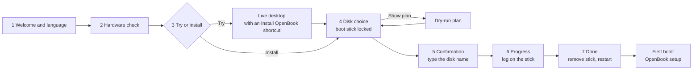

# Installer: USB image, boot chain, install flow and wizard (ANAL-189)

Status as of 2026-10-16. This is the design for milestone M8 (epic ANAL-188). The owner gave the go-ahead to move on to live USB booting on 2026-10-16 (ANAL-189), and stage 2 (ANAL-190, the live USB image) is built: see §11.

Labels: **C** = confirmed (a primary source, or we ran it), **R** = reported by others, **H** = hypothesis (not tested yet). Evidence is in `evidence/2026-10-16-installer/`, starting with `SUMMARY.md`.

## Recommendation (what the owner is asked to approve)

| # | Decision | Recommendation | Basis |
|---|---|---|---|
| 1 | Image format | **One raw GPT disk image** (`openbook-<ver>-x86_64.img`, shipped as `.img.xz` with a `.sha256`). No hybrid ISO. | Android needs real GPT partitions, found by name and by PARTUUID. The prototype's userdata and metadata were created on first boot and survived a reboot (C). |
| 2 | Loader | **systemd-boot** with Boot Loader Spec type #1 entries: GKI `bzImage`, then the vendor ramdisk, the generic ramdisk, and a bootconfig blob as the last initrd. One entry per slot; A/B tries use systemd-boot's boot counting. A small Android-side `openbook-bootsync` keeps the ESP copy in step with the active slot. **GRUB 2.16** is the tested fallback. **GBL** is the long-term target, once upstream lands USB and multi-disk support. | All four loaders were booted from a USB GPT image in QEMU/OVMF (§2.3, C). |
| 3 | Install layouts | Whole disk (A/B, virtual A/B `super`), or alongside an existing OS **in space the user has already freed**. Our files go under `EFI/OpenBook/` plus an XBOOTLDR partition, and we add a firmware boot entry. Nothing is resized in v1. | §3 |
| 4 | Wizard | **An Android app in the live OpenBook session** (Compose), backed by a privileged install engine with a CLI (`openbook-install`: dry run, JSON plan, logs). There is no separate Linux live system. | Scores in §4 |
| 5 | Safety | Rules S1–S13 in §5. They are enforced in the engine, not just the UI: the boot stick is never a target, the user types the disk name, identity is re-checked before the first write, and there is a dry run and a log. | §5 |
| 6 | Kernel delta | Add `CONFIG_EFIVAR_FS` to the OpenBook GKI (built-in, or a module if the KMI allows), so the installer can create the firmware boot entry. Optionally add `SYSFB_SIMPLEFB`/`DRM_SIMPLEDRM` for a "safe graphics" mode. | Our GKI has neither (C, `dot_config`) |

**Naming.** The project is **OpenBook**: images, boot entries, the installer, its tools and `androidboot.openbook.*` all use that name.
- A few identifiers still carry the old name because running work builds with them today: the `anybook_cf_x86_64_pc` product, `device/anybook`, `kernel/devices/anybook` and the `anybook_amd` KMI list, the `anybook-*` tool images, and the host data dir `~/anybook`.
- They change together in one repo-wide rename once the AOSP and kernel lanes are idle (§7). Evidence logs keep the names they were recorded with.

**This reverses an earlier plan.** The loader and layout here are meant for the whole chain:
- ANAL-198 (kernel packaging: first-stage modules, `vendor_boot`, dlkm images, firmware) fills the boot images that §2.1 and §3.4 describe.
- ANAL-199 (the G14 product, booting in QEMU/OVMF first) can boot through these scripts. `qemu-run.py` already attaches images as USB or NVMe on OVMF.
- ANAL-176 (USB boot on the G14) uses the same loader on hardware. None of them should bring their own.

## 1. Image format

### 1.1 What Android needs
- **Partitions are block devices found by name.** First-stage init mounts `super` with dm-linear and dm-verity from `/dev/block/by-name/*`. ueventd creates those links from each partition's `PARTNAME` uevent. When `androidboot.boot_part_uuid` is set, it only links partitions on the disk holding that PARTUUID; this is in AOSP since 2024-11 and in our `android17-release` tree. That is the *recommended way* in `init/README.ueventd.md`, added by AOSP `519d3f8b` (2024-11), which relies on kernel `74f4a8dc0dd8` "block: add partition uuid into uevent as PARTUUID" (C).
- **This matters for us because a live USB stick and an installed NVMe disk carry the same partition names.** Without `boot_part_uuid`, Android can mount the wrong disk's `super`.

### 1.2 Options

| | Raw GPT `.img` | Hybrid ISO 9660 + El Torito EFI `.iso` |
|---|---|---|
| Written with | Any flasher: dd, GNOME Disks, Rufus (DD mode), balenaEtcher, Raspberry Pi Imager (R) | Same, or burned to optical or attached as a CD-ROM |
| Android partitions | Native GPT partitions: `super`, `vbmeta`, `misc`, `metadata`, `userdata`… | Only as appended partitions after the ISO (xorriso `-append_partition`, at most 8), so too few for about 12 partitions. Used as a real ISO (CD-ROM, Ventoy, loop mount) there are no partitions at all, and first-stage init would need loop-device logic it doesn't have |
| Writable live session | `userdata` and `metadata` are blank in the image; fs_mgr formats them on first boot (`formattable`) and they persist (**C**: f2fs `/data` 3.4 GiB and ext4 `/metadata`, formatted on boot 1 and kept on boot 2) | Read-only medium: `/data` would need tmpfs or zram. Android's file-based encryption needs a real filesystem with fscrypt, so this means extra init work (H) |
| VM testing | Attach as a USB or NVMe disk | CD-ROM, then the same problems |

**Recommendation: raw GPT only.** Ship `openbook-<ver>-x86_64.img.xz` with a `.sha256` and a signature. Keep the expanded image small (about 4–5 GiB): `super` shrunk to its content plus headroom, and a 1 GiB `userdata` that is grown to fill the stick on first boot. Growing it needs a small `exec` service on `late-fs`, before `mount_all --late`, that runs only when the boot disk is removable and `userdata` is blank and last (H, ANAL-190). **Built differently:** `openbook-live-init` grows it before Android starts (§11.2). The minimum stick is 16 GB; 32 GB USB 3 is recommended.

**"Try without keeping anything"** is a boot-menu entry, not a separate image. It sets `androidboot.openbook.live_reset=1`, and an early service then discards the superblocks of `userdata` and `metadata` so fs_mgr formats them again (H).

## 2. Boot chain

### 2.1 What the loader has to hand over

| Item | Where it comes from | Notes |
|---|---|---|
| Kernel | `boot_<slot>` (GKI `bzImage`) | Booted through the EFI stub (`EFI_STUB=y`, C) |
| Initrd | `vendor_boot_<slot>` ramdisk(s), then `init_boot_<slot>` generic ramdisk, then **bootconfig** | The bootconfig trailer (`[data][size][checksum]#BOOTCONFIG\n`) must be the last bytes of the combined initrd; otherwise the kernel says "'bootconfig' found on command line, but no bootconfig found" (C, UKI run) |
| Kernel cmdline | GKI built-in `CONFIG_CMDLINE` (includes `bootconfig`) + `vendor_boot` cmdline | No `androidboot.*` on the cmdline: Android wants them in bootconfig (source.android.com, Implementing Bootconfig, updated 2026-10-09) |
| Static product bootconfig | `vendor_boot` bootconfig section | `androidboot.hardware`, `fstab_suffix`, console, HAL/APEX choices. **GBL reads only the boot images**, so everything static belongs here (C) |
| Runtime bootconfig (loader) | Computed per boot or per install | `slot_suffix`, `force_normal_boot=1`, `verifiedbootstate=orange`, `vbmeta.device_state=unlocked`, `vbmeta.{hash_alg,size,digest,avb_version,invalidate_on_error}`, `veritymode`, `boot_part_uuid`, `serialno`, `openbook.*` |

**lz4 pitfall (C).** The ramdisks are lz4 legacy streams. The kernel's `unlz4` goes straight from one stream to the next magic number, but 1–3 stray zero bytes between streams make it read a bogus chunk length (`lib/decompress_unlz4.c`). GRUB starts every initrd on a 4-byte boundary, and systemd-boot pads them (research, C). So every ramdisk file we put on the ESP is padded to a multiple of 4 with at least 4 zero bytes. A zero chunk length ends the stream cleanly, and initramfs skips the rest (`mkproto.py: copy_padded`).

**AVB in the orange state (C).** On hardware the user owns, with Secure Boot off, the loader reports `orange`/`unlocked`. In Android 17, first-stage init treats `orange` as unlocked: verification errors are allowed, but dm-verity still runs on every `super` partition. The digest and size the loader passes are re-checked by libfs_avb. A wrong digest is logged (`vbmeta digest mismatch`) and boot continues; that is the `grub-bad-digest` run. The digest is computed the way libavb does it: the top-level vbmeta, then every chained vbmeta struct (`boot`, `init_boot`, `vbmeta_system`, `vbmeta_system_dlkm`, `vbmeta_vendor_dlkm`). `avbtool calculate_vbmeta_digest` and our own computation agree.

**The orange notice.** Certified devices show a 10-second orange screen (source.android.com Boot flow, updated 2026-09-30). OpenBook is not a certified device. We show a persistent note in Settings › About and during setup instead.

**What the user sees at boot.** The boot should look calm, with no text:
- **The menu stays hidden** (`timeout menu-hidden`). Holding a key at power-on shows it.
- **The firmware logo stays up.** Our GKI has no `simpledrm`/`efifb` and the cmdline has no `tty0` console, so nothing draws over the firmware logo until amdgpu loads. Then the OpenBook boot animation takes over (frame in §4.1). In QEMU, the OVMF logo stayed on screen from the loader until Android's init (C, `matrix/sdboot/shot-*.png`). On the G14 this should be the ASUS logo (H, ANAL-176).
- **When the menu is shown,** entries read "OpenBook (17 · slot A)". systemd-boot's menu can't be themed. If a graphical menu ever matters more than size and simplicity, GRUB with a theme is the fallback.

### 2.2 Prototype (C)
The scripts are in `scripts/installer/`, and the image is `tools/Dockerfile.installer`: QEMU 11.1.2, edk2-ovmf 202608, GRUB 2.16, systemd 262, mtools, gptfdisk. No root is needed and nothing touches a real disk.
- **Inputs, read-only:** a reflink snapshot of the `anybook_cf_x86_64_pc-cp2a-userdebug` images (ANAL-169) and the OpenBook GKI `6.18.21-android17-5-g44a90255c95f` (ANAL-171/172). The AOSP tree was not built or modified.
- **`mkproto.py`** does the following:
  - Makes `boot.img` from our `bzImage`, signed as a chained partition with the AOSP test key.
  - Makes `vendor_boot` from the product's vendor ramdisk without its 6.12 modules, adding an empty module dir for our release and a probe. Console, `rdinit=/openbook-probe` and the product's static `androidboot.*` go into `vendor_boot`.
  - Rebuilds `vbmeta` with the same chain layout.
  - Lays out a 12 GiB GPT with an ESP, `misc`, A/B `boot`/`init_boot`/`vendor_boot`/`vbmeta*`, `metadata`, an 8 GiB `super` and a blank `userdata`. PARTUUIDs are deterministic, and every copied partition is checked by sha256.
  - Fills the ESP for one loader.
- **`probe-init.c`** is a 0.9 MB static `rdinit`. It logs `/proc/cmdline`, `/proc/bootconfig` and every block device with its PARTNAME, PARTUUID and bus path, waits for the boot disk by PARTUUID as ueventd does, and then `exec`s Android's `/init`. So one boot proves both what the loader passed and how Android used it.
- **`qemu-run.py`** boots the image on q35 with KVM and OVMF, attached as `usb-storage` on xHCI. It can add a **decoy NVMe disk with the same partition names and random PARTUUIDs**, standing in for an installed internal disk. It types commands into the userdebug serial console and takes screenshots.
- **`proto-matrix.sh`** builds and runs every variant; **`proto-summary.py`** tabulates the result.

### 2.3 Results (matrix `matrix-20261016-openbook`, all on the same inputs)

| Variant | Loader | `/proc/bootconfig` | Boot disk chosen | Android | Notes |
|---|---|---|---|---|---|
| `grub` (+ decoy NVMe) | GRUB 2.16 standalone | 28 lines | USB, via `boot_part_uuid` probed at run time (`probe --part-uuid`) | console 20 s after power-on; `/metadata` and `/data` formatted on first boot | by-name links → `sda*`, not the NVMe |
| `grub-2nd-boot` | same stick, second boot | 28 lines | USB | console | no reformat: the live session persists |
| `grub-bad-digest` | GRUB, wrong `vbmeta.digest` | 28 lines | USB | console | `libfs_avb: vbmeta digest mismatch` logged; orange continues |
| `grub-slot-b` | GRUB, grubenv `slot=b` | `_b` | — | probe only | Loads `openbook/b/kernel` (`BOOT_IMAGE=(hd0,gpt1)/openbook/b/kernel`) |
| `sdboot` (+ decoy NVMe) | systemd-boot 262, type #1, menu hidden | 29 lines | USB, `boot_part_uuid` written into the entry's bootconfig | console 17 s after power-on (first-stage init at 4.6 s); first-boot format | Boot counting renamed `openbook-a+3.conf` → `openbook-a+2-1.conf`. The screen keeps the firmware logo the whole time (no text) |
| `sdboot-menu` | the same loader, menu shown | 29 lines | — | probe only | The menu a held key brings up: "OpenBook (17 · slot A)", "OpenBook (17 · slot B)", "Reboot Into Firmware Interface" |
| `uki` | ukify UKI from firmware | **empty** | — | — | The kernel finds no bootconfig: systemd-stub appends its own cpio archives after `.initrd` |
| `gbl` | GBL dev, ci.android.com build 16633196 (`gbl-mainline:6296919847ee`) | 40 lines, generated by GBL | none | **first-stage mount fails** | GBL passes no `boot_part_uuid` or `boot_devices` |
| `gbl-uuid` | GBL, UUID baked into `vendor_boot` bootconfig | 41 lines | USB | console 19 s after power-on | GBL does libavb in orange (key "Invalid", allowed), always slot `a`, and emits per-partition digests |
| `gbl-uuid-decoy` | same, plus decoy NVMe | — | — | **GBL panics** | `Failed to read bootloader message from misc partition: NotUnique`, then reset |

Screenshots:
- `matrix/sdboot/shot-{1,3,5,8,12}.png`: what the screen shows from power-on to Android's init with the menu hidden.
- `matrix/sdboot-menu/shot-3.png`: the systemd-boot menu.
- `matrix/grub/shot-2.png`: the GRUB menu.
- `matrix/gbl-uuid-decoy/shot-20.png`: the GBL panic.

Full serial logs are `matrix/*/serial.log.gz`.

**Limits of the prototype.** This is plain QEMU booting the Cuttlefish `pc` product, so it shows the boot chain only:
- There's no GPU, so we stop at the console. `sys.boot_completed` was not checked.
- Cuttlefish's 6.12 `system_dlkm`/`vendor_dlkm` modules don't load on our kernel.
- Cuttlefish's duplicate vendor APEXes are picked through bootconfig, as cvd does.
- Nothing ran on the G14.
- GBL's console writes failed through a QEMU *socket* serial backend, and GBL then panicked inside its own error printer. With a FIFO or file backend that does not happen, so the runner uses FIFOs. This is an environment quirk, not counted against GBL.

### 2.4 Loader evaluation

| Need | GRUB 2.16 | systemd-boot 262 (type #1) | UKI / systemd-stub | GBL (dev, 2026-10-16) |
|---|---|---|---|---|
| vendor + generic ramdisk + trailing bootconfig | yes, with lz4 padding | yes, with lz4 padding | **no**: stub appends cpio after `.initrd` | yes, natively from boot images v4 |
| `boot_part_uuid` | at run time (`probe --part-uuid`), but only on the cmdline (fs_mgr accepts it; not bootconfig-pure) | static, written by the installer into the entry's bootconfig | — | **no**: open CL 4286120 (2026-10-15) |
| USB stick + installed NVMe with the same names | yes (`$cmdpath`) | yes | — | **no**: `NotUnique` (open CL 4051936) |
| A/B with Android semantics | grubenv strings, no arithmetic; needs ESP sync | **boot counting = tries**; good/bad/indeterminate entries; needs ESP sync | — | Needs firmware `GblEfiBootControlProtocol`; without it, always slot `a` ("only supported on dev GBL") |
| AVB | none in the loader; digest precomputed | none in the loader; digest precomputed | none | **full libavb**: orange, per-partition digests |
| OTA by update_engine (writes `boot_b` etc.) | needs `openbook-bootsync` | needs `openbook-bootsync` | — | native |
| Dual boot | chainload anything, menus, themes | lists Windows Boot Manager on the same ESP automatically; `efi` entries chainload others | — | none (chainload it from a menu) |
| Size, complexity | 0.9 MB standalone with our module set (C); scripting; long CVE history | 157 KB (C), declarative | — | 2.2 MB (C) |
| Licence | GPL-3.0-or-later | LGPL-2.1-or-later | LGPL-2.1+ | Apache-2.0 |
| Ship today? | yes | yes | no | **No.** The dev build "can't be shipped", and the prod build needs vendor AVB/BootControl protocols |

**Choice: systemd-boot now.** It is small and declarative, its boot counting maps onto Android's A/B tries, and everything goes into bootconfig. GRUB passed the same tests and stays the fallback, for example if we need richer menus, theming, or GRUB's run-time `boot_part_uuid`.

**GBL later.** It reads the boot images, runs libavb, and is Google's direction. Switch when three things are true: CL 4051936 (pick the disk GBL was loaded from) has landed, CL 4286120 (`boot_part_uuid`) has landed, and we have a BootControl provider, either upstream or a small OpenBook EFI driver backed by `misc`. systemd-boot would then chainload GBL (`efi /EFI/OpenBook/gbl_x86_64.efi`), or the firmware entry points straight at it.

### 2.5 A/B and updates with systemd-boot (design, H)
- **Source of truth:** the Android partitions (`boot_x`, `init_boot_x`, `vendor_boot_x`, `vbmeta_x`). `super` uses virtual A/B with compression, so there is one copy, and the OTA's copy-on-write data lives in `/data`.
- **ESP mirror:** `openbook/<slot>/{kernel, vendor_ramdisk.img, ramdisk.img, bootconfig.img}`. Entry `loader/entries/openbook-<slot>[+N[-M]].conf` lists the three initrds with bootconfig last.
- **`openbook-bootsync`**, a native tool in its own SELinux domain. GKI has `VFAT_FS=y`, C. It runs:
  - **After update_engine postinstall:** export slot B's boot images to the ESP, compute B's vbmeta digest, write `openbook-b+3.conf`, and make it the default.
  - **On `markBootSuccessful`:** rename the entry to `openbook-b.conf` ("good").
  - **On a failed boot:** systemd-boot itself lowers the count and, at `+0`, sorts the entry last, so slot A boots again.
- **Boot control HAL:** `android.hardware.boot-service.openbook` = AOSP `libboot_control` (`misc`, already working: "Invalid boot control found… Re-initializing" on first boot, C) plus calls into bootsync.
- **Live USB:** slot A only, and no OTA; you re-flash instead. Whether Android 17 is happy with no `_b` partitions at all is checked in ANAL-190; the fallback is tiny `_b` partitions (H). **Checked:** a slot-A-only stick boots as far as the A/B image does (§11.4, C).

### 2.6 Firmware entry, cmdline and Secure Boot
- **On the USB stick:** systemd-boot at `EFI/BOOT/BOOTX64.EFI`, the removable-media path, so no NVRAM change is needed.
- **Installed:**
  - systemd-boot goes to `EFI/OpenBook/systemd-bootx64.efi`, and we add an NVRAM `Boot####` entry named "OpenBook". The fallback `EFI/BOOT/BOOTX64.EFI` is written only on a whole-disk install.
  - Creating the NVRAM entry from Android needs efivarfs, which our GKI lacks (decision 6). Without it, the user picks "OpenBook" from the firmware boot menu (Esc on the G14 (R)) once, and we print exact instructions.
- **Secure Boot must be off** for now. Later: sign systemd-boot and the kernel with an OpenBook key and enroll it via shim/MOK (H).

### 2.7 Test stick for a first hardware check (G14)
`scripts/installer/make-hwcheck-stick.sh` builds `openbook-hwcheck-<date>.img` (11 GiB, about 1 GB as `.img.xz`). It holds the same boot chain as the prototype (systemd-boot, our 6.18 kernel, `boot_part_uuid`, orange AVB) with two menu entries:

- **"OpenBook hardware check"** (default after 8 s) is for the laptop. The probe (`probe-init.c`, `openbook.probe=report`):
  1. Records the firmware identity (DMI, without serials), CPU (incl. AVX-VNNI), memory, PCI devices and the bootconfig the loader passed.
  2. Writes a first copy of the report to the stick, so a hang still leaves results.
  3. Loads our module set (ANAL-172's dependency-resolved set for this exact kernel: GKI + the 138 OpenBook modules) with the firmware subset (ANAL-171). It loads dependencies first and skips a safety list: the cs35l56 speaker-amp drivers (they download DSP firmware and tuning to the amps; the check plays no audio, and ANAL-179 validates the speakers), asus-wmi/asus-nb-wmi/hid-asus (they can change firmware settings), and test modules.
  4. Waits 10 s, then records which drivers bound and the `drm`, `net`, `bluetooth`, `sound`, `backlight`, `power_supply`, `typec` and input devices.
  5. Writes `openbook/logs/hwcheck-NNN.txt` and `-dmesg.txt` to the stick and powers off.

  It only mounts the ESP whose PARTUUID is `boot_part_uuid`, and only if that partition is on USB. It never writes to the laptop's disks. GKI has no devtmpfs, so the probe makes that one device node itself from sysfs.
- **"OpenBook preview (virtual machines only)"** is the Android 17 boot from §2.3, with the console on the serial port. It shows nothing on a laptop: this preview has no graphics stack for real hardware yet. That arrives with ANAL-174/198/199.

**Tested in QEMU on the final image (C, `evidence/2026-10-16-installer/hwcheck-stick/`):** the check loaded 236 modules (0 failed, 29 skipped), wrote the report and kernel log to the stick, and powered off after 23 s, with the decoy NVMe untouched. The preview entry reached the Android console.

**Run on the G14 (C, `evidence/2026-10-16-g14-hwcheck/SUMMARY.md`).** The owner's first run:
- UEFI → systemd-boot → our kernel; 235 modules loaded, 0 failed.
- These came up:
  - amdgpu: SMU, DCN 3.5 and DMUB, the eDP panel with PSR, and backlight;
  - mt7925e with `wlan0`, Bluetooth `hci0`, and the ELAN touchpad;
  - the keyboard, lid switch, NPU `accel0`, battery, UCSI and USB4.
- The stick also booted the preview entry: Android's first and second stage ran from USB on the laptop.
- Findings:
  - `regulatory.db` was missing;
  - the dGPU's HDMI-audio function is bound;
  - the backup GPT isn't at the end of a larger stick;
  - power and display facts weren't recorded.

**v2 (`make-hwcheck-stick.sh`, `openbook-hwcheck-20261016b`).**
- **Probe:** runs from the check initrd (`rdinit=/openbook-check/probe`). It adds the CPU frequency driver and EPP, sleep states, connected displays and modes, backlight, battery health, the dGPU's PCI power state and runtime status, and temperatures. It writes `hwcheck-NNN.json` (schema `openbook-hwcheck/2`) next to the text report.
- **Firmware:** `regulatory.db` with its licence is added.
- **"OpenBook hardware check + sleep test":** one RTC-woken suspend of 20 s. The stick is unmounted while asleep. It records time asleep, `suspend_stats` and the AMD PMC s0ix counters.
- **Updating a stick flashed from v1:** v2 changes only `openbook/check/`, the check entries and the README. `update-hwcheck-stick.sh /dev/disk/by-id/usb-… <bundle>` copies them onto the stick's OPENBOOK partition with udisks. It checks the by-id path, the ESP PARTUUID, the label and an existing OpenBook entry first, then verifies the copy with sha256.
- **Tested in QEMU (C, `hwcheck-stick/v2/`):** the update bundle applied to the exact image the owner flashed:
  - the check loads 236 modules and writes the JSON;
  - the sleep entry slept 19.8 s, woke on the RTC alarm and wrote its result (QEMU uses S3; the G14 offers s2idle only);
  - shared reports are redacted: USB serial numbers are blanked in the kernel log, and partition UUIDs are shown only for the stick;
  - the fresh v2 image passes the check too.

**G14 runs 2 and 3 (v2, C, `evidence/2026-10-16-g14-hwcheck/`).**
- amd-pstate-epp is active.
- s2idle is the only sleep state, and a suspend/resume cycle works (18.2 s, no errors after resume).
- **S0ix residency stayed 0** ("Last suspend didn't reach deepest state").
- The dGPU and its HDMI-audio function stay D0/active.
- Battery health is 88.7 %, and `regulatory.db` now loads.

**v3 (`openbook-hwcheck-20261016c`)** adds a fourth entry, "OpenBook sleep test, NVIDIA GPU powered down". For this boot only, it unbinds the dGPU's HDMI-audio function, removes both NVIDIA functions, and sets the root port to runtime PM (`docs/nvidia.md` §1, option 2). It then repeats the sleep test.
- The JSON (`openbook-hwcheck/3`) adds `dgpu_detach` (bridge power state before and after) and `s0ix_residency_us`.
- The report adds the AMD PMC firmware info and every PCI function still awake right before suspend.
- Connectors that read "unknown" are probed before they're reported.
- **Tested in QEMU:** the detach path was run against a virtio device behind a PCIe root port (unbind, remove and runtime PM all succeed; QEMU's port has no `_PR3`, so it stays D0), and the sleep test ran after it.

## 3. Install flow

### 3.1 Live USB layout (ANAL-190)

| Partition | Size | Content |
|---|---|---|
| `EFI` (ESP, FAT32, label `OPENBOOK`) | 256 MiB | systemd-boot, `loader/`, `openbook/a/*`, `openbook/logs/` (install logs and hardware reports land here) |
| `misc` | 1 MiB | zeros (boot control and BCB) |
| `boot_a`, `init_boot_a`, `vendor_boot_a`, `vbmeta_a` | 64 / 8 / 64 / 1 MiB | images |
| `metadata` | 64 MiB | blank, becomes ext4 on first boot |
| `super` | content + about 10% (about 3 GiB, H; the prototype's dynamic partitions hold 1.6 GB) | dynamic partitions, slot A |
| `userdata` | 1 GiB in the image, grown at first boot | blank, becomes f2fs on first boot |

Bootconfig on the stick adds `androidboot.openbook.live=1`. With it, the launcher shows "Install OpenBook" and the installer app is enabled (ANAL-191).

The built layout differs in two places: `misc` is 4 MiB, and `super` is the product's dynamic partitions re-packed to their content plus 64 MiB (1.26 GiB for today's G14 product). See §11.1.

### 3.2 Whole-disk layout (installed)

| Partition | Size | Notes |
|---|---|---|
| `EFI` | 512 MiB | systemd-boot, two slots of boot artifacts (46 MB per slot in the prototype: kernel 27 MB, vendor ramdisk 18 MB, generic ramdisk 3 MB), room for GBL later |
| `misc` | 4 MiB | as on Googlebook |
| `boot_a/_b` | 64 MiB each | GKI `bzImage` is 27 MB |
| `init_boot_a/_b` | 8 MiB each | |
| `vendor_boot_a/_b` | 64 MiB each | first-stage modules plus vendor ramdisk |
| `vbmeta_a/_b` | 1 MiB each | Fold `vbmeta_system*` into one `vbmeta` as Googlebook does (product decision for ANAL-174); otherwise add three 1 MiB pairs |
| `metadata` | 64 MiB | metadata encryption keys, OTA state |
| `super` | 12 GiB | virtual A/B with compression, the same size as Googlebook's |
| `userdata` | the rest | blank, formatted on first boot |

About 13 GiB is fixed. The minimum disk is 64 GB (H; set it once ANAL-174's image size is known). New random disk GUID and PARTUUIDs; partition type `0FC63DAF` (Linux data) except the ESP, so other OSes don't mount them.

### 3.3 Alongside an existing OS
- **v1 never moves or shrinks anything.** The user frees space first, with Windows Disk Management or GParted, and the wizard shows how much is needed (64 GB). OpenBook partitions go into the largest unallocated extent.
- **ESP:**
  - Reuse the existing ESP for `EFI/OpenBook/systemd-bootx64.efi` only (157 KB).
  - Kernels and entries go to a new **XBOOTLDR** partition (512 MiB, FAT32, type `bc13c2ff-59e6-4262-a352-b275fd6f7172`) on the same disk. Windows ESPs are often only 100–260 MB (R).
  - If the disk has no ESP, create a 512 MiB one.
- **Menu:**
  - systemd-boot lists Windows Boot Manager automatically when it's on that ESP.
  - For other loaders (GRUB, Limine) we add an `efi` chainload entry.
  - **BootOrder** changes only if the user ticks "Start OpenBook by default". It is off by default when alongside.
- **The OpenBook disk and the Android partitions must be the same disk,** because `boot_part_uuid` points at it. If the only ESP is on another disk, create one on the OpenBook disk.

### 3.4 Firmware subset and vendor modules
- **First-stage modules** (`vendor_boot` ramdisk, `lib/modules/<release>/`): only what's needed to reach `super`. On the G14 that is nothing: NVMe, xHCI, usb-storage and uas are built into GKI (C). Keep the directory non-empty with at least one module, or empty it in the product. First-stage init falls back to the flat `/lib/modules/modules.load` when the release directory loads nothing, and a vermagic error there is fatal (C, `first_stage_init.cpp`; we hit it).
- **Second stage:** the 138 OpenBook modules (amdgpu, mt7925e, i2c-hid, sound…) go in `vendor_dlkm`, and the GKI modules from the same build in `system_dlkm`. The rule from ANAL-172 holds: the `bzImage` and `system_dlkm` must come from one dist.
- **linux-firmware subset** (131 files, 52.5 MB, ANAL-171):
  - Lives in `/vendor/firmware`, uncompressed (`FW_LOADER_COMPRESS` is off), with `firmware_class.path=/vendor/firmware`.
  - The licence files and WHENCE go under `/vendor/firmware/` and into NOTICE.

### 3.5 Install engine steps (`openbook-install`, used by the app and by test automation)
1. **`disks`** (read-only inventory):
   - Model, vendor, serial, WWN, size, bus and removable flag, read from sysfs. The `by-id` name is computed in udev's format, for example `nvme-SK_hynix_PVC10_<serial>`, because Android has no `/dev/disk/by-id`.
   - The partition table: names, types, labels, filesystems detected from superblocks.
   - The **boot disk** is marked: the one holding `ro.boot.boot_part_uuid`.
2. **`plan --target <by-id> --layout whole|alongside [--json]`** computes every operation: offsets, sizes, sources and their sha256, and what is erased. It opens the target `O_RDONLY`. This is the dry run, and the "Show plan" button.
3. **`apply --plan plan.json --confirm-disk <by-id>`** re-computes the plan and refuses if it differs. Then:
   1. Verify the source partitions on the stick against the image manifest.
   2. Whole disk: wipe the old primary and backup GPT and the protective MBR first, so an interrupted install leaves a clearly blank disk, not a half-valid one.
   3. Write partition contents. `super` is copied sparsely.
   4. Write the new GPT.
   5. Zero `misc`, `metadata` and `userdata` headers.
   6. ESP or XBOOTLDR: systemd-boot and boot artifacts, plus an entry whose bootconfig has the new `boot_part_uuid`, the vbmeta digest, a new random `serialno`, and the locale and keyboard picked in the wizard (`androidboot.openbook.locale`, `.keyboard`).
   7. Add the NVRAM entry when efivarfs is available.
   8. **Read back** every written partition and compare hashes.
   9. Write a JSON report.
4. **Logs:** an append-only log and `install-<UTC>.json` go to the stick's `openbook/logs/`, and a copy goes to `/metadata/openbook/` on the new system (copied on first boot). No secrets are logged.

### 3.6 First boot and setup
- `/metadata` and `/data` are created on first boot, as in the prototype. Android then starts its setup flow.
- **Google's SetupWizard is not in AOSP:** AOSP 17 only has the `setupcompat`/`setupdesign`/`setupwizard` libraries and `Provision`, which only sets the provisioned bit (C).
- OpenBook therefore needs its own small setup app, built on those libraries: language (pre-selected from `ro.boot.openbook.locale`), Wi-Fi, user and screen lock, privacy. No Google account step. This is a work item for ANAL-191.

## 4. Wizard technology

| Score 1–5 | (a) Android app in the live session (Compose) | (b1) Linux live system + Calamares 3.4.3 | (b2) Linux live system + custom Qt Quick app |
|---|---|---|---|
| Polish / same look as the OS | **5**: the same toolkit and theme; "Try" then "Install" in one session | 3: QML branding, but a different OS look | 4 |
| Size added to the image | **5**: about 5 MB (app and engine) | 2: a second kernel and Qt userspace, about 250–350 MB (H) | 2 |
| Licence | **5**: Apache-2.0, AOSP Compose prebuilts (C) | 4: GPL-3.0-or-later; fine, but the source must ship | 4: Qt LGPL-3; avoid GPL-only modules such as Virtual Keyboard (C) |
| Effort | 2: privileged engine daemon, SELinux, efivarfs, setup app | 3: existing modules, but Android partitions need a custom module; `rawfs` picks targets by mount point (C) | 2 |
| Accessibility | 3: Compose semantics, but no screen reader in AOSP; TalkBack is Apache-2.0 on GitHub and would need building (C) | 2: Orca support open since 2019 (#1294), Tab navigation bug #2531 open (C) | 3: Qt `Accessible` + AT-SPI/Orca |
| Hardware support | 2: needs OpenBook's own graphics and input. GKI has no `simpledrm`/`efifb`, so nothing shows until amdgpu loads (C) | **5**: generic kernel, simpledrm, any GOP display | **5** |
| **Total** | **22** | 19 | 20 |

**Choice: (a).**
- If the wizard can run, OpenBook can run on that machine. The hardware check also tests the drivers that matter after install (Wi-Fi, touchpad, audio, suspend), not a different kernel's.
- For machines where the display doesn't come up, the boot menu has **"Hardware report (text)"**. It boots with `androidboot.openbook.diag=1`, writes a report to the stick's `openbook/logs/`, and powers off (H, ANAL-191).
- The same `openbook-install` engine runs unattended for the device agent (PLAN §4a), with JSON output.
- Revisit (b2) if "tell users on unsupported hardware why" becomes a goal (NVIDIA-only laptops), or if decision 6's simpledrm is rejected.

### 4.1 Screens



**High-fidelity design:** `docs/installer-design/index.html`. Open it in a browser for the gallery, or use `?screen=<id>[&theme=dark]` for one screen. The renders are in `docs/installer-design/png/` (`gallery.png` shows everything); `scripts/installer/render-design.sh` re-renders them.
- **Design language:** Material 3 Expressive in an OpenBook desktop window: Roboto Flex, Material Symbols Rounded, tonal surfaces, pill buttons, and a wavy progress indicator.
  - The light and dark themes come from one seed colour (`#4A5BD4`). The window sits on the live desktop with its taskbar.
  - This is buildable from AOSP alone: `external/roboto-flex-fonts`, Compose Material 3 and `material-icons-extended` are in the tree (C).
- **Brand:** the OpenBook mark is two pages opening from a spine, with a spark. It is used in the window, the taskbar and the boot animation.
- **Sample data.** Hardware states, sizes and times on the screens are illustrations, not test results.

| Screen | What it does | Safety it carries |
|---|---|---|
| 1 Welcome and language | Brand panel, language list with native names, a keyboard test field, and accessibility toggles from the first screen | "Nothing on this computer changes until you say so" |
| 2 Hardware check | One verdict, then a tile per component (Ready, Quieter, New, Off) in plain words; "Save report to USB" | A report for support and the device agent |
| 3 Try or install | Two large illustrated choices | Try never touches the internal disk |
| 4 Disk | A card per disk with what is on it today; erase or alongside; an explainer for keeping Windows | **The boot stick is locked** (S1); "View the plan" is the dry run (S5) |
| 5 Confirm | What gets erased, before and after, the full `by-id`, and the typed model name | The red button enables only on a match and is never the default focus (S2–S4) |
| 6 Install | Percentage, wavy progress, the engine's steps, and a tip card | Charger state (S8); the log path on the stick (S6) |
| 7 Done | Read-back result, boot entry, report; "Restart now" | Verification result shown (S9) |
| Boot | The OpenBook boot animation frame after the firmware logo | — |

## 5. Safety rules (enforced by the engine; the UI only reflects them)
- **S1. Never the boot medium.** Refuse any disk holding the partition whose PARTUUID is `ro.boot.boot_part_uuid`. Also refuse any disk with a mounted filesystem, and read-only disks. This is checked again at `open()` time.
- **S2. Show identity.** Show model, vendor, size (GB and GiB), bus, serial (last 4 characters, full in details), the `by-id` name in udev format, and the current partitions with names, types, filesystem labels and detected OS ("Windows", "Linux"). List exactly what will be erased.
- **S3. Typed confirmation.**
  - Interactive: the user types the model name; case and whitespace are normalised.
  - Unattended: `--confirm-disk /dev/disk/by-id/…` must equal the target exactly, **and** `OPENBOOK_INSTALL_ERASE=<same by-id>` must be set. This matches the project rule that a write needs an explicit confirmation naming the `by-id` device.
- **S4. Re-check before the first write.** Serial, size, WWN and a hash of the partition table must be unchanged since the confirmation; otherwise abort.
- **S5. Dry run.** `plan` and `--dry-run` open the target read-only and print every operation (offset, length, source, sha256). The UI's "Show plan" is the same output.
- **S6. Logs.** An append-only text log plus a JSON report on the stick, copied to the new system. Every command and result is logged. No passwords, Wi-Fi keys or account data.
- **S7. Alongside never destroys.**
  - Never delete, format, move or resize existing partitions.
  - Write only `EFI/OpenBook/` and `loader/entries/openbook-*.conf` on a shared ESP.
  - Never overwrite `EFI/BOOT/BOOTX64.EFI` there.
  - Change BootOrder only with consent.
- **S8. Power.** Require AC power, or battery ≥ 50%.
- **S9. Interruption.**
  - The order above means a cut leaves either the old table (before step 2) or a blank disk (before step 4). The installer can be restarted from the stick.
  - A failed read-back marks the install as failed and doesn't create the boot entry.
- **S10. Source integrity.** The stick's partitions are hashed against the signed manifest before copying, and the install is refused on a mismatch. This catches a bad flash or a failing stick.
- **S11. No firmware writes.** Never write SPI flash or capsules, never change Secure Boot keys, and never change firmware settings. The only NVRAM write is one `Boot####` entry (and BootOrder with consent).
- **S12. Minimum sizes.** Refuse targets below the minimum. Warn about, but never touch, BitLocker, LUKS or other encrypted volumes in alongside mode.
- **S13. External targets.** USB or Thunderbolt disks other than the boot stick are allowed, with an extra warning.

## 6. Licensing checklist for a public image

| Item | Licence | Ship? | Obligation |
|---|---|---|---|
| AOSP 17 platform built from source | Apache-2.0 and others (per-module NOTICE) | yes | NOTICE in Settings › Legal; GPL/LGPL parts (e2fsprogs `mke2fs`, f2fs-tools, …) need a source offer |
| OpenBook GKI + 138 vendor modules | GPL-2.0 | yes | **Corresponding source** (kernel tree, our 3 patches, config, `kernel/devices/anybook`) per release, plus a written offer or a tarball next to the image for 3 years |
| linux-firmware subset (131 files) | per WHENCE: LICENSE.amdgpu, LICENCE.mediatek, LICENSE.amdnpu, LICENCE.rtlwifi_firmware.txt, LICENSE.cirrus | yes | Ship the licence files and WHENCE with the files; no modification |
| Mesa radeonsi/RADV | MIT; **libelf LGPL-3.0+** | after decision | **Open decision:** link libelf as a shared library (recommended, `docs/mesa.md`) |
| Digitalis (if Track A ships it) | Apache-2.0 | yes, built from source | Never the DigitalisX64 sample-app SDK binary |
| systemd-boot | LGPL-2.1-or-later | yes | Source offer for the exact version |
| GRUB (only if used) | GPL-3.0-or-later | fallback | Source offer; GPLv3 installation-information rules if ever shipped on locked hardware (not our case) |
| GBL (later) | Apache-2.0 (+ third-party LICENSE from its build) | later | Build from source; ship its LICENSE |
| Roboto Flex (UI font) | OFL-1.1 | yes, from AOSP `external/roboto-flex-fonts` | Keep the licence text |
| Material Symbols / Compose icons | Apache-2.0 | yes, via Compose `material-icons-extended` | NOTICE |
| Installer app, engine, bootsync | ours | yes | Repo licence decision (Apache-2.0 suggested; files already carry SPDX Apache-2.0) |
| **Never ship** | — | no | GMS, Google apps, SetupWizard, Play services, libhoudini, libndk_translation, Googlebook recovery images or parts of them, vendor blobs without a redistribution licence, the CS35L56 tuning blob (not public anyway) |
| AVB keys | — | — | Release images must not be signed with the AOSP test key. **Open:** who holds the OpenBook release key |
| Names and marks | — | — | The product is **OpenBook**. **Open:** a trademark check of "OpenBook" before any public image, the use of "Android", and no "Googlebook" in naming so no endorsement is implied |

**Blocking decisions before any public image** (from `docs/STATUS.md`): the repo licence and Mesa libelf linkage. Added here: AVB key custody and a trademark check of the OpenBook name.

## 7. Open questions for the owner
1. Approve decisions 1–5 above (format, loader, layouts, wizard, safety rules).
2. Decision 6 (kernel lane): add `CONFIG_EFIVAR_FS`. Also add `SYSFB_SIMPLEFB`+`DRM_SIMPLEDRM` for a safe-graphics boot entry?
3. Alongside installs v1: no resizing (the user frees space first). OK?
4. Who holds the OpenBook AVB release key, and do test-key images stay userdebug-only?
5. A trademark check of "OpenBook" before any public image.
6. **The repo-wide rename to OpenBook.** Rename `device/anybook` → `device/openbook` and the `anybook_*` products → `openbook_*` (with `PRODUCT_BRAND`, which ends up in build fingerprints). Also `kernel/devices/anybook` and the `anybook_amd` KMI list, the `anybook-*` tool images, `ANYBOOK_HOME`, and `~/anybook` → `~/openbook`.
   - Doing it while ANAL-174 (AOSP lane) and ANAL-198 (kernel lane) are mid-build would break their runs, so it should be one coordinated change when both lanes are idle.
   - Evidence logs keep the names they were recorded with.
   - The installer already uses OpenBook everywhere.

## 8. Next steps (once signed off)
- **ANAL-199 / ANAL-176.** Boot the G14 product with systemd-boot entries generated the way `mkproto.py --loader sdboot` does, first in QEMU (`qemu-run.py`), then from a stick on the G14. Use the dGPU-off default from ANAL-187 (`docs/nvidia.md`).
- **ANAL-190 (live USB image).** Built: §11. Build from the real G14 product (ANAL-174/199), not the Cuttlefish one. Includes:
  - systemd-boot entries generated from the product's `vendor_boot`;
  - a slot-A-only layout;
  - the `userdata` grow service and `openbook.live`;
  - QEMU tests with these scripts, then a G14 USB boot. Writing the stick needs the owner's confirmation naming its `/dev/disk/by-id/…`.
- **ANAL-191 (wizard and engine).** The `openbook-install` engine (disks, plan, apply, JSON), `openbook-installd` with SELinux, the Compose app (7 screens), `openbook-bootsync` with the boot control HAL, the setup app, and the text hardware report.
- **ANAL-192 (end-to-end tests).** In QEMU:
  - install from the USB image onto an NVMe image file, then boot the installed disk with the stick removed and again with it present;
  - alongside, with a Windows-like ESP image;
  - interrupted installs at each step;
  - an OTA slot switch with boot counting;
  - an unattended run for the device agent.
- **GBL watch.** Re-test when CLs 4051936 and 4286120 merge (`MATRIX_ONLY=gbl scripts/installer/proto-matrix.sh`).

## 9. Reproduce
```bash
docker build -t openbook-installer -f tools/Dockerfile.installer tools
scripts/installer/render-design.sh                           # design PNGs (fetches Roboto Flex + Material Symbols, not committed)
scripts/installer/make-hwcheck-stick.sh                      # the G14 test stick image (§2.7) into <data dir>/installer/out/
scripts/installer/snapshot-inputs.sh cf-pc-20261016          # reflink snapshot of PRODUCT_OUT + kernel dist (refuses while an AOSP build runs)
# GBL dev EFI (Apache-2.0) for the gbl variants, from ci.android.com aosp_uefi-gbl-mainline build 16633196:
mkdir -p ~/anybook/installer/dl/gbl-16633196 && curl -L -o ~/anybook/installer/dl/gbl-16633196/gbl_x86_64_dev.efi \
  https://ci.android.com/builds/submitted/16633196/gbl_efi_dist_and_test/latest/raw/gbl_x86_64_dev.efi
MATRIX_EVIDENCE=$PWD/evidence/2026-10-16-installer/matrix scripts/installer/proto-matrix.sh cf-pc-20261016 matrix-20261016-openbook
```
- **Cost:** about 20 s to build each image and 20–25 s for each Android boot, under 10 minutes for the whole matrix.
- **Disk:** each image is a 12 GiB sparse file with about 2 GB of data.
- **Logs:** `~/anybook/logs/installer/<run>/`.

## 10. Sources (accessed 2026-10-16)
- **Bootconfig, AVB, boot flow:**
  - source.android.com/docs/core/architecture/bootloader/implementing-bootconfig (updated 2026-10-09)
  - source.android.com/docs/security/features/verifiedboot/boot-flow (updated 2026-09-30)
  - `external/avb` README and `libavb/avb_cmdline.c`
  - docs.kernel.org/admin-guide/bootconfig.html
- **`boot_part_uuid`:**
  - AOSP `519d3f8b` "fs_mgr: Add getter for androidboot.boot_part_uuid" (2024-11-05)
  - kernel `74f4a8dc0dd8`
  - local tree `system/core/init/devices.cpp`, `block_dev_initializer.cpp`, `system/fs/fs_mgr/libfstab/fstab.cpp` (android17-release)
- **GBL:**
  - android.googlesource.com/platform/bootable/libbootloader, branch `gbl-mainline` (head `6296919847ee`, 2026-10-16); `gbl/docs/efi_integration.md`, `partitions.md`
  - source.android.com/docs/core/architecture/bootloader/generic-bootloader (updated 2026-10-09)
  - Open CLs android-review 4051936, 4286120, 4259565, 4279441
  - ci.android.com `aosp_uefi-gbl-mainline` build 16633196
- **systemd-boot:** uapi-group.org Boot Loader Specification; systemd v262 `src/boot/boot.c` (`initrd_prepare`) and `stub.c`; the boot-counting docs.
- **GRUB:** `grub-core/loader/linux.c` (initrd alignment); the GRUB manual (grubenv).
- **Calamares:** codeberg.org/Calamares/calamares v3.4.3 (2026-09); issues #1294, #2531.
- **Qt:** doc.qt.io Qt 6 licensing and accessibility.
- **AOSP:** `packages/apps/Provision`; `prebuilts/sdk/current/androidx/m2repository/androidx/compose`; github.com/google/talkback (Apache-2.0).
- **Other installers:**
  - ChromeOS Flex: support.google.com/chromeosflex/answer/11550703
  - Android-x86: android-x86.org/installhowto.html
  - Bliss OS: docs.blissos.org/installation/install-from-bootable-usb
- **Googlebook (ruby) image, inspected locally and not redistributed:**
  - The `EFI-SYSTEM` and `KERN-A` partitions in the recovery image are all zeros.
  - `ota_recovery_a` holds a nested GPT whose `boot_a` (an Android boot image) carries the ChromeOS kernel type GUID.
  - So Googlebooks boot from a loader in firmware, not from the disk. There is nothing on the disk for us to reuse (C).

## 11. Live USB image (ANAL-190)

Status as of 2026-10-16. Evidence is in `evidence/2026-10-16-installer/live/` (build and QEMU) and `evidence/2026-10-16-installer/g14-live/` (the first G14 live boot, §11.10), each starting with `SUMMARY.md`.

### 11.1 What `scripts/installer-image.sh` builds

```bash
scripts/installer-image.sh                       # from <data dir>/aosp/src/out/target/product/anybook_g14
scripts/installer-image.sh --menu-timeout 10     # the same, with the boot menu shown for 10 s (test sticks; `openbook-live-20261016a` is built this way)
scripts/installer-image.sh --inputs <snapshot>   # rebuild from an earlier snapshot (byte-identical output)
```

It snapshots the product's `boot`, `init_boot`, `vendor_boot`, `vbmeta` and `super` images from `PRODUCT_OUT` (reflinks; it refuses while an AOSP build runs), builds and tests `openbook-live-init`, and assembles the image with `scripts/installer/mklive.py` in the `openbook-installer` container. Nothing in the Android images is rebuilt or re-signed. The kernel, the 138 vendor modules and the firmware come from those images (ANAL-198 via ANAL-199).

| Output in `<data dir>/installer/out/` | |
|---|---|
| `<label>.img` | the raw GPT image to write to a stick |
| `<label>.img.xz`, `<label>.sha256` | compressed copy and the sha256 of both |
| `<label>.img.json` | layout, PARTUUIDs, every entry's bootconfig, vbmeta digest, `super` re-pack check, firmware licence check, ESP file list |
| `<label>.build.json` | `openbook-live-build/1`: size, sha256, build time per step, input hashes, tool versions, repo commit |
| `<label>.vm/` | two extra entries the QEMU tests copy into their test copy (not on the stick) |

**Layout** (slot A only; PARTUUIDs derived from the label):

| Partition | Size | Content |
|---|---|---|
| `EFI` (FAT32 `OPENBOOK`) | 256 MiB | systemd-boot at `EFI/BOOT/BOOTX64.EFI`, `loader/`, `openbook/a/` (kernel, vendor ramdisk, generic ramdisk, `live.img`, one bootconfig per entry), `openbook/logs/`, `openbook/README.txt`, `openbook/MANIFEST.json`, `LICENSES/` |
| `misc` | 4 MiB | zeros |
| `boot_a`, `init_boot_a`, `vendor_boot_a`, `vbmeta_a` | 64, 8, 64, 1 MiB | the product's images, unchanged |
| `metadata` | 64 MiB | blank: Android formats it (ext4) on the first boot |
| `super` | content + 64 MiB | the product's dynamic partitions, re-packed with `lpmake` |
| `userdata` | 1 GiB | blank: grown to fill the stick, then formatted (f2fs, metadata encryption) on the first boot |

- **`super` is re-packed, not shrunk in place.** The product's `super` is 8 GiB, sized for OTAs, which a live stick never takes. `mklive.py` copies each logical partition out and re-packs them with `lpmake`, keeping the names, groups, attributes, the virtual A/B flag and 3 metadata slots. It then checks every partition's sha256 against the original. AVB is unaffected: the hashtrees live inside the partitions.
- **Licences on the stick** (`LICENSES/`): the firmware licence files are taken from the vendor image that ships, not from a staging folder. `firmware/FILES.tsv` maps every file in `/vendor/firmware` to its licence. The build fails the check if a file has none (today: 137 files, 0 without a licence). Also: systemd-boot's LGPL-2.1-or-later and the kernel's GPL-2.0 texts, and a `README.txt` naming each component, its licence and where its source is.
- **Reproducible.** File times come from `--epoch`, which defaults to the repo's HEAD commit time. The FAT uses `mkfs.fat --invariant` with a volume ID derived from the label. PARTUUIDs and the disk GUID are derived from the label too. The same inputs and label give the same image, byte for byte (C, §11.4).

### 11.2 `openbook-live-init` (`scripts/installer/live-init.c`)

A 1 MB static `rdinit=` in `live.img`. It runs as PID 1 before Android's first-stage init, and it only acts with `androidboot.openbook.live=1`, which only the stick's entries set. Then it `exec`s `/init`.

- **Grow.** On a stick larger than the image, it moves the backup GPT to the end and grows `userdata` (the last partition) to the last whole MiB. It only grows while `userdata` is still blank. Android then formats `/data` at the full size, because fs_mgr formats a `formattable` partition whose first 4 KiB are zero (`libcutils` `partition_wiped()`, C). If `userdata` is already in use, it only moves the backup GPT, which fixes the "backup GPT is not at the end" finding from the hardware-check stick. The kernel then re-reads the table (`BLKRRPART`, with `BLKPG` as a fallback); nothing has opened a partition yet.
  - **Why not the `late-fs` service from §1.2.** Before Android starts nothing holds the disk, so the kernel can re-read the table. It needs no AOSP change, no SELinux domain and no AOSP build, and the AOSP lane was busy with ANAL-199. It is also the same code for every product.
- **Start fresh** (`androidboot.openbook.live_reset=1`). It zeroes the first MiB of `metadata` and `userdata`, so Android formats both again, exactly as on the first boot. The metadata-encryption key lives in `/metadata`, so the old `/data` contents cannot be read back.
- **Save logs** (`androidboot.openbook.logs=1`). A helper process copies the kernel log to the stick while Android boots. 90 s into second stage, and again when `sys.boot_completed=1` (+45 s) or after 600 s, it saves logcat, system facts and a screenshot. It runs `logcat`, `dumpsys`, `getprop` and `screencap` inside Android's root via `/proc/1/root`. Everything goes to `openbook/logs/live-NNN/` with a `summary.json` (`openbook-live-logs/1`). Then it shuts Android down (`androidboot.openbook.logs_after`: `poweroff`, `reboot` or `stay`). It mounts the ESP with the new mount API (`fsopen`/`fsmount`), so the mount is attached to no directory and Android never sees it.
  - **This entry boots SELinux permissive** (`androidboot.selinux=permissive`, userdebug only). The helper reads logcat and talks to SurfaceFlinger from outside Android's own domains. Results from this entry say so (`ro.boot.selinux`), and its AVC counts are reported, not enforced.
- **Safety.** It acts only on the disk holding the ESP whose PARTUUID is `androidboot.boot_part_uuid`, only if that disk is on USB, and only if its primary GPT is valid (header and entry CRCs) and has the live layout (`EFI` with that PARTUUID, `metadata`, `super`, `userdata` last). It refuses a stick smaller than the GPT says. Writes go backup GPT first, then primary, so a cut leaves one valid table. Anything unexpected is logged and the disk is left as it is. Every change is recorded in `openbook/logs/live-init-NNN.json` and in the kernel log (`openbook-live:`).
- **Host test:** `scripts/installer/live-init-test.sh` runs 9 cases on GPT image files: grow, a second run, repair only, exact size, wrong ESP, userdata not last, a short stick, a bad CRC, and reset. `installer-image.sh` runs it on every build.

### 11.3 Boot entries

| Entry (`loader/entries/`) | Title | Adds to the bootconfig |
|---|---|---|
| `openbook-live.conf` (default) | OpenBook | `androidboot.openbook.live=1` |
| `openbook-logs.conf` | OpenBook - save logs to this USB stick | `+ openbook.logs=1`, `selinux=permissive` |
| `openbook-reset.conf` | OpenBook - start fresh (erase this stick's saved data) | `+ openbook.live_reset=1` |
| `openbook-vm.conf` | OpenBook - serial console (virtual machines) | `+ lcd_density=160`; `console=ttyS0` on the cmdline |
| `<label>.vm/`: `openbook-vm-reset.conf`, `openbook-vm-logs.conf` | QEMU tests only | console + start fresh, console + save logs |

Every entry loads the same kernel and ramdisks, plus `live.img`, with the bootconfig last (§2.1). The bootconfig is the product's static values plus the loader's runtime values: slot `_a`, `orange`, the vbmeta digest and size, `boot_part_uuid` (this stick's ESP) and `serialno`. The menu is hidden (`timeout menu-hidden`; hold a key to see it), except in test builds made with `--menu-timeout N`.

### 11.4 Results in QEMU/OVMF (C)

Image `openbook-live-20261016a` (`evidence/2026-10-16-installer/live/`), built from ANAL-199's G14 product as of 2026-10-16 22:13 UTC (its iter6 inputs; `ro.build.fingerprint` `OpenBook/anybook_g14_x86_64/anybook_g14:17/CP2A.260605.016/eng.builde:userdebug/test-keys`, kernel `6.18.21-android17-5-g44a90255c95f`).

| | |
|---|---|
| Image | 2,882,535,424 bytes (2.68 GiB; 1.32 GB allocated), sha256 `b50b6dfc60fc29dfd30b7e8c301822e848a518f671a233816176f5106f2db07c` |
| `.img.xz` | 904,520,596 bytes, sha256 `7f18d9b2298fc46cdbb3722aba1a7958697099ca011a772aca4ca6a0e0c0f213` |
| `super` | 8 GiB → 1.23 GiB (1,323,302,912 bytes); 7 logical partitions byte-identical |
| Build time | 41 s on the 7950X: 10 s for `openbook-live-init` and its test, 8 s for the image, 23 s for sha256 and xz |
| Reproducible | three builds from the same snapshot and label gave the same image and `.xz`, byte for byte |

**QEMU/OVMF matrix** (`scripts/installer/live-qemu.sh`; q35/KVM, the image as a USB stick on xHCI, virtio-vga 1920×1200, TPM 2.0). **38 of 39 checks pass.** The one failure is the desktop, which is a product issue (§11.5).

| Case | What it showed |
|---|---|
| first: 16 GiB stick + decoy NVMe with the same partition names | `openbook-live-init` moved the backup GPT (LBA 5,629,951 → 33,554,431) and grew `userdata` from 1 GiB to 14.3 GiB. `sgdisk -v` is clean. Android formatted `/metadata` and `/data` on the stick ("is wiped … formattable. Format it"); `df /data` = 15,008,768 KiB. All 10 by-name links point at `sda` (the stick). The marker file was written. **`sys.boot_completed` was not set after 600 s.** |
| second: same stick | "grow: nothing to do"; the marker from the first boot is still there |
| reset: same stick, start fresh | the first MiB of `metadata` and `userdata` zeroed; Android formatted both again; the marker is gone; `live-init-002.json` on the ESP records it |
| decoy NVMe | sha256 unchanged after all three boots, with every partition still zero: Android never touched the internal disk |
| exact: stick the size of the image | "grow: nothing to do"; `/data` 1,046,528 KiB (the image's 1 GiB) |
| logs: 16 GiB stick, save logs | `openbook/logs/live-001/` on the stick: `dmesg.txt` (1.0 MB), `logcat-early.txt` and `logcat-final.txt` (2.7 and 6.0 MB), `collect-*.txt`, `screen-*.png` (the boot animation), valid `summary.json`. Then Android shut down by itself, and QEMU exited 0 after 311 s |
| default: the image's own default entry, nothing changed | the menu (`shot-4.png`: four entries, "Boot in 9s"), then the boot without a console; the GPT and `userdata` grew, and the ESP report was written |

Slot A only works: Android 17 boots with no `_b` partitions as far as the product goes on ANAL-199's A/B image.

### 11.5 What the QEMU runs do not show

- **No desktop yet.** It is a product issue (ANAL-199), not one of the image. The same boot on ANAL-199's own A/B test image stops at the same point. Two causes are visible in the logs that the save-logs entry wrote:
  1. **`system_server` is killed by its watchdog in a loop** (5 kills in 600 s). `AudioService` blocks in `AudioSystem.setLowRamDevice`, because `audioserver` waits for `android.hardware.audio.core.IModule/default`. The AOSP example audio HAL never registers that module: it logs `AHAL_Config: getEngineConfig: No audio configuration files found`, and the product's `/vendor/etc` has no `audio_policy_configuration.xml` (only the r_submix, USB and volume files). Passed to ANAL-199 with a likely fix (copy AOSP's `audio_policy_configuration_generic.xml` and `primary_audio_policy_configuration.xml`). This is hardware-independent, so it very likely stops the G14 too (H).
  2. **Nothing reaches QEMU's display.** With SELinux enforcing, ANAL-199's runs show SurfaceFlinger crashing on `execmem` denials for SwiftShader, the VM's software renderer. With it permissive (the save-logs entry), SurfaceFlinger composes the boot animation (`screencap` shows it) and the DRM connector reads `connected enabled 1920x1200`. But QEMU's virtio-vga still reports "Display output is not active". Both are VM-only: the G14 renders on the Radeon 890M.
- **No Radeon 890M, Wi-Fi, touchpad, battery or dGPU** in a VM. The product has no Wi-Fi HAL or `wpa_supplicant` yet (`cmd wifi status`: "Can't find service: wifi"), and no `regulatory.db` in `/vendor/firmware`. Both are ANAL-199/179 items.
- **The live format adds no regression:** ANAL-199's own A/B test images stop at the same point (iter3–5: no `sys.boot_completed` after 900 s).
- **The save-logs entry's `display` verdict** means SurfaceFlinger runs and a connector is connected. Whether the panel lights up is for the photos to show.

### 11.6 On the G14: owner checklist (until the device agent exists)

Nothing below has run yet. The first G14 boot of this image needs the owner to confirm the stick.

1. **Write the stick** (erases it; the hardware-check reports on it are copied to `<data dir>/installer/stick-backup/` first). Either reply on the issue with `Write /dev/disk/by-id/usb-<stick>` and the agent runs this, or run it yourself on the dev host:
   ```bash
   OPENBOOK_WRITE_CONFIRM=/dev/disk/by-id/usb-<stick> \
     scripts/installer/write-stick.sh ~/anybook/installer/out/openbook-live-20261016a.img /dev/disk/by-id/usb-<stick>
   ```
   It checks the image's sha256, writes, reads the stick back and compares, then powers the stick off. `--dry-run` shows the stick and writes nothing. Any flasher works too, with the `.img.xz` and its sha256.
2. **On the G14** (Secure Boot off, as today): power on with **Esc**, pick the USB stick. The OpenBook menu shows for 10 s. Press **↓ once, then Enter** for "OpenBook - save logs to this USB stick".
3. **Photograph the screen** at about 30 s, 2 min and 5 min. Expected (H): the ASUS logo, then the boot animation or a dark screen. The desktop is not expected yet (§11.5).
4. **Leave it alone.** It saves logs and powers off by itself within about 12 minutes. If it is still on after 15 minutes, hold the power button: that is a result too.
5. **Plug the stick into the dev host and reply.** The agent runs (read-only):
   ```bash
   scripts/installer/read-stick-logs.sh /dev/disk/by-id/usb-<stick>
   ```
   This writes `<data dir>/installer/g14/stick-<UTC>/live-001/` with `report.md` and `report.json` (`live-report.py --expect g14`: display, GPU HAL, `/data` on the stick, Wi-Fi, touchpad, keyboard, backlight, battery, CPU power, dGPU in D3cold), `dmesg.txt`, `logcat-*.txt`, `collect-*.txt` and `screen-*.png`.
   - **Attach to the issue:** the photos. The agent adds the redacted logs (`live-report.py --redact`: MAC addresses, USB serials and Wi-Fi names masked) to `evidence/`.
6. Optional: boot the default "OpenBook" entry and try the keyboard and touchpad. "Start fresh" erases what the live session saved on the stick.

The internal NVMe is never touched. Android only uses the partitions on the disk whose ESP has `boot_part_uuid` (QEMU: 10 of 10 by-name links on the stick, decoy NVMe unchanged), and `openbook-live-init` only writes to a USB disk.

### 11.7 Unattended runs for the device agent (ANAL-193)

Every step is scripted and writes JSON: `installer-image.sh` writes `<label>.build.json`, `live-qemu.sh` writes `results.json`, the stick writes `summary.json`, and `live-report.py` writes `report.json`. A device agent on the G14's Linux (ANAL-194/196) can run the hardware test without a person (H: designed, not run yet):
1. Build, or copy the image, and write it with `write-stick.sh`. The owner names the stick once, by `/dev/disk/by-id`.
2. Add an entry for unattended runs to the stick's ESP. It is a copy of `openbook-logs.conf` whose bootconfig adds `androidboot.openbook.logs_after=reboot`:
   ```bash
   python3 scripts/installer/bootconfig.py make bootconfig-agent.img --base <esp>/openbook/a/bootconfig-logs.img androidboot.openbook.logs_after=reboot
   ```
3. `bootctl set-oneshot openbook-agent.conf` and `efibootmgr --bootnext <USB entry>`, then reboot. The stick boots once into the save-logs entry and reboots when done. The firmware then starts Linux again.
4. Run `read-stick-logs.sh` and read `report.json`.

### 11.8 Open items

- **Product (ANAL-199, ANAL-179):** the audio HAL registration, the display path in QEMU, a Wi-Fi HAL, and `regulatory.db`. Once ANAL-199 boots to the desktop, re-run `installer-image.sh` and `live-qemu.sh`. Nothing in the image builder needs to change.
- **Public images** still need the decisions in §6: repo licence, Mesa libelf, AVB release key (this image uses the AOSP test keys, `userdebug`), and a trademark check. Until then, images stay on the build host and the owner's stick.
- **Menu:** release builds keep `timeout menu-hidden`. Test sticks use `--menu-timeout 10`.
- **"Install OpenBook"** (`androidboot.openbook.live=1` → launcher entry and installer app) is ANAL-191.

### 11.9 Reproduce

```bash
docker build -t openbook-installer -f tools/Dockerfile.installer tools
scripts/installer-image.sh --label openbook-live-20261016a --menu-timeout 10      # or --inputs <snapshot>
scripts/installer/live-qemu.sh ~/anybook/installer/out/openbook-live-20261016a.img live-20261016a   # 6 cases, ~18 min
scripts/installer/live-init-test.sh                                                # 9 host cases, seconds
```
Logs: `~/anybook/logs/installer/live-<label>-<UTC>.log` (build), `~/anybook/logs/installer/<run>/` (QEMU), `~/anybook/logs/installer/write-stick-<UTC>.log`.

### 11.10 First live boot on the G14 (C, `evidence/2026-10-16-installer/g14-live/`)

The owner wrote `openbook-live-20261016a.img` with `write-stick.sh` (read back and verified). They booted the default entry (black screen) and then "save logs" (black screen with a pointer the touchpad moves). The stick powered itself off, and its logs were read back read-only.
- **Works on the laptop:**
  - the USB boot chain;
  - `userdata` grown to 56.2 GiB on the 62 GB stick, with `/data` on the stick;
  - amdgpu on `eDP-1` 2880×1800 with backlight, and the `amdgpu` HAL (ANGLE/RADV, minigbm, drm_hwcomposer);
  - SurfaceFlinger, and the pointer driven by the ELAN touchpad and the ASUS keyboard;
  - the dGPU in `D3cold` without a driver;
  - battery, AC, UCSI, `amd-pstate-epp`, and `mt7925e` with `wlan0`.
- **Stops it:**
  1. The boot animation crashes in `vulkan.radv.so` (`AcquireNextImageKHR` via ANGLE, null pointer), so the screen stays black.
  2. `system_server` loops on the missing `audio_policy_configuration.xml` (fixed in ANAL-199's newer build).
  3. 66 SELinux denials by Android services (this entry was permissive).
  4. No Wi-Fi service.
- **Next:** ANAL-199 takes the RADV swapchain crash and the denials. When its fixed build lands, `installer-image.sh` rebuilds the stick and the owner reruns "save logs".
