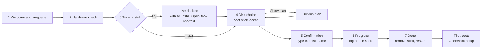

# Installer: USB image, boot chain, install flow and wizard (ANAL-189)

How OpenBook gets onto a laptop and stays updatable: a raw GPT live USB image (§1, §11), systemd-boot passing Android
its bootconfig (§2), an install wizard that is an Android app in the live session, backed by the `openbook-install`
engine (§3–§5, §12), and A/B updates through `openbook-bootsync` (§2.5, §13.13). This is milestone M8 (epic ANAL-188).
The user guide is `docs/INSTALL.md`.

| Part | Issue | Section |
|---|---|---|
| Design: image format, loader, layouts, wizard, safety rules | ANAL-189 | §1–§10 |
| Live USB image and `openbook-live-init` | ANAL-190 | §11 |
| Wizard app, install engine, daemon, firmware boot entries | ANAL-191 | §12 |
| End-to-end tests and the integrated test stick | ANAL-192 | §13 |
| A/B updates: `openbook-bootsync`, the boot control HAL, updates over adb | ANAL-223 | §2.5, §13.13 |
| App add-ons (microG) | ANAL-210 | §14 |
| A Google apps package the user brings | ANAL-211 | §15 |

**State as of 2026-10-18.** Everything here is built and tested in QEMU/OVMF. On 2026-10-18 the installer put OpenBook
on the G14's internal NVMe disk (a whole-disk install), and later builds reached the laptop as A/B updates over adb.

Labels: **C** = confirmed (a primary source, or we ran it), **R** = reported by others, **H** = hypothesis (not tested
yet).

## Decisions

The owner accepted these recommendations on ANAL-189 (2026-10-16/17). Decision 6 was done another way.

| # | Decision | Choice | Why |
|---|---|---|---|
| 1 | Image format | **One raw GPT disk image** (`openbook-<ver>-x86_64.img`, shipped as `.img.xz` with a checksum). No hybrid ISO. | Android needs real GPT partitions, found by name and by PARTUUID. The prototype's userdata and metadata were created on first boot and survived a reboot (C). |
| 2 | Loader | **systemd-boot** with Boot Loader Spec type #1 entries: GKI `bzImage`, then the vendor ramdisk, the generic ramdisk, and a bootconfig blob as the last initrd. One entry per slot; A/B tries use systemd-boot's boot counting. `openbook-bootsync` keeps the ESP copy in step with the active slot (§2.5). **GRUB 2.16** is the tested fallback. **GBL** is the long-term target, once upstream lands USB and multi-disk support. | All four loaders were booted from a USB GPT image in QEMU/OVMF (§2.3, C); systemd-boot is the smallest and maps onto Android's A/B tries (§2.4). |
| 3 | Install layouts | Whole disk (A/B, virtual A/B `super`), or alongside an existing OS **in space the user has already freed**. Our files go under `EFI/OpenBook/` plus an XBOOTLDR partition, and we add a firmware boot entry. Nothing is resized in v1. | An alongside install never moves, shrinks or deletes another OS's partitions (S7); the user frees the space first (§3.3). |
| 4 | Wizard | **An Android app in the live OpenBook session** (Compose), backed by a privileged install engine with a CLI (`openbook-install`: dry run, JSON plan, logs). There is no separate Linux live system. | Highest score in §4: one look, about 5 MB, and it tests the drivers the installed system will use. |
| 5 | Safety | Rules S1–S13 in §5. They are enforced in the engine, not just the UI: the boot stick is never a target, the user types the disk name, identity is re-checked before the first write, and there is a dry run and a log. | Rules in the engine hold for the app, the CLI and unattended runs alike (§5, §12.2). |
| 6 | Kernel delta | Add `CONFIG_EFIVAR_FS` to the OpenBook GKI, so the installer can create the firmware boot entry. Optionally add `SYSFB_SIMPLEFB`/`DRM_SIMPLEDRM` for a "safe graphics" mode. | **Done another way:** `efivarfs.ko` ships as a vendor module, with the GKI configuration unchanged (ANAL-198, #64), and the installer creates the firmware entry (§12.11). `SYSFB_SIMPLEFB`/`DRM_SIMPLEDRM`: not added; the "safe graphics" entry uses Mesa GL instead (§11.3). |

**Naming.** The project is **OpenBook**: images, boot entries, the installer, its tools and `androidboot.openbook.*` all
use that name.
- A few identifiers still carry the old name because builds use them: the `anybook_cf_x86_64_pc` product,
  `device/anybook`, `kernel/devices/anybook` and the `anybook_amd` KMI list, the `anybook-*` tool images, and the host
  data dir `~/anybook`.
- They change together in one repo-wide rename once the AOSP and kernel lanes are idle (§7).

**One loader and layout for the whole chain.** ANAL-198 (kernel packaging: first-stage modules, `vendor_boot`, dlkm
images, firmware) fills the boot images that §2.1 and §3.4 describe. ANAL-199's G14 product boots through these scripts
(`qemu-run.py` attaches images as USB or NVMe on OVMF), and ANAL-176 uses the same loader on hardware. None of them
brings its own.

## 1. Image format

### 1.1 What Android needs
- **Partitions are block devices found by name.** First-stage init mounts `super` with dm-linear and dm-verity from
  `/dev/block/by-name/*`. ueventd creates those links from each partition's `PARTNAME` uevent. When
  `androidboot.boot_part_uuid` is set, it only links partitions on the disk holding that PARTUUID; this is in AOSP since
  2024-11 and in our `android17-release` tree. That is the *recommended way* in `init/README.ueventd.md`, added by AOSP
  `519d3f8b` (2024-11), which relies on kernel `74f4a8dc0dd8` "block: add partition uuid into uevent as PARTUUID" (C).
- **This matters for us because a live USB stick and an installed NVMe disk carry the same partition names.** Without
  `boot_part_uuid`, Android can mount the wrong disk's `super`.

### 1.2 Options

| | Raw GPT `.img` | Hybrid ISO 9660 + El Torito EFI `.iso` |
|---|---|---|
| Written with | Any flasher: dd, GNOME Disks, Rufus (DD mode), balenaEtcher, Raspberry Pi Imager (R) | Same, or burned to optical or attached as a CD-ROM |
| Android partitions | Native GPT partitions: `super`, `vbmeta`, `misc`, `metadata`, `userdata`… | Only as appended partitions after the ISO (xorriso `-append_partition`, at most 8), so too few for about 12 partitions. Used as a real ISO (CD-ROM, Ventoy, loop mount) there are no partitions at all, and first-stage init would need loop-device logic it doesn't have |
| Writable live session | `userdata` and `metadata` are blank in the image; fs_mgr formats them on first boot (`formattable`) and they persist (**C**: f2fs `/data` 3.4 GiB and ext4 `/metadata`, formatted on boot 1 and kept on boot 2) | Read-only medium: `/data` would need tmpfs or zram. Android's file-based encryption needs a real filesystem with fscrypt, so this means extra init work (H) |
| VM testing | Attach as a USB or NVMe disk | CD-ROM, then the same problems |

**Choice: raw GPT only.** Ship `openbook-<ver>-x86_64.img.xz` with a checksum and a signature. Keep the expanded image
small: `super` re-packed to its content plus headroom, and a 1 GiB `userdata` that is grown to fill the stick on first
boot. `openbook-live-init` does the growing before Android starts (§11.2). The built image is about 2.7–2.8 GiB (§11.4).
The design recommended a 16 GB stick at least and 32 GB USB 3; the user guide asks for 4 GB or more (`docs/INSTALL.md`
§1).

**"Try without keeping anything"** is a boot-menu entry, not a separate image: "start fresh" sets
`androidboot.openbook.live_reset=1`, and `openbook-live-init` zeroes the start of `userdata` and `metadata` so fs_mgr
formats them again (§11.2, §11.3).

## 2. Boot chain

### 2.1 What the loader has to hand over

| Item | Where it comes from | Notes |
|---|---|---|
| Kernel | `boot_<slot>` (GKI `bzImage`) | Booted through the EFI stub (`EFI_STUB=y`, C) |
| Initrd | `vendor_boot_<slot>` ramdisk(s), then `init_boot_<slot>` generic ramdisk, then **bootconfig** | The bootconfig trailer (`[data][size][checksum]#BOOTCONFIG\n`) must be the last bytes of the combined initrd; otherwise the kernel says "'bootconfig' found on command line, but no bootconfig found" (C, UKI run) |
| Kernel cmdline | GKI built-in `CONFIG_CMDLINE` (includes `bootconfig`) + `vendor_boot` cmdline | No `androidboot.*` on the cmdline: Android wants them in bootconfig (source.android.com, Implementing Bootconfig, updated 2026-10-09) |
| Static product bootconfig | `vendor_boot` bootconfig section | `androidboot.hardware`, `fstab_suffix`, console, HAL/APEX choices. **GBL reads only the boot images**, so everything static belongs here (C) |
| Runtime bootconfig (loader) | Computed per boot or per install | `slot_suffix`, `force_normal_boot=1`, `verifiedbootstate=orange`, `vbmeta.device_state=unlocked`, `vbmeta.{hash_alg,size,digest,avb_version,invalidate_on_error}`, `veritymode`, `boot_part_uuid`, `serialno`, `openbook.*` |

**lz4 pitfall (C).** The ramdisks are lz4 legacy streams. The kernel's `unlz4` goes straight from one stream to the next
magic number, but 1–3 stray zero bytes between streams make it read a bogus chunk length (`lib/decompress_unlz4.c`).
GRUB starts every initrd on a 4-byte boundary, and systemd-boot pads them. So every ramdisk file we put on the ESP is
padded to a multiple of 4 with at least 4 zero bytes. A zero chunk length ends the stream cleanly, and initramfs skips
the rest (`mkproto.py: copy_padded`).

**AVB in the orange state (C).** On hardware the user owns, with Secure Boot off, the loader reports
`orange`/`unlocked`. In Android 17, first-stage init treats `orange` as unlocked: verification errors are allowed, but
dm-verity still runs on every `super` partition. The digest and size the loader passes are re-checked by libfs_avb. A
wrong digest is logged (`vbmeta digest mismatch`) and boot continues (the `grub-bad-digest` case in §2.3). The digest is
computed the way libavb does it: the top-level vbmeta, then every chained vbmeta struct (`boot`, `init_boot`,
`vbmeta_system`, `vbmeta_system_dlkm`, `vbmeta_vendor_dlkm`). `avbtool calculate_vbmeta_digest` and our own computation
agree.

**The orange notice.** Certified devices show a 10-second orange screen (source.android.com Boot flow, updated
2026-09-30). OpenBook is not a certified device. We show a persistent note in Settings › About and during setup instead.

**What the user sees at boot.** The boot should look calm, with no text:
- **The menu stays hidden** (`timeout menu-hidden`). Holding a key at power-on shows it.
- **The firmware logo stays up.** Our GKI has no `simpledrm`/`efifb` and the cmdline has no `tty0` console, so nothing
  draws over the firmware logo until amdgpu loads. Then the OpenBook boot animation takes over. In QEMU, the OVMF logo
  stays on screen from the loader until Android's init (C). On the G14 this should be the ASUS logo (H, ANAL-176).
- **When the menu is shown,** entries read "OpenBook (17 · slot A)". systemd-boot's menu can't be themed. If a graphical
  menu ever matters more than size and simplicity, GRUB with a theme is the fallback.

### 2.2 Prototype (C)
The scripts are in `scripts/installer/`, and the tool image is `tools/Dockerfile.installer`: QEMU 11.1.2, edk2-ovmf
202608, GRUB 2.16, systemd 262, mtools, gptfdisk. No root is needed and nothing touches a real disk.
- **Inputs, read-only:** a reflink snapshot of a product's images and an OpenBook GKI dist. The prototype used the
  `anybook_cf_x86_64_pc-cp2a-userdebug` images (ANAL-169) and the GKI `6.18.21-android17-5-g44a90255c95f`
  (ANAL-171/172).
- **`mkproto.py`** does the following:
  - Makes `boot.img` from our `bzImage`, signed as a chained partition with the AOSP test key.
  - Makes `vendor_boot` from the product's vendor ramdisk without its 6.12 modules, adding an empty module dir for our
    release and a probe. Console, `rdinit=/openbook-probe` and the product's static `androidboot.*` go into
    `vendor_boot`.
  - Rebuilds `vbmeta` with the same chain layout.
  - Lays out a 12 GiB GPT with an ESP, `misc`, A/B `boot`/`init_boot`/`vendor_boot`/`vbmeta*`, `metadata`, an 8 GiB
    `super` and a blank `userdata`. PARTUUIDs are deterministic, and every copied partition is checked by sha256.
  - Fills the ESP for one loader.
- **`probe-init.c`** is a 0.9 MB static `rdinit`. It logs `/proc/cmdline`, `/proc/bootconfig` and every block device
  with its PARTNAME, PARTUUID and bus path, waits for the boot disk by PARTUUID as ueventd does, and then `exec`s
  Android's `/init`. So one boot proves both what the loader passed and how Android used it.
- **`qemu-run.py`** boots the image on q35 with KVM and OVMF, attached as `usb-storage` on xHCI. It can add a **decoy
  NVMe disk with the same partition names and random PARTUUIDs**, standing in for an installed internal disk. It types
  commands into the userdebug serial console and takes screenshots.
- **`proto-matrix.sh`** builds and runs every variant; **`proto-summary.py`** tabulates the result.

### 2.3 Results (matrix `matrix-20261016-openbook`, all on the same inputs)

| Variant | Loader | `/proc/bootconfig` | Boot disk chosen | Android | Notes |
|---|---|---|---|---|---|
| `grub` (+ decoy NVMe) | GRUB 2.16 standalone | 28 lines | USB, via `boot_part_uuid` probed at run time (`probe --part-uuid`) | console 20 s after power-on; `/metadata` and `/data` formatted on first boot | by-name links → `sda*`, not the NVMe |
| `grub-2nd-boot` | same stick, second boot | 28 lines | USB | console | no reformat: the live session persists |
| `grub-bad-digest` | GRUB, wrong `vbmeta.digest` | 28 lines | USB | console | `libfs_avb: vbmeta digest mismatch` logged; orange continues |
| `grub-slot-b` | GRUB, grubenv `slot=b` | `_b` | — | probe only | Loads `openbook/b/kernel` (`BOOT_IMAGE=(hd0,gpt1)/openbook/b/kernel`) |
| `sdboot` (+ decoy NVMe) | systemd-boot 262, type #1, menu hidden | 29 lines | USB, `boot_part_uuid` written into the entry's bootconfig | console 17 s after power-on (first-stage init at 4.6 s); first-boot format | Boot counting renamed `openbook-a+3.conf` → `openbook-a+2-1.conf`. The screen keeps the firmware logo the whole time (no text) |
| `sdboot-menu` | the same loader, menu shown | 29 lines | — | probe only | The menu a held key brings up: "OpenBook (17 · slot A)", "OpenBook (17 · slot B)", "Reboot Into Firmware Interface" |
| `uki` | ukify UKI from firmware | **empty** | — | — | The kernel finds no bootconfig: systemd-stub appends its own cpio archives after `.initrd` |
| `gbl` | GBL dev, ci.android.com build 16633196 (`gbl-mainline:6296919847ee`) | 40 lines, generated by GBL | none | **first-stage mount fails** | GBL passes no `boot_part_uuid` or `boot_devices` |
| `gbl-uuid` | GBL, UUID baked into `vendor_boot` bootconfig | 41 lines | USB | console 19 s after power-on | GBL does libavb in orange (key "Invalid", allowed), always slot `a`, and emits per-partition digests |
| `gbl-uuid-decoy` | same, plus decoy NVMe | — | — | **GBL panics** | `Failed to read bootloader message from misc partition: NotUnique`, then reset |

**Limits of the prototype.** This is plain QEMU booting the Cuttlefish `pc` product, so it shows the boot chain only:
- There's no GPU, so it stops at the console. `sys.boot_completed` was not checked.
- Cuttlefish's 6.12 `system_dlkm`/`vendor_dlkm` modules don't load on our kernel.
- Cuttlefish's duplicate vendor APEXes are picked through bootconfig, as cvd does.
- **Gotcha:** GBL's console writes fail through a QEMU *socket* serial backend, and GBL then panics inside its own error
  printer. With a FIFO or file backend that does not happen, so the runner uses FIFOs. This is an environment quirk, not
  counted against GBL.

### 2.4 Loader evaluation

| Need | GRUB 2.16 | systemd-boot 262 (type #1) | UKI / systemd-stub | GBL (dev, 2026-10-16) |
|---|---|---|---|---|
| vendor + generic ramdisk + trailing bootconfig | yes, with lz4 padding | yes, with lz4 padding | **no**: stub appends cpio after `.initrd` | yes, natively from boot images v4 |
| `boot_part_uuid` | at run time (`probe --part-uuid`), but only on the cmdline (fs_mgr accepts it; not bootconfig-pure) | static, written by the installer into the entry's bootconfig | — | **no**: open CL 4286120 (2026-10-15) |
| USB stick + installed NVMe with the same names | yes (`$cmdpath`) | yes | — | **no**: `NotUnique` (open CL 4051936) |
| A/B with Android semantics | grubenv strings, no arithmetic; needs ESP sync | **boot counting = tries**; good/bad/indeterminate entries; needs ESP sync | — | Needs firmware `GblEfiBootControlProtocol`; without it, always slot `a` ("only supported on dev GBL") |
| AVB | none in the loader; digest precomputed | none in the loader; digest precomputed | none | **full libavb**: orange, per-partition digests |
| OTA by update_engine (writes `boot_b` etc.) | needs `openbook-bootsync` | needs `openbook-bootsync` | — | native |
| Dual boot | chainload anything, menus, themes | lists Windows Boot Manager on the same ESP automatically; `efi` entries chainload others | — | none (chainload it from a menu) |
| Size, complexity | 0.9 MB standalone with our module set (C); scripting; long CVE history | 157 KB (C), declarative | — | 2.2 MB (C) |
| Licence | GPL-3.0-or-later | LGPL-2.1-or-later | LGPL-2.1+ | Apache-2.0 |
| Ship today? | yes | yes | no | **No.** The dev build "can't be shipped", and the prod build needs vendor AVB/BootControl protocols |

**Choice: systemd-boot now.** It is small and declarative, its boot counting maps onto Android's A/B tries, and
everything goes into bootconfig. GRUB passed the same tests and stays the fallback, for example if we need richer menus,
theming, or GRUB's run-time `boot_part_uuid`.

**GBL later.** It reads the boot images, runs libavb, and is Google's direction. Switch when three things are true: CL
4051936 (pick the disk GBL was loaded from) has landed, CL 4286120 (`boot_part_uuid`) has landed, and we have a
BootControl provider, either upstream or a small OpenBook EFI driver backed by `misc`. systemd-boot would then chainload
GBL (`efi /EFI/OpenBook/gbl_x86_64.efi`), or the firmware entry points straight at it.

### 2.5 A/B and updates with systemd-boot (built, ANAL-223)
Built and tested in QEMU, and used for the G14's first update on 2026-10-18 (§13.13). The design below is as built (C)
unless marked H. How to run an update: `docs/adb-debug.md` §7.
- **Source of truth:** the Android partitions (`boot_x`, `init_boot_x`, `vendor_boot_x`, `vbmeta_x`). `super` uses
  virtual A/B with compression, so there is one copy, and the OTA's copy-on-write data lives in `super`'s free space and
  `/data`.
- **ESP mirror:** `openbook/<slot>/{kernel, vendor_ramdisk.img, ramdisk.img, bootconfig.img}`. Entry
  `loader/entries/openbook-<slot>[+N[-M]].conf` lists the three initrds with bootconfig last.
- **`openbook-bootsync`** (`device/anybook/common/bootsync/bootsync.c`): a vendor binary in its own SELinux domain,
  `openbook_bootsync`. It is plain C on the install engine's GPT, FAT, JSON and SHA-256 code, so it needs no mount: the
  ESP is opened `O_EXCL` (refused while mounted) through `/dev/block/by-name/EFI`, which gets its own label,
  `openbook_esp_block_device`. It does four things:
  - **`activate SLOT`** (the HAL's `setActiveBootSlot`, which update_engine calls after postinstall):
    - Reads `vbmeta_SLOT` (one top-level struct; chained partitions are refused) and checks every hash descriptor
      against `boot_SLOT`, `init_boot_SLOT` and `vendor_boot_SLOT`. It requires a signature, and the running slot's
      signing key unless `--allow-new-key`.
    - Extracts the kernel, the generic ramdisk and the vendor ramdisk fragments, padded as `mkproto.py copy_padded`
      does. Slot A's files from the installer are byte-identical to what it exports.
    - Builds the bootconfig from the running entry's own blob: the product's static keys are taken from the new
      `vendor_boot`, and the slot suffix and vbmeta digest and size are set.
    - The command line is the new `vendor_boot`'s, plus whatever the running entry added (a VM's console).
    - Writes, in this order:
      1. removes the slot's old entry;
      2. writes `openbook/SLOT/*` and reads it back;
      3. writes `openbook-SLOT+3.conf`;
      4. writes loader.conf with `default openbook-<running>.conf` and `preferred openbook-SLOT.conf`.
  - **`mark-good`** (`markBootSuccessful`): the running slot's counted entry becomes `openbook-SLOT.conf`, and
    loader.conf's default becomes this slot.
    - After an update, the other slot's entry is removed: the merge overwrites that slot.
    - On every later boot it changes nothing.
  - **`disable SLOT`** (`setSlotAsUnbootable`; update_engine calls it after the merge): removes that slot's entry, but
    never the running slot's.
  - **`status`**: read-only JSON with both slots, the ESP files against what they should hold, and the entry
    systemd-boot starts next. The model of systemd-boot v262.1's `boot_entry_compare` and `config_select_default_entry`
    was checked against an independent one in the host tests.
- **How the loader picks:** systemd-boot 262 skips a `preferred` entry with no tries left (`config_find_entry(...,
  check_assessment=true)` in `src/boot/boot.c`), and the `default` is the slot that last booted fine.
  - **New slot:** systemd-boot boots the new slot and counts it down itself (`+3` → `+2-1` → …).
  - **Slot that never reaches Android:** at `+0` it is skipped, and the old slot starts. That is the rollback, with no
    Android code involved.
- **Every ESP write is crash-ordered** (`fat_replace`, `fat_rename`, `fat_unlink` in the engine's `fat.c`): new data and
  its FAT chain first, then the directory entry, then the old chain is freed, with an fsync between each. A stop after
  any write step leaves a FAT that passes `fsck.fat` and a loader state that boots: the old slot until loader.conf is
  written, the new slot after (host tests, `scripts/ota/bootsync-test.py`).
- **Boot control HAL:** `android.hardware.boot-service.openbook` (`device/anybook/common/bootsync/hal/`) is AOSP's AIDL
  default service on `libboot_control` (`misc`), running in AOSP's `hal_bootctl_default` domain. It replaces
  `com.android.hardware.boot`.
  - `setActiveBootSlot`, `markBootSuccessful` and `setSlotAsUnbootable` run bootsync first, and change `misc` only when
    bootsync succeeded.
  - So a slot is marked successful in `misc` (which lets update_engine start the merge) only once its ESP entry is good.
  - If the loader fell back to the old slot, `misc` follows the loader at the next `markBootSuccessful`.
- **The first update onto an image without bootsync:** a new image's `postinstall` cannot do the ESP step. update_engine
  runs it in AOSP's `postinstall` domain under the *running* image's policy, which allows no block device at all
  (`system/sepolicy/private/postinstall.te`).
  - On the old image, the HAL is AOSP's and only writes `misc`.
  - So `scripts/g14-adb.sh ota` runs the package's own `openbook-bootsync activate` once, as root over adb, after
    update_engine finished. On userdebug, `su` is permissive.
  - From then on the image's own HAL does it.
- **Live USB:** slot A only, and no OTA; you re-flash instead. **Checked:** a slot-A-only stick boots as far as the A/B
  image does (§11.4, C).
- **Not done:**
  - Alongside installs (kernels on XBOOTLDR, no loader.conf of ours on a shared ESP): bootsync refuses them.
  - A bring-your-own GApps product (§15) is not carried across an update: a full package brings the stock `product`.
  - A slot that fails on the G14 itself was not tried. The G14's firmware does write systemd-boot's counter: its first
    boot of slot B renamed `openbook-b+3.conf` to `+2-1` (§13.13).

### 2.6 Firmware entry, cmdline and Secure Boot
- **On the USB stick:** systemd-boot at `EFI/BOOT/BOOTX64.EFI`, the removable-media path, so no NVRAM change is needed.
- **Installed:**
  - systemd-boot goes to `EFI/OpenBook/systemd-bootx64.efi`, and the installer adds an NVRAM `Boot####` entry named
    "OpenBook". The fallback `EFI/BOOT/BOOTX64.EFI` is written only on a whole-disk install.
  - Creating the NVRAM entry from Android needs efivarfs: `efivarfs.ko` (ANAL-198) and the installer's `Boot####` entry,
    appended to `BootOrder`, or first only with consent (owner decision 2026-10-17, §12.11).
- **Secure Boot must be off** for now. Later: sign systemd-boot and the kernel with an OpenBook key and enroll it via
  shim/MOK (H).

### 2.7 Test stick for a first hardware check (G14)
`scripts/installer/make-hwcheck-stick.sh` builds `openbook-hwcheck-<date>.img` (11 GiB, about 1 GB as `.img.xz`). It
holds the same boot chain as the prototype (systemd-boot, our 6.18 kernel, `boot_part_uuid`, orange AVB). It only writes
image files; writing a stick is a separate step. Menu entries:

- **"OpenBook hardware check"** (the default after 8 s) is for the laptop. The probe runs from the check initrd
  (`rdinit=/openbook-check/probe`, `openbook.probe=report`):
  1. Records the firmware identity (DMI, without serials), CPU (incl. AVX-VNNI), memory, PCI devices with their ACPI
     paths, and the bootconfig the loader passed.
  2. Writes a first copy of the report to the stick, so a hang still leaves results.
  3. Loads our module set (ANAL-172's dependency-resolved set for this exact kernel: GKI + the 138 OpenBook modules)
     with the firmware subset (ANAL-171). It loads dependencies first and skips a safety list: the cs35l56 speaker-amp
     drivers (they download DSP firmware and tuning to the amps; the check plays no audio),
     asus-wmi/asus-nb-wmi/hid-asus (they can change firmware settings), and test modules.
  4. Waits 10 s, then records which drivers bound; the `drm`, `net`, `bluetooth`, `sound`, `backlight`, `power_supply`,
     `typec` and input devices; the CPU frequency driver and EPP, sleep states, connected displays and modes (connectors
     that read "unknown" are probed first), backlight, battery health, the dGPU's PCI power state and runtime status,
     and temperatures.
  5. Writes `openbook/logs/hwcheck-NNN.txt`, `hwcheck-NNN.json` (schema `openbook-hwcheck/N`) and `-dmesg.txt` to the
     stick and powers off.

  It only mounts the ESP whose PARTUUID is `boot_part_uuid`, and only if that partition is on USB. It never writes to
  the laptop's disks. GKI has no devtmpfs, so the probe makes that one device node itself from sysfs. Shared reports are
  redacted: USB serial numbers are blanked in the kernel log, and partition UUIDs are shown only for the stick.
- **"OpenBook hardware check + sleep test":** one RTC-woken suspend of 20 s, with the stick unmounted while asleep. It
  records time asleep, `suspend_stats`, the AMD PMC s0ix counters and firmware info, every PCI function still awake
  right before suspend, and ACPI device power states and power resources before suspend and after resume. The sleep
  entries turn on `pm_debug_messages` and dynamic debug for amd_pmc, pinctrl_amd and the ACPI LPS0 code.
- **"OpenBook sleep test, NVIDIA GPU + unused port powered down":** for this boot only, it unbinds the dGPU's HDMI-audio
  function, removes both NVIDIA functions and sets the root port to runtime PM (`docs/nvidia.md` §1, option 2), waits
  for the bridge's final power state, then repeats the sleep test. It also loads a test-only module
  (`scripts/installer/kmod/`, built by `build-check-kmod.sh` against the check kernel) that puts `GPP0.SWUS` into
  D3cold. The module is tested in QEMU with a fixture SSDT (`acpi-d3cold-test.asl`) that recreates the unused, powered
  `_ADR` child. Building it needs `make`, `flex`, `bison`, `bc`, `pahole` and `acpica` in the installer image
  (`tools/Dockerfile.installer`).
- **"OpenBook preview (virtual machines only)"** is the Android 17 boot from §2.3, with the console on the serial port.
  It shows nothing on a laptop.

**Updating a written stick:** `update-hwcheck-stick.sh /dev/disk/by-id/usb-… <bundle>` copies a newer `openbook/check/`,
the check entries and the README onto the stick's OPENBOOK partition with udisks. It checks the by-id path, the ESP
PARTUUID, the label and an existing OpenBook entry first, then verifies the copy with sha256.

**What the G14 showed (2026-10-16, seven runs):**
- UEFI → systemd-boot → our kernel works; 235 modules load with 0 failures. The stick's preview entry also ran Android's
  first and second stage from USB on the laptop.
- These come up: amdgpu (SMU, DCN 3.5 and DMUB, the 2880×1800 eDP panel with PSR, and backlight); mt7925e with `wlan0`,
  Bluetooth `hci0` and the ELAN touchpad; the keyboard, lid switch, NPU `accel0`, battery, UCSI and USB4. amd-pstate-epp
  is active. `regulatory.db` was missing at first; it ships with its licence since.
- s2idle is the only sleep state, and a suspend/resume cycle works with no errors after resume. **S0i3 is not reached**
  ("Last S0i3 Status: Unknown/Fail").
- In the check, the dGPU and its HDMI-audio function (bound by `snd_hda_intel`) stay D0. With the detach entry the
  dGPU's bridge reaches D3cold, and the firmware re-enumerates the dGPU on resume.
- `GPP0` is `00:01.1`, an empty hotplug port; the dGPU is `GPP9.PEGP` on `00:03.1`. `GPP0.SWUS` has no device, yet stays
  D0 with its power resource on: the kernel powers it up to scan behind the bridge
  (`acpi_dev_power_up_children_with_adr()`) and nothing powers it down again. Powering it down met every LPI constraint,
  but S0i3 was still not reached with the same SMU idle mask, so `GPP0.SWUS` is ruled out.
- The S0i3 work moved to ANAL-178. Its probe (several sleep cycles in one boot with a bisect,
  `openbook.probe.s0i3_steps`, more test-only modules and per-cycle JSON) ships as an add-on for the live stick instead
  of a separate stick image (`scripts/power/`, `docs/power-input.md` §1.4). S0i3 does not block live USB booting or
  installation.

## 3. Install flow

### 3.1 Live USB layout (ANAL-190)

| Partition | Size | Content |
|---|---|---|
| `EFI` (ESP, FAT32, label `OPENBOOK`) | 256 MiB | systemd-boot, `loader/`, `openbook/a/*`, `openbook/logs/` (install logs and hardware reports land here) |
| `misc` | 4 MiB | zeros (boot control and BCB) |
| `boot_a`, `init_boot_a`, `vendor_boot_a`, `vbmeta_a` | 64 / 8 / 64 / 1 MiB | images |
| `metadata` | 64 MiB | blank, becomes ext4 on first boot |
| `super` | content + 64 MiB (about 1.3 GiB for the G14 product) | the product's dynamic partitions, slot A, re-packed |
| `userdata` | 1 GiB in the image, grown at first boot | blank, becomes f2fs on first boot |

Bootconfig on the stick adds `androidboot.openbook.live=1`. With it, the launcher shows "Install OpenBook" and the
installer app is enabled. The built layout in detail: §11.1.

### 3.2 Whole-disk layout (installed)

| Partition | Size | Notes |
|---|---|---|
| `EFI` | 512 MiB | systemd-boot, two slots of boot artifacts (about 46 MB per slot: kernel 27 MB, vendor ramdisk 18 MB, generic ramdisk 3 MB), room for GBL later |
| `misc` | 4 MiB | as on Googlebook |
| `boot_a/_b` | 64 MiB each | GKI `bzImage` is 27 MB |
| `init_boot_a/_b` | 8 MiB each | |
| `vendor_boot_a/_b` | 64 MiB each | first-stage modules plus vendor ramdisk |
| `vbmeta_a/_b` | 1 MiB each | Fold `vbmeta_system*` into one `vbmeta` as Googlebook does (product decision for ANAL-174); otherwise add three 1 MiB pairs |
| `metadata` | 64 MiB | metadata encryption keys, OTA state |
| `super` | 12 GiB | virtual A/B with compression, the same size as Googlebook's |
| `userdata` | the rest | blank, formatted on first boot |

About 13 GiB is fixed. The minimum disk is 64 GB. New random disk GUID and PARTUUIDs; partition type `0FC63DAF` (Linux
data) except the ESP, so other OSes don't mount them.

### 3.3 Alongside an existing OS
- **v1 never moves or shrinks anything.** The user frees space first, with Windows Disk Management or GParted, and the
  wizard shows how much is needed (64 GB). OpenBook partitions go into the largest unallocated extent.
- **ESP:**
  - Reuse the existing ESP for `EFI/OpenBook/systemd-bootx64.efi` only (157 KB).
  - Kernels and entries go to a new **XBOOTLDR** partition (512 MiB, FAT32, type `bc13c2ff-59e6-4262-a352-b275fd6f7172`)
    on the same disk. Windows ESPs are often only 100–260 MB (R).
  - If the disk has no ESP, create a 512 MiB one.
- **Menu:**
  - systemd-boot lists Windows Boot Manager automatically when it's on that ESP.
  - For other loaders (GRUB, Limine) we add an `efi` chainload entry.
  - **BootOrder:** OpenBook's entry is appended at the end, so the system that starts now stays the default and OpenBook
    is in the firmware's boot menu. It goes first only if the user ticks "Start OpenBook by default", which is off by
    default when alongside (owner decision 2026-10-17, §12.11).
- **The OpenBook disk and the Android partitions must be the same disk,** because `boot_part_uuid` points at it. If the
  only ESP is on another disk, create one on the OpenBook disk.

### 3.4 Firmware subset and vendor modules
- **First-stage modules** (`vendor_boot` ramdisk, `lib/modules/<release>/`): only what's needed to reach `super`. On the
  G14 that is nothing: NVMe, xHCI, usb-storage and uas are built into GKI (C). Keep the directory non-empty with at
  least one module, or empty it in the product. First-stage init falls back to the flat `/lib/modules/modules.load` when
  the release directory loads nothing, and a vermagic error there is fatal (C, `first_stage_init.cpp`; we hit it).
- **Second stage:** the 138 OpenBook modules (amdgpu, mt7925e, i2c-hid, sound…) go in `vendor_dlkm`, and the GKI modules
  from the same build in `system_dlkm`. The rule from ANAL-172 holds: the `bzImage` and `system_dlkm` must come from one
  dist.
- **linux-firmware subset** (ANAL-171):
  - Lives in `/vendor/firmware`, uncompressed (`FW_LOADER_COMPRESS` is off), with
    `firmware_class.path=/vendor/firmware`.
  - The licence files and WHENCE go under `/vendor/firmware/` and into NOTICE. The live image also carries them in
    `LICENSES/` on the ESP (§11.1).

### 3.5 Install engine steps (`openbook-install`, used by the app and by test automation)
1. **`disks`** (read-only inventory):
   - Model, vendor, serial, WWN, size, bus and removable flag, read from sysfs. The `by-id` name is computed in udev's
     format, for example `nvme-SK_hynix_PVC10_<serial>`, because Android has no `/dev/disk/by-id`.
   - The partition table: names, types, labels, filesystems detected from superblocks.
   - The **boot disk** is marked: the one holding `ro.boot.boot_part_uuid`.
2. **`plan --target <by-id> --layout whole|alongside [--json]`** computes every operation: offsets, sizes, sources and
   their sha256, and what is erased. It opens the target `O_RDONLY`. This is the dry run, and the "Show plan" button.
3. **`apply --plan plan.json --confirm-disk <by-id>`** re-computes the plan and refuses if it differs. Then:
   1. Verify the source partitions on the stick against the image manifest.
   2. Whole disk: wipe the old primary and backup GPT and the protective MBR first, so an interrupted install leaves a
      clearly blank disk, not a half-valid one.
   3. Write partition contents. `super` is copied sparsely.
   4. Write the new GPT.
   5. Zero `misc`, `metadata` and `userdata` headers.
   6. ESP or XBOOTLDR: systemd-boot and boot artifacts, plus an entry whose bootconfig has the new `boot_part_uuid`, the
      vbmeta digest, a new random `serialno`, and the locale and keyboard picked in the wizard
      (`androidboot.openbook.locale`, `.keyboard`).
   7. Add the NVRAM entry when efivarfs is available.
   8. **Read back** every written partition and compare hashes.
   9. Write a JSON report.
4. **Logs:** an append-only log and `install-<UTC>.json` go to the stick's `openbook/logs/` and to the new ESP's
   `openbook/logs/`. No secrets are logged. (The design also copied them to `/metadata/openbook/` on first boot; that is
   not built.)

How the engine does each step: §12.2.

### 3.6 First boot and setup
- `/metadata` and `/data` are created on first boot. Android then starts its setup flow.
- **Google's SetupWizard is not in AOSP:** AOSP 17 only has the `setupcompat`/`setupdesign`/`setupwizard` libraries and
  `Provision`, which only sets the provisioned bit (C).
- So OpenBook has its own setup app, `OpenBookSetup` (ANAL-209, `docs/setup.md`). It replaces Provision in both
  products: nine pages, no Google account step, Skip, and `androidboot.openbook.setup=skip` for unattended runs.
  Language and keyboard start from the wizard's choice (`ro.boot.openbook.locale`, `.keyboard`). It uses Compose and the
  installer's design, not the `setupdesign` libraries.

## 4. Wizard technology

| Score 1–5 | (a) Android app in the live session (Compose) | (b1) Linux live system + Calamares 3.4.3 | (b2) Linux live system + custom Qt Quick app |
|---|---|---|---|
| Polish / same look as the OS | **5**: the same toolkit and theme; "Try" then "Install" in one session | 3: QML branding, but a different OS look | 4 |
| Size added to the image | **5**: about 5 MB (app and engine) | 2: a second kernel and Qt userspace, about 250–350 MB (H) | 2 |
| Licence | **5**: Apache-2.0, AOSP Compose prebuilts (C) | 4: GPL-3.0-or-later; fine, but the source must ship | 4: Qt LGPL-3; avoid GPL-only modules such as Virtual Keyboard (C) |
| Effort | 2: privileged engine daemon, SELinux, efivarfs, setup app | 3: existing modules, but Android partitions need a custom module; `rawfs` picks targets by mount point (C) | 2 |
| Accessibility | 3: Compose semantics, but no screen reader in AOSP; TalkBack is Apache-2.0 on GitHub and would need building (C) | 2: Orca support open since 2019 (#1294), Tab navigation bug #2531 open (C) | 3: Qt `Accessible` + AT-SPI/Orca |
| Hardware support | 2: needs OpenBook's own graphics and input. GKI has no `simpledrm`/`efifb`, so nothing shows until amdgpu loads (C) | **5**: generic kernel, simpledrm, any GOP display | **5** |
| **Total** | **22** | 19 | 20 |

**Choice: (a).**
- If the wizard can run, OpenBook can run on that machine. The hardware check also tests the drivers that matter after
  install (Wi-Fi, touchpad, audio, suspend), not a different kernel's.
- For machines where the display doesn't come up, the design adds a boot entry **"Hardware report (text)"**
  (`androidboot.openbook.diag=1`) that writes a report to the stick's `openbook/logs/` and powers off. Not built yet
  (§8); the "save logs" entry (§11.2) covers part of it.
- The same `openbook-install` engine runs unattended, with JSON output (§12.9).
- Revisit (b2) if "tell users on unsupported hardware why" becomes a goal (NVIDIA-only laptops).

### 4.1 Screens



**High-fidelity design:** `docs/installer-design/index.html` is the source. Open it in a browser for the gallery of
every screen, light and dark, or use `?screen=<id>[&theme=dark]` for one screen. `scripts/installer/render-design.sh`
renders it to PNGs outside the repository; the README carries five renders in `assets/readme/installer/`.
- **Design language:** Material 3 Expressive in an OpenBook desktop window: Roboto Flex, Material Symbols Rounded, tonal
  surfaces, pill buttons, and a wavy progress indicator.
  - The light and dark themes come from one seed colour (`#4A5BD4`). The window sits on the live desktop with its
    taskbar.
  - This is buildable from AOSP alone: `external/roboto-flex-fonts`, Compose Material 3 and `material-icons-extended`
    are in the tree (C).
- **Brand:** the OpenBook mark is two pages opening from a spine, with a spark. It is used in the window, the taskbar
  and the boot animation.
- **Sample data.** Hardware states, sizes and times on the design screens are illustrations, not test results.

| Screen | What it does | Safety it carries |
|---|---|---|
| 1 Welcome and language | Brand panel, language list with native names, a keyboard test field, and accessibility toggles from the first screen | "Nothing on this computer changes until you say so" |
| 2 Hardware check | One verdict, then a tile per component (Ready, Quieter, New, Off) in plain words; "Save report to USB" | A report for support and test automation |
| 3 Try or install | Two large illustrated choices | Try never touches the internal disk |
| 4 Disk | A card per disk with what is on it today; erase or alongside; an explainer for keeping Windows; the add-on and Google apps switches (§14, §15) | **The boot stick is locked** (S1); "View the plan" is the dry run (S5) |
| 5 Confirm | What gets erased, before and after, the full `by-id`, and the typed model name | The red button enables only on a match and is never the default focus (S2–S4) |
| 6 Install | Percentage, wavy progress, the engine's steps, and a tip card | Charger state (S8); the log path on the stick (S6) |
| 7 Done | Read-back result, boot entry, report; "Restart now" | Verification result shown (S9) |
| Boot | The OpenBook boot animation frame after the firmware logo | — |

## 5. Safety rules (enforced by the engine; the UI only reflects them)
- **S1. Never the boot medium.** Refuse any disk holding the partition whose PARTUUID is `ro.boot.boot_part_uuid`. Also
  refuse any disk with a mounted filesystem, and read-only disks. This is checked again at `open()` time.
- **S2. Show identity.** Show model, vendor, size (GB and GiB), bus, serial (last 4 characters, full in details), the
  `by-id` name in udev format, and the current partitions with names, types, filesystem labels and detected OS
  ("Windows", "Linux"). List exactly what will be erased.
- **S3. Typed confirmation.**
  - Interactive: the user types the model name; case and whitespace are normalised.
  - Unattended: `--confirm-disk /dev/disk/by-id/…` must equal the target exactly, **and** `OPENBOOK_INSTALL_ERASE=<same
    by-id>` must be set. This matches the project rule that a write needs an explicit confirmation naming the `by-id`
    device.
- **S4. Re-check before the first write.** Serial, size, WWN and a hash of the partition table must be unchanged since
  the confirmation; otherwise abort.
- **S5. Dry run.** `plan` and `--dry-run` open the target read-only and print every operation (offset, length, source,
  sha256). The UI's "Show plan" is the same output.
- **S6. Logs.** An append-only text log plus a JSON report on the stick, copied to the new system. Every command and
  result is logged. No passwords, Wi-Fi keys or account data.
- **S7. Alongside never destroys.**
  - Never delete, format, move or resize existing partitions.
  - Write only `EFI/OpenBook/` and `loader/entries/openbook-*.conf` on a shared ESP.
  - Never overwrite `EFI/BOOT/BOOTX64.EFI` there.
  - Put OpenBook first in BootOrder only with consent; without it, OpenBook is appended (S11).
- **S8. Power.** Require AC power, or battery ≥ 50%.
- **S9. Interruption.**
  - The order above means a cut leaves either the old table (before step 2) or a blank disk (before step 4). The
    installer can be restarted from the stick.
  - A failed read-back marks the install as failed and doesn't create the boot entry.
- **S10. Source integrity.** The stick's partitions are hashed against the signed manifest before copying, and the
  install is refused on a mismatch. This catches a bad flash or a failing stick.
- **S11. No firmware writes.** Never write SPI flash or capsules, never change Secure Boot keys, and never change
  firmware settings. The only NVRAM writes: adds one `Boot####`; appends it to `BootOrder`, or puts it first only with
  consent (owner decision 2026-10-17). Never overwrites or deletes another entry.
- **S12. Minimum sizes.** Refuse targets below the minimum. Warn about, but never touch, BitLocker, LUKS or other
  encrypted volumes in alongside mode.
- **S13. External targets.** USB or Thunderbolt disks other than the boot stick are allowed, with an extra warning.

Where the engine enforces each rule: §12.2.

## 6. Licensing checklist for a public image

| Item | Licence | Ship? | Obligation |
|---|---|---|---|
| AOSP 17 platform built from source | Apache-2.0 and others (per-module NOTICE) | yes | NOTICE in Settings › Legal; GPL/LGPL parts (e2fsprogs `mke2fs`, f2fs-tools, …) need a source offer |
| OpenBook GKI + 138 vendor modules | GPL-2.0 | yes | **Corresponding source** (kernel tree, our patches, config, `kernel/devices/anybook`) per release, plus a written offer or a tarball next to the image for 3 years |
| linux-firmware subset | per WHENCE: LICENSE.amdgpu, LICENCE.mediatek, LICENSE.amdnpu, LICENCE.rtlwifi_firmware.txt, LICENSE.cirrus | yes | Ship the licence files and WHENCE with the files; no modification |
| Mesa radeonsi/RADV | MIT; **libelf LGPL-3.0+** | after decision | **Open decision:** link libelf as a shared library (recommended, `docs/mesa.md`) |
| Digitalis (the arm64 bridge) | Apache-2.0 | yes, built from source | Never the DigitalisX64 sample-app SDK binary |
| systemd-boot | LGPL-2.1-or-later | yes | Source offer for the exact version |
| GRUB (only if used) | GPL-3.0-or-later | fallback | Source offer; GPLv3 installation-information rules if ever shipped on locked hardware (not our case) |
| GBL (later) | Apache-2.0 (+ third-party LICENSE from its build) | later | Build from source; ship its LICENSE |
| Roboto Flex (UI font) | OFL-1.1 | yes, from AOSP `external/roboto-flex-fonts` | Keep the licence text |
| Material Symbols / Compose icons | Apache-2.0 | yes, via Compose `material-icons-extended` | NOTICE |
| Installer app, engine, bootsync | ours | yes | Repo licence decision (Apache-2.0 suggested; files already carry SPDX Apache-2.0) |
| **Never ship** | — | no | GMS, Google apps, SetupWizard, Play services, libhoudini, libndk_translation, Googlebook recovery images or parts of them, vendor blobs without a redistribution licence, the CS35L56 tuning blob (not public anyway) |
| AVB keys | — | — | Release images must not be signed with the AOSP test key. **Open:** who holds the OpenBook release key |
| Names and marks | — | — | The product is **OpenBook**. **Open:** a trademark check of "OpenBook" before any public image, the use of "Android", and no "Googlebook" in naming so no endorsement is implied |

The release checklist in `docs/INSTALL.md` §9 tracks each item's current state, including the source bundle
(`scripts/release/make-sources.sh`) and the open owner decisions: the repo licence, Mesa libelf linkage, AVB key custody
and the trademark check.

## 7. Open questions for the owner
1. ~~Approve decisions 1–5 (format, loader, layouts, wizard, safety rules).~~ Accepted on ANAL-189.
2. ~~Decision 6 (kernel lane): `CONFIG_EFIVAR_FS`.~~ Done as a vendor module (§12.11). `SYSFB_SIMPLEFB`+`DRM_SIMPLEDRM`
   for a safe-graphics entry: not added.
3. ~~Alongside installs v1: no resizing.~~ Accepted with decision 3.
4. Who holds the OpenBook AVB release key, and do test-key images stay userdebug-only? Open (`docs/INSTALL.md` §9, item
   9).
5. A trademark check of "OpenBook" before any public image. Open (`docs/INSTALL.md` §9, item 11).
6. **The repo-wide rename to OpenBook.** Rename `device/anybook` → `device/openbook` and the `anybook_*` products →
   `openbook_*` (with `PRODUCT_BRAND`, which ends up in build fingerprints). Also `kernel/devices/anybook` and the
   `anybook_amd` KMI list, the `anybook-*` tool images, `ANYBOOK_HOME`, and `~/anybook` → `~/openbook`.
   - Doing it while the AOSP and kernel lanes are mid-build would break their runs, so it should be one coordinated
     change when both lanes are idle.
   - The installer already uses OpenBook everywhere.

## 8. Next steps
- **Not built yet:** the text hardware report entry (`androidboot.openbook.diag`), a signed install manifest (needs the
  release key), translations, copying the install report into `/metadata`, updates for alongside installs (§2.5), and
  carrying a user's Google apps package across an update (§15.7).
- **Not shown on real firmware:** the installer's `Boot####` entry and `BootOrder` change (§12.11), and a slot that
  fails and rolls back on the G14 itself (§2.5).
- **Engine robustness:** a crash-replay test on the host (log every write and replay every prefix, including writes lost
  since the last flush, especially for a shared Windows ESP), and fuzzing of the Google apps package check (§15.7).
- **Known issues to fix:** §13.5 findings 1 and 2 (the installed system offers to set up the stick; an installed
  OpenBook shows as "Linux").
- **GBL watch.** Re-test when CLs 4051936 and 4286120 merge (`MATRIX_ONLY=gbl scripts/installer/proto-matrix.sh`).

## 9. Reproduce
The boot-chain prototype (§2.2–§2.4) and the hardware-check stick (§2.7):
```bash
docker build -t openbook-installer -f tools/Dockerfile.installer tools
scripts/installer/render-design.sh                           # design PNGs, outside the repository (fetches Roboto Flex + Material Symbols)
scripts/installer/make-hwcheck-stick.sh                      # the G14 test stick image (§2.7) into <data dir>/installer/out/
scripts/installer/snapshot-inputs.sh cf-pc-20261016          # reflink snapshot of PRODUCT_OUT + kernel dist (refuses while an AOSP build runs)
# GBL dev EFI (Apache-2.0) for the gbl variants, from ci.android.com aosp_uefi-gbl-mainline build 16633196:
mkdir -p ~/anybook/installer/dl/gbl-16633196 && curl -L -o ~/anybook/installer/dl/gbl-16633196/gbl_x86_64_dev.efi \
  https://ci.android.com/builds/submitted/16633196/gbl_efi_dist_and_test/latest/raw/gbl_x86_64_dev.efi
scripts/installer/proto-matrix.sh cf-pc-20261016 matrix-20261016-openbook
```
- **Cost:** about 20 s to build each image and 20–25 s for each Android boot, under 10 minutes for the whole matrix.
- **Disk:** each image is a 12 GiB sparse file with about 2 GB of data.
- **Logs:** `~/anybook/logs/installer/<run>/`.

## 10. Sources (accessed 2026-10-16)
- **Bootconfig, AVB, boot flow:**
  - source.android.com/docs/core/architecture/bootloader/implementing-bootconfig (updated 2026-10-09)
  - source.android.com/docs/security/features/verifiedboot/boot-flow (updated 2026-09-30)
  - `external/avb` README and `libavb/avb_cmdline.c`
  - docs.kernel.org/admin-guide/bootconfig.html
- **`boot_part_uuid`:**
  - AOSP `519d3f8b` "fs_mgr: Add getter for androidboot.boot_part_uuid" (2024-11-05)
  - kernel `74f4a8dc0dd8`
  - local tree `system/core/init/devices.cpp`, `block_dev_initializer.cpp`, `system/fs/fs_mgr/libfstab/fstab.cpp`
    (android17-release)
- **GBL:**
  - android.googlesource.com/platform/bootable/libbootloader, branch `gbl-mainline` (head `6296919847ee`, 2026-10-16);
    `gbl/docs/efi_integration.md`, `partitions.md`
  - source.android.com/docs/core/architecture/bootloader/generic-bootloader (updated 2026-10-09)
  - Open CLs android-review 4051936, 4286120, 4259565, 4279441
  - ci.android.com `aosp_uefi-gbl-mainline` build 16633196
- **systemd-boot:** uapi-group.org Boot Loader Specification; systemd v262 `src/boot/boot.c` (`initrd_prepare`) and
  `stub.c`; the boot-counting docs.
- **GRUB:** `grub-core/loader/linux.c` (initrd alignment); the GRUB manual (grubenv).
- **Calamares:** codeberg.org/Calamares/calamares v3.4.3 (2026-09); issues #1294, #2531.
- **Qt:** doc.qt.io Qt 6 licensing and accessibility.
- **AOSP:** `packages/apps/Provision`; `prebuilts/sdk/current/androidx/m2repository/androidx/compose`;
  github.com/google/talkback (Apache-2.0).
- **Other installers:**
  - ChromeOS Flex: support.google.com/chromeosflex/answer/11550703
  - Android-x86: android-x86.org/installhowto.html
  - Bliss OS: docs.blissos.org/installation/install-from-bootable-usb
- **Googlebook (ruby) image, inspected locally and not redistributed:**
  - The `EFI-SYSTEM` and `KERN-A` partitions in the recovery image are all zeros.
  - `ota_recovery_a` holds a nested GPT whose `boot_a` (an Android boot image) carries the ChromeOS kernel type GUID.
  - So Googlebooks boot from a loader in firmware, not from the disk. There is nothing on the disk for us to reuse (C).

## 11. Live USB image (ANAL-190)

The live stick boots OpenBook from USB without touching the laptop's disks, keeps the live session's data on the stick,
and carries everything the installer copies (§12). Built from a real product's images; nothing in them is rebuilt or
re-signed.

### 11.1 What `scripts/installer-image.sh` builds

```bash
scripts/installer-image.sh                       # from <data dir>/aosp/src/out/target/product/anybook_g14
scripts/installer-image.sh --menu-timeout 10     # the same, with the boot menu shown for 10 s (test sticks)
scripts/installer-image.sh --inputs <snapshot>   # rebuild from an earlier snapshot (byte-identical output)
```

It snapshots the product's `boot`, `init_boot`, `vendor_boot`, `vbmeta` and `super` images from `PRODUCT_OUT` (reflinks;
it refuses while an AOSP build runs), builds and tests `openbook-live-init`, and assembles the image with
`scripts/installer/mklive.py` in the `openbook-installer` container. Nothing in the Android images is rebuilt or
re-signed. The kernel, the 138 vendor modules and the firmware come from those images.

| Output in `<data dir>/installer/out/` | |
|---|---|
| `<label>.img` | the raw GPT image to write to a stick |
| `<label>.img.xz`, `<label>.sha256` | compressed copy and the sha256 of both |
| `<label>.img.json` | layout, PARTUUIDs, every entry's bootconfig, vbmeta digest, `super` re-pack check, firmware licence check, ESP file list |
| `<label>.build.json` | `openbook-live-build/1`: size, sha256, build time per step, input hashes, tool versions, repo commit |
| `<label>.vm/` | two extra entries the QEMU tests copy into their test copy (not on the stick) |

**Layout** (slot A only; PARTUUIDs derived from the label):

| Partition | Size | Content |
|---|---|---|
| `EFI` (FAT32 `OPENBOOK`) | 256 MiB | systemd-boot at `EFI/BOOT/BOOTX64.EFI`, `loader/`, `openbook/a/` (kernel, vendor ramdisk, generic ramdisk, `live.img`, one bootconfig per entry), `openbook/logs/`, `openbook/README.txt`, `openbook/MANIFEST.json`, `openbook/install/` (§12.5), `LICENSES/` |
| `misc` | 4 MiB | zeros |
| `boot_a`, `init_boot_a`, `vendor_boot_a`, `vbmeta_a` | 64, 8, 64, 1 MiB | the product's images, unchanged |
| `metadata` | 64 MiB | blank: Android formats it (ext4) on the first boot |
| `super` | content + 64 MiB | the product's dynamic partitions, re-packed with `lpmake` |
| `userdata` | 1 GiB | blank: grown to fill the stick, then formatted (f2fs, metadata encryption) on the first boot |

- **`super` is re-packed, not shrunk in place.** The product's `super` is 8 GiB, sized for OTAs, which a live stick
  never takes. `mklive.py` copies each logical partition out and re-packs them with `lpmake`, keeping the names, groups,
  attributes, the virtual A/B flag and 3 metadata slots. It then checks every partition's sha256 against the original.
  AVB is unaffected: the hashtrees live inside the partitions.
- **Licences on the stick** (`LICENSES/`): the firmware licence files are taken from the vendor image that ships, not
  from a staging folder. `firmware/FILES.tsv` maps every file in `/vendor/firmware` to its licence. The build fails if a
  file has none. Also: systemd-boot's LGPL-2.1-or-later and the kernel's GPL-2.0 texts, and a `README.txt` naming each
  component, its licence and where its source is.
- **Reproducible.** File times come from `--epoch`, which defaults to the repo's HEAD commit time. The FAT uses
  `mkfs.fat --invariant` with a volume ID derived from the label. PARTUUIDs and the disk GUID are derived from the label
  too. The same inputs and label give the same image, byte for byte (C, §11.4).

### 11.2 `openbook-live-init` (`scripts/installer/live-init.c`)

A 1 MB static `rdinit=` in `live.img`. It runs as PID 1 before Android's first-stage init, and it only acts with
`androidboot.openbook.live=1`, which only the stick's entries set. Then it `exec`s `/init`.

- **Grow.** On a stick larger than the image, it moves the backup GPT to the end and grows `userdata` (the last
  partition) to the last whole MiB. It only grows while `userdata` is still blank. Android then formats `/data` at the
  full size, because fs_mgr formats a `formattable` partition whose first 4 KiB are zero (`libcutils`
  `partition_wiped()`, C). If `userdata` is already in use, it only moves the backup GPT. The kernel then re-reads the
  table (`BLKRRPART`, with `BLKPG` as a fallback); nothing has opened a partition yet.
  - **Why here, not in an Android `late-fs` service:** before Android starts nothing holds the disk, so the kernel can
    re-read the table. It needs no AOSP change, no SELinux domain and no AOSP build, and it is the same code for every
    product.
- **Start fresh** (`androidboot.openbook.live_reset=1`). It zeroes the first MiB of `metadata` and `userdata`, so
  Android formats both again, exactly as on the first boot. The metadata-encryption key lives in `/metadata`, so the old
  `/data` contents cannot be read back.
- **Save logs** (`androidboot.openbook.logs=1`). A helper process copies the kernel log to the stick while Android
  boots. 90 s into second stage, and again when `sys.boot_completed=1` (+45 s) or after 600 s, it saves logcat, system
  facts and a screenshot. It runs `logcat`, `dumpsys`, `getprop` and `screencap` inside Android's root via
  `/proc/1/root`. Everything goes to `openbook/logs/live-NNN/` with a `summary.json` (`openbook-live-logs/1`). Then it
  shuts Android down (`androidboot.openbook.logs_after`: `poweroff`, `reboot` or `stay`). It mounts the ESP with the new
  mount API (`fsopen`/`fsmount`), so the mount is attached to no directory and Android never sees it. Since ANAL-191 it
  also collects the installer (section `INSTALLER`): the daemon's log with disk serial numbers, EUI and WWN masked, and
  `openbook-install nvram`.
  - **This entry boots SELinux permissive** (`androidboot.selinux=permissive`, userdebug only). The helper reads logcat
    and talks to SurfaceFlinger from outside Android's own domains. Results from this entry say so (`ro.boot.selinux`),
    and its AVC counts are reported, not enforced.
- **Safety.** It acts only on the disk holding the ESP whose PARTUUID is `androidboot.boot_part_uuid`, only if that disk
  is on USB, and only if its primary GPT is valid (header and entry CRCs) and has the live layout (`EFI` with that
  PARTUUID, `metadata`, `super`, `userdata` last). It refuses a stick smaller than the GPT says. Writes go backup GPT
  first, then primary, so a cut leaves one valid table. Anything unexpected is logged and the disk is left as it is.
  Every change is recorded in `openbook/logs/live-init-NNN.json` and in the kernel log (`openbook-live:`).
- **Host test:** `scripts/installer/live-init-test.sh` runs 9 cases on GPT image files: grow, a second run, repair only,
  exact size, wrong ESP, userdata not last, a short stick, a bad CRC, and reset. `installer-image.sh` runs it on every
  build.

### 11.3 Boot entries

| Entry (`loader/entries/`) | Title | Adds to the bootconfig |
|---|---|---|
| `openbook-live.conf` (default) | OpenBook | `androidboot.openbook.live=1` |
| `openbook-logs.conf` | OpenBook - save logs to this USB stick | `+ openbook.logs=1`, `selinux=permissive` |
| `openbook-safe.conf` | OpenBook - safe graphics (Mesa GL, no ANGLE) | `+ hardware.egl=mesa` (ANAL-176) |
| `openbook-safe-logs.conf` | OpenBook - safe graphics, save logs to this USB stick | `+ hardware.egl=mesa`, `openbook.logs=1`, `selinux=permissive` |
| `openbook-reset.conf` | OpenBook - start fresh (erase this stick's saved data) | `+ openbook.live_reset=1` |
| `openbook-vm.conf` | OpenBook - serial console (virtual machines) | `+ lcd_density=160`; `console=ttyS0` on the cmdline |
| `<label>.vm/`: `openbook-vm-reset.conf`, `openbook-vm-logs.conf` | QEMU tests only | console + start fresh, console + save logs |

Every entry loads the same kernel and ramdisks, plus `live.img`, with the bootconfig last (§2.1). The bootconfig is the
product's static values plus the loader's runtime values: slot `_a`, `orange`, the vbmeta digest and size,
`boot_part_uuid` (this stick's ESP) and `serialno`. The menu is hidden (`timeout menu-hidden`; hold a key to see it),
except in test builds made with `--menu-timeout N`. Test sticks also carry the check add-ons' entries (§13.1).

### 11.4 The live matrix in QEMU/OVMF (C)

`scripts/installer/live-qemu.sh` boots the image as a USB stick on q35/KVM (xHCI, virtio-vga, TPM 2.0) and checks, from
outside the VM and from the serial console:

| Case | What it checks |
|---|---|
| `first`: 16 GiB stick + decoy NVMe with the same partition names | `openbook-live-init` moves the backup GPT and grows `userdata` (1 GiB → about 14.3 GiB); `sgdisk -v` is clean; Android formats `/metadata` and `/data` on the stick; every by-name link points at the stick; a marker file is written; `sys.boot_completed` |
| `second`: same stick | "grow: nothing to do"; the marker from the first boot is still there |
| `reset`: same stick, start fresh | the first MiB of `metadata` and `userdata` zeroed; Android formats both again; the marker is gone; `live-init-NNN.json` records it |
| decoy NVMe | unchanged after all three boots: Android never touches the internal disk |
| `exact`: stick the size of the image | "grow: nothing to do"; `/data` keeps the image's 1 GiB |
| `logs`: save logs | `openbook/logs/live-NNN/` on the stick with `dmesg.txt`, logcat, `collect-*.txt`, screenshots and a valid `summary.json`; then Android shuts down by itself |
| `default`: the image's own default entry, nothing changed | the hidden menu, the boot without a console; the GPT and `userdata` grow, and the ESP report is written |

**Measured (2026-10-16, G14 product):** the image is about 2.7 GiB (1.3 GB allocated), about 0.9 GB as `.img.xz`;
`super` goes from 8 GiB to about 1.2 GiB with every logical partition byte-identical; the build takes about 40 s on a
Ryzen 9 7950X (10 s for `openbook-live-init` and its test, 8 s for the image, the rest for sha256 and xz). Three builds
from the same snapshot and label gave the same image and `.xz`, byte for byte. A slot-A-only image boots as far as the
product's A/B image does. On a quiet host the first boot reaches `sys.boot_completed` in about 11–23 s.

### 11.5 What the QEMU runs do not show

- **No Radeon 890M, Wi-Fi, touchpad, battery or dGPU** in a VM. The VM renders with SwiftShader.
- **The save-logs entry's `display` verdict** means SurfaceFlinger runs and a connector is connected. Whether the panel
  lights up needs a look at the screen.
- **Gotchas seen in the VM (as of 2026-10-16):**
  - `screencap` can time out in the VM (the VM display path); on the G14 it works.
  - The kernel's power-off hangs after Android's clean shutdown, so the save-logs entry doesn't switch the VM off;
    init's reboot monitor reboots it after 300 s. The logs are saved and closed before shutdown starts, so holding the
    power button after the capture is safe.
  - QEMU's virtio-vga can report "Display output is not active" while SurfaceFlinger composes and the DRM connector
    reads connected.

### 11.6 On the G14

**What the first live boots showed (2026-10-16 and 2026-10-17):**
- **Works on the laptop:** the USB boot chain; `userdata` grown to fill the stick, with `/data` on it; amdgpu on `eDP-1`
  2880×1800 with backlight, and the `amdgpu` graphics HAL (ANGLE/RADV, minigbm, drm_hwcomposer); SurfaceFlinger, with
  the pointer driven by the ELAN touchpad and the ASUS keyboard; the dGPU in `D3cold` without a driver; battery, AC,
  UCSI, `amd-pstate-epp`, and `mt7925e` with `wlan0`.
- **RADV and Android 17's deferred swapchain allocation.** Android 17's libvulkan binds swapchain images at acquire time
  with `memory = VK_NULL_HANDLE` and a `VkNativeBufferANDROID` in `pNext`
  (`frameworks/native/vulkan/libvulkan/swapchain.cpp`, the deferred-allocation path). `radv_BindImageMemory2` handles a
  null `memory` only with `RADV_USE_WSI_PLATFORM`, which Android builds don't have, so it dereferenced the null memory
  object and the boot animation crashed (a black screen). ANV handles this case in its bind path. The G14 product keeps
  ANGLE off that path (`debug.angle.feature_overrides_disabled=supportsSwapchainMaintenance1`, ANAL-199, as of
  2026-10-17); a RADV patch could import the gralloc buffer instead.
- The internal NVMe is never touched. Android only uses the partitions on the disk whose ESP has `boot_part_uuid`, and
  `openbook-live-init` only writes to a USB disk.

**Checking a live image on the laptop:**
1. **Write the stick** on the build host. It erases the stick; the reports already on it are copied to `<data
   dir>/installer/stick-backup/` first. The stick's `by-id` path needs the owner's confirmation:
   ```bash
   OPENBOOK_WRITE_CONFIRM=/dev/disk/by-id/usb-<stick> \
     scripts/installer/write-stick.sh ~/anybook/installer/out/<label>.img /dev/disk/by-id/usb-<stick>
   ```
   It checks the image's sha256, writes, reads the stick back and compares, then powers the stick off. `--dry-run` shows
   the stick and writes nothing.
2. **On the G14** (Secure Boot off): power on holding **Esc**, pick the USB stick, and choose "OpenBook - save logs to
   this USB stick". It saves logs and powers off by itself within about 12 minutes. If it is still on after 15 minutes,
   hold the power button: that is a result too.
3. **Read the stick** on the build host, read-only:
   ```bash
   scripts/installer/read-stick-logs.sh /dev/disk/by-id/usb-<stick>
   ```
   This writes `<data dir>/installer/g14/stick-<UTC>/live-NNN/` with `report.md` and `report.json` (`live-report.py
   --expect g14`: display, GPU HAL, `/data` on the stick, Wi-Fi, touchpad, keyboard, backlight, battery, CPU power, dGPU
   in D3cold), `dmesg.txt`, `logcat-*.txt`, `collect-*.txt` and `screen-*.png`. `live-report.py --redact` masks MAC
   addresses, USB serials and Wi-Fi names in a copy for sharing.

The full checklist for a test stick, with the installer's dry run and the check add-ons: §13.6. Since 2026-10-18 the
installed system is debugged over adb instead (`docs/adb-debug.md`).

### 11.7 Unattended runs (device agent, ANAL-193)

Every step is scripted and writes JSON: `installer-image.sh` writes `<label>.build.json`, `live-qemu.sh` writes
`results.json`, the stick writes `summary.json`, and `live-report.py` writes `report.json`. A device agent running on a
second OS on the laptop can run the hardware test without a person (H: designed, not run; the G14's own Linux was
replaced by the whole-disk install of 2026-10-18):
1. Build, or copy the image, and write it with `write-stick.sh`. The owner names the stick once, by `/dev/disk/by-id`.
2. Add an entry for unattended runs to the stick's ESP. It is a copy of `openbook-logs.conf` whose bootconfig adds
   `androidboot.openbook.logs_after=reboot`:
   ```bash
   python3 scripts/installer/bootconfig.py make bootconfig-agent.img --base <esp>/openbook/a/bootconfig-logs.img androidboot.openbook.logs_after=reboot
   ```
3. `bootctl set-oneshot openbook-agent.conf` and `efibootmgr --bootnext <USB entry>`, then reboot. The stick boots once
   into the save-logs entry and reboots when done. The firmware then starts the other OS again.
4. Run `read-stick-logs.sh` and read `report.json`.

### 11.8 Open items

- **Public images** need the owner decisions in §6 (repo licence, Mesa libelf, AVB release key, trademark check).
  Today's images use the AOSP test keys and are `userdebug`. Current state: `docs/INSTALL.md` §9.
- **Menu:** release builds keep `timeout menu-hidden`. Test sticks use `--menu-timeout 10`.

### 11.9 Reproduce

```bash
docker build -t openbook-installer -f tools/Dockerfile.installer tools
scripts/installer-image.sh --label openbook-live-<date>-<x> --menu-timeout 10      # or --inputs <snapshot>
scripts/installer/live-qemu.sh ~/anybook/installer/out/openbook-live-<date>-<x>.img <run>   # 6 cases, ~18 min
scripts/installer/live-init-test.sh                                                # 9 host cases, seconds
```
Logs: `~/anybook/logs/installer/live-<label>-<UTC>.log` (build), `~/anybook/logs/installer/<run>/` (QEMU),
`~/anybook/logs/installer/write-stick-<UTC>.log`.

### 11.13 Updating a live stick, keeping its data (ANAL-331)

A live stick keeps its owner's data in `metadata` (the encryption metadata) and `userdata` (grown to fill the stick
on its first boot), so writing a new image over it would erase both. An update writes only the system instead:

1. **Read the stick back** (read-only) and keep a full backup with its SHA-256, so the stick can be restored.
2. **Build the image for that stick:** `scripts/installer-image.sh --uuid-label LABEL --super-mib N`.
   - `LABEL` is the label the stick's image was built with. The PARTUUIDs and the bootconfig's
     `androidboot.boot_part_uuid`, by which first-stage init finds the boot disk, derive from it.
   - `N` is the stick's `super` size. `userdata` sits right behind `super`, so `super` can't grow; the build is
     refused when the new content doesn't fit.
3. **`scripts/installer/stick-update.py --image IMG --target STICK --from SUMS`.** Its writes:
   - it writes `super`, `boot_a`, `init_boot_a`, `vendor_boot_a` and `vbmeta_a` where they differ, then the ESP
     file by file (never deleting, never the stick's `loader/random-seed` or `openbook/logs/`);
   - it never writes the GPT, `misc`, `metadata` or `userdata`;
   - it refuses a stick whose GPT isn't the image's (start, size and PARTUUID of every partition but `userdata`) or
     whose system isn't the read-back `SUMS`;
   - it reads back every write.

   Without `--write` it only prints the plan.
4. **Rehearse on byte copies of the stick first:** `scripts/installer/stick-rehearse.sh BACKUP IMG SUMS RUN`.
   - It boots an untouched copy and an updated copy in QEMU and prints the same user-data checks for both:
     encryption state, users, third-party apps, Wi-Fi networks, adb keys, internal storage, app data, and a hash of
     the Android ID.
   - The data survives when they agree, apart from the new system's own app-data folders.

The keys stay usable because the image is signed with the same AVB key and its security patch is not older:
OpenBook's software KeyMint binds key blobs to the verified boot key and state, not to `vbmeta`'s digest. The write to
a physical stick needs the owner's approval naming the image, the operation and the `/dev/disk/by-id/...` device.

## 12. The wizard, the install engine and first-boot setup (ANAL-191)

Built and tested in QEMU/OVMF on image files (from 2026-10-17), and used on the G14 (§12.8).

### 12.1 What is built
| Piece | Where | What it does |
|---|---|---|
| `openbook-install` (engine) | `device/anybook/common/installer/engine/`, plain C, libc only | `disks`, `hwinfo`, `plan` (the dry run), `apply` (the install), `nvram`, `addons`, `gapps-check` and `daemon`. Writes GPT and FAT itself, so it needs no mount permission. The same sources build for Android (`/system_ext/bin`) and for the host tests |
| `openbook-installd` | the engine's `daemon` mode; `openbook-installd.rc`; SELinux in `sepolicy/private/` | Started only when `ro.boot.openbook.live=1`. Serves the app over `/dev/socket/openbook_installd` (`PROTOCOL.md`). The install runs in a child process, so it survives the app |
| `OpenBookInstaller` | `device/anybook/common/installer/app/`, Kotlin and Compose (Material 3) | The seven screens of §4.1 after the hi-fi design. Starts by itself on live boots; its launcher entry "Install OpenBook" exists only there |
| OpenBook setup | its own app, `OpenBookSetup` (ANAL-209, `docs/setup.md`) | The first screen of an installed system (§3.6). The installer keeps a `BootReceiver` that applies `androidboot.openbook.locale` once |
| Install data on the stick | `scripts/installer/mklive.py` | `MANIFEST.json` gains an `install` section, and `openbook/install/super-metadata.img` is added to the ESP (§12.5) |
| Tests | `scripts/installer/engine-test.{sh,py}`, `scripts/installer/wizard-qemu.{sh,py}` | Host tests of the engine on image files; the wizard end to end in QEMU (§12.6) |

### 12.2 The engine
- **The dry run and the install share one computation.** `plan` builds the layout and every operation from the disk
  inventory, the stick's manifest and random seeds (disk GUID, PARTUUIDs, serial number), and prints them with a
  `plan_sha256`. `apply` re-computes the plan with the same seeds and refuses (`plan_changed`) if the hash differs. The
  plan includes the target's model, serial, WWN, size and a hash of its first and last MiB, so this is also the S4
  identity check. It is repeated on the exclusively opened disk just before the first write.
- **Whole disk** (§3.2): `EFI` 512 MiB, `misc`, `boot`/`init_boot`/`vendor_boot`/`vbmeta` `_a` and `_b`, `metadata`,
  `super` 12 GiB, `userdata` (the rest). Slot B and `misc`, `metadata` and `userdata` start blank; Android formats
  `metadata` and `userdata` on the first boot. Slot B is filled by the first update (§2.5).
- **Alongside** (§3.3): our partitions go into the largest free extent, at the lowest free GPT entries. Kernels and the
  entry go on a new XBOOTLDR partition, and only `EFI/OpenBook/systemd-bootx64.efi` is added to the existing ESP.
  Nothing is moved, resized or deleted, and `EFI/BOOT/BOOTX64.EFI` there is not touched (S7).
- **`super`** is copied extent by extent: the 7 logical partitions from the stick's re-packed super, then the metadata
  for a 12 GiB super that `mklive.py` made with `lpmake` (same partitions, groups, attributes, virtual A/B flag). The
  installed super is not a copy of the stick's small one.
- **Write order (S9).** Whole disk: the old table is wiped first (first and last MiB). Then the boot images, `super`,
  the new ESP and its files, then the GPT, backup first. Every partition and file is then read back and compared by
  sha256 (caches dropped first). Only then are the loader entry, `loader.conf` and the fallback `EFI/BOOT/BOOTX64.EFI`
  written, and verified in turn. A cut leaves the old table or a blank disk; a failed read-back leaves nothing that
  boots.
- **The boot entry.** `loader/entries/openbook-a.conf` loads the stick's kernel and ramdisks (byte-identical, checked
  against the manifest) and a new bootconfig: the product's static values, slot `_a`, orange AVB with the vbmeta digest,
  `boot_part_uuid` = the new ESP (or XBOOTLDR), a new random `serialno`, `androidboot.openbook.locale`/`.keyboard`, and
  `androidboot.openbook.installed=whole|alongside`. No live flags.
- **Reports (S6):** `openbook/logs/install-<UTC>.{json,log}` on the stick and on the new ESP. The JSON has every step
  with its time, every verified item with its hash, and the whole plan. A dry run writes no report; the daemon's own log
  is in `/data/misc/openbook_install/` on the stick's userdata.

| Rule | Where it is enforced |
|---|---|
| S1 boot medium | The disk holding `boot_part_uuid` is refused in `disks`, `plan` and `apply`; so are disks with a mounted, held (dm) or swap partition, and read-only disks. `apply` opens the target `O_EXCL`, which the kernel refuses if anything holds a partition |
| S2 identity | `disks`/`plan`: model, vendor, serial, WWN, size, bus, the udev-style `by-id`, partitions with filesystem, label and OS |
| S3 typed confirmation | App: `typed` must equal the model (case and spaces ignored). CLI: `--confirm-disk /dev/disk/by-id/X` and `OPENBOOK_INSTALL_ERASE=/dev/disk/by-id/X` |
| S4 re-check | The plan hash (identity and table hash), and the table hash again on the `O_EXCL` descriptor |
| S5 dry run | `plan` opens every disk read-only. In QEMU the 64 GiB NVMe file has 0 allocated blocks after the app's and the CLI's dry runs |
| S6 logs | Reports and logs on the stick and the new ESP; the daemon's log in `/data/misc/openbook_install/` |
| S7 alongside | Tested on a Windows-like disk image (host tests): MSR, NTFS and recovery partitions byte-identical afterwards; `bootmgfw.efi` and `EFI/BOOT/BOOTX64.EFI` untouched |
| S8 power | AC, or battery ≥ 50 %, or no battery. On Android only the health HAL may read the battery's sysfs (a neverallow), so the app sends its `BatteryManager` reading with `apply`. **It fails closed:** with no reading, the engine refuses with `power` |
| S9 interruption | Write order above |
| S10 source integrity | Every source partition and loader file is hashed against `MANIFEST.json` before anything is written. A corrupted stick is refused with the target untouched (host test). The manifest itself is not signed yet (no release key, §6) |
| S11 firmware | No firmware writes except one new `Boot####` after verification, appended to `BootOrder`, or put first only when the user turned on "Start OpenBook by default" (owner decision 2026-10-17, §12.11). Never overwrites or deletes a variable, never writes `BootNext`, Secure Boot keys or settings |
| S12 sizes | 64 GB minimum (whole disk or free space). BitLocker and LUKS volumes are flagged: erased with "whole", kept with "alongside" |
| S13 external | USB and Thunderbolt targets are allowed with a warning |

**Decision 6 and the kernel.** Our G14 kernel configuration has `# CONFIG_EFIVAR_FS is not set` (the `android17-6.18`
tip has it in `gki_defconfig`, `docs/kernel.md`). Rather than change Google's GKI configuration, `efivarfs.ko` ships as
a vendor module in `vendor_dlkm` (ANAL-198, #64), and the installer writes firmware entries through it (§12.11). Without
efivarfs the engine still installs:
- **Whole disk:** the firmware starts the disk through the fallback path `EFI/BOOT/BOOTX64.EFI`. This boots in QEMU with
  fresh NVRAM.
- **Alongside:** the user must pick OpenBook in the firmware's boot menu or add a boot option in the firmware setup. The
  plan and the Confirm screen say so (`nvram_unavailable`).

### 12.3 The daemon and SELinux
- **The domain.** `openbook_installd` is a system (`coredomain`) domain, so Treble rules apply. They forbid reading
  unlabeled sysfs and procfs files and the battery's sysfs. What the daemon can read:
  - **Whole disks only:** `/dev/block/(sdX|nvmeNnM|mmcblkN|vdX)` are labeled `openbook_disk_block_device`. The engine
    never opens a partition node; it works at offsets on the whole disk, so Android's by-name partition types stay out
    of its reach. Size, sector size and the read-only flag come from ioctls.
  - **Labeled sysfs:** disk identity files (WWN, NVMe model and serial, SCSI vendor, model and unit serial, USB vendor
    ID and serial, MMC name and serial) and the DMI names get the type `sysfs_openbook_installer` (file_contexts;
    ueventd labels them as devices appear). vold, which reads SCSI vendors, is allowed that type too.
  - **Existing types:** the iGPU's PCI IDs (`sysfs_gpu`), cpufreq, `mem_sleep`, `/proc/cpuinfo`, `meminfo`, `swaps`,
    `asound`. Directories and links anywhere in sysfs are readable, which is enough to find disks, holders, GPUs and
    drivers.
- **What the app supplies.** Display, touchpad and battery come from the app (`DisplayManager`, `InputManager`,
  `BatteryManager`), so the daemon never touches those files. The daemon's attempt to read the power supplies
  (`sysfs_batteryinfo`), seen only on real hardware, is `dontaudit`.
- **MLS.** Apps run with categories (`s0:c512,c768`), so the daemon is an `mlstrustedsubject`. Without that, `connectto`
  is denied.
- **Result.** No denial for the app or the daemon in enforcing dry-run and install boots. PCI attributes that only the
  iGPU has labels for are not probed on Android; on VMs the GPU is named by its driver.
- **Can't be allowed:** the hardware check listing `/vendor/firmware` (a `system_ext` domain and a vendor type). The
  speaker-tuning check then stays silent, by design.

### 12.4 The app and OpenBook setup
- **Screens:** the seven of §4.1, plus the plan (the dry run) and the install details.
  - The theme is the design's palette (seed `#4A5BD4`), light and dark.
  - The window is fullscreen in QEMU, where the desktop mode does not engage. On the G14 it requests a 1200×780 dp
    freeform window.
  - At 2880×1800 and density 240 (the G14's panel) the layout is 1920×1200 dp.
- **Keyboard:** Tab order, Enter on the focused button, Escape is Back except while installing. The red button never
  takes the default focus, and Enter in the confirmation field does not press it.
- **Accessibility:** content descriptions, headings, live regions for progress and errors. The toggles are larger text,
  high-contrast text and reduce motion. AOSP has no screen reader, so the Screen reader toggle is shown disabled with
  that reason (TalkBack is Apache-2.0 but not built).
- **Language:** applied system-wide at once and passed to the installed system.
  - Keyboard layouts are recorded for the installed system; they are not applied in the live session.
  - Only the English strings exist so far.
- **OpenBook setup** is `OpenBookSetup` (`device/anybook/common/setup`, `docs/setup.md`). The installer app keeps its
  theme, buttons and mark, which setup compiles in (`OpenBookInstallerDesign`). On a live stick setup steps aside at
  once. `wizard-qemu.py` and `e2e-qemu.py` walk its nine pages (`setup_steps`).

### 12.5 What changed on the stick
`MANIFEST.json` is `openbook-live-manifest/2` with an `install` section:
- the minimum size and the partition list;
- `super` (device bytes, the metadata file and its hash, and every logical partition's offset in both supers with its
  hash);
- the loader files with sizes and hashes;
- the entry title and options;
- `loader.conf`;
- the bootconfig without the live-only values.

`openbook/install/super-metadata.img` is 1 MiB. Sticks built before this have no install data: the wizard's "Install"
choice is disabled there with that reason, and "Try" works.

### 12.6 Tests
`scripts/installer/engine-test.sh` (host, image files) covers: inventory and by-id; the dry run leaves the target
unchanged; refusals (no `OPENBOOK_INSTALL_ERASE`, wrong disk, the stick, a held partition, 32 GiB, a disk changed after
the plan, a corrupted stick, S8 on battery under 50 % with the charger off, unreadable supplies with no reading); a
whole-disk install checked from outside by `sgdisk -v`, `fsck.fat`, mtools, `lpdump` and sha256; alongside a
Windows-like disk; firmware entries (§12.11).

`scripts/installer/wizard-qemu.sh` (G14 product, virtio-vga 2880×1800 at density 240, SELinux enforcing, a blank 64 GiB
virtual NVMe disk):

| Case | What it shows |
|---|---|
| `dryrun` | The wizard opens by itself after boot. Welcome, hardware check, try or install, disk, and the plan through the app and the daemon. CLI `disks` and `plan` logged. The NVMe file has **0 allocated blocks** afterwards |
| `install` | Confirm with the typed name, progress, done. **About 20 s** in the VM (check the stick 6.5 s, `super` 7.4 s, read-back 5.6 s). "Restart now" reboots |
| `installed` | The installed disk alone (fresh NVRAM, no stick): the boot animation at about 10 s, **OpenBook setup at about 30 s** |
| `console` | A copy with a serial-console entry: `boot_completed` at about 10 s; every by-name link on `nvme0n1`; no live flags; `installed=whole`; enforcing; the installer's daemon and launcher entry off; OpenBook setup first, then the launcher |
| `nvram-boot`, `alongside`, `alongside-default`, `alongside-boot` | Firmware boot entries (§12.11) |

The live matrix (§11.4) runs on the same image as a regression check: the installer changes nothing in the live stick's
behaviour.

### 12.7 What these runs do not show
- **Real-hardware timings.** USB 3 and the 890M change timings; the install's reads run at stick speed. On a real
  install, `userdata` is the rest of a 1 TB disk.
- **Alongside on real firmware.** Alongside was booted in QEMU only, with a stand-in Windows boot manager (§13.2).
- **Gotcha: QEMU's display shows red and blue swapped.** The wizard's `#4355B9` shows as `#B95543` in QEMU's screendump.
  Android's own `screencap` is correct, so screenshots are taken with `screencap`. This is the VM display path
  (virtio-gpu fallback), not the app.
- **Not built yet:** the text hardware report boot entry (`androidboot.openbook.diag`), a signed manifest, translations,
  and copying the install report into `/metadata` on first boot.

### 12.8 On the G14
**What real hardware showed (2026-10-18):**
- The wizard opens by itself on the stick's first boot, and the installer's setup steps aside without a crash.
- `efivarfs.ko` loads and efivarfs mounts, with no denial.
- **S8 on battery:** an install of the internal NVMe requested on battery at 41 % was refused before anything was
  written (most likely S8, H; the table was unchanged). That run also showed that the daemon can't read the power
  supplies on Android, so S8 now uses the app's `BatteryManager` reading and fails closed without one (§12.2, §12.3).
- **Two denials only real hardware shows:** the daemon reading the power supplies (now `dontaudit`), and the hardware
  check listing `/vendor/firmware` (can't be allowed, §12.3).
- **"Save logs" collects the installer** (§11.2): the daemon's log and `openbook-install nvram`. `report.md` gains
  `installer_nvram` (the firmware's entries and `BootOrder`) and `installer_log` (dry runs, installs, refusals).
- Later that day the installer put OpenBook on the G14's whole internal NVMe disk.

Installing onto a disk of the laptop needs the owner's confirmation naming the target by `/dev/disk/by-id` (§13.7). The
checklist for a test stick: §13.6.

### 12.9 Unattended runs for the device agent
Every step has machine-readable output. From a root shell on the live system:
```bash
openbook-install disks                                             # JSON inventory
openbook-install hwinfo                                            # JSON hardware check
openbook-install nvram                                             # JSON: BootOrder, BootCurrent, BootNext, every Boot####
openbook-install plan --target /dev/disk/by-id/<target> --layout whole --out /data/local/tmp/plan.json
OPENBOOK_INSTALL_ERASE=/dev/disk/by-id/<target> openbook-install apply --plan /data/local/tmp/plan.json \
    --confirm-disk /dev/disk/by-id/<target> --events               # progress as JSON lines, then the report
```
The same flow from the host, in QEMU: `scripts/installer/wizard-qemu.sh` (results in `results.json`). A real target
needs the owner's by-id confirmation.

### 12.10 Reproduce
```bash
scripts/aosp-docker.sh -d anybook-aosp-build /repo/scripts/aosp-build.sh anybook_g14_x86_64-cp2a-userdebug && docker wait anybook-aosp-build
scripts/installer-image.sh --label openbook-live-<date>-<x> --menu-timeout 10                  # ~30 s
scripts/installer/engine-test.sh ~/anybook/installer/out/<label>.img <run>                     # host tests, ~3 min
scripts/installer/wizard-qemu.sh ~/anybook/installer/out/<label>.img <run> [dryrun install installed console]
device/anybook/common/installer/app/tools/compile-check.sh                                     # the app's Kotlin, without Soong
```
- **Costs:** an incremental product build takes about 2 minutes (memory peak about 48 GB). `wizard-qemu.sh` takes about
  20 minutes for the four main cases.
- **Logs:** `~/anybook/logs/installer/<run>/`.

### 12.11 Firmware boot entries (efivarfs, after ANAL-198's #64)

QEMU/OVMF only (as of 2026-10-17).
- **The kernel side** (ANAL-198): `efivarfs.ko` in `vendor_dlkm`, loaded on every boot; Google's GKI configuration
  unchanged.
- **Mount.** On live boots only, init mounts it at `/sys/firmware/efi/efivars` (`openbook-installd.rc`). An installed
  system does not mount it.
- **SELinux** (`sepolicy/private/`): AOSP 17 has no label for efivarfs, so its files were `unlabeled` and nothing could
  create one.
  - `genfscon efivarfs / openbook_efivarfs`.
  - init may mount that type.
  - `openbook_installd` may search and list it, read variables, and create files in it. It cannot unlink or relabel, and
    it needs no capability for this.
- **The engine** (`engine/efivar.c`). After every partition and file has been read back and verified, and the loader
  entry activated, it reads `BootOrder` and creates one `Boot####`, the lowest number that is neither an existing
  variable nor in `BootOrder` (a stale reference keeps its place), with `O_EXCL`:
  - attributes NV+BS+RT, `LOAD_OPTION_ACTIVE`, description "OpenBook";
  - the device path `HD(n, GPT, PARTUUID, start, size)/\EFI\OpenBook\systemd-bootx64.efi`, where the partition is the
    new ESP (whole disk) or the existing ESP that received `EFI/OpenBook/` (alongside);
  - it reads the variable back and compares it byte for byte.
- **BootOrder (S11; owner decision 2026-10-17).** Without `set_default` (the app's "Start OpenBook by default"),
  OpenBook is **appended at the end**: the system that starts now stays the default, and OpenBook is in the firmware's
  boot menu. With it, OpenBook goes first. Either way every other entry keeps its order, `BootOrder` is created if
  absent, and the result is read back. If `BootOrder` can't be read whole (an odd length, more than 256 entries),
  nothing is written.
  - The app always sends `set_default` for a whole-disk install, because that disk becomes OpenBook's. For alongside the
    switch is off by default.
  - **Why append rather than leave `BootOrder` alone:** EDK2 (OVMF, and likely many laptop firmwares; H for the G14's
    AMI firmware) lists only `BootOrder` entries in its boot menu, so an entry outside `BootOrder` is not offered there.
- **A failed NVRAM write does not fail the install.** The disk is installed and verified. The report says `nvram:
  failed` with the reason; a whole disk still has its fallback path.
- **Plan and report fields:** `boot.nvram` (`planned`/`unavailable`), `boot.boot_order` (`first`/`last`; `unchanged`
  without efivarfs); in the result, `nvram` (`created`/`failed`/`unavailable`/`skipped`), `nvram_entry` (`Boot0005`),
  `boot_order` (`first`/`last`, or `failed` if the entry exists but `BootOrder` could not be written), `nvram_error`.
- **The app:** with `last`, Confirm notes "OpenBook is added to this laptop's boot menu; Windows stays the default" (the
  kept system's name, else "the system that starts now"), and Done names the entry and the boot-menu key.
- **`openbook-install nvram`:** a read-only JSON listing of `BootOrder`, `BootCurrent`, `BootNext` and every `Boot####`,
  for checks and test automation.

**What the tests show** (engine host tests with a directory in efivarfs format standing in for the firmware;
`wizard-qemu.sh` under enforcing):
- **Whole disk with consent:** a new `Boot####` → the new ESP, first in `BootOrder`, every other entry byte-identical. A
  copy of that disk **with `EFI/BOOT/BOOTX64.EFI` deleted** and no `bootindex` hints still starts from NVRAM
  (`BootCurrent` = the new entry), `installed=whole`.
- **Alongside without consent:** next to a Windows-like disk whose "Windows Boot Manager" is first, one new entry → the
  Windows ESP, **appended at the end**; the Windows entry byte-identical; a stale `BootOrder` number not reused. The
  firmware starts Windows (a stand-in, `scripts/installer/efi-standin.c`) by default, and its boot menu lists OpenBook
  last; picked there, or through `BootNext`, Android boots from the new partitions (`installed=alongside`). Confirm and
  Done say OpenBook is added to the boot menu and Windows stays the default.
- The dry run leaves the variables untouched. No denial for init, `openbook_installd` or the app in the enforcing
  install runs; none for OpenBook's domains on the installed system.

**Not shown:** the G14's firmware with these entries, including whether its menu lists `BootOrder` only, like EDK2's.
The first real NVRAM write is one more reason an install onto a laptop disk needs the owner's go-ahead.

## 13. End to end, and the integrated test stick (ANAL-192)

The installer's end-to-end tests run in QEMU/KVM + OVMF on image files, SELinux enforcing. A test stick for the G14
carries the installer plus check add-ons, so one stick covers the open hardware checks.

### 13.1 The integrated test stick
- **Built from a clean checkout of `main`**, product `anybook_g14_x86_64-cp2a-userdebug`, with the recipe of §13.9. The
  product build and the `PRODUCT_OUT` snapshot run under one hold of the lane lock.
- **Add-ons**, each applied with its own applier in `--image` mode to a copy of the image; their entries appear in the
  stick's menu:
  - the power check (`scripts/power/add-to-live-stick.sh`, `docs/power-input.md`);
  - the ARM apps check (`scripts/compat/digitalis/stick/`);
  - the graphics check (dEQP, ANGLE and the blur check, `docs/graphics-amd.md`), built from the same product's test
    modules;
  - microG (§14). It does not fit on the ESP next to the graphics check (§13.11).
- **The SELinux gate:** every enforcing boot in the test runs is scanned for denials. None may involve an OpenBook type;
  the rest are AOSP's or the test shell's (MediaProvider and `/data/local/tmp`, SystemUI and `bluetooth_lea_prop`,
  keystore and a missing gatekeeper HAL), as of 2026-10-18.
- **Reproducibility:** a stick rebuilt from its input snapshot is byte-identical.
- **Tests on each stick:** the live matrix (§11.4), the wizard (§12.6), the end-to-end matrix (§13.2), and each add-on's
  own QEMU test (`bridge-qemu.sh`, `power-check-qemu.sh`, `gfx-qemu.sh`).

### 13.2 The end-to-end matrix (`scripts/installer/e2e-qemu.sh`)
**Disks** (image files):
- a Windows-like 200 GiB disk: ESP, MSR, a 100 GiB NTFS partition, recovery, about 99 GiB free;
- a 32 GiB blank disk;
- a Windows-like 128 GiB disk that the whole-disk runs erase.

The Windows ESPs hold `EFI/Microsoft/Boot/bootmgfw.efi` and `EFI/BOOT/BOOTX64.EFI`. Both are a **stand-in boot
manager**: a 7 KB test EFI app (`scripts/installer/e2e/obtest-efi.c`, built with gcc and the PE linker) that prints
`OBTEST-MARK windows-bootmgr <its path>` and powers off. So "Windows still boots" is a real firmware boot, read from the
serial log.

**Engine runs** are the unattended form: `openbook-install disks`, `plan`, `apply --confirm-disk /dev/disk/by-id/…
--events` with `OPENBOOK_INSTALL_ERASE`, from the live stick's root shell. The output is JSON lines.

**Disk states** are read from outside the VM after every run (`e2e-qemu.py inspect`):
- both GPT copies, parsed and CRC-checked;
- the protective MBR;
- every FAT partition's files and `fsck.fat`;
- the plan's files against their sha256;
- a content digest of every partition: non-zero 64 KiB chunks with their offsets, so holes and written zeros compare
  equal.

| Case | What it shows |
|---|---|
| `live-a` | Stick + Windows-like disk + 32 GiB disk. The disks are inventoried. The 32 GiB disk is refused (`too_small`, CLI and wizard: "Can't be used"). Apply without `OPENBOOK_INSTALL_ERASE` is refused. **The unattended alongside install: about 13.5 s.** Afterwards: MSR, NTFS and recovery byte-identical; the Windows ESP gained only `EFI/OpenBook/systemd-bootx64.efi`, its other files have unchanged hashes, and `fsck.fat` is clean; both GPT copies are valid with 4 + 13 partitions; a second alongside install is refused (`name_clash`) |
| `al-windows` | The alongside disk alone, fresh NVRAM: the firmware's fallback path still starts "Windows" (`OBTEST-MARK windows-bootmgr \EFI\BOOT\BOOTX64.EFI`) |
| `al-fwsetup` | What a user does in the firmware setup: a helper stick with the test app's other mode writes `Boot1000 "OpenBook"` → `\EFI\OpenBook\systemd-bootx64.efi` on the Windows ESP and puts it first in `BootOrder`. (The engine's own entry: §12.11) |
| `al-openbook` | The unchanged alongside disk with that NVRAM: the firmware starts `Boot1000 "OpenBook"`, then systemd-boot finds the entry on XBOOTLDR, and OpenBook setup is on screen |
| `al-console` | A copy with a serial-console entry on XBOOTLDR. `installed=alongside`; `boot_part_uuid` is the XBOOTLDR partition; enforcing; every by-name link is on the NVMe disk; no Windows partition is mounted; setup, then the desktop |
| `cut-1` … `cut-6`, `fw-cut-*`, `install` | A power cut at each install step, each followed by a restart from the stick (§13.3) |
| `installed` | The installed disk alone, unchanged, fresh NVRAM: the firmware starts its fallback path, and OpenBook setup is up |
| `inst-stick` | The stick left plugged in, with the disk first in the boot order. The system boots from its own disk (by-name, `installed=whole`, enforcing), the installer is off, setup runs, then the desktop. **The stick's partitions are unchanged.** Known issue: SystemUI offers to set up the stick (§13.5) |
| `reinstall` | Stick + the used installed disk (after setup). The live system boots from the stick and mounts nothing of the NVMe disk. The engine sees OpenBook on it; whole is possible, alongside is refused (`name_clash`). **Unattended reinstall: about 30 s;** new disk and partition GUIDs; the old `userdata` is gone and the new one starts blank |
| `reinstalled` | Its console copy, no stick: a new serial number, setup again, then the desktop |

79 checks in all (as of 2026-10-18).

### 13.3 Power cuts (whole disk over the Windows-like 128 GiB disk)
A cut is `quit` on QEMU's monitor at the engine's `--events` line, plus a delay. The guest's page cache is lost. Writes
that already reached the virtual disk stay, because QEMU writes through to the image file. **A disk's own volatile cache
is not modelled.** Each `cut-N` restarts the install on `cut-(N-1)`'s disk, so every restart starts from a cut state.

| Cut | At | Disk afterwards | Firmware, fresh NVRAM, disk alone | Restart |
|---|---|---|---|---|
| 1 | `check_source` running + 1 s | **Old table**, all four Windows partitions unchanged | starts "Windows" | `disks`: whole OK |
| 2 | `boot_images` running | **Blank**: no MBR, no valid GPT | nothing from the disk | whole OK |
| 3 | `system` running + 3 s | **Blank** | nothing | whole OK |
| 4 | `boot_entry` running + 0.3 s | **New table, not activated**: both copies valid; the ESP passes `fsck.fat`; no loader entry, no `EFI/BOOT/BOOTX64.EFI` | nothing | whole OK |
| 5 | `verify` running + 1 s | **New table, not activated** | nothing | whole OK |
| 6 | `report` running | **Complete**: activated, every planned file matches, the ESP passes `fsck.fat` | starts OpenBook's fallback path | whole OK |
| — | `install`: the restart over cut 6 | verified, both copies valid, bootable | — | — |

**S9 holds in every case:** the disk keeps its old table, is blank, or carries the new one, and it is bootable only when
complete. Where a cut lands depends on timing, so a run can land on a neighbouring state (for example cut 4 on a blank
disk), which skips that state's checks.

### 13.4 What these runs do not show
- **Real firmware and disks.** USB 3, NVMe and the firmware's boot manager will differ. In particular, **QEMU's OVMF
  reorders `BootOrder` by QEMU's `bootindex`**, so the stick-first and disk-first orders here are set by QEMU, not by
  the NVRAM.
- **The cut model is the guest's**, not a disk's: a real SSD can lose or reorder writes in its own cache. The engine
  flushes (fsync) after every step and before the GPT and the activation, but a crash-replay test of every write would
  show more (§8).
- **Windows is a stand-in.** BitLocker, Windows' own boot repair and Fast Startup were not tested. Real Windows ESPs are
  often 100 MB; ours is 260 MB.
- **The firmware option in `al-fwsetup` is added by a test app**, through the same `SetVariable` a firmware setup uses.
  The G14's setup screens were not tried.

### 13.5 Findings
1. **The installed system offers to "set up" the installer stick.** With the stick plugged into an installed OpenBook,
   vold logs "disk:8,0 has unknown partition table … giving up", and SystemUI shows "USB drive detected · Tap to set up"
   (`StorageNotification`, unsupported disk). Tapping it leads to formatting the stick. PR #52's vold patch only skips
   the disk the running system booted from. *Fix proposal:* also skip any disk whose GPT has an ESP labelled `OPENBOOK`
   plus `super`/`misc` partitions (an OpenBook stick or disk), with a QEMU check in `e2e-qemu.py inst-stick`. Reported,
   not gated; in `docs/INSTALL.md` known issues.
2. **The wizard calls an installed OpenBook "Linux".** On a disk with OpenBook, `disks` reports `os: ["OpenBook",
   "Linux"]`: the ext4 `metadata` and f2fs `userdata` partitions are classified as Linux. The disk bar then says "Linux
   137 GB", with the tip "Want to keep OpenBook and Linux?". *Fix:* in `disks.c`, partitions whose GPT names are
   OpenBook's own (`metadata`, `userdata`, `misc`, `boot_*`, …) count as OpenBook. Safety is unaffected: alongside is
   refused (`name_clash`).
3. **Alongside exposes Windows' partitions under `/dev/block/by-name`** (`EFI_system_partition`, `Basic_data_partition`,
   …), because by-name links follow the boot disk. Harmless (none is mounted, `name_clash` stops real clashes), but a
   write by name to the wrong partition would be possible for privileged code.
4. **Harness gotchas:**
   - `wizard-qemu.py`'s `section()` waits for its end marker, which the shell's echo of the typed command also contains.
     So any command running longer than the following 30 s prompt wait is cut off by the harness. `e2e-qemu.py` anchors
     the marker at a line start. `wizard-qemu.py` still has the pattern; its commands are short.
   - `svc power shutdown` aborted once on the live system; the harness uses `reboot -p`.

### 13.6 On the G14: the checklist for a test stick
One stick covers every open G14 check in a few boots. **Nothing here writes to the laptop's disks:** the installer step
is a dry run. Each boot's results are read from the stick afterwards (§13.12).

**Write the stick** on the build host, with the stick's full `by-id` name (the owner's confirmation). It backs up the
stick's logs, then erases it:
```bash
OPENBOOK_WRITE_CONFIRM=/dev/disk/by-id/usb-<stick> \
  scripts/installer/write-stick.sh ~/anybook/installer/out/<label>.img /dev/disk/by-id/usb-<stick>
```
Wait for `stick powered off: safe to unplug`. On the G14: mains power, lid open, power on holding **Esc**, pick the
stick.

**Boot 1: "OpenBook"** (the default; 30–45 minutes). The first boot after writing is slow.
1. **Installer dry run.** The installer opens by itself.
   - Language → **Continue**.
   - Hardware check → **Save report to USB** → Continue.
   - **Install OpenBook** → Continue.
   - Disk: select the internal NVMe, then press **View the plan**. Photograph the Disk screen and the plan, then close
     the plan.
   - **Back** → **Try OpenBook**. Never press Continue on the Disk screen.
2. **Wi-Fi:** connect.
3. **Sound:** Bluetooth headphones (play, turn them off and on, play again), a browser video on the speakers and over
   Bluetooth, wired headphones in and out while sound plays, and Settings → Sound previews from both speakers.
4. **The desktop:** what the change under test touches (look, windows, Quick Settings, refresh rate). Photograph each.
5. **Use it for 10+ minutes:** a few windows and the browser. Note any stutter with the time.
6. **Battery Saver:** turn it on in Quick Settings and confirm the dialog. Then power off from the menu.

**Boot 2: "OpenBook - save logs to this USB stick"** (about 12 minutes; powers off by itself). Use the touchpad for 20
seconds as soon as the desktop appears, then leave the laptop in a quiet room, lid open. The logs helper records the
audio loopback, Wi-Fi, PNO and the rest.

**Boot 3: "OpenBook ARM apps check"** (about 10 minutes; mains power, lid open; powers off by itself). Leave it alone;
test windows open now and then.

**Boot 4: "OpenBook graphics check"** (about 40 minutes; no screen-lock PIN; powers off by itself). The blur part runs
first, about 7 minutes: the shade and Quick Settings open and close by themselves 80 times. Then dEQP and ANGLE run.

**Optional, Wi-Fi throughput** (`wifi_iperf3`). Before boot 2:
- run `iperf3 -s` on a PC on the same network as the G14;
- plug the written stick into a Linux PC and run `printf 'iperf3_server=<that PC's address>\n' >
  /run/media/$USER/OPENBOOK/openbook/hwtest.conf && sync` (`docs/g14-audio-net.md` §7).

The "save logs" boot then measures both directions. Without it, `wifi_iperf3` stays "unknown"; everything else runs.

**Then plug the stick into the build host** and attach the photos to the issue.

### 13.7 The spare-drive install on the G14 (only once the owner names the drive)
The install goes onto a **spare drive only**: an external USB/Thunderbolt SSD, or a second NVMe. It never goes onto the
laptop's internal NVMe unless the owner names that disk explicitly as the target.

1. **Owner:** plug the drive into the build host and reply with its exact `/dev/disk/by-id/…` path (`ls -l
   /dev/disk/by-id/`). The agent reads it read-only (`lsblk`, model, size, serial) and confirms it is not the internal
   disk.
2. **On the G14,** boot "OpenBook" from the stick with the spare drive attached. In the wizard's Disk step, check that
   the spare drive's `by-id` line matches the named one.
   - Choose **Erase disk and install**, type the name shown, then **Erase and install**.
   - At **Done**, remove the stick and press **Restart now**.
   - **The firmware's NVRAM (§12.11, S11):** the install adds one `Boot####` "OpenBook" and, because a whole-disk
     install always starts OpenBook by default, puts it **first** in `BootOrder`. No other entry changes. While the
     spare drive is attached the G14 starts OpenBook; to start the laptop's own system again, pick it with Esc or move
     it back up in the firmware setup (or delete "OpenBook" there). An alongside install would instead append OpenBook
     at the end.
3. Boot the spare drive: Esc → pick it (it is listed as "OpenBook"). Then run the smoke tests:
   - OpenBook setup → Wi-Fi;
   - a sound;
   - close the lid for 1 minute and open it (suspend and resume);
   - photograph each.
4. Plug the stick into the build host: the install report and log are in `openbook/logs/install-*.{json,log}`. For an
   external drive, attach it too: its ESP carries the same report.

The installed system has no "save logs" entry. Its logs come over the network instead: `scripts/g14-adb.sh capture`
saves the same files from the running system in about 35 s (`docs/adb-debug.md`).

### 13.8 Unattended runs (the device agent, ANAL-193)
The matrix is the agent's procedure. `e2e-qemu.sh IMG RUN all` runs every case in QEMU and writes `results.json`. On the
laptop, the same engine commands run from a root shell on the live stick:
```bash
openbook-install disks                                                         # JSON inventory
openbook-install plan --target /dev/disk/by-id/<spare> --layout whole --out /data/local/tmp/plan.json
OPENBOOK_INSTALL_ERASE=/dev/disk/by-id/<spare> openbook-install apply --plan /data/local/tmp/plan.json \
    --confirm-disk /dev/disk/by-id/<spare> --events                           # JSON lines, then the report
```
As of 2026-10-17 the live stick offered no adb or network shell to run these on the G14 remotely.

### 13.9 Reproduce
```bash
# the integrated stick, in one lane-lock hold, from a clean checkout of main
flock ~/anybook/aosp/.lane.lock bash -c 'AOSP_JOBS=24 scripts/aosp-docker.sh -d anybook-aosp-build /repo/scripts/aosp-build.sh \
  anybook_g14_x86_64-cp2a-userdebug droid openbook_hals_test validatekeymaps && docker wait anybook-aosp-build &&
  OPENBOOK_LANE_LOCK_HELD=1 scripts/installer-image.sh --label openbook-live-<date>-<x> --menu-timeout 10 --no-xz'
cp --reflink=always IMG pre/ && cp IMG.json pre/ && cp -r --reflink=always IMG.vm pre/      # keep a copy for the add-on tests
scripts/installer/inst-docker.sh "$PWD"/scripts/power/add-to-live-stick.sh --image IMG ~/anybook/installer/out/openbook-powercheck-<x>-addon
scripts/compat/build-probes.sh && scripts/compat/digitalis/stick/make-bridge-check.sh openbook-bridgecheck-<x>
scripts/installer/inst-docker.sh "$PWD"/scripts/compat/digitalis/stick/add-to-image.sh IMG ~/anybook/installer/out/openbook-bridgecheck-<x>-addon
sha256sum IMG > IMG.sha256 (in its directory)
# tests (each call under 10 min; e2e cases keep their disks between calls)
scripts/installer/live-qemu.sh IMG RUN first second reset ; scripts/installer/live-qemu.sh IMG RUN exact logs default
scripts/installer/wizard-qemu.sh IMG RUN dryrun install ; scripts/installer/wizard-qemu.sh IMG RUN installed console
scripts/installer/e2e-qemu.sh IMG RUN prep live-a al-windows al-fwsetup al-console al-openbook
scripts/installer/e2e-qemu.sh IMG RUN cut-1 cut-2 cut-3 cut-4 cut-5 cut-6 install
scripts/installer/e2e-qemu.sh IMG RUN installed inst-stick reinstall ; scripts/installer/e2e-qemu.sh IMG RUN reinstalled check
scripts/compat/digitalis/stick/bridge-qemu.sh openbook-bridgecheck-<x> <run> pre/IMG
OPENBOOK_INSTALLER_IMAGE=openbook-installer:anal178 scripts/power/power-check-qemu.sh openbook-powercheck-<x> vm|real pre/IMG
python3 scripts/installer/e2e-qemu.py avc OUT <logcat.gz and sections/avc.txt files>
```
- **Costs:** the e2e matrix is about 25 minutes, the live matrix 11, the wizard 10, and the add-on tests 6 each. Pairs
  of independent runs share the host fine: 32 cores, 8 GiB per VM.
- `bridge-qemu.sh` needs a short add-on name: QEMU's monitor socket path must stay under 108 bytes.

### 13.10 Open items
- Fixes for §13.5 findings 1 and 2. They touch vold and the engine's OS labels.
- A crash-replay test of the engine on the host (§8).
- The release checklist's open items (`docs/INSTALL.md` §9): `WHENCE`, the release key, a signed manifest.

### 13.11 Building a test stick: gotchas
- **Space on the ESP.** A plain stick's 256 MiB EFI partition has about 220 MB free. The microG add-on (about 112 MB)
  and the graphics check (about 82–86 MB) don't both fit; put on the one the round needs, and swap with the applier
  later.
- **Build from a clean checkout.** A `.gitignore` pattern (`*.zip`) once kept a committed boot-animation link out of the
  commit, so a clean checkout of `main` could not build either product (fixed in PR #83). A stick built from a working
  tree would have hidden it.
- **The lane lock.** Run `installer-image.sh` inside an outer `flock` only with `OPENBOOK_LANE_LOCK_HELD=1`, and stop
  such a chain by its process group. An interrupted run once left orphans holding the AOSP lane with nothing running: a
  `tee` that had inherited the lock's file descriptor, and a `flock -w` waiting for the same lock. To diagnose:
  `/proc/locks` names the pid that took the lock; then scan `/proc/*/fd` for open descriptors of `.lane.lock`.
- **Host load skews boot timings.** With other AOSP or Cuttlefish builds running, the live stick's first
  `boot_completed` took 29–35 s instead of 11–18 s. Timings from a loaded host are not measurements.
- **Some check parts skip themselves** when the image already has what they test: the graphics check's `vk14` part skips
  on an image that declares Vulkan 1.4.

### 13.12 Reading a returned stick
1. Copy the stick read-only: `scripts/installer/read-stick-logs.sh /dev/disk/by-id/usb-<stick>` →
   `~/anybook/installer/g14/stick-<UTC>/`. Never touch the stick again; everyone reads the host copy.
2. Note which `live-NNN` is which boot; the default boot's earlier logs are in `live-NNN/prior/`.
3. Each area reads its part:

| Area | What it reads |
|---|---|
| Installer | the dry-run photos, `hwcheck-live-NNN.json`, `installer_nvram` and `installer_log` in `report.md` |
| Desktop and graphics | the desktop and settings photos; stutter notes; tombstones, denials, frame stats and decoder errors of boot 1; the `refresh_rate` verdict; boot 4's `addon-gfx/` (dEQP, GLES, EGL, ANGLE end2end) and `addon-gfx/blur/` with the `gfx_blur` verdict |
| Audio and Wi-Fi | `live-report.py --expect g14`: `audio_android_clean`, `wifi_connected`, `wifi_pno`, `wifi_iperf3`, `audio_routes`, Bluetooth and app audio denials |
| Power and input | `touchpad_clock`, `epp_modes.battery_saver_seen`, the power facts |
| Kernel | `/dev/dma_heap/system`, a ringtone decode, efivarfs, `amdgpu_firmware_info` |
| ARM apps | `bridge-report.py` on boot 3's `addon-bridge*` |

### 13.13 Image updates over adb (ANAL-223)
A full A/B update over adb onto an installed system, keeping `/data`. The design is §2.5; how to run it is
`docs/adb-debug.md` §7.

**The pieces:**
- `scripts/ota/make-ota.sh LABEL` snapshots a build's target files and otatools under the lane lock and runs AOSP's
  `ota_from_target_files`. The result is a full package, with the payload signed by the build's key. Next to it:
  `LABEL.json` (tree, fingerprint, build date, size, sha256, vbmeta digest) and `LABEL.bootsync` (the build's
  `/vendor/bin/openbook-bootsync`). `--break-boot` makes a test-only package whose kernel cannot start, rebuilt and
  signed with AOSP's own `add_img_to_target_files`.
- `scripts/g14-adb.sh ota PACKAGE` runs in order:
  1. checks the package against its manifest and the device (product, downgrade, VAB, whole-disk install, update_engine
     idle, `/data` space, AC or at least 50 % battery);
  2. asks for the device's address as confirmation (`--yes` skips it);
  3. streams the package with AOSP's `update_device.py` over the adb connection and shows update_engine's progress;
  4. on an image without bootsync, runs the package's copy once as root;
  5. verifies that systemd-boot starts the new slot next;
  6. prints the reboot and rollback steps.

  `ota-status` and `ota-cancel` follow it up, and `state` records what an update must keep.

**Tests:**
- `scripts/ota/bootsync-test.sh`: host tests on a whole-disk install made by the engine, with a candidate's boot images
  in slot B. Refusals leave the ESP unchanged (blank slot, a changed byte, another key, unsigned); activate, mark-good,
  rollback, re-update, B → A, cancel and disable work; a stop after each write step still boots.
- `scripts/ota/ota-qemu.py`: the rehearsal in QEMU/OVMF from an `e2e-qemu.sh` whole-disk install or from any saved
  state, with adb over QEMU's USB Ethernet (GKI `cdc_ether`) and the serial console on the installed entry. Cases:
  - `ab`: A → B with bootsync from the package; PIN, app, setting and file kept; no setup screen; merge done; ESP and
    `misc` agree.
  - `ba`: B → A through the boot HAL.
  - `rollback`: an unbootable slot panics three times, then the old slot starts by itself with `/data` intact, and
    `misc` follows; the good package then installs.
  - `cut`: a power cut during the write (at 40 %) leaves the old slot booting; the re-run resumes and completes.

**On the G14 (2026-10-18, the owner's go on ANAL-214):** slot B was written in 82 s over Wi-Fi; the boot completed 36 s
after the reboot; the firmware had written systemd-boot's counter, and `markBootSuccessful` renamed
`openbook-b+2-1.conf` to `openbook-b.conf`; the merge finished 12 s after boot. The same user, packages, Settings, Wi-Fi
networks, account and PIN were there afterwards, with no crashes and no denial from the update path. Later builds
reached the laptop the same way.

**Not shown:** a slot that fails on the G14 itself (rollback was shown in QEMU), and alongside installs.

## 14. App add-ons: microG (ANAL-210)

How the image and the installer carry optional apps. microG's design, security trade-off and results: `docs/gapps.md`
§6.

### 14.1 What the image and the installer do
- **The catalogue is part of the image.**
  - `device/anybook/common/addons/<name>.json` installs to `/system_ext/etc/openbook/addons/`. It lists an add-on's APKs
    with their package, versionCode, sha256 and size, and what to grant.
  - The APKs travel on the boot disk's EFI partition, in `openbook/addons/<name>/`. The image has none.
  - Today the catalogue has one add-on, microG (112 MB).
- **`openbook-addons`** (PC products, init, once per boot after `sys.boot_completed`, SELinux domain `openbook_addons`):
  - It finds the partition `androidboot.boot_part_uuid` names. That is the stick's ESP in a live session, and the new
    disk's ESP or XBOOTLDR on an installed system.
  - It reads that partition through the whole-disk node at the partition's offset, as the engine reads the stick, and
    never writes it.
  - It installs a present add-on whose files all match the pins, as normal apps through PackageManager.
  - It records the result in `/data/misc/openbook_addons/`.
  - Without an add-on, it logs one line and stops.
- **The stick:** `scripts/microg/add-to-image.sh IMG ADDON_DIR` works on image files only. It refuses a block device,
  writes only `openbook/addons/microg/`, checks that there is room and reads every file back. `--remove` takes it off.
- **The engine** (`engine/addon.c`; PROTOCOL.md):
  - `hello` and `openbook-install addons` list the catalogued add-ons with `on_stick`.
  - A plan request may name add-ons. The plan then gains a `check_addon` operation and one file per APK on the new boot
    partition.
  - `check_source` reads the APKs from the stick and compares them with the image's pins before anything is written.
    `verify` reads them back from the new disk.
  - **A plan without add-ons is byte for byte what it was before add-ons existed**: an older engine accepts it, because
    its own recomputation gives the same `plan_sha256`.
- **The wizard:** on the disk screen, one switch per add-on the stick carries: "Google services compatibility (microG)",
  with its size and what it is. **It is off by default.** The plan key includes the ticked add-ons, so changing the
  switch makes a new plan.

### 14.2 Tests
- `scripts/microg/addons-test.sh`: `openbook-addons` on the host with GPT/FAT image fixtures and a fake `cmd`.
- `scripts/microg/engine-addon-test.sh`: the engine's add-on path on the host: inventory, a plan without add-ons against
  the previous engine, a plan and install with the add-on read back with mtools, refusals (not on the stick, no
  catalogue, a corrupted APK: refused in `check_source`, target unchanged).
- `scripts/installer/engine-test.sh` on the same engine, and the app's `compile-check.sh`.
- `scripts/microg/addon-qemu.sh`: the G14 image in QEMU, live without and with the add-on, a second boot, an image
  without add-on support, an install with the add-on ticked and that disk's first start. The add-on installs under
  enforcing on the live stick and on an installed disk's first start (microG's self-check 18/18); the wizard's switch is
  off by default.

### 14.3 Not done
- The wizard switch has not been clicked through in QEMU; the install case drives the engine's CLI from the serial
  console, as the e2e matrix does.
- No power-cut case for the add-on files. They are written in `boot_entry` like the other boot files, before the table
  and before verification, so the existing guarantees cover them (HYPOTHESIS until a cut lands in them).
- On the G14, microG was installed over adb with `openbook-addons --from-dir` (2026-10-19, `docs/gapps.md` §6.7); the
  stick path was not run there.

## 15. A Google apps package the user brings (ANAL-211, G2)

An advanced, off-by-default installer step that checks a Google apps package the user provides and installs its apps
into a rebuilt `product` partition. Built 2026-10-18 and tested on image files and in QEMU/KVM + OVMF, SELinux
enforcing, with synthetic packages only: OpenBook's own dummy APKs and XMLs in LiteGapps' layout (`scripts/gapps/`). No
Google package was downloaded, and none is committed. Not run on the G14 as of 2026-10-18 (§15.7). Why, and what users
should expect: `docs/gapps.md` §4, §5.

### 15.1 What the user sees
- **Disk screen (step 4):** under the layout choice (and §14's add-ons), a switch, off by default: "Install a Google
  apps package you provide (advanced)". With it on, Continue opens the package page. The page belongs to step 4, so the
  rail keeps its seven steps; Back returns to the disk.
- **The package page** (`ui/GappsScreen.kt`):
  - "Choose a package…" opens the system file picker (DocumentsUI). It lists this stick's storage (the live session's
    internal storage lives on the stick) and any USB drive. DocumentsUI opens on "Recent" with its roots folded at this
    window size; the USB drive is one tap away ("Show roots").
  - The app streams the file to the daemon (`gapps_check`, `PROTOCOL.md`) and shows the bytes read, then "Checking every
    file…".
  - **Accepted:** the package's name, version, file, size and sha256, then every app with its package name, version,
    "privileged system app" or "system app", native code, and signer (name and certificate SHA-256).
  - **Refused:** the reason, and up to 12 paths, each with why.
  - **Before you continue:** not Play Protect certified (register the GSF Android ID at
    `google.com/android/uncertified`; OpenBook shows the ID); no Play Integrity device verdict (Google Wallet tap to
    pay, Netflix from Google Play and many banking apps may not work); the apps live in the read-only `product`
    partition, checked by dm-verity, and only a reinstall removes them; OpenBook doesn't work around any of this.
  - Continue only works once the user ticks "I understand. Install this package." The engine refuses a package step
    without that confirmation (`gapps_not_confirmed`).
- **Confirm screen:** "Also installs <name>: N apps, size, into the new system", and the plan's warnings:
  `gapps_uncertified`, and `privapp_allowlist_not_enforced` (§15.6).
- **After the install:** OpenBook setup adds a page before Done, "Register this computer with Google" (`docs/setup.md`).
  It shows the GSF Android ID (decimal and hexadecimal, with a copy button), read from GSF's `gservices` provider, or
  "No ID yet" until GSF has been online. The same page stays available as **Settings › About › Google apps
  registration**: an injected Settings entry (category `com.android.settings.category.ia.my_device_info`), enabled at
  boot only when `/product/etc/openbook/gapps-manifest.json` exists.

### 15.2 The check (`engine/gapps.c`, `zipr.c`, `apk.c`)
`openbook-install gapps-check --package FILE`, or the daemon's `gapps_check`. The input is untrusted:
- **Container.** A zip (stored or deflate, zip64 sizes; encrypted entries refused; each entry's CRC-32 and declared size
  enforced). The payload is `files/files.tar.br`, `.xz` or `.tar`, decoded as a stream: brotli (`libbrotli`), the LZMA
  SDK's xz (`liblzma`), and a tar reader (ustar, GNU long names, pax `path`/`size`).
- **Layout.** LiteGapps' layout, read from its MIT build scripts (`docs/gapps.md` §5). `module.prop`'s `litegapps_arch`
  and `litegapps_sdk` must say x86_64 and this image's SDK (`ro.build.version.sdk`, 37).
- **Paths.** Only these are accepted below `x86_64/37/system/product/`; everything else is refused with a rule, path by
  path:

| Accepted | Refused (rule) |
|---|---|
| `priv-app/<D>/<name>.apk`, `app/<D>/<name>.apk` | other ABIs `lib/arm64-v8a/…` (`native_abi`); precompiled `oat/` (`preopted`); anything else in an app directory |
| `priv-app/<D>/lib/x86_64/*.so`, `app/<D>/lib/x86_64/*.so` (ELF64 x86-64) | `framework/`, `overlay/`, `apex/`, `etc/vintf`, `etc/security`, `build.prop` (`framework`); `etc/init/`, `bin/` (`init`); `etc/selinux/` (`selinux`); `lib/`, `lib64/` (`native_lib`) |
| `etc/permissions/*.xml`, `etc/sysconfig/*.xml`, `etc/default-permissions/*.xml` | other partitions: `system/system_ext`, `vendor` (`outside_product`); other SDKs and architectures (`wrong_sdk`, `wrong_arch`); `..`, absolute and odd names (`unsafe_path`); links, devices (`link`, `special_file`) |

- **XML.** Checked element by element, with an allowlist per directory. `privapp-permissions`, `feature`, the
  power-save, data-saver, user-type and app-link lists, and similar are accepted. These are refused: `library` and the
  other shared-library elements, `split-permission`, `assign-permission`, top-level `permission`/`group` (Linux group
  mappings), `unavailable-feature`, `oem-permissions`, DOCTYPE/entities, and anything unknown.
- **APKs** (the binary manifest and the signing block):
  - must be signed (v3.1, v3, v2 or v1);
  - must not claim `android.uid.*`;
  - must not need a newer SDK;
  - must not repeat a package;
  - one base APK per directory, plus splits of it;
  - native code must include x86_64, every `lib/x86_64/*.so` ELF64 x86-64. Other ABIs in a multi-ABI APK are listed
    (`multi_abi`) and never loaded: this image's ABIs are `x86_64,arm64-v8a`, 64-bit only.
  - The signature itself is not verified here; PackageManager does that when it scans the app.
- **Staging.** Accepted files go to `/data/misc/openbook_install/gapps/<sha256 of the manifest>/`, on the stick's
  userdata, labelled `openbook_install_data_file`. One staged package at a time: a new check removes the old one, and a
  refused one leaves nothing. The manifest, `openbook-gapps/1`, records the package (file, size, sha256, `module.prop`),
  every file (path, size, sha256), and every app (package, version, SDK levels, ABIs, signing scheme, signer DN and
  SHA-256). It is the install manifest: `plan` names it by sha256, and the new system keeps it as
  `/product/etc/openbook/gapps-manifest.json`.

### 15.3 The new product (`engine/product.c`, `erofs.c`, `avb.c`, `lp.c`)
- **Plan** (`plan --gapps SHA256`):
  - reads the stick's `vbmeta_a` (checked against its manifest), product's AVB footer and footer vbmeta, and the
    installed super's metadata (`openbook/install/super-metadata.img`);
  - merge-plans the EROFS image and refuses a package that would add a path the image already has (`gapps_clash`);
  - sizes the new partition and finds its place in super.
- **EROFS without a rebuild.** The stick's product blocks are kept byte for byte, so its LZ4 files are never re-encoded.
  - The new files' data, the new and changed directories and the new inodes go after the last block the old hashtree
    covered.
  - Directories that gain entries are rewritten in place as flat directories pointing at their new blocks.
  - The superblock gets its new block and inode counts and CRC-32C.
  - New inodes are extended, owned by root, 0644/0755, with the image's build time. They carry the xattrs of the nearest
    existing directory above them: the same SELinux label (`u:object_r:system_file:s0`, which `plat_file_contexts` gives
    `/(product|system/product)(/.*)?`) and the same xattr name filter.
- **dm-verity.** A new hashtree is built as avbtool lays it out: SHA-256, 4 KiB blocks, the stick's salt, top level
  first. The partition's own unsigned vbmeta and the AVB footer follow it. **No FEC:** the stick's product has 2 FEC
  roots, the rebuilt one none. FEC corrects errors; dm-verity still detects every changed block.
- **super.** `product_a` moves to one new extent after every allocated one, 1 MiB aligned. It must fit its group's
  maximum size. All six metadata copies get the new metadata with fresh checksums. Every other partition stays at its
  offset, byte-identical to the stick's.
- **vbmeta_a and the bootconfig.** `vbmeta_a` becomes the stick's vbmeta with product's hashtree descriptor replaced,
  **unsigned** (`AVB_ALGORITHM_TYPE_NONE`); every other descriptor is unchanged. The new boot entry's
  `androidboot.vbmeta.digest` and `.size` are this image's. OpenBook boots in the orange state anyway (§2.1):
  first-stage init allows the verification error, checks the digest, and sets up dm-verity from the new descriptor.
- **Where it runs (S9).** All of it happens in the `system` step, after `check_source` has verified every staged file
  against the manifest and before the GPT is written. So a power cut leaves the states the installer already guarantees:
  the old table, or a blank disk, or a new table that isn't activated.
  - Every input is re-hashed as it is read: the stick's product extent against the manifest, every staged file against
    the check.
  - The rebuilt `product_a`, the super metadata and `vbmeta_a` are read back and compared before activation.
- **Plan and report.** Only a plan with a package has `request.gapps`, the `gapps` and `product` sections, the
  operations `check_gapps`, `product` and `vbmeta`, and `bootconfig.img` marked `after_product`. The report adds the
  root digest, the vbmeta digest and the product's sha256. **Without the step, installs are byte-identical to installs
  before this step existed** (§15.4).

### 15.4 Host tests (`scripts/gapps/engine-gapps-test.sh`, C)
89 checks as of 2026-10-18:

| Case | What it checks |
|---|---|
| `check` | The reference package as brotli, xz and plain tar is accepted, with its files' sha256, apps, versions, SDK levels and signer exactly as `aapt2` and `apksigner` report them; 26 negative packages, each refused with its rule (ARM-only APK, ARM library directory, an aarch64 `.so` under `lib/x86_64`, `framework/`, `overlay/`, `etc/init`, `etc/selinux`, `lib64/`, `system_ext`, `vendor`, SDK 36 in `module.prop` or only in the tree, arm64, `..`, a symlink, `<library>`, `<assign-permission>`, `<permission><group>`, DOCTYPE, an unknown element, unsigned, `android.uid.system`, a corrupt payload, not a zip, not LiteGapps' layout, empty); a refused package leaves nothing staged |
| `same-install` | A plan without the step has no package key, section, operation or file; the previous engine accepts it (same plan sha256) and installs it; the two disks have identical partition tables and partitions, and identical EFI files except the install logs |
| `plan-gapps` | The operations, request, product and package sections, the warnings, `bootconfig.img` after product, `vbmeta_a` rebuilt; the target only read |
| `refuse-*` | An unknown package (`no_gapps`), a file the image has (`gapps_clash`), no confirmation (`gapps_not_confirmed`), a staged APK changed after the plan (fails in `check_source`, target untouched) |
| `apply-gapps` | The install verifies. Then, from outside the engine: `lpdump` shows `product_a` moved and the others in place; `avbtool info_image`/`verify_image` show product's footer and descriptor (no FEC) and recompute its hashtree correctly; `avbtool add_hashtree_footer` over the same image and salt gives the same root digest and tree bytes; `fsck.erofs --extract` shows every stick file unchanged and exactly the package files plus the manifest added; the new inodes are root-owned, 0644/0755, labelled `system_file`; `vbmeta_a` is unsigned with only product's descriptor changed; `avbtool calculate_vbmeta_digest` equals the bootconfig's digest; every other logical partition is byte-identical to the stick's |
| `alongside-gapps` | Next to a Windows-like disk: the plan puts everything in the free space and rebuilds product; the install verifies; MSR, NTFS and recovery byte-identical (S7); `avbtool verify_image` passes on the rebuilt product |
| `scale` | A package with a 256 MiB app (seeded random, incompressible): check about 1.5 s, install about 16 s on image files (slower on a busy host); `avbtool verify_image` passes on the 533 MiB product; the app reads back byte for byte |

The installer's own host tests (`engine-test.sh`) and the add-on tests (`engine-addon-test.sh`) pass with this engine
too.

### 15.5 End to end in QEMU (`scripts/gapps/gapps-e2e-qemu.sh`, C)
On the installer's harness: `e2e-qemu.sh`'s prep (the 16 GiB stick copy with a serial console, the Windows-like 128 GiB
disk), `e2e-qemu.py`'s disk inspection and `qemu-run.py`. A second USB drive (FAT32 `GAPPSUSB`) carries the synthetic
packages: the reference one, a 256 MiB one for the power cuts, and one that touches the framework. The live boots are
enforcing.

| Case | What it shows |
|---|---|
| `g-cut-1` … `g-cut-5` | In every live boot, `gapps-check` refuses the framework package and accepts the 256 MiB one from the USB drive (vold's mount); `plan --gapps` lists `check_gapps`, `product` and `vbmeta`. Then the unattended install, cut by `quit` on QEMU's monitor. **States afterwards:** cut 1 (checking the staged package) **old table**, Windows-like partitions unchanged; cut 2 (inside the 533 MiB product build) **blank**; cut 3 (product built, super's metadata not yet) **blank**; cut 4 (`vbmeta_a` rewritten, GPT not yet) **blank**; cut 5 (read-back running) **new table, not activated**. Every cut restarts on the previous cut's disk |
| `g-ui` | **The wizard end to end:** the disk screen with the switch off, then on; the package page; DocumentsUI, then `GAPPSUSB`, then the zip; the app streams it and the daemon accepts it; the card lists the apps with their signer and certificate SHA-256, the warning and the ticked box; Confirm shows "Also installs …" and both warnings; the typed name, "Erase and install", then "OpenBook is installed". The product build itself takes about 3 s (5 s for the 256 MiB package); most of the `system` step is the final `fsync` to the image file |
| `g-installed` | The installed disk alone, fresh NVRAM: enforcing; `ro.boot.verifiedbootstate` orange; `ro.boot.vbmeta.digest` equals the report's; **`product-verity` is a dm-verity target with the report's root digest** and the stick's salt (no FEC); `partition.product.verified=2`; every product file reads back through it. `pm list packages -f` shows the apps from `/product`; the privileged app is `PRIVILEGED PRODUCT`, `x86_64`, with its allowlisted permissions and default grants; `pm get-privapp-permissions`, `pm list features` and `deviceidle whitelist` show the package's XMLs in effect. Setup's Register page shows the stand-in GSF's ID, and Settings › About lists "Google apps registration" |
| `g-verity` | A copy of the installed disk with one byte flipped in a block the rebuild appended. An intact package file reads; reading the flipped one gives `device-mapper: verity: … data block … is corrupted`, then `Restarting system with command 'dm-verity device corrupted'` |

No denial involves the installer, its files or the package's apps.

### 15.6 Findings
1. **The daemon needs `ro.control_privapp_permissions`.** `openbook_installd` was first denied reading it
   (`packagemanager_config_prop`), so the plan's warning could be wrong on an image that sets it. Fixed with `get_prop`.
2. **After OpenBook setup, `uiautomator dump` keeps returning the finished setup window** even with Settings on screen.
   The test taps About's last row by position and checks the activity on top. This is the harness's view, not the app's.
3. **OpenBook images don't enforce the privileged-permission allowlist** (`ro.control_privapp_permissions` unset):
   `docs/gapps.md` §5.

### 15.7 What these runs do not show, and open items
- **No G14 and no real package.** Only OpenBook's synthetic packages were used. A real LiteGapps package may hold paths
  the check refuses (`framework/` jars for Maps, overlays, `lib64/`); the check then lists them and installs nothing
  (HYPOTHESIS: we have not opened one). The owner can try one locally; nothing from it may be committed.
- **Removal and updates.** Only a reinstall removes the package. An A/B update writes the stock `product` to the other
  slot, so the package is gone after an update (§2.5). Keeping it needs a decision.
- **The vbmeta is unsigned.** That's fine in the orange state OpenBook boots in. A locked boot (GBL with a locked state,
  a release key) would refuse it.
- **No FEC on the rebuilt product.**
- **The package's apps aren't checked against the image's own packages** (a package that ships a newer `com.android.*`
  app); PackageManager decides then.
- **The check parses untrusted archives inside a root daemon.** Every length is bounded and checked, and decompressed
  sizes are limited, but there's no fuzzing yet. Next: fuzz `gapps-check` with the test packages as seeds.

### 15.8 On the G14
Bare-metal steps: a dry run of the step from the live stick (no write), and an install only onto a spare drive the owner
names (§13.7). The package comes on a second USB drive.

### 15.9 Reproduce
```bash
scripts/gapps/build-synthetic-apks.sh                       # the synthetic APKs (anybook-ndk container, throwaway key)
scripts/installer/inst-docker.sh python3 "$PWD"/scripts/gapps/make-synthetic.py --apks ~/anybook/gapps/out/apks \
  --etc "$PWD"/scripts/gapps/testapps/etc --out ~/anybook/installer/gapps/packages
scripts/gapps/engine-gapps-test.sh IMG RUN                   # host tests, about 3 min
scripts/gapps/gapps-e2e-qemu.sh IMG RUN prep g-cut-1 g-cut-2 g-cut-3 g-cut-4 g-cut-5   # about 7 min
scripts/gapps/gapps-e2e-qemu.sh IMG RUN g-ui g-installed g-verity check                # about 12 min
```
