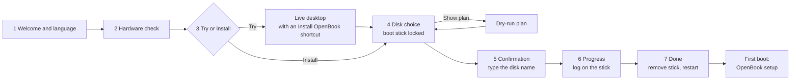

# Installer: USB image, boot chain, install flow and wizard (ANAL-189)

Status as of 2026-10-17. This is the design for milestone M8 (epic ANAL-188). The owner gave the go-ahead to move on to live USB booting on 2026-10-16 (ANAL-189). Stage 2 (ANAL-190, the live USB image) is built: see §11. Stage 3 (ANAL-191: the wizard, the install engine and first-boot setup) is built and tested in QEMU: see §12.

Labels: **C** = confirmed (a primary source, or we ran it), **R** = reported by others, **H** = hypothesis (not tested yet). Evidence is in `evidence/2026-10-16-installer/`, starting with `SUMMARY.md`.

## Recommendation (what the owner is asked to approve)

| # | Decision | Recommendation | Basis |
|---|---|---|---|
| 1 | Image format | **One raw GPT disk image** (`openbook-<ver>-x86_64.img`, shipped as `.img.xz` with a `.sha256`). No hybrid ISO. | Android needs real GPT partitions, found by name and by PARTUUID. The prototype's userdata and metadata were created on first boot and survived a reboot (C). |
| 2 | Loader | **systemd-boot** with Boot Loader Spec type #1 entries: GKI `bzImage`, then the vendor ramdisk, the generic ramdisk, and a bootconfig blob as the last initrd. One entry per slot; A/B tries use systemd-boot's boot counting. A small Android-side `openbook-bootsync` keeps the ESP copy in step with the active slot. **GRUB 2.16** is the tested fallback. **GBL** is the long-term target, once upstream lands USB and multi-disk support. | All four loaders were booted from a USB GPT image in QEMU/OVMF (§2.3, C). |
| 3 | Install layouts | Whole disk (A/B, virtual A/B `super`), or alongside an existing OS **in space the user has already freed**. Our files go under `EFI/OpenBook/` plus an XBOOTLDR partition, and we add a firmware boot entry. Nothing is resized in v1. | §3 |
| 4 | Wizard | **An Android app in the live OpenBook session** (Compose), backed by a privileged install engine with a CLI (`openbook-install`: dry run, JSON plan, logs). There is no separate Linux live system. | Scores in §4 |
| 5 | Safety | Rules S1–S13 in §5. They are enforced in the engine, not just the UI: the boot stick is never a target, the user types the disk name, identity is re-checked before the first write, and there is a dry run and a log. | §5 |
| 6 | Kernel delta | Add `CONFIG_EFIVAR_FS` to the OpenBook GKI (built-in, or a module if the KMI allows), so the installer can create the firmware boot entry. Optionally add `SYSFB_SIMPLEFB`/`DRM_SIMPLEDRM` for a "safe graphics" mode. | **Done another way:** `efivarfs.ko` ships as a vendor module, with the GKI configuration unchanged (ANAL-198, #64), and the installer creates the firmware entry (§12.11). `SYSFB_SIMPLEFB`/`DRM_SIMPLEDRM`: not added |

**Naming.** The project is **OpenBook**: images, boot entries, the installer, its tools and `androidboot.openbook.*` all use that name.
- A few identifiers still carry the old name because running work builds with them today: the `anybook_cf_x86_64_pc` product, `device/anybook`, `kernel/devices/anybook` and the `anybook_amd` KMI list, the `anybook-*` tool images, and the host data dir `~/anybook`.
- They change together in one repo-wide rename once the AOSP and kernel lanes are idle (§7). Evidence logs keep the names they were recorded with.

**This reverses an earlier plan.** The loader and layout here are meant for the whole chain:
- ANAL-198 (kernel packaging: first-stage modules, `vendor_boot`, dlkm images, firmware) fills the boot images that §2.1 and §3.4 describe.
- ANAL-199 (the G14 product, booting in QEMU/OVMF first) can boot through these scripts. `qemu-run.py` already attaches images as USB or NVMe on OVMF.
- ANAL-176 (USB boot on the G14) uses the same loader on hardware. None of them should bring their own.

## 1. Image format

### 1.1 What Android needs
- **Partitions are block devices found by name.** First-stage init mounts `super` with dm-linear and dm-verity from `/dev/block/by-name/*`. ueventd creates those links from each partition's `PARTNAME` uevent. When `androidboot.boot_part_uuid` is set, it only links partitions on the disk holding that PARTUUID; this is in AOSP since 2024-11 and in our `android17-release` tree. That is the *recommended way* in `init/README.ueventd.md`, added by AOSP `519d3f8b` (2024-11), which relies on kernel `74f4a8dc0dd8` "block: add partition uuid into uevent as PARTUUID" (C).
- **This matters for us because a live USB stick and an installed NVMe disk carry the same partition names.** Without `boot_part_uuid`, Android can mount the wrong disk's `super`.

### 1.2 Options

| | Raw GPT `.img` | Hybrid ISO 9660 + El Torito EFI `.iso` |
|---|---|---|
| Written with | Any flasher: dd, GNOME Disks, Rufus (DD mode), balenaEtcher, Raspberry Pi Imager (R) | Same, or burned to optical or attached as a CD-ROM |
| Android partitions | Native GPT partitions: `super`, `vbmeta`, `misc`, `metadata`, `userdata`… | Only as appended partitions after the ISO (xorriso `-append_partition`, at most 8), so too few for about 12 partitions. Used as a real ISO (CD-ROM, Ventoy, loop mount) there are no partitions at all, and first-stage init would need loop-device logic it doesn't have |
| Writable live session | `userdata` and `metadata` are blank in the image; fs_mgr formats them on first boot (`formattable`) and they persist (**C**: f2fs `/data` 3.4 GiB and ext4 `/metadata`, formatted on boot 1 and kept on boot 2) | Read-only medium: `/data` would need tmpfs or zram. Android's file-based encryption needs a real filesystem with fscrypt, so this means extra init work (H) |
| VM testing | Attach as a USB or NVMe disk | CD-ROM, then the same problems |

**Recommendation: raw GPT only.** Ship `openbook-<ver>-x86_64.img.xz` with a `.sha256` and a signature. Keep the expanded image small (about 4–5 GiB): `super` shrunk to its content plus headroom, and a 1 GiB `userdata` that is grown to fill the stick on first boot. Growing it needs a small `exec` service on `late-fs`, before `mount_all --late`, that runs only when the boot disk is removable and `userdata` is blank and last (H, ANAL-190). **Built differently:** `openbook-live-init` grows it before Android starts (§11.2). The minimum stick is 16 GB; 32 GB USB 3 is recommended.

**"Try without keeping anything"** is a boot-menu entry, not a separate image. It sets `androidboot.openbook.live_reset=1`, and an early service then discards the superblocks of `userdata` and `metadata` so fs_mgr formats them again (H).

## 2. Boot chain

### 2.1 What the loader has to hand over

| Item | Where it comes from | Notes |
|---|---|---|
| Kernel | `boot_<slot>` (GKI `bzImage`) | Booted through the EFI stub (`EFI_STUB=y`, C) |
| Initrd | `vendor_boot_<slot>` ramdisk(s), then `init_boot_<slot>` generic ramdisk, then **bootconfig** | The bootconfig trailer (`[data][size][checksum]#BOOTCONFIG\n`) must be the last bytes of the combined initrd; otherwise the kernel says "'bootconfig' found on command line, but no bootconfig found" (C, UKI run) |
| Kernel cmdline | GKI built-in `CONFIG_CMDLINE` (includes `bootconfig`) + `vendor_boot` cmdline | No `androidboot.*` on the cmdline: Android wants them in bootconfig (source.android.com, Implementing Bootconfig, updated 2026-10-09) |
| Static product bootconfig | `vendor_boot` bootconfig section | `androidboot.hardware`, `fstab_suffix`, console, HAL/APEX choices. **GBL reads only the boot images**, so everything static belongs here (C) |
| Runtime bootconfig (loader) | Computed per boot or per install | `slot_suffix`, `force_normal_boot=1`, `verifiedbootstate=orange`, `vbmeta.device_state=unlocked`, `vbmeta.{hash_alg,size,digest,avb_version,invalidate_on_error}`, `veritymode`, `boot_part_uuid`, `serialno`, `openbook.*` |

**lz4 pitfall (C).** The ramdisks are lz4 legacy streams. The kernel's `unlz4` goes straight from one stream to the next magic number, but 1–3 stray zero bytes between streams make it read a bogus chunk length (`lib/decompress_unlz4.c`). GRUB starts every initrd on a 4-byte boundary, and systemd-boot pads them (research, C). So every ramdisk file we put on the ESP is padded to a multiple of 4 with at least 4 zero bytes. A zero chunk length ends the stream cleanly, and initramfs skips the rest (`mkproto.py: copy_padded`).

**AVB in the orange state (C).** On hardware the user owns, with Secure Boot off, the loader reports `orange`/`unlocked`. In Android 17, first-stage init treats `orange` as unlocked: verification errors are allowed, but dm-verity still runs on every `super` partition. The digest and size the loader passes are re-checked by libfs_avb. A wrong digest is logged (`vbmeta digest mismatch`) and boot continues; that is the `grub-bad-digest` run. The digest is computed the way libavb does it: the top-level vbmeta, then every chained vbmeta struct (`boot`, `init_boot`, `vbmeta_system`, `vbmeta_system_dlkm`, `vbmeta_vendor_dlkm`). `avbtool calculate_vbmeta_digest` and our own computation agree.

**The orange notice.** Certified devices show a 10-second orange screen (source.android.com Boot flow, updated 2026-09-30). OpenBook is not a certified device. We show a persistent note in Settings › About and during setup instead.

**What the user sees at boot.** The boot should look calm, with no text:
- **The menu stays hidden** (`timeout menu-hidden`). Holding a key at power-on shows it.
- **The firmware logo stays up.** Our GKI has no `simpledrm`/`efifb` and the cmdline has no `tty0` console, so nothing draws over the firmware logo until amdgpu loads. Then the OpenBook boot animation takes over (frame in §4.1). In QEMU, the OVMF logo stayed on screen from the loader until Android's init (C, `matrix/sdboot/shot-*.png`). On the G14 this should be the ASUS logo (H, ANAL-176).
- **When the menu is shown,** entries read "OpenBook (17 · slot A)". systemd-boot's menu can't be themed. If a graphical menu ever matters more than size and simplicity, GRUB with a theme is the fallback.

### 2.2 Prototype (C)
The scripts are in `scripts/installer/`, and the image is `tools/Dockerfile.installer`: QEMU 11.1.2, edk2-ovmf 202608, GRUB 2.16, systemd 262, mtools, gptfdisk. No root is needed and nothing touches a real disk.
- **Inputs, read-only:** a reflink snapshot of the `anybook_cf_x86_64_pc-cp2a-userdebug` images (ANAL-169) and the OpenBook GKI `6.18.21-android17-5-g44a90255c95f` (ANAL-171/172). The AOSP tree was not built or modified.
- **`mkproto.py`** does the following:
  - Makes `boot.img` from our `bzImage`, signed as a chained partition with the AOSP test key.
  - Makes `vendor_boot` from the product's vendor ramdisk without its 6.12 modules, adding an empty module dir for our release and a probe. Console, `rdinit=/openbook-probe` and the product's static `androidboot.*` go into `vendor_boot`.
  - Rebuilds `vbmeta` with the same chain layout.
  - Lays out a 12 GiB GPT with an ESP, `misc`, A/B `boot`/`init_boot`/`vendor_boot`/`vbmeta*`, `metadata`, an 8 GiB `super` and a blank `userdata`. PARTUUIDs are deterministic, and every copied partition is checked by sha256.
  - Fills the ESP for one loader.
- **`probe-init.c`** is a 0.9 MB static `rdinit`. It logs `/proc/cmdline`, `/proc/bootconfig` and every block device with its PARTNAME, PARTUUID and bus path, waits for the boot disk by PARTUUID as ueventd does, and then `exec`s Android's `/init`. So one boot proves both what the loader passed and how Android used it.
- **`qemu-run.py`** boots the image on q35 with KVM and OVMF, attached as `usb-storage` on xHCI. It can add a **decoy NVMe disk with the same partition names and random PARTUUIDs**, standing in for an installed internal disk. It types commands into the userdebug serial console and takes screenshots.
- **`proto-matrix.sh`** builds and runs every variant; **`proto-summary.py`** tabulates the result.

### 2.3 Results (matrix `matrix-20261016-openbook`, all on the same inputs)

| Variant | Loader | `/proc/bootconfig` | Boot disk chosen | Android | Notes |
|---|---|---|---|---|---|
| `grub` (+ decoy NVMe) | GRUB 2.16 standalone | 28 lines | USB, via `boot_part_uuid` probed at run time (`probe --part-uuid`) | console 20 s after power-on; `/metadata` and `/data` formatted on first boot | by-name links → `sda*`, not the NVMe |
| `grub-2nd-boot` | same stick, second boot | 28 lines | USB | console | no reformat: the live session persists |
| `grub-bad-digest` | GRUB, wrong `vbmeta.digest` | 28 lines | USB | console | `libfs_avb: vbmeta digest mismatch` logged; orange continues |
| `grub-slot-b` | GRUB, grubenv `slot=b` | `_b` | — | probe only | Loads `openbook/b/kernel` (`BOOT_IMAGE=(hd0,gpt1)/openbook/b/kernel`) |
| `sdboot` (+ decoy NVMe) | systemd-boot 262, type #1, menu hidden | 29 lines | USB, `boot_part_uuid` written into the entry's bootconfig | console 17 s after power-on (first-stage init at 4.6 s); first-boot format | Boot counting renamed `openbook-a+3.conf` → `openbook-a+2-1.conf`. The screen keeps the firmware logo the whole time (no text) |
| `sdboot-menu` | the same loader, menu shown | 29 lines | — | probe only | The menu a held key brings up: "OpenBook (17 · slot A)", "OpenBook (17 · slot B)", "Reboot Into Firmware Interface" |
| `uki` | ukify UKI from firmware | **empty** | — | — | The kernel finds no bootconfig: systemd-stub appends its own cpio archives after `.initrd` |
| `gbl` | GBL dev, ci.android.com build 16633196 (`gbl-mainline:6296919847ee`) | 40 lines, generated by GBL | none | **first-stage mount fails** | GBL passes no `boot_part_uuid` or `boot_devices` |
| `gbl-uuid` | GBL, UUID baked into `vendor_boot` bootconfig | 41 lines | USB | console 19 s after power-on | GBL does libavb in orange (key "Invalid", allowed), always slot `a`, and emits per-partition digests |
| `gbl-uuid-decoy` | same, plus decoy NVMe | — | — | **GBL panics** | `Failed to read bootloader message from misc partition: NotUnique`, then reset |

Screenshots:
- `matrix/sdboot/shot-{1,3,5,8,12}.png`: what the screen shows from power-on to Android's init with the menu hidden.
- `matrix/sdboot-menu/shot-3.png`: the systemd-boot menu.
- `matrix/grub/shot-2.png`: the GRUB menu.
- `matrix/gbl-uuid-decoy/shot-20.png`: the GBL panic.

Full serial logs are `matrix/*/serial.log.gz`.

**Limits of the prototype.** This is plain QEMU booting the Cuttlefish `pc` product, so it shows the boot chain only:
- There's no GPU, so we stop at the console. `sys.boot_completed` was not checked.
- Cuttlefish's 6.12 `system_dlkm`/`vendor_dlkm` modules don't load on our kernel.
- Cuttlefish's duplicate vendor APEXes are picked through bootconfig, as cvd does.
- Nothing ran on the G14.
- GBL's console writes failed through a QEMU *socket* serial backend, and GBL then panicked inside its own error printer. With a FIFO or file backend that does not happen, so the runner uses FIFOs. This is an environment quirk, not counted against GBL.

### 2.4 Loader evaluation

| Need | GRUB 2.16 | systemd-boot 262 (type #1) | UKI / systemd-stub | GBL (dev, 2026-10-16) |
|---|---|---|---|---|
| vendor + generic ramdisk + trailing bootconfig | yes, with lz4 padding | yes, with lz4 padding | **no**: stub appends cpio after `.initrd` | yes, natively from boot images v4 |
| `boot_part_uuid` | at run time (`probe --part-uuid`), but only on the cmdline (fs_mgr accepts it; not bootconfig-pure) | static, written by the installer into the entry's bootconfig | — | **no**: open CL 4286120 (2026-10-15) |
| USB stick + installed NVMe with the same names | yes (`$cmdpath`) | yes | — | **no**: `NotUnique` (open CL 4051936) |
| A/B with Android semantics | grubenv strings, no arithmetic; needs ESP sync | **boot counting = tries**; good/bad/indeterminate entries; needs ESP sync | — | Needs firmware `GblEfiBootControlProtocol`; without it, always slot `a` ("only supported on dev GBL") |
| AVB | none in the loader; digest precomputed | none in the loader; digest precomputed | none | **full libavb**: orange, per-partition digests |
| OTA by update_engine (writes `boot_b` etc.) | needs `openbook-bootsync` | needs `openbook-bootsync` | — | native |
| Dual boot | chainload anything, menus, themes | lists Windows Boot Manager on the same ESP automatically; `efi` entries chainload others | — | none (chainload it from a menu) |
| Size, complexity | 0.9 MB standalone with our module set (C); scripting; long CVE history | 157 KB (C), declarative | — | 2.2 MB (C) |
| Licence | GPL-3.0-or-later | LGPL-2.1-or-later | LGPL-2.1+ | Apache-2.0 |
| Ship today? | yes | yes | no | **No.** The dev build "can't be shipped", and the prod build needs vendor AVB/BootControl protocols |

**Choice: systemd-boot now.** It is small and declarative, its boot counting maps onto Android's A/B tries, and everything goes into bootconfig. GRUB passed the same tests and stays the fallback, for example if we need richer menus, theming, or GRUB's run-time `boot_part_uuid`.

**GBL later.** It reads the boot images, runs libavb, and is Google's direction. Switch when three things are true: CL 4051936 (pick the disk GBL was loaded from) has landed, CL 4286120 (`boot_part_uuid`) has landed, and we have a BootControl provider, either upstream or a small OpenBook EFI driver backed by `misc`. systemd-boot would then chainload GBL (`efi /EFI/OpenBook/gbl_x86_64.efi`), or the firmware entry points straight at it.

### 2.5 A/B and updates with systemd-boot (design, H)
- **Source of truth:** the Android partitions (`boot_x`, `init_boot_x`, `vendor_boot_x`, `vbmeta_x`). `super` uses virtual A/B with compression, so there is one copy, and the OTA's copy-on-write data lives in `/data`.
- **ESP mirror:** `openbook/<slot>/{kernel, vendor_ramdisk.img, ramdisk.img, bootconfig.img}`. Entry `loader/entries/openbook-<slot>[+N[-M]].conf` lists the three initrds with bootconfig last.
- **`openbook-bootsync`**, a native tool in its own SELinux domain. GKI has `VFAT_FS=y`, C. It runs:
  - **After update_engine postinstall:** export slot B's boot images to the ESP, compute B's vbmeta digest, write `openbook-b+3.conf`, and make it the default.
  - **On `markBootSuccessful`:** rename the entry to `openbook-b.conf` ("good").
  - **On a failed boot:** systemd-boot itself lowers the count and, at `+0`, sorts the entry last, so slot A boots again.
- **Boot control HAL:** `android.hardware.boot-service.openbook` = AOSP `libboot_control` (`misc`, already working: "Invalid boot control found… Re-initializing" on first boot, C) plus calls into bootsync.
- **Live USB:** slot A only, and no OTA; you re-flash instead. Whether Android 17 is happy with no `_b` partitions at all is checked in ANAL-190; the fallback is tiny `_b` partitions (H). **Checked:** a slot-A-only stick boots as far as the A/B image does (§11.4, C).

### 2.6 Firmware entry, cmdline and Secure Boot
- **On the USB stick:** systemd-boot at `EFI/BOOT/BOOTX64.EFI`, the removable-media path, so no NVRAM change is needed.
- **Installed:**
  - systemd-boot goes to `EFI/OpenBook/systemd-bootx64.efi`, and we add an NVRAM `Boot####` entry named "OpenBook". The fallback `EFI/BOOT/BOOTX64.EFI` is written only on a whole-disk install.
  - Creating the NVRAM entry from Android needs efivarfs. **Built (§12.11):** `efivarfs.ko` (ANAL-198) and the installer's `Boot####` entry, appended to `BootOrder`, or first only with consent (owner decision 2026-10-17).
- **Secure Boot must be off** for now. Later: sign systemd-boot and the kernel with an OpenBook key and enroll it via shim/MOK (H).

### 2.7 Test stick for a first hardware check (G14)
`scripts/installer/make-hwcheck-stick.sh` builds `openbook-hwcheck-<date>.img` (11 GiB, about 1 GB as `.img.xz`). It holds the same boot chain as the prototype (systemd-boot, our 6.18 kernel, `boot_part_uuid`, orange AVB) with two menu entries:

- **"OpenBook hardware check"** (default after 8 s) is for the laptop. The probe (`probe-init.c`, `openbook.probe=report`):
  1. Records the firmware identity (DMI, without serials), CPU (incl. AVX-VNNI), memory, PCI devices and the bootconfig the loader passed.
  2. Writes a first copy of the report to the stick, so a hang still leaves results.
  3. Loads our module set (ANAL-172's dependency-resolved set for this exact kernel: GKI + the 138 OpenBook modules) with the firmware subset (ANAL-171). It loads dependencies first and skips a safety list: the cs35l56 speaker-amp drivers (they download DSP firmware and tuning to the amps; the check plays no audio, and ANAL-179 validates the speakers), asus-wmi/asus-nb-wmi/hid-asus (they can change firmware settings), and test modules.
  4. Waits 10 s, then records which drivers bound and the `drm`, `net`, `bluetooth`, `sound`, `backlight`, `power_supply`, `typec` and input devices.
  5. Writes `openbook/logs/hwcheck-NNN.txt` and `-dmesg.txt` to the stick and powers off.

  It only mounts the ESP whose PARTUUID is `boot_part_uuid`, and only if that partition is on USB. It never writes to the laptop's disks. GKI has no devtmpfs, so the probe makes that one device node itself from sysfs.
- **"OpenBook preview (virtual machines only)"** is the Android 17 boot from §2.3, with the console on the serial port. It shows nothing on a laptop: this preview has no graphics stack for real hardware yet. That arrives with ANAL-174/198/199.

**Tested in QEMU on the final image (C, `evidence/2026-10-16-installer/hwcheck-stick/`):** the check loaded 236 modules (0 failed, 29 skipped), wrote the report and kernel log to the stick, and powered off after 23 s, with the decoy NVMe untouched. The preview entry reached the Android console.

**Run on the G14 (C, `evidence/2026-10-16-g14-hwcheck/SUMMARY.md`).** The owner's first run:
- UEFI → systemd-boot → our kernel; 235 modules loaded, 0 failed.
- These came up:
  - amdgpu: SMU, DCN 3.5 and DMUB, the eDP panel with PSR, and backlight;
  - mt7925e with `wlan0`, Bluetooth `hci0`, and the ELAN touchpad;
  - the keyboard, lid switch, NPU `accel0`, battery, UCSI and USB4.
- The stick also booted the preview entry: Android's first and second stage ran from USB on the laptop.
- Findings:
  - `regulatory.db` was missing;
  - the dGPU's HDMI-audio function is bound;
  - the backup GPT isn't at the end of a larger stick;
  - power and display facts weren't recorded.

**v2 (`make-hwcheck-stick.sh`, `openbook-hwcheck-20261016b`).**
- **Probe:** runs from the check initrd (`rdinit=/openbook-check/probe`). It adds the CPU frequency driver and EPP, sleep states, connected displays and modes, backlight, battery health, the dGPU's PCI power state and runtime status, and temperatures. It writes `hwcheck-NNN.json` (schema `openbook-hwcheck/2`) next to the text report.
- **Firmware:** `regulatory.db` with its licence is added.
- **"OpenBook hardware check + sleep test":** one RTC-woken suspend of 20 s. The stick is unmounted while asleep. It records time asleep, `suspend_stats` and the AMD PMC s0ix counters.
- **Updating a stick flashed from v1:** v2 changes only `openbook/check/`, the check entries and the README. `update-hwcheck-stick.sh /dev/disk/by-id/usb-… <bundle>` copies them onto the stick's OPENBOOK partition with udisks. It checks the by-id path, the ESP PARTUUID, the label and an existing OpenBook entry first, then verifies the copy with sha256.
- **Tested in QEMU (C, `hwcheck-stick/v2/`):** the update bundle applied to the exact image the owner flashed:
  - the check loads 236 modules and writes the JSON;
  - the sleep entry slept 19.8 s, woke on the RTC alarm and wrote its result (QEMU uses S3; the G14 offers s2idle only);
  - shared reports are redacted: USB serial numbers are blanked in the kernel log, and partition UUIDs are shown only for the stick;
  - the fresh v2 image passes the check too.

**G14 runs 2 and 3 (v2, C, `evidence/2026-10-16-g14-hwcheck/`).**
- amd-pstate-epp is active.
- s2idle is the only sleep state, and a suspend/resume cycle works (18.2 s, no errors after resume).
- **S0ix residency stayed 0** ("Last suspend didn't reach deepest state").
- The dGPU and its HDMI-audio function stay D0/active.
- Battery health is 88.7 %, and `regulatory.db` now loads.

**v3 (`openbook-hwcheck-20261016c`)** adds a fourth entry, "OpenBook sleep test, NVIDIA GPU powered down". For this boot only, it unbinds the dGPU's HDMI-audio function, removes both NVIDIA functions, and sets the root port to runtime PM (`docs/nvidia.md` §1, option 2). It then repeats the sleep test.
- The JSON (`openbook-hwcheck/3`) adds `dgpu_detach` (bridge power state before and after) and `s0ix_residency_us`.
- The report adds the AMD PMC firmware info and every PCI function still awake right before suspend.
- Connectors that read "unknown" are probed before they're reported.
- **Tested in QEMU:** the detach path was run against a virtio device behind a PCIe root port (unbind, remove and runtime PM all succeed; QEMU's port has no `_PR3`, so it stays D0), and the sleep test ran after it.

**G14 run 4 (v3).**
- The eDP panel is detected (2880×1800).
- The dGPU detach works, but its bridge only reaches D3hot.
- **S0i3 is still not reached** (the SMU reports "Last S0i3 Status: Unknown/Fail").
- The firmware re-enumerates the dGPU on resume.

**v4 (`openbook-hwcheck-20261016d`).** The sleep entries turn on `pm_debug_messages` and dynamic debug for amd_pmc, pinctrl_amd and the ACPI LPS0 code, and dump amd_pmc's idle mask and the wakeup sources. The detach step waits for the bridge's final power state (`openbook-hwcheck/4`). Tested in QEMU like v3.

**G14 run 5 (v4).**
- The dGPU's bridge reaches **D3cold**, and S0i3 is **still not reached**.
- The kernel's LPI check names one unmet constraint: `\_SB_.PCI0.GPP0.SWUS` stays D0 (HYPOTHESIS: the child of the empty hotplug port `00:01.1`, not the dGPU).

**v5 (`openbook-hwcheck-20261016e`).** Each PCI line carries its ACPI path. The sleep entries list ACPI device power states and power resources before the detach, before suspend and after resume. Tested in QEMU on a v4 image updated with the v5 bundle.

**G14 run 6 (v5).**
- `GPP0` is `00:01.1`, the empty hotplug port; the dGPU is `GPP9.PEGP` on `00:03.1`.
- `GPP0.SWUS` has no device, yet stays D0 with its power resource on through the whole cycle. The kernel powered it up to scan behind the bridge (`acpi_dev_power_up_children_with_adr()`), and nothing powers it down again.

**v6 (`openbook-hwcheck-20261016f`).**
- Entry 3 ("NVIDIA GPU + unused port powered down") also loads a test-only module (`scripts/installer/kmod/`, built by `build-check-kmod.sh` against the check kernel). The module puts `GPP0.SWUS` into D3cold before the sleep test.
- Tested in QEMU: once with the real entry, and once with a fixture SSDT (`acpi-d3cold-test.asl`) that recreates the unused, powered `_ADR` child; the module turns it off.
- Building it needs `make`, `flex`, `bison`, `bc`, `pahole` and `acpica` in the installer image (`tools/Dockerfile.installer`). Until the shared image is rebuilt from that file, use `OPENBOOK_INSTALLER_IMAGE=openbook-installer:anal189`.

**G14 run 7 (v6).**
- The module powered `GPP0.SWUS` down on the laptop, and every LPI constraint was met.
- S0i3 was still not reached, with the same SMU idle mask as runs 5 and 6. `GPP0.SWUS` is ruled out.
- The S0i3 investigation moves to ANAL-178. The deciding next test is `amd-s2idle` on the owner's Linux on the same laptop.
- S0i3 does not block live USB booting or installation (ANAL-190, ANAL-176).

**v7 (ANAL-178).** The probe runs several sleep cycles in one boot with a bisect (`openbook.probe.s0i3_steps`), two more test-only modules (an S0i3-entry PCI snapshot, PCI power management for driverless functions), and per-cycle JSON (`openbook-hwcheck/6`). It ships as an add-on for the live stick instead of a separate stick image (`scripts/power/`, `docs/power-input.md` §1.4).

## 3. Install flow

### 3.1 Live USB layout (ANAL-190)

| Partition | Size | Content |
|---|---|---|
| `EFI` (ESP, FAT32, label `OPENBOOK`) | 256 MiB | systemd-boot, `loader/`, `openbook/a/*`, `openbook/logs/` (install logs and hardware reports land here) |
| `misc` | 1 MiB | zeros (boot control and BCB) |
| `boot_a`, `init_boot_a`, `vendor_boot_a`, `vbmeta_a` | 64 / 8 / 64 / 1 MiB | images |
| `metadata` | 64 MiB | blank, becomes ext4 on first boot |
| `super` | content + about 10% (about 3 GiB, H; the prototype's dynamic partitions hold 1.6 GB) | dynamic partitions, slot A |
| `userdata` | 1 GiB in the image, grown at first boot | blank, becomes f2fs on first boot |

Bootconfig on the stick adds `androidboot.openbook.live=1`. With it, the launcher shows "Install OpenBook" and the installer app is enabled (ANAL-191).

The built layout differs in two places: `misc` is 4 MiB, and `super` is the product's dynamic partitions re-packed to their content plus 64 MiB (1.26 GiB for today's G14 product). See §11.1.

### 3.2 Whole-disk layout (installed)

| Partition | Size | Notes |
|---|---|---|
| `EFI` | 512 MiB | systemd-boot, two slots of boot artifacts (46 MB per slot in the prototype: kernel 27 MB, vendor ramdisk 18 MB, generic ramdisk 3 MB), room for GBL later |
| `misc` | 4 MiB | as on Googlebook |
| `boot_a/_b` | 64 MiB each | GKI `bzImage` is 27 MB |
| `init_boot_a/_b` | 8 MiB each | |
| `vendor_boot_a/_b` | 64 MiB each | first-stage modules plus vendor ramdisk |
| `vbmeta_a/_b` | 1 MiB each | Fold `vbmeta_system*` into one `vbmeta` as Googlebook does (product decision for ANAL-174); otherwise add three 1 MiB pairs |
| `metadata` | 64 MiB | metadata encryption keys, OTA state |
| `super` | 12 GiB | virtual A/B with compression, the same size as Googlebook's |
| `userdata` | the rest | blank, formatted on first boot |

About 13 GiB is fixed. The minimum disk is 64 GB (H; set it once ANAL-174's image size is known). New random disk GUID and PARTUUIDs; partition type `0FC63DAF` (Linux data) except the ESP, so other OSes don't mount them.

### 3.3 Alongside an existing OS
- **v1 never moves or shrinks anything.** The user frees space first, with Windows Disk Management or GParted, and the wizard shows how much is needed (64 GB). OpenBook partitions go into the largest unallocated extent.
- **ESP:**
  - Reuse the existing ESP for `EFI/OpenBook/systemd-bootx64.efi` only (157 KB).
  - Kernels and entries go to a new **XBOOTLDR** partition (512 MiB, FAT32, type `bc13c2ff-59e6-4262-a352-b275fd6f7172`) on the same disk. Windows ESPs are often only 100–260 MB (R).
  - If the disk has no ESP, create a 512 MiB one.
- **Menu:**
  - systemd-boot lists Windows Boot Manager automatically when it's on that ESP.
  - For other loaders (GRUB, Limine) we add an `efi` chainload entry.
  - **BootOrder:** OpenBook's entry is appended at the end, so the system that starts now stays the default and OpenBook is in the firmware's boot menu. It goes first only if the user ticks "Start OpenBook by default", which is off by default when alongside (owner decision 2026-10-17, §12.11).
- **The OpenBook disk and the Android partitions must be the same disk,** because `boot_part_uuid` points at it. If the only ESP is on another disk, create one on the OpenBook disk.

### 3.4 Firmware subset and vendor modules
- **First-stage modules** (`vendor_boot` ramdisk, `lib/modules/<release>/`): only what's needed to reach `super`. On the G14 that is nothing: NVMe, xHCI, usb-storage and uas are built into GKI (C). Keep the directory non-empty with at least one module, or empty it in the product. First-stage init falls back to the flat `/lib/modules/modules.load` when the release directory loads nothing, and a vermagic error there is fatal (C, `first_stage_init.cpp`; we hit it).
- **Second stage:** the 138 OpenBook modules (amdgpu, mt7925e, i2c-hid, sound…) go in `vendor_dlkm`, and the GKI modules from the same build in `system_dlkm`. The rule from ANAL-172 holds: the `bzImage` and `system_dlkm` must come from one dist.
- **linux-firmware subset** (131 files, 52.5 MB, ANAL-171):
  - Lives in `/vendor/firmware`, uncompressed (`FW_LOADER_COMPRESS` is off), with `firmware_class.path=/vendor/firmware`.
  - The licence files and WHENCE go under `/vendor/firmware/` and into NOTICE.

### 3.5 Install engine steps (`openbook-install`, used by the app and by test automation)
1. **`disks`** (read-only inventory):
   - Model, vendor, serial, WWN, size, bus and removable flag, read from sysfs. The `by-id` name is computed in udev's format, for example `nvme-SK_hynix_PVC10_<serial>`, because Android has no `/dev/disk/by-id`.
   - The partition table: names, types, labels, filesystems detected from superblocks.
   - The **boot disk** is marked: the one holding `ro.boot.boot_part_uuid`.
2. **`plan --target <by-id> --layout whole|alongside [--json]`** computes every operation: offsets, sizes, sources and their sha256, and what is erased. It opens the target `O_RDONLY`. This is the dry run, and the "Show plan" button.
3. **`apply --plan plan.json --confirm-disk <by-id>`** re-computes the plan and refuses if it differs. Then:
   1. Verify the source partitions on the stick against the image manifest.
   2. Whole disk: wipe the old primary and backup GPT and the protective MBR first, so an interrupted install leaves a clearly blank disk, not a half-valid one.
   3. Write partition contents. `super` is copied sparsely.
   4. Write the new GPT.
   5. Zero `misc`, `metadata` and `userdata` headers.
   6. ESP or XBOOTLDR: systemd-boot and boot artifacts, plus an entry whose bootconfig has the new `boot_part_uuid`, the vbmeta digest, a new random `serialno`, and the locale and keyboard picked in the wizard (`androidboot.openbook.locale`, `.keyboard`).
   7. Add the NVRAM entry when efivarfs is available.
   8. **Read back** every written partition and compare hashes.
   9. Write a JSON report.
4. **Logs:** an append-only log and `install-<UTC>.json` go to the stick's `openbook/logs/`, and a copy goes to `/metadata/openbook/` on the new system (copied on first boot). No secrets are logged.

**Built (ANAL-191, §12):** all of the above except the copy into `/metadata` (the report is on the new ESP's `openbook/logs/` instead). The NVRAM entry came with efivarfs (§12.11).

### 3.6 First boot and setup
- `/metadata` and `/data` are created on first boot, as in the prototype. Android then starts its setup flow.
- **Google's SetupWizard is not in AOSP:** AOSP 17 only has the `setupcompat`/`setupdesign`/`setupwizard` libraries and `Provision`, which only sets the provisioned bit (C).
- OpenBook therefore needs its own small setup app, built on those libraries: language (pre-selected from `ro.boot.openbook.locale`), Wi-Fi, user and screen lock, privacy. No Google account step. **Built (ANAL-191, §12.4):** language, Wi-Fi and screen lock, in the installer app; it uses Compose, not the `setupdesign` libraries.

## 4. Wizard technology

| Score 1–5 | (a) Android app in the live session (Compose) | (b1) Linux live system + Calamares 3.4.3 | (b2) Linux live system + custom Qt Quick app |
|---|---|---|---|
| Polish / same look as the OS | **5**: the same toolkit and theme; "Try" then "Install" in one session | 3: QML branding, but a different OS look | 4 |
| Size added to the image | **5**: about 5 MB (app and engine) | 2: a second kernel and Qt userspace, about 250–350 MB (H) | 2 |
| Licence | **5**: Apache-2.0, AOSP Compose prebuilts (C) | 4: GPL-3.0-or-later; fine, but the source must ship | 4: Qt LGPL-3; avoid GPL-only modules such as Virtual Keyboard (C) |
| Effort | 2: privileged engine daemon, SELinux, efivarfs, setup app | 3: existing modules, but Android partitions need a custom module; `rawfs` picks targets by mount point (C) | 2 |
| Accessibility | 3: Compose semantics, but no screen reader in AOSP; TalkBack is Apache-2.0 on GitHub and would need building (C) | 2: Orca support open since 2019 (#1294), Tab navigation bug #2531 open (C) | 3: Qt `Accessible` + AT-SPI/Orca |
| Hardware support | 2: needs OpenBook's own graphics and input. GKI has no `simpledrm`/`efifb`, so nothing shows until amdgpu loads (C) | **5**: generic kernel, simpledrm, any GOP display | **5** |
| **Total** | **22** | 19 | 20 |

**Choice: (a).**
- If the wizard can run, OpenBook can run on that machine. The hardware check also tests the drivers that matter after install (Wi-Fi, touchpad, audio, suspend), not a different kernel's.
- For machines where the display doesn't come up, the boot menu has **"Hardware report (text)"**. It boots with `androidboot.openbook.diag=1`, writes a report to the stick's `openbook/logs/`, and powers off (H, ANAL-191).
- The same `openbook-install` engine runs unattended for the device agent (PLAN §4a), with JSON output.
- Revisit (b2) if "tell users on unsupported hardware why" becomes a goal (NVIDIA-only laptops), or if decision 6's simpledrm is rejected.

### 4.1 Screens



**High-fidelity design:** `docs/installer-design/index.html`. Open it in a browser for the gallery, or use `?screen=<id>[&theme=dark]` for one screen. The renders are in `docs/installer-design/png/` (`gallery.png` shows everything); `scripts/installer/render-design.sh` re-renders them.
- **Design language:** Material 3 Expressive in an OpenBook desktop window: Roboto Flex, Material Symbols Rounded, tonal surfaces, pill buttons, and a wavy progress indicator.
  - The light and dark themes come from one seed colour (`#4A5BD4`). The window sits on the live desktop with its taskbar.
  - This is buildable from AOSP alone: `external/roboto-flex-fonts`, Compose Material 3 and `material-icons-extended` are in the tree (C).
- **Brand:** the OpenBook mark is two pages opening from a spine, with a spark. It is used in the window, the taskbar and the boot animation.
- **Sample data.** Hardware states, sizes and times on the screens are illustrations, not test results.

| Screen | What it does | Safety it carries |
|---|---|---|
| 1 Welcome and language | Brand panel, language list with native names, a keyboard test field, and accessibility toggles from the first screen | "Nothing on this computer changes until you say so" |
| 2 Hardware check | One verdict, then a tile per component (Ready, Quieter, New, Off) in plain words; "Save report to USB" | A report for support and the device agent |
| 3 Try or install | Two large illustrated choices | Try never touches the internal disk |
| 4 Disk | A card per disk with what is on it today; erase or alongside; an explainer for keeping Windows | **The boot stick is locked** (S1); "View the plan" is the dry run (S5) |
| 5 Confirm | What gets erased, before and after, the full `by-id`, and the typed model name | The red button enables only on a match and is never the default focus (S2–S4) |
| 6 Install | Percentage, wavy progress, the engine's steps, and a tip card | Charger state (S8); the log path on the stick (S6) |
| 7 Done | Read-back result, boot entry, report; "Restart now" | Verification result shown (S9) |
| Boot | The OpenBook boot animation frame after the firmware logo | — |

## 5. Safety rules (enforced by the engine; the UI only reflects them)
- **S1. Never the boot medium.** Refuse any disk holding the partition whose PARTUUID is `ro.boot.boot_part_uuid`. Also refuse any disk with a mounted filesystem, and read-only disks. This is checked again at `open()` time.
- **S2. Show identity.** Show model, vendor, size (GB and GiB), bus, serial (last 4 characters, full in details), the `by-id` name in udev format, and the current partitions with names, types, filesystem labels and detected OS ("Windows", "Linux"). List exactly what will be erased.
- **S3. Typed confirmation.**
  - Interactive: the user types the model name; case and whitespace are normalised.
  - Unattended: `--confirm-disk /dev/disk/by-id/…` must equal the target exactly, **and** `OPENBOOK_INSTALL_ERASE=<same by-id>` must be set. This matches the project rule that a write needs an explicit confirmation naming the `by-id` device.
- **S4. Re-check before the first write.** Serial, size, WWN and a hash of the partition table must be unchanged since the confirmation; otherwise abort.
- **S5. Dry run.** `plan` and `--dry-run` open the target read-only and print every operation (offset, length, source, sha256). The UI's "Show plan" is the same output.
- **S6. Logs.** An append-only text log plus a JSON report on the stick, copied to the new system. Every command and result is logged. No passwords, Wi-Fi keys or account data.
- **S7. Alongside never destroys.**
  - Never delete, format, move or resize existing partitions.
  - Write only `EFI/OpenBook/` and `loader/entries/openbook-*.conf` on a shared ESP.
  - Never overwrite `EFI/BOOT/BOOTX64.EFI` there.
  - Put OpenBook first in BootOrder only with consent; without it, OpenBook is appended (S11).
- **S8. Power.** Require AC power, or battery ≥ 50%.
- **S9. Interruption.**
  - The order above means a cut leaves either the old table (before step 2) or a blank disk (before step 4). The installer can be restarted from the stick.
  - A failed read-back marks the install as failed and doesn't create the boot entry.
- **S10. Source integrity.** The stick's partitions are hashed against the signed manifest before copying, and the install is refused on a mismatch. This catches a bad flash or a failing stick.
- **S11. No firmware writes.** Never write SPI flash or capsules, never change Secure Boot keys, and never change firmware settings. The only NVRAM writes: adds one `Boot####`; appends it to `BootOrder`, or puts it first only with consent (owner decision 2026-10-17). Never overwrites or deletes another entry.
- **S12. Minimum sizes.** Refuse targets below the minimum. Warn about, but never touch, BitLocker, LUKS or other encrypted volumes in alongside mode.
- **S13. External targets.** USB or Thunderbolt disks other than the boot stick are allowed, with an extra warning.

## 6. Licensing checklist for a public image

| Item | Licence | Ship? | Obligation |
|---|---|---|---|
| AOSP 17 platform built from source | Apache-2.0 and others (per-module NOTICE) | yes | NOTICE in Settings › Legal; GPL/LGPL parts (e2fsprogs `mke2fs`, f2fs-tools, …) need a source offer |
| OpenBook GKI + 138 vendor modules | GPL-2.0 | yes | **Corresponding source** (kernel tree, our 3 patches, config, `kernel/devices/anybook`) per release, plus a written offer or a tarball next to the image for 3 years |
| linux-firmware subset (131 files) | per WHENCE: LICENSE.amdgpu, LICENCE.mediatek, LICENSE.amdnpu, LICENCE.rtlwifi_firmware.txt, LICENSE.cirrus | yes | Ship the licence files and WHENCE with the files; no modification |
| Mesa radeonsi/RADV | MIT; **libelf LGPL-3.0+** | after decision | **Open decision:** link libelf as a shared library (recommended, `docs/mesa.md`) |
| Digitalis (if Track A ships it) | Apache-2.0 | yes, built from source | Never the DigitalisX64 sample-app SDK binary |
| systemd-boot | LGPL-2.1-or-later | yes | Source offer for the exact version |
| GRUB (only if used) | GPL-3.0-or-later | fallback | Source offer; GPLv3 installation-information rules if ever shipped on locked hardware (not our case) |
| GBL (later) | Apache-2.0 (+ third-party LICENSE from its build) | later | Build from source; ship its LICENSE |
| Roboto Flex (UI font) | OFL-1.1 | yes, from AOSP `external/roboto-flex-fonts` | Keep the licence text |
| Material Symbols / Compose icons | Apache-2.0 | yes, via Compose `material-icons-extended` | NOTICE |
| Installer app, engine, bootsync | ours | yes | Repo licence decision (Apache-2.0 suggested; files already carry SPDX Apache-2.0) |
| **Never ship** | — | no | GMS, Google apps, SetupWizard, Play services, libhoudini, libndk_translation, Googlebook recovery images or parts of them, vendor blobs without a redistribution licence, the CS35L56 tuning blob (not public anyway) |
| AVB keys | — | — | Release images must not be signed with the AOSP test key. **Open:** who holds the OpenBook release key |
| Names and marks | — | — | The product is **OpenBook**. **Open:** a trademark check of "OpenBook" before any public image, the use of "Android", and no "Googlebook" in naming so no endorsement is implied |

**Blocking decisions before any public image** (from `docs/STATUS.md`): the repo licence and Mesa libelf linkage. Added here: AVB key custody and a trademark check of the OpenBook name.

## 7. Open questions for the owner
1. Approve decisions 1–5 above (format, loader, layouts, wizard, safety rules).
2. Decision 6 (kernel lane): add `CONFIG_EFIVAR_FS`. Also add `SYSFB_SIMPLEFB`+`DRM_SIMPLEDRM` for a safe-graphics boot entry?
3. Alongside installs v1: no resizing (the user frees space first). OK?
4. Who holds the OpenBook AVB release key, and do test-key images stay userdebug-only?
5. A trademark check of "OpenBook" before any public image.
6. **The repo-wide rename to OpenBook.** Rename `device/anybook` → `device/openbook` and the `anybook_*` products → `openbook_*` (with `PRODUCT_BRAND`, which ends up in build fingerprints). Also `kernel/devices/anybook` and the `anybook_amd` KMI list, the `anybook-*` tool images, `ANYBOOK_HOME`, and `~/anybook` → `~/openbook`.
   - Doing it while ANAL-174 (AOSP lane) and ANAL-198 (kernel lane) are mid-build would break their runs, so it should be one coordinated change when both lanes are idle.
   - Evidence logs keep the names they were recorded with.
   - The installer already uses OpenBook everywhere.

## 8. Next steps (once signed off)
- **ANAL-199 / ANAL-176.** Boot the G14 product with systemd-boot entries generated the way `mkproto.py --loader sdboot` does, first in QEMU (`qemu-run.py`), then from a stick on the G14. Use the dGPU-off default from ANAL-187 (`docs/nvidia.md`).
- **ANAL-190 (live USB image).** Built: §11. Build from the real G14 product (ANAL-174/199), not the Cuttlefish one. Includes:
  - systemd-boot entries generated from the product's `vendor_boot`;
  - a slot-A-only layout;
  - the `userdata` grow service and `openbook.live`;
  - QEMU tests with these scripts, then a G14 USB boot. Writing the stick needs the owner's confirmation naming its `/dev/disk/by-id/…`.
- **ANAL-191 (wizard and engine).** The `openbook-install` engine (disks, plan, apply, JSON), `openbook-installd` with SELinux, the Compose app (7 screens), `openbook-bootsync` with the boot control HAL, the setup app, and the text hardware report. **Built (§12):** the engine, the daemon, the app and the setup screen. Still open: `openbook-bootsync` and the text hardware report.
- **ANAL-192 (end-to-end tests).** In QEMU:
  - install from the USB image onto an NVMe image file, then boot the installed disk with the stick removed and again with it present;
  - alongside, with a Windows-like ESP image;
  - interrupted installs at each step;
  - an OTA slot switch with boot counting;
  - an unattended run for the device agent.

  **Done in QEMU (§13)**, except the OTA slot switch, which waits for `openbook-bootsync`.
- **GBL watch.** Re-test when CLs 4051936 and 4286120 merge (`MATRIX_ONLY=gbl scripts/installer/proto-matrix.sh`).

## 9. Reproduce
```bash
docker build -t openbook-installer -f tools/Dockerfile.installer tools
scripts/installer/render-design.sh                           # design PNGs (fetches Roboto Flex + Material Symbols, not committed)
scripts/installer/make-hwcheck-stick.sh                      # the G14 test stick image (§2.7) into <data dir>/installer/out/
scripts/installer/snapshot-inputs.sh cf-pc-20261016          # reflink snapshot of PRODUCT_OUT + kernel dist (refuses while an AOSP build runs)
# GBL dev EFI (Apache-2.0) for the gbl variants, from ci.android.com aosp_uefi-gbl-mainline build 16633196:
mkdir -p ~/anybook/installer/dl/gbl-16633196 && curl -L -o ~/anybook/installer/dl/gbl-16633196/gbl_x86_64_dev.efi \
  https://ci.android.com/builds/submitted/16633196/gbl_efi_dist_and_test/latest/raw/gbl_x86_64_dev.efi
MATRIX_EVIDENCE=$PWD/evidence/2026-10-16-installer/matrix scripts/installer/proto-matrix.sh cf-pc-20261016 matrix-20261016-openbook
```
- **Cost:** about 20 s to build each image and 20–25 s for each Android boot, under 10 minutes for the whole matrix.
- **Disk:** each image is a 12 GiB sparse file with about 2 GB of data.
- **Logs:** `~/anybook/logs/installer/<run>/`.

## 10. Sources (accessed 2026-10-16)
- **Bootconfig, AVB, boot flow:**
  - source.android.com/docs/core/architecture/bootloader/implementing-bootconfig (updated 2026-10-09)
  - source.android.com/docs/security/features/verifiedboot/boot-flow (updated 2026-09-30)
  - `external/avb` README and `libavb/avb_cmdline.c`
  - docs.kernel.org/admin-guide/bootconfig.html
- **`boot_part_uuid`:**
  - AOSP `519d3f8b` "fs_mgr: Add getter for androidboot.boot_part_uuid" (2024-11-05)
  - kernel `74f4a8dc0dd8`
  - local tree `system/core/init/devices.cpp`, `block_dev_initializer.cpp`, `system/fs/fs_mgr/libfstab/fstab.cpp` (android17-release)
- **GBL:**
  - android.googlesource.com/platform/bootable/libbootloader, branch `gbl-mainline` (head `6296919847ee`, 2026-10-16); `gbl/docs/efi_integration.md`, `partitions.md`
  - source.android.com/docs/core/architecture/bootloader/generic-bootloader (updated 2026-10-09)
  - Open CLs android-review 4051936, 4286120, 4259565, 4279441
  - ci.android.com `aosp_uefi-gbl-mainline` build 16633196
- **systemd-boot:** uapi-group.org Boot Loader Specification; systemd v262 `src/boot/boot.c` (`initrd_prepare`) and `stub.c`; the boot-counting docs.
- **GRUB:** `grub-core/loader/linux.c` (initrd alignment); the GRUB manual (grubenv).
- **Calamares:** codeberg.org/Calamares/calamares v3.4.3 (2026-09); issues #1294, #2531.
- **Qt:** doc.qt.io Qt 6 licensing and accessibility.
- **AOSP:** `packages/apps/Provision`; `prebuilts/sdk/current/androidx/m2repository/androidx/compose`; github.com/google/talkback (Apache-2.0).
- **Other installers:**
  - ChromeOS Flex: support.google.com/chromeosflex/answer/11550703
  - Android-x86: android-x86.org/installhowto.html
  - Bliss OS: docs.blissos.org/installation/install-from-bootable-usb
- **Googlebook (ruby) image, inspected locally and not redistributed:**
  - The `EFI-SYSTEM` and `KERN-A` partitions in the recovery image are all zeros.
  - `ota_recovery_a` holds a nested GPT whose `boot_a` (an Android boot image) carries the ChromeOS kernel type GUID.
  - So Googlebooks boot from a loader in firmware, not from the disk. There is nothing on the disk for us to reuse (C).

## 11. Live USB image (ANAL-190)

Status as of 2026-10-16. Evidence is in `evidence/2026-10-16-installer/live/` (build and QEMU) and `evidence/2026-10-16-installer/g14-live/` (the first G14 live boot, §11.10), each starting with `SUMMARY.md`.

### 11.1 What `scripts/installer-image.sh` builds

```bash
scripts/installer-image.sh                       # from <data dir>/aosp/src/out/target/product/anybook_g14
scripts/installer-image.sh --menu-timeout 10     # the same, with the boot menu shown for 10 s (test sticks; `openbook-live-20261016a` is built this way)
scripts/installer-image.sh --inputs <snapshot>   # rebuild from an earlier snapshot (byte-identical output)
```

It snapshots the product's `boot`, `init_boot`, `vendor_boot`, `vbmeta` and `super` images from `PRODUCT_OUT` (reflinks; it refuses while an AOSP build runs), builds and tests `openbook-live-init`, and assembles the image with `scripts/installer/mklive.py` in the `openbook-installer` container. Nothing in the Android images is rebuilt or re-signed. The kernel, the 138 vendor modules and the firmware come from those images (ANAL-198 via ANAL-199).

| Output in `<data dir>/installer/out/` | |
|---|---|
| `<label>.img` | the raw GPT image to write to a stick |
| `<label>.img.xz`, `<label>.sha256` | compressed copy and the sha256 of both |
| `<label>.img.json` | layout, PARTUUIDs, every entry's bootconfig, vbmeta digest, `super` re-pack check, firmware licence check, ESP file list |
| `<label>.build.json` | `openbook-live-build/1`: size, sha256, build time per step, input hashes, tool versions, repo commit |
| `<label>.vm/` | two extra entries the QEMU tests copy into their test copy (not on the stick) |

**Layout** (slot A only; PARTUUIDs derived from the label):

| Partition | Size | Content |
|---|---|---|
| `EFI` (FAT32 `OPENBOOK`) | 256 MiB | systemd-boot at `EFI/BOOT/BOOTX64.EFI`, `loader/`, `openbook/a/` (kernel, vendor ramdisk, generic ramdisk, `live.img`, one bootconfig per entry), `openbook/logs/`, `openbook/README.txt`, `openbook/MANIFEST.json`, `LICENSES/` |
| `misc` | 4 MiB | zeros |
| `boot_a`, `init_boot_a`, `vendor_boot_a`, `vbmeta_a` | 64, 8, 64, 1 MiB | the product's images, unchanged |
| `metadata` | 64 MiB | blank: Android formats it (ext4) on the first boot |
| `super` | content + 64 MiB | the product's dynamic partitions, re-packed with `lpmake` |
| `userdata` | 1 GiB | blank: grown to fill the stick, then formatted (f2fs, metadata encryption) on the first boot |

- **`super` is re-packed, not shrunk in place.** The product's `super` is 8 GiB, sized for OTAs, which a live stick never takes. `mklive.py` copies each logical partition out and re-packs them with `lpmake`, keeping the names, groups, attributes, the virtual A/B flag and 3 metadata slots. It then checks every partition's sha256 against the original. AVB is unaffected: the hashtrees live inside the partitions.
- **Licences on the stick** (`LICENSES/`): the firmware licence files are taken from the vendor image that ships, not from a staging folder. `firmware/FILES.tsv` maps every file in `/vendor/firmware` to its licence. The build fails the check if a file has none (today: 137 files, 0 without a licence). Also: systemd-boot's LGPL-2.1-or-later and the kernel's GPL-2.0 texts, and a `README.txt` naming each component, its licence and where its source is.
- **Reproducible.** File times come from `--epoch`, which defaults to the repo's HEAD commit time. The FAT uses `mkfs.fat --invariant` with a volume ID derived from the label. PARTUUIDs and the disk GUID are derived from the label too. The same inputs and label give the same image, byte for byte (C, §11.4).

### 11.2 `openbook-live-init` (`scripts/installer/live-init.c`)

A 1 MB static `rdinit=` in `live.img`. It runs as PID 1 before Android's first-stage init, and it only acts with `androidboot.openbook.live=1`, which only the stick's entries set. Then it `exec`s `/init`.

- **Grow.** On a stick larger than the image, it moves the backup GPT to the end and grows `userdata` (the last partition) to the last whole MiB. It only grows while `userdata` is still blank. Android then formats `/data` at the full size, because fs_mgr formats a `formattable` partition whose first 4 KiB are zero (`libcutils` `partition_wiped()`, C). If `userdata` is already in use, it only moves the backup GPT, which fixes the "backup GPT is not at the end" finding from the hardware-check stick. The kernel then re-reads the table (`BLKRRPART`, with `BLKPG` as a fallback); nothing has opened a partition yet.
  - **Why not the `late-fs` service from §1.2.** Before Android starts nothing holds the disk, so the kernel can re-read the table. It needs no AOSP change, no SELinux domain and no AOSP build, and the AOSP lane was busy with ANAL-199. It is also the same code for every product.
- **Start fresh** (`androidboot.openbook.live_reset=1`). It zeroes the first MiB of `metadata` and `userdata`, so Android formats both again, exactly as on the first boot. The metadata-encryption key lives in `/metadata`, so the old `/data` contents cannot be read back.
- **Save logs** (`androidboot.openbook.logs=1`). A helper process copies the kernel log to the stick while Android boots. 90 s into second stage, and again when `sys.boot_completed=1` (+45 s) or after 600 s, it saves logcat, system facts and a screenshot. It runs `logcat`, `dumpsys`, `getprop` and `screencap` inside Android's root via `/proc/1/root`. Everything goes to `openbook/logs/live-NNN/` with a `summary.json` (`openbook-live-logs/1`). Then it shuts Android down (`androidboot.openbook.logs_after`: `poweroff`, `reboot` or `stay`). It mounts the ESP with the new mount API (`fsopen`/`fsmount`), so the mount is attached to no directory and Android never sees it.
  - **This entry boots SELinux permissive** (`androidboot.selinux=permissive`, userdebug only). The helper reads logcat and talks to SurfaceFlinger from outside Android's own domains. Results from this entry say so (`ro.boot.selinux`), and its AVC counts are reported, not enforced.
- **Safety.** It acts only on the disk holding the ESP whose PARTUUID is `androidboot.boot_part_uuid`, only if that disk is on USB, and only if its primary GPT is valid (header and entry CRCs) and has the live layout (`EFI` with that PARTUUID, `metadata`, `super`, `userdata` last). It refuses a stick smaller than the GPT says. Writes go backup GPT first, then primary, so a cut leaves one valid table. Anything unexpected is logged and the disk is left as it is. Every change is recorded in `openbook/logs/live-init-NNN.json` and in the kernel log (`openbook-live:`).
- **Host test:** `scripts/installer/live-init-test.sh` runs 9 cases on GPT image files: grow, a second run, repair only, exact size, wrong ESP, userdata not last, a short stick, a bad CRC, and reset. `installer-image.sh` runs it on every build.

### 11.3 Boot entries

| Entry (`loader/entries/`) | Title | Adds to the bootconfig |
|---|---|---|
| `openbook-live.conf` (default) | OpenBook | `androidboot.openbook.live=1` |
| `openbook-logs.conf` | OpenBook - save logs to this USB stick | `+ openbook.logs=1`, `selinux=permissive` |
| `openbook-safe.conf` | OpenBook - safe graphics (Mesa GL, no ANGLE) | `+ hardware.egl=mesa` (ANAL-176) |
| `openbook-safe-logs.conf` | OpenBook - safe graphics, save logs to this USB stick | `+ hardware.egl=mesa`, `openbook.logs=1`, `selinux=permissive` |
| `openbook-reset.conf` | OpenBook - start fresh (erase this stick's saved data) | `+ openbook.live_reset=1` |
| `openbook-vm.conf` | OpenBook - serial console (virtual machines) | `+ lcd_density=160`; `console=ttyS0` on the cmdline |
| `<label>.vm/`: `openbook-vm-reset.conf`, `openbook-vm-logs.conf` | QEMU tests only | console + start fresh, console + save logs |

Every entry loads the same kernel and ramdisks, plus `live.img`, with the bootconfig last (§2.1). The bootconfig is the product's static values plus the loader's runtime values: slot `_a`, `orange`, the vbmeta digest and size, `boot_part_uuid` (this stick's ESP) and `serialno`. The menu is hidden (`timeout menu-hidden`; hold a key to see it), except in test builds made with `--menu-timeout N`.

### 11.4 Results in QEMU/OVMF (C)

Image `openbook-live-20261016a` (`evidence/2026-10-16-installer/live/`), built from ANAL-199's G14 product as of 2026-10-16 22:13 UTC (its iter6 inputs; `ro.build.fingerprint` `OpenBook/anybook_g14_x86_64/anybook_g14:17/CP2A.260605.016/eng.builde:userdebug/test-keys`, kernel `6.18.21-android17-5-g44a90255c95f`).

| | |
|---|---|
| Image | 2,882,535,424 bytes (2.68 GiB; 1.32 GB allocated), sha256 `b50b6dfc60fc29dfd30b7e8c301822e848a518f671a233816176f5106f2db07c` |
| `.img.xz` | 904,520,596 bytes, sha256 `7f18d9b2298fc46cdbb3722aba1a7958697099ca011a772aca4ca6a0e0c0f213` |
| `super` | 8 GiB → 1.23 GiB (1,323,302,912 bytes); 7 logical partitions byte-identical |
| Build time | 41 s on the 7950X: 10 s for `openbook-live-init` and its test, 8 s for the image, 23 s for sha256 and xz |
| Reproducible | three builds from the same snapshot and label gave the same image and `.xz`, byte for byte |

**QEMU/OVMF matrix** (`scripts/installer/live-qemu.sh`; q35/KVM, the image as a USB stick on xHCI, virtio-vga 1920×1200, TPM 2.0). **38 of 39 checks pass.** The one failure is the desktop, which is a product issue (§11.5).

| Case | What it showed |
|---|---|
| first: 16 GiB stick + decoy NVMe with the same partition names | `openbook-live-init` moved the backup GPT (LBA 5,629,951 → 33,554,431) and grew `userdata` from 1 GiB to 14.3 GiB. `sgdisk -v` is clean. Android formatted `/metadata` and `/data` on the stick ("is wiped … formattable. Format it"); `df /data` = 15,008,768 KiB. All 10 by-name links point at `sda` (the stick). The marker file was written. **`sys.boot_completed` was not set after 600 s.** |
| second: same stick | "grow: nothing to do"; the marker from the first boot is still there |
| reset: same stick, start fresh | the first MiB of `metadata` and `userdata` zeroed; Android formatted both again; the marker is gone; `live-init-002.json` on the ESP records it |
| decoy NVMe | sha256 unchanged after all three boots, with every partition still zero: Android never touched the internal disk |
| exact: stick the size of the image | "grow: nothing to do"; `/data` 1,046,528 KiB (the image's 1 GiB) |
| logs: 16 GiB stick, save logs | `openbook/logs/live-001/` on the stick: `dmesg.txt` (1.0 MB), `logcat-early.txt` and `logcat-final.txt` (2.7 and 6.0 MB), `collect-*.txt`, `screen-*.png` (the boot animation), valid `summary.json`. Then Android shut down by itself, and QEMU exited 0 after 311 s |
| default: the image's own default entry, nothing changed | the menu (`shot-4.png`: four entries, "Boot in 9s"), then the boot without a console; the GPT and `userdata` grew, and the ESP report was written |

Slot A only works: Android 17 boots with no `_b` partitions as far as the product goes on ANAL-199's A/B image.

### 11.5 What the QEMU runs do not show

- **No desktop yet.** It is a product issue (ANAL-199), not one of the image. The same boot on ANAL-199's own A/B test image stops at the same point. Two causes are visible in the logs that the save-logs entry wrote:
  1. **`system_server` is killed by its watchdog in a loop** (5 kills in 600 s). `AudioService` blocks in `AudioSystem.setLowRamDevice`, because `audioserver` waits for `android.hardware.audio.core.IModule/default`. The AOSP example audio HAL never registers that module: it logs `AHAL_Config: getEngineConfig: No audio configuration files found`, and the product's `/vendor/etc` has no `audio_policy_configuration.xml` (only the r_submix, USB and volume files). Passed to ANAL-199 with a likely fix (copy AOSP's `audio_policy_configuration_generic.xml` and `primary_audio_policy_configuration.xml`). This is hardware-independent, so it very likely stops the G14 too (H).
  2. **Nothing reaches QEMU's display.** With SELinux enforcing, ANAL-199's runs show SurfaceFlinger crashing on `execmem` denials for SwiftShader, the VM's software renderer. With it permissive (the save-logs entry), SurfaceFlinger composes the boot animation (`screencap` shows it) and the DRM connector reads `connected enabled 1920x1200`. But QEMU's virtio-vga still reports "Display output is not active". Both are VM-only: the G14 renders on the Radeon 890M.
- **No Radeon 890M, Wi-Fi, touchpad, battery or dGPU** in a VM. The product has no Wi-Fi HAL or `wpa_supplicant` yet (`cmd wifi status`: "Can't find service: wifi"), and no `regulatory.db` in `/vendor/firmware`. Both are ANAL-199/179 items.
- **The live format adds no regression:** ANAL-199's own A/B test images stop at the same point (iter3–5: no `sys.boot_completed` after 900 s).
- **The save-logs entry's `display` verdict** means SurfaceFlinger runs and a connector is connected. Whether the panel lights up is for the photos to show.

### 11.6 On the G14: owner checklist (until the device agent exists)

Nothing below has run yet. The first G14 boot of this image needs the owner to confirm the stick.

1. **Write the stick** (erases it; the hardware-check reports on it are copied to `<data dir>/installer/stick-backup/` first). Either reply on the issue with `Write /dev/disk/by-id/usb-<stick>` and the agent runs this, or run it yourself on the dev host:
   ```bash
   OPENBOOK_WRITE_CONFIRM=/dev/disk/by-id/usb-<stick> \
     scripts/installer/write-stick.sh ~/anybook/installer/out/openbook-live-20261016a.img /dev/disk/by-id/usb-<stick>
   ```
   It checks the image's sha256, writes, reads the stick back and compares, then powers the stick off. `--dry-run` shows the stick and writes nothing. Any flasher works too, with the `.img.xz` and its sha256.
2. **On the G14** (Secure Boot off, as today): power on with **Esc**, pick the USB stick. The OpenBook menu shows for 10 s. Press **↓ once, then Enter** for "OpenBook - save logs to this USB stick".
3. **Photograph the screen** at about 30 s, 2 min and 5 min. Expected (H): the ASUS logo, then the boot animation or a dark screen. The desktop is not expected yet (§11.5).
4. **Leave it alone.** It saves logs and powers off by itself within about 12 minutes. If it is still on after 15 minutes, hold the power button: that is a result too.
5. **Plug the stick into the dev host and reply.** The agent runs (read-only):
   ```bash
   scripts/installer/read-stick-logs.sh /dev/disk/by-id/usb-<stick>
   ```
   This writes `<data dir>/installer/g14/stick-<UTC>/live-001/` with `report.md` and `report.json` (`live-report.py --expect g14`: display, GPU HAL, `/data` on the stick, Wi-Fi, touchpad, keyboard, backlight, battery, CPU power, dGPU in D3cold), `dmesg.txt`, `logcat-*.txt`, `collect-*.txt` and `screen-*.png`.
   - **Attach to the issue:** the photos. The agent adds the redacted logs (`live-report.py --redact`: MAC addresses, USB serials and Wi-Fi names masked) to `evidence/`.
6. Optional: boot the default "OpenBook" entry and try the keyboard and touchpad. "Start fresh" erases what the live session saved on the stick.

The internal NVMe is never touched. Android only uses the partitions on the disk whose ESP has `boot_part_uuid` (QEMU: 10 of 10 by-name links on the stick, decoy NVMe unchanged), and `openbook-live-init` only writes to a USB disk.

### 11.7 Unattended runs for the device agent (ANAL-193)

Every step is scripted and writes JSON: `installer-image.sh` writes `<label>.build.json`, `live-qemu.sh` writes `results.json`, the stick writes `summary.json`, and `live-report.py` writes `report.json`. A device agent on the G14's Linux (ANAL-194/196) can run the hardware test without a person (H: designed, not run yet):
1. Build, or copy the image, and write it with `write-stick.sh`. The owner names the stick once, by `/dev/disk/by-id`.
2. Add an entry for unattended runs to the stick's ESP. It is a copy of `openbook-logs.conf` whose bootconfig adds `androidboot.openbook.logs_after=reboot`:
   ```bash
   python3 scripts/installer/bootconfig.py make bootconfig-agent.img --base <esp>/openbook/a/bootconfig-logs.img androidboot.openbook.logs_after=reboot
   ```
3. `bootctl set-oneshot openbook-agent.conf` and `efibootmgr --bootnext <USB entry>`, then reboot. The stick boots once into the save-logs entry and reboots when done. The firmware then starts Linux again.
4. Run `read-stick-logs.sh` and read `report.json`.

### 11.8 Open items

- **Product (ANAL-199, ANAL-179):** the audio HAL registration, the display path in QEMU, a Wi-Fi HAL, and `regulatory.db`. Once ANAL-199 boots to the desktop, re-run `installer-image.sh` and `live-qemu.sh`. Nothing in the image builder needs to change.
- **Public images** still need the decisions in §6: repo licence, Mesa libelf, AVB release key (this image uses the AOSP test keys, `userdebug`), and a trademark check. Until then, images stay on the build host and the owner's stick.
- **Menu:** release builds keep `timeout menu-hidden`. Test sticks use `--menu-timeout 10`.
- **"Install OpenBook"** (`androidboot.openbook.live=1` → launcher entry and installer app) is ANAL-191: built, §12.

### 11.9 Reproduce

```bash
docker build -t openbook-installer -f tools/Dockerfile.installer tools
scripts/installer-image.sh --label openbook-live-20261016a --menu-timeout 10      # or --inputs <snapshot>
scripts/installer/live-qemu.sh ~/anybook/installer/out/openbook-live-20261016a.img live-20261016a   # 6 cases, ~18 min
scripts/installer/live-init-test.sh                                                # 9 host cases, seconds
```
Logs: `~/anybook/logs/installer/live-<label>-<UTC>.log` (build), `~/anybook/logs/installer/<run>/` (QEMU), `~/anybook/logs/installer/write-stick-<UTC>.log`.

### 11.10 First live boot on the G14 (C, `evidence/2026-10-16-installer/g14-live/`)

The owner wrote `openbook-live-20261016a.img` with `write-stick.sh` (read back and verified). They booted the default entry (black screen) and then "save logs" (black screen with a pointer the touchpad moves). The stick powered itself off, and its logs were read back read-only.
- **Works on the laptop:**
  - the USB boot chain;
  - `userdata` grown to 56.2 GiB on the 62 GB stick, with `/data` on the stick;
  - amdgpu on `eDP-1` 2880×1800 with backlight, and the `amdgpu` HAL (ANGLE/RADV, minigbm, drm_hwcomposer);
  - SurfaceFlinger, and the pointer driven by the ELAN touchpad and the ASUS keyboard;
  - the dGPU in `D3cold` without a driver;
  - battery, AC, UCSI, `amd-pstate-epp`, and `mt7925e` with `wlan0`.
- **Stops it:**
  1. The boot animation crashes in `vulkan.radv.so` (`AcquireNextImageKHR` via ANGLE, null pointer), so the screen stays black.
  2. `system_server` loops on the missing `audio_policy_configuration.xml` (fixed in ANAL-199's newer build).
  3. 66 SELinux denials by Android services (this entry was permissive).
  4. No Wi-Fi service.
- **Next:** ANAL-199 takes the RADV swapchain crash and the denials. When its fixed build lands, `installer-image.sh` rebuilds the stick and the owner reruns "save logs".

### 11.11 Rebuilt after ANAL-199 delivered (`openbook-live-20261016b`, C, `evidence/2026-10-16-installer/live-b/`)

The rebuild used ANAL-199's product with the audio fix (PR #35): sha256 `cb5961b0…`, `.xz` `7e911ae2…`, built in 42 s.
- **QEMU: Android now finishes booting from the stick.** `sys.boot_completed=1` at 23 s, with one `system_server` start and Launcher3 resumed. 37 of 39 checks pass.
- **Kernel power-off hangs** after Android's clean shutdown (also in ANAL-199's own boots), so the save-logs entry doesn't switch the machine off. Init's reboot monitor reboots it after 300 s. The logs are saved and closed before shutdown starts, so holding the power button after the capture is safe.
- **`screencap` times out in the VM** (VM display path); on the G14 it worked.
- **Still open for the G14 desktop:** the RADV crash of §11.10.
  - Root cause, from the sources: Android 17's libvulkan binds swapchain images at acquire time with `memory = VK_NULL_HANDLE` and a `VkNativeBufferANDROID` in `pNext` (`frameworks/native/vulkan/libvulkan/swapchain.cpp:2593`, the deferred-allocation path).
  - `radv_BindImageMemory2` (Mesa 26.2.5 and the Android-Generic 26.0 tree) handles a null `memory` only with `RADV_USE_WSI_PLATFORM`, which Android builds don't have. It dereferences the null memory object (`mem->alloc_size`): the SIGSEGV at 0x60.
  - The crash symbolizes to `radv_BindImageMemory2` in the unstripped build `mesa/build/upstream/src/amd/vulkan/libvulkan_radeon.so`, Build ID `301af9c5…` (matches the shipped `vulkan.radv.so`).
  - ANV handles this case (`anv_image.c`, `VK_STRUCTURE_TYPE_NATIVE_BUFFER_ANDROID` in its bind path), so a RADV patch can import the gralloc buffer there.
  - A stop-gap is to keep ANGLE off the deferred-allocation swapchain (H). Any app window drawn through ANGLE on RADV takes the same path, not only the boot animation (H).

### 11.12 Rebuilt on ANAL-199's G14 live-boot fixes (`openbook-live-20261017a`, C, `evidence/2026-10-16-installer/live-c/`)

ANAL-199's PR #38 keeps ANGLE off the deferred swapchain path (`debug.angle.feature_overrides_disabled=supportsSwapchainMaintenance1`) and labels the denials seen on the laptop. The stick built from it (sha256 `8dfba134…`) passes the same 37 of 39 QEMU checks as image `b`, booting to Launcher3 at 23 s. Whether the G14 now shows the desktop needs the next G14 boot.

## 12. The wizard, the install engine and first-boot setup (ANAL-191)

Status as of 2026-10-17. Evidence is in `evidence/2026-10-17-installer-wizard/`, starting with `SUMMARY.md`. Everything below ran in QEMU/OVMF on image files; nothing has run on the G14 yet (§12.8).

### 12.1 What is built
| Piece | Where | What it does |
|---|---|---|
| `openbook-install` (engine) | `device/anybook/common/installer/engine/`, plain C, libc only (5,600 lines) | `disks`, `hwinfo`, `plan` (the dry run), `apply` (the install), and `daemon`. Writes GPT and FAT itself, so it needs no mount permission. The same sources build for Android (`/system_ext/bin`) and for the host tests |
| `openbook-installd` | the engine's `daemon` mode; `openbook-installd.rc`; SELinux in `sepolicy/private/` | Started only when `ro.boot.openbook.live=1`. Serves the app over `/dev/socket/openbook_installd` (`PROTOCOL.md`). The install runs in a child process, so it survives the app |
| `OpenBookInstaller` | `device/anybook/common/installer/app/`, Kotlin and Compose (Material 3) | The seven screens of §4.1 after the hi-fi design. Starts by itself on live boots; its launcher entry "Install OpenBook" exists only there |
| OpenBook setup | `SetupActivity` in the same app | The first screen of an installed system: language (pre-selected from the wizard's choice), Wi-Fi, screen lock, no account step (§3.6) |
| Install data on the stick | `scripts/installer/mklive.py` | `MANIFEST.json` gains an `install` section, and `openbook/install/super-metadata.img` is added to the ESP (§12.5) |
| Tests | `scripts/installer/engine-test.{sh,py}`, `scripts/installer/wizard-qemu.{sh,py}` | Host tests of the engine on image files (53 checks); the wizard end to end in QEMU (25 checks) |

### 12.2 The engine
- **The dry run and the install share one computation.** `plan` builds the layout and every operation from the disk inventory, the stick's manifest and random seeds (disk GUID, PARTUUIDs, serial number), and prints them with a `plan_sha256`. `apply` re-computes the plan with the same seeds and refuses (`plan_changed`) if the hash differs. The plan includes the target's model, serial, WWN, size and a hash of its first and last MiB, so this is also the S4 identity check. It is repeated on the exclusively opened disk just before the first write.
- **Whole disk** (§3.2): `EFI` 512 MiB, `misc`, `boot`/`init_boot`/`vendor_boot`/`vbmeta` `_a` and `_b`, `metadata`, `super` 12 GiB, `userdata` (the rest). Slot B and `misc`, `metadata` and `userdata` start blank; Android formats `metadata` and `userdata` on the first boot.
- **Alongside** (§3.3): our partitions go into the largest free extent, at the lowest free GPT entries. Kernels and the entry go on a new XBOOTLDR partition, and only `EFI/OpenBook/systemd-bootx64.efi` is added to the existing ESP. Nothing is moved, resized or deleted, and `EFI/BOOT/BOOTX64.EFI` there is not touched (S7).
- **`super`** is copied extent by extent: the 7 logical partitions from the stick's re-packed super, then the metadata for a 12 GiB super that `mklive.py` made with `lpmake` (same partitions, groups, attributes, virtual A/B flag). The installed super is not a copy of the stick's 1.4 GB one.
- **Write order (S9).** Whole disk: the old table is wiped first (first and last MiB). Then the boot images, `super`, the new ESP and its files, then the GPT, backup first. Every partition and file is then read back and compared by sha256 (caches dropped first). Only then are the loader entry, `loader.conf` and the fallback `EFI/BOOT/BOOTX64.EFI` written, and verified in turn. A cut leaves the old table or a blank disk; a failed read-back leaves nothing that boots.
- **The boot entry.** `loader/entries/openbook-a.conf` loads the stick's kernel and ramdisks (byte-identical, checked against the manifest) and a new bootconfig: the product's static values, slot `_a`, orange AVB with the vbmeta digest, `boot_part_uuid` = the new ESP (or XBOOTLDR), a new random `serialno`, `androidboot.openbook.locale`/`.keyboard`, and `androidboot.openbook.installed=whole|alongside`. No live flags.
- **Reports (S6):** `openbook/logs/install-<UTC>.{json,log}` on the stick and on the new ESP. The JSON has every step with its time, every verified item with its hash, and the whole plan.

| Rule | Where it is enforced |
|---|---|
| S1 boot medium | The disk holding `boot_part_uuid` is refused in `disks`, `plan` and `apply`; so are disks with a mounted, held (dm) or swap partition, and read-only disks. `apply` opens the target `O_EXCL`, which the kernel refuses if anything holds a partition |
| S2 identity | `disks`/`plan`: model, vendor, serial, WWN, size, bus, the udev-style `by-id`, partitions with filesystem, label and OS |
| S3 typed confirmation | App: `typed` must equal the model (case and spaces ignored). CLI: `--confirm-disk /dev/disk/by-id/X` and `OPENBOOK_INSTALL_ERASE=/dev/disk/by-id/X` |
| S4 re-check | The plan hash (identity and table hash), and the table hash again on the `O_EXCL` descriptor |
| S5 dry run | `plan` opens every disk read-only. In QEMU the 64 GiB NVMe file had 0 allocated blocks after the app's and the CLI's dry runs |
| S6 logs | Reports and logs on the stick and the new ESP; the daemon's log in `/data/misc/openbook_install/` |
| S7 alongside | Tested on a Windows-like disk image (host tests): MSR, NTFS and recovery partitions byte-identical afterwards; `bootmgfw.efi` and `EFI/BOOT/BOOTX64.EFI` untouched |
| S8 power | AC, or battery ≥ 50 %, or no battery. On Android only the health HAL may read the battery's sysfs, so the app sends its `BatteryManager` reading with `apply` |
| S9 interruption | Write order above |
| S10 source integrity | Every source partition and loader file is hashed against `MANIFEST.json` before anything is written. A corrupted stick is refused with the target untouched (host test). The manifest itself is not signed yet (no release key, §6) |
| S11 firmware | No firmware writes except one new `Boot####` after verification, appended to `BootOrder`, or put first only when the user turned on "Start OpenBook by default" (owner decision 2026-10-17, §12.11). Never overwrites or deletes a variable, never writes `BootNext`, Secure Boot keys or settings |
| S12 sizes | 64 GB minimum (whole disk or free space). BitLocker and LUKS volumes are flagged: erased with "whole", kept with "alongside" |
| S13 external | USB and Thunderbolt targets are allowed with a warning |

**Decision 6, checked.** Our G14 kernel (`anybook-g14-gbos-16302624/dot_config`) has `# CONFIG_EFIVAR_FS is not set`; the `android17-6.18` tip has `EFIVAR_FS` in `gki_defconfig` (`docs/kernel.md`). So v1 creates no firmware boot entry:
- **Whole disk:** the firmware starts the disk through the fallback path `EFI/BOOT/BOOTX64.EFI`. This booted in QEMU with fresh NVRAM.
- **Alongside:** the user must pick OpenBook in the firmware's boot menu or add a boot option in the firmware setup. The plan and the Confirm screen say so (`nvram_unavailable`). This is the open item for the kernel lane.

**Update 2026-10-17 (ANAL-198, #64):** `efivarfs.ko` now ships in `vendor_dlkm`, with Google's GKI configuration unchanged (`docs/kernel.md`, follow-up).
- **In QEMU/OVMF:** `mount -t efivarfs efivarfs /sys/firmware/efi/efivars` works, and `Boot####` and `BootOrder` read correctly.
- **Writing is blocked by SELinux under enforcing:** efivarfs is `unlabeled` (AOSP 17 has no `genfscon` for it), so `associate` is denied. With SELinux permissive, a variable is created, read and deleted.
- **Left for ANAL-191:** an efivarfs type, rules for `openbook_installd`, and the `Boot####`/`BootOrder` writes. **Done: §12.11.**

### 12.3 The daemon and SELinux
- **The domain.** `openbook_installd` is a system (`coredomain`) domain, so Treble rules apply. They forbid reading unlabeled sysfs and procfs files and the battery's sysfs. What the daemon can read:
  - **Whole disks only:** `/dev/block/(sdX|nvmeNnM|mmcblkN|vdX)` are labeled `openbook_disk_block_device`. The engine never opens a partition node; it works at offsets on the whole disk, so Android's by-name partition types stay out of its reach. Size, sector size and the read-only flag come from ioctls.
  - **Labeled sysfs:** disk identity files (WWN, NVMe model and serial, SCSI vendor, model and unit serial, USB vendor ID and serial, MMC name and serial) and the DMI names get the type `sysfs_openbook_installer` (file_contexts; ueventd labels them as devices appear). vold, which reads SCSI vendors, is allowed that type too.
  - **Existing types:** the iGPU's PCI IDs (`sysfs_gpu`), cpufreq, `mem_sleep`, `/proc/cpuinfo`, `meminfo`, `swaps`, `asound`. Directories and links anywhere in sysfs are readable, which is enough to find disks, holders, GPUs and drivers.
- **What the app supplies.** Display, touchpad and battery come from the app (`DisplayManager`, `InputManager`, `BatteryManager`), so the daemon never touches those files.
- **MLS.** Apps run with categories (`s0:c512,c768`), so the daemon is an `mlstrustedsubject`. Without that, `connectto` is denied.
- **Result.** No denial for the app or the daemon in enforcing dry-run and install boots (`qemu/*/avc.txt`). PCI attributes that only the iGPU has labels for are not probed on Android; on VMs the GPU is named by its driver.

### 12.4 The app and OpenBook setup
- **Screens:** `screens/1-welcome.png` to `7-done.png`, plus `4-plan.png` (the dry run) and `6-install-details.png`.
  - The theme is the design's palette (seed `#4A5BD4`), light and dark.
  - The window is fullscreen in QEMU, where the desktop mode does not engage. On the G14 it requests a 1200×780 dp freeform window.
  - At 2880×1800 and density 240 (the G14's panel) the layout is 1920×1200 dp (`1-welcome-2880x1800.png`).
- **Keyboard:** Tab order, Enter on the focused button, Escape is Back except while installing. The red button never takes the default focus, and Enter in the confirmation field does not press it.
- **Accessibility:** content descriptions, headings, live regions for progress and errors. The toggles are larger text, high-contrast text and reduce motion. AOSP has no screen reader, so the Screen reader toggle is shown disabled with that reason (TalkBack is Apache-2.0 but not built).
- **Language:** applied system-wide at once and passed to the installed system.
  - Keyboard layouts are recorded for the installed system; they are not applied in the live session.
  - Only the English strings exist so far.
- **OpenBook setup.** A home activity above Provision, and direct-boot aware: Provision is too, and without that it takes the home screen during the first boot's locked phase and marks the device provisioned. It sets `device_provisioned` and `user_setup_complete` and then turns itself off. On a live stick it steps aside at once.
  - **QEMU:** the installed disk's first screen is OpenBook setup. After it, the launcher runs and setup is off (`screens/8-setup-*.png`, `9-desktop.png`).

### 12.5 What changed on the stick
`MANIFEST.json` is now `openbook-live-manifest/2` with an `install` section:
- the minimum size and the partition list;
- `super` (device bytes, the metadata file and its hash, and every logical partition's offset in both supers with its hash);
- the loader files with sizes and hashes;
- the entry title and options;
- `loader.conf`;
- the bootconfig without the live-only values.

`openbook/install/super-metadata.img` is 1 MiB. Sticks built before this have no install data: the wizard's "Install" choice is disabled there with that reason, and "Try" works.

### 12.6 Results (C)
Image `openbook-live-20261017-anal191e` (built from this branch, `userdebug`, AOSP test keys), virtio-vga 2880×1800 at density 240, SELinux enforcing, a blank 64 GiB virtual NVMe disk:

| Run | Result |
|---|---|
| Engine host tests (`engine-test.sh`) | **53/53**: inventory and by-id; dry run leaves the target unchanged; refusals (no `OPENBOOK_INSTALL_ERASE`, wrong disk, the stick, a held partition, 32 GiB, a disk changed after the plan, a corrupted stick); whole-disk install checked from outside by `sgdisk -v`, `fsck.fat`, mtools, `lpdump` and sha256; alongside a Windows-like disk |
| `dryrun` | The wizard opens by itself after boot. Welcome, hardware check, try or install, disk, and the plan through the app and the daemon. CLI `disks` and `plan` logged. The NVMe file has **0 allocated blocks** afterwards |
| `install` | Confirm with the typed name, progress, done. **20.2 s**: check the stick 6.5 s, `super` 7.4 s, read-back 5.6 s; 33 items verified. "Restart now" reboots |
| `installed` | The installed disk alone (fresh NVRAM, no stick): the boot animation at 10 s, **OpenBook setup at 30 s** |
| `console` | A copy with a serial-console entry: `boot_completed` at 10 s; all 14 by-name links on `nvme0n1`; no live flags; `installed=whole`; enforcing; the installer's daemon and launcher entry off; OpenBook setup first, then the launcher |
| Live matrix (`live-qemu.sh`, regression) | **39/39** on the same image: the installer changes nothing in the live stick's behaviour (grow, persist, start fresh, save logs, the decoy NVMe disk unchanged) |

### 12.7 What these runs do not show
- **No G14.** USB 3 and the 890M will change timings; the install's reads run at stick speed. On a real install, `userdata` is the rest of a 1 TB disk.
- **Alongside was not booted in QEMU,** only checked on image files. A firmware entry needs efivarfs (decision 6). End-to-end alongside, interrupted installs and an OTA slot switch are ANAL-192. *Since done, except the OTA slot switch: §13. The firmware entry: §12.11.*
- **QEMU's display shows red and blue swapped.** The wizard's `#4355B9` shows as `#B95543` in QEMU's screendump (`screens/qemu-display-channel-swap-example.png`). Android's own `screencap` is correct; the screenshots here are `screencap`s. The two `installed-boot-*` frames were captured through QEMU and have their channels swapped back. This is the VM display path (virtio-gpu fallback), not the app; it is passed to the graphics lane.
- **Not built yet:** `openbook-bootsync` and the boot control link (slot B stays blank), the text hardware report boot entry (`androidboot.openbook.diag`), a signed manifest, translations, and copying the install report into `/metadata` on first boot.
- **The boot animation** of the installed system is AOSP's, not OpenBook's.

### 12.8 On the G14: owner checklist (until the device agent exists)
Installing onto the laptop's own disk is not part of this check: that is ANAL-192, on a spare drive the owner names by `/dev/disk/by-id`. These steps only read the laptop's disks.
1. **Write the new stick** (it erases the stick; the reports on it are backed up first):
   ```bash
   OPENBOOK_WRITE_CONFIRM=/dev/disk/by-id/usb-<stick> \
     scripts/installer/write-stick.sh ~/anybook/installer/out/openbook-live-20261017-anal191e.img /dev/disk/by-id/usb-<stick>
   ```
   Do this after the `anal178c` run (`docs/STATUS.md`): this stick has the same Android system as `anal178c` (`main` has had no device changes since) plus the installer, but not `anal178c`'s power and graphics checks. Their scripts can add them (`docs/power-input.md`, `docs/graphics-amd.md`).
2. **Boot the default "OpenBook" entry** (enforcing). The installer opens by itself. Photograph each screen as you go.
   - **Welcome:** pick a language.
   - **Hardware check:** press **Save report to USB**.
   - **Try or install:** choose **Install OpenBook**, then Continue.
   - **Disk:** select the internal NVMe and press **View the plan**. Read it, close it.
   - **Then stop.** Press Back to **Try or install**, choose **Try OpenBook**, and shut down from the desktop.
3. **Plug the stick into the dev host and reply "stick attached".** The agent reads it, read-only:
   ```bash
   scripts/installer/read-stick-logs.sh /dev/disk/by-id/usb-<stick>
   ```
   Attach the photos.
   - **Expected on the stick:** `openbook/logs/hwcheck-live-NNN.json` (the hardware check).
   - **Not expected:** `install-*` files. A dry run writes no report; the daemon's log stays on the stick's userdata.
4. **Optional:** boot "OpenBook - save logs to this USB stick" once and leave the wizard open. That entry saves logcat, the kernel log and a screenshot to the stick and shuts down by itself within about 12 minutes. "Save report to USB" refuses there, because the logs helper owns the stick's ESP on that boot.

### 12.9 Unattended runs for the device agent
Every step has machine-readable output. A device agent on the G14 (ANAL-193) can run the following unattended (designed, not run yet):
- **The engine CLI from a root shell on the live system:**
  ```bash
  openbook-install disks                                             # JSON inventory
  openbook-install hwinfo                                            # JSON hardware check
  openbook-install plan --target /dev/disk/by-id/<target> --layout whole --out /data/local/tmp/plan.json
  OPENBOOK_INSTALL_ERASE=/dev/disk/by-id/<target> openbook-install apply --plan /data/local/tmp/plan.json \
      --confirm-disk /dev/disk/by-id/<target> --events               # progress as JSON lines, then the report
  ```
- **The same flow from the host, in QEMU:** `scripts/installer/wizard-qemu.sh` (results in `results.json`).

A real target needs the owner's by-id confirmation (ANAL-192).

### 12.10 Reproduce
```bash
scripts/aosp-docker.sh -d anybook-aosp-build /repo/scripts/aosp-build.sh anybook_g14_x86_64-cp2a-userdebug && docker wait anybook-aosp-build
scripts/installer-image.sh --label openbook-live-<date>-<x> --menu-timeout 10                  # ~30 s
scripts/installer/engine-test.sh ~/anybook/installer/out/<label>.img <run>                     # host tests, ~3 min
scripts/installer/wizard-qemu.sh ~/anybook/installer/out/<label>.img <run> [dryrun install installed console]
device/anybook/common/installer/app/tools/compile-check.sh                                     # the app's Kotlin, without Soong
```
- **Costs:** the incremental product build took 1 min 42 s here (memory peak 48 GB). `wizard-qemu.sh` takes about 20 minutes for all four cases.
- **Logs:** `~/anybook/logs/installer/<run>/`.

### 12.11 Firmware boot entries (efivarfs, after ANAL-198's #64)

Status as of 2026-10-17, 22:10 UTC. Evidence: `evidence/2026-10-17-installer-nvram/` (#68) and `evidence/2026-10-17-installer-bootorder/` (the owner's `BootOrder` decision), each starting with `SUMMARY.md`. QEMU/OVMF only.
- **The kernel side** (ANAL-198): `efivarfs.ko` in `vendor_dlkm`, loaded on every boot; Google's GKI configuration unchanged.
- **Mount.** On live boots only, init mounts it at `/sys/firmware/efi/efivars` (`openbook-installd.rc`). An installed system does not mount it yet; `openbook-bootsync` will need it.
- **SELinux** (`sepolicy/private/`): AOSP 17 has no label for efivarfs, so its files were `unlabeled` and nothing could create one.
  - `genfscon efivarfs / openbook_efivarfs`.
  - init may mount that type.
  - `openbook_installd` may search and list it, read variables, and create files in it. It cannot unlink or relabel, and it needs no capability for this.
- **The engine** (`engine/efivar.c`). After every partition and file has been read back and verified, and the loader entry activated, it reads `BootOrder` and creates one `Boot####`, the lowest number that is neither an existing variable nor in `BootOrder` (a stale reference keeps its place), with `O_EXCL`:
  - attributes NV+BS+RT, `LOAD_OPTION_ACTIVE`, description "OpenBook";
  - the device path `HD(n, GPT, PARTUUID, start, size)/\EFI\OpenBook\systemd-bootx64.efi`, where the partition is the new ESP (whole disk) or the existing ESP that received `EFI/OpenBook/` (alongside);
  - it reads the variable back and compares it byte for byte.
- **BootOrder (S11; owner decision 2026-10-17).** Without `set_default` (the app's "Start OpenBook by default"), OpenBook is **appended at the end**: the system that starts now stays the default, and OpenBook is in the firmware's boot menu. With it, OpenBook goes first. Either way every other entry keeps its order, `BootOrder` is created if absent, and the result is read back. If `BootOrder` can't be read whole (an odd length, more than 256 entries), nothing is written.
  - The app always sends `set_default` for a whole-disk install, because that disk becomes OpenBook's. For alongside the switch is off by default.
  - Until the owner's decision (#68), an install without consent left `BootOrder` alone. EDK2 (OVMF, and likely many laptop firmwares; H for the G14's AMI firmware) lists only `BootOrder` in its boot menu, so the entry was not offered there (`evidence/2026-10-17-installer-bootorder/screens/fw-menu-before.png`).
- **A failed NVRAM write does not fail the install.** The disk is installed and verified. The report says `nvram: failed` with the reason; a whole disk still has its fallback path.
- **Plan and report fields:** `boot.nvram` (`planned`/`unavailable`), `boot.boot_order` (`first`/`last`; `unchanged` without efivarfs); in the result, `nvram` (`created`/`failed`/`unavailable`/`skipped`), `nvram_entry` (`Boot0005`), `boot_order` (`first`/`last`, or `failed` if the entry exists but `BootOrder` could not be written), `nvram_error`.
- **The app:** with `last`, Confirm notes "OpenBook is added to this laptop's boot menu; Windows stays the default" (the kept system's name, else "the system that starts now"), and Done names the entry and the boot-menu key.
- **`openbook-install nvram`:** a read-only JSON listing of `BootOrder`, `BootCurrent`, `BootNext` and every `Boot####`, for checks and the device agent.

| Run (`wizard-qemu.sh` run `nvram-b`, image `anal191h`, enforcing) | Result |
|---|---|
| Engine host tests, with a directory in efivarfs format standing in for the firmware | **65/65**. Whole disk with consent: `Boot0002` → the new ESP, first, the other entries byte-identical. Alongside without consent: `BootOrder` 0000 (Windows), 0001 (a stale reference) → `Boot0002` → the Windows ESP, **appended: 0000, 0001, 0002**; `Boot0000` byte-identical, the stale number not reused. The dry run leaves the variables untouched |
| `install`: the wizard, whole disk, fresh NVRAM | `Boot0005 "OpenBook"` → `HD(1, GPT, new ESP)`, first in `BootOrder`. efivarfs is mounted by init with `openbook_efivarfs` |
| `nvram-boot`: a copy of that disk **with `EFI/BOOT/BOOTX64.EFI` deleted**, the install's NVRAM, no stick, no `bootindex` hints | OVMF starts **`BootCurrent=0005`**: Android boots from the NVMe, `installed=whole` |
| `alongside`: the wizard, "Start OpenBook by default" off, next to a Windows-like disk whose `Boot0007 "Windows Boot Manager"` is first. Its `bootmgfw.efi` is a stand-in EFI app (`scripts/installer/efi-standin.c`) | One new `Boot0005` → `HD(1, GPT, the Windows ESP)`, **appended: `BootOrder` 0007, 0002, 0003, 0000, 0001, 0004, 0005**; `Boot0007` byte-identical (sha256). Confirm and Done say OpenBook is added to the boot menu and Windows stays the default |
| `alongside-default`: that disk, the install's NVRAM, no stick, no `bootindex` hints | **The firmware starts Windows by default**: the stand-in reports `BootCurrent=0007`, then returns to the firmware. **Its boot menu lists OpenBook last**; picked there (Up, Enter), `BootCurrent=0005` and Android boots from the new partitions (`installed=alongside`) |
| `alongside-boot`: the same disk and NVRAM plus `BootNext=0005` | **`BootCurrent=0005`**, `BootNext` used up, `Boot0007` still first |
| SELinux | No denial for init, `openbook_installd` or the app in the enforcing install runs; none for OpenBook's domains on the installed system |

**Not shown:** the G14's firmware with these entries, including whether its menu lists `BootOrder` only, like EDK2's. ANAL-192's spare-drive install will be the first real NVRAM write, and the NVRAM write is one more reason that step needs the owner's go-ahead.

## 13. End to end, and the owner's integrated stick (ANAL-192)

Status as of 2026-10-17, 17:10 UTC. Evidence: `evidence/2026-10-17-installer-e2e/`, starting with `SUMMARY.md`. Everything here ran in QEMU/KVM + OVMF on image files, SELinux enforcing. **Nothing has run on the G14 yet** (§13.6).

### 13.1 The stick: `openbook-live-20261017-anal192c`
- **Built from `main` at `3908b14`** (clean checkout, PRs #1–#59), product `anybook_g14_x86_64-cp2a-userdebug`. The build and the `PRODUCT_OUT` snapshot ran under one hold of the lane lock (2 min 27 s). It includes:
  - the installer (#53);
  - PR #52's G14 fixes (vold leaves the live stick alone, no boot lock screen, no overlay planes, Bluetooth and app audio policy);
  - ANAL-178's touchpad fix (#57, `frameworks/native`);
  - ANAL-179's codec-paced audio HAL and PNO (#58, `hardware/interfaces` 0002).
- **Add-ons**, each applied with its own applier in `--image` mode:
  - the power check `openbook-powercheck-anal178-c`, unchanged since `anal178c` (its builder did not change);
  - the ARM apps check `openbook-bridgecheck-anal192c`, built from `main` (#56).
- **Not on it: the graphics check.** ANAL-177's second G14 run needs Vulkan 1.4, a Mesa rebuild and new case lists (PR #61, open). The first run is done (on `anal176t`), and re-running it on 1.1 would cost the owner 25 minutes for nothing new. Once #61 is on `main`, the next stick takes about 10 minutes to build: Mesa, stage, product, add-on.
- **sha256** `dd1ebe202cb49e56317b4ec477c17464ef754d3bd7e482904ddc047612301442`, and `ab0c5726…` before the add-ons (`image/`).
- **Superseded:** `anal192a` (main `42726e4`, for the first matrix runs) and `anal192b` (main `7787195`, before #56–#58 merged). Both passed the same tests (`dev-runs/`).

| Run on `anal192c` | Result | Evidence |
|---|---|---|
| Live stick matrix (`live-qemu.sh`, two calls) | **40/40**; first boot `boot_completed` at 11.5 s | `live-qemu/` |
| Wizard (`wizard-qemu.sh`: dry run, install, installed, console) | **25/25** | `wizard-qemu/` |
| End-to-end matrix (`e2e-qemu.sh`, §13.2) | **79/79** | `e2e-qemu/` |
| ARM apps check (`bridge-qemu.sh`, on a copy before the add-ons) | 5/5 verdicts; probe x86_64 18/0, arm64 18/2 (the known `isa` and `signals` groups); CoreMark arm64/x86_64 0.39 (exe) and 0.40 (app), in a VM | `addons-qemu/bridge-*` |
| Power check (`power-check-qemu.sh vm` and `real`) | 14/14 and 10/10 steps | `addons-qemu/power-*` |
| SELinux denials in every enforcing boot above | **None involve an OpenBook type.** 234 records in 10 groups, all AOSP's or from the test shell: MediaProvider and `/data/local/tmp`, SystemUI and `bluetooth_lea_prop`, keystore and a missing gatekeeper HAL | `avc/anal192c.md` |
| Reproducibility | `anal192b` was rebuilt from its input snapshot, byte for byte | `image/reproducible-anal192b.txt` |

### 13.2 The end-to-end matrix (`scripts/installer/e2e-qemu.sh`)
**Disks** (image files):
- a Windows-like 200 GiB disk: ESP, MSR, a 100 GiB NTFS partition, recovery, about 99 GiB free;
- a 32 GiB blank disk;
- a Windows-like 128 GiB disk that the whole-disk runs erase.

The Windows ESPs hold `EFI/Microsoft/Boot/bootmgfw.efi` and `EFI/BOOT/BOOTX64.EFI`. Both are a **stand-in boot manager**: a 7 KB test EFI app (`scripts/installer/e2e/obtest-efi.c`, built with gcc and the PE linker) that prints `OBTEST-MARK windows-bootmgr <its path>` and powers off. So "Windows still boots" is a real firmware boot, read from the serial log.

**Engine runs** are the device agent's unattended form: `openbook-install disks`, `plan`, `apply --confirm-disk /dev/disk/by-id/… --events` with `OPENBOOK_INSTALL_ERASE`, from the live stick's root shell. The output is JSON lines.

**Disk states** are read from outside the VM after every run (`e2e-qemu.py inspect`):
- both GPT copies, parsed and CRC-checked;
- the protective MBR;
- every FAT partition's files and `fsck.fat`;
- the plan's files against their sha256;
- a content digest of every partition: non-zero 64 KiB chunks with their offsets, so holes and written zeros compare equal.

| Case | What it shows | Checks |
|---|---|---|
| `live-a` | Stick + Windows-like disk + 32 GiB disk. The disks are inventoried. The 32 GiB disk is refused (`too_small`, CLI and wizard: "Can't be used", `screens/1-…`). Apply without `OPENBOOK_INSTALL_ERASE` is refused. **The unattended alongside install: 13.5 s, 31 items verified.** Afterwards: MSR, NTFS and recovery byte-identical; the Windows ESP gained only `EFI/OpenBook/systemd-bootx64.efi`, its other files have unchanged hashes, and `fsck.fat` is clean; both GPT copies are valid with 4 + 13 partitions; a second alongside install is refused (`name_clash`) | 17/17 |
| `al-windows` | The alongside disk alone, fresh NVRAM: the firmware's fallback path still starts "Windows" (`OBTEST-MARK windows-bootmgr \EFI\BOOT\BOOTX64.EFI`) | 1/1 |
| `al-fwsetup` | What the user does in the firmware setup (OpenBook added no entry then: no efivarfs; since §12.11 it does). A helper stick with the test app's other mode writes `Boot1000 "OpenBook"` → `\EFI\OpenBook\systemd-bootx64.efi` on the Windows ESP and puts it first in `BootOrder` | 1/1 |
| `al-openbook` | The unchanged alongside disk with that NVRAM: the firmware starts `Boot1000 "OpenBook"`, then systemd-boot finds the entry on XBOOTLDR, and OpenBook setup is on screen (`screens/2-…`) | 3/3 |
| `al-console` | A copy with a serial-console entry on XBOOTLDR. `installed=alongside`; `boot_part_uuid` is the XBOOTLDR partition; enforcing; every by-name link is on the NVMe disk; no Windows partition is mounted; setup, then the desktop | 5/5 |
| `cut-1` … `cut-6`, `fw-cut-*`, `install` | A power cut at each install step, each followed by a restart from the stick (§13.3) | 32/32 |
| `installed` | The installed disk alone, unchanged, fresh NVRAM: the firmware starts its fallback path, and OpenBook setup is up (`screens/4-…`) | 2/2 |
| `inst-stick` | The stick left plugged in, with the disk first in the boot order. The system boots from its own disk (by-name, `installed=whole`, enforcing), the installer is off, setup runs, then the desktop. **The stick's partitions are unchanged.** Known issue: SystemUI posts "QEMU USB drive detected · Tap to set up" for the stick (§13.5) | 7/7 |
| `reinstall` | Stick + the used installed disk (after setup). The live system boots from the stick and mounts nothing of the NVMe disk. The engine sees OpenBook on it; whole is possible, alongside is refused (`name_clash`). **Unattended reinstall: 29.5 s, 33 items verified;** new disk and partition GUIDs; the old `userdata` is gone and the new one starts blank | 6/6 |
| `reinstalled` | Its console copy, no stick: a new serial number, setup again, then the desktop | 5/5 |

### 13.3 Power cuts (whole disk over the Windows-like 128 GiB disk)
A cut is `quit` on QEMU's monitor at the engine's `--events` line, plus a delay. The guest's page cache is lost. Writes that already reached the virtual disk stay, because QEMU writes through to the image file. **A disk's own volatile cache is not modelled.** Each `cut-N` restarts the install on `cut-(N-1)`'s disk, so every restart starts from a cut state.

| Cut | At | Disk afterwards | Firmware, fresh NVRAM, disk alone | Restart |
|---|---|---|---|---|
| 1 | `check_source` running + 1 s | **Old table**, all four Windows partitions unchanged | starts "Windows" | `disks`: whole OK |
| 2 | `boot_images` running | **Blank**: no MBR, no valid GPT | nothing from the disk | whole OK |
| 3 | `system` running + 3 s | **Blank** | nothing | whole OK |
| 4 | `boot_entry` running + 0.3 s | **New table, not activated**: both copies valid; the ESP passes `fsck.fat`; no loader entry, no `EFI/BOOT/BOOTX64.EFI` | nothing | whole OK |
| 5 | `verify` running + 1 s | **New table, not activated** | nothing | whole OK |
| 6 | `report` running | **Complete**: activated, every planned file matches, the ESP passes `fsck.fat` | starts OpenBook's fallback path | whole OK |
| — | `install`: the restart over cut 6 | verified (33 items), both copies valid, bootable | — | — |

An accidental seventh cut, in a development run, landed during `system` and left a blank disk too (`dev-runs/`). **S9 holds in every case:** the disk keeps its old table, is blank, or carries the new one, and it is bootable only when complete.

### 13.4 What these runs do not show
- **No G14.** USB 3, NVMe and the firmware's boot manager will differ. In particular, **QEMU's OVMF reorders `BootOrder` by QEMU's `bootindex`**, so the stick-first and disk-first orders here are set by QEMU, not by the NVRAM.
- **The cut model is the guest's**, not a disk's: a real SSD can lose or reorder writes in its own cache. The engine flushes (fsync) after every step and before the GPT and the activation, but a crash-replay test of every write (`Next`) would show more.
- **Windows is a stand-in.** BitLocker, Windows' own boot repair and Fast Startup were not tested. Real Windows ESPs are often 100 MB; ours is 260 MB.
- **The firmware option was added by a test app**, through the same `SetVariable` a firmware setup uses. The G14's setup screens were not tried.
- **No OTA slot switch or boot counting:** `openbook-bootsync` isn't built, and slot B is blank.

### 13.5 Findings
1. **The installed system offers to "set up" the installer stick.** With the stick plugged into an installed OpenBook, vold logs "disk:8,0 has unknown partition table … giving up", and SystemUI shows "QEMU USB drive detected · Tap to set up" (`StorageNotification`, unsupported disk). Tapping it leads to formatting the stick. PR #52's vold patch only skips the disk the running system booted from. *Fix proposal:* also skip any disk whose GPT has an ESP labelled `OPENBOOK` plus `super`/`misc` partitions (an OpenBook stick or disk), with a QEMU check in `e2e-qemu.py inst-stick`. Reported, not gated; in `docs/INSTALL.md` known issues.
2. **The wizard calls an installed OpenBook "Linux".** On a disk with OpenBook, `disks` reports `os: ["OpenBook", "Linux"]`: the ext4 `metadata` and f2fs `userdata` partitions are classified as Linux. The disk bar then says "Linux 137 GB", with the tip "Want to keep OpenBook and Linux?" (`screens/5-…`). *Fix:* in `disks.c`, partitions whose GPT names are OpenBook's own (`metadata`, `userdata`, `misc`, `boot_*`, …) count as OpenBook. Safety is unaffected: alongside is refused (`name_clash`).
3. **Alongside exposes Windows' partitions under `/dev/block/by-name`** (`EFI_system_partition`, `Basic_data_partition`, …), because by-name links follow the boot disk. Harmless (none is mounted, `name_clash` stops real clashes), but a write by name to the wrong partition would be possible for privileged code.
4. **Harness bugs found and fixed while building the matrix:**
   - `wizard-qemu.py`'s `section()` waits for its end marker, which the shell's echo of the typed command also contains. So any command running longer than the following 30 s prompt wait is cut off by the harness. `e2e-qemu.py` anchors the marker at a line start. `wizard-qemu.py` still has the pattern; its commands are short.
   - `svc power shutdown` aborted once on the live system; `reboot -p` is used instead.

### 13.6 On the G14: the owner's checklist for `anal192c`
This one stick replaces `anal176t` and the earlier sticks. It covers every open G14 check in three boots, plus one optional run on Linux. **Nothing here writes to the laptop's disks:** the installer step is a dry run.

**0. Write the stick** (on the build host, with the stick's full `by-id` name; it erases the stick after backing up its logs. The dry run passed at 17:02 UTC):
```bash
cd ~/anybook/repo && OPENBOOK_WRITE_CONFIRM=/dev/disk/by-id/usb-SanDisk_Ultra_<serial>-0:0 \
  scripts/installer/write-stick.sh ~/anybook/installer/out/openbook-live-20261017-anal192c.img \
  /dev/disk/by-id/usb-SanDisk_Ultra_<serial>-0:0
```
Wait for `stick powered off: safe to unplug`. On the G14: mains power, lid open, power on holding **Esc**, pick the stick.

**Boot 1: "OpenBook"** (the default; about 25 minutes). The first boot after writing is slow.
1. **Installer dry run** (ANAL-191). The installer opens by itself.
   - Language → **Continue**.
   - Hardware check → **Save report to USB** → Continue.
   - **Install OpenBook** → Continue.
   - Disk: select the internal NVMe, then press **View the plan**. Photograph the Disk screen and the plan, then close the plan.
   - **Back** → **Try OpenBook**. Do not press Continue on the Disk screen.
2. **Wi-Fi** (ANAL-179): connect.
3. **Bluetooth audio** (ANAL-176, ANAL-179): connect your headphones and play music or a video through them. Turn them off and on, and play again.
4. **Browser video with sound,** on the speakers and over Bluetooth.
5. **Headphone jack:** plug wired headphones in while sound plays, then unplug them. The sound should move to them and back.
6. **Speakers:** Settings → Sound → Phone ringtone, and play a preview. On `anal176t` every preview failed to decode (ANAL-176 suspects the missing system DMA-BUF heap). Note whether both speakers sound, or nothing.
7. **Use it for 10+ minutes:** a few windows and the browser. Note any stutter with the time. With the taskbar's All Apps open, press **Esc**: the launcher should stay.
8. **Battery Saver** (ANAL-178): turn it on in Quick Settings and confirm the dialog.
9. Power off from the menu.

**Boot 2: "OpenBook - save logs to this USB stick"** (about 12 minutes, powers off by itself).
- As soon as the desktop appears, **use the touchpad for 20 seconds** (ANAL-178: the touchpad clock fix).
- Then leave the laptop in a quiet room, lid open. The logs helper records the audio loopback (ANAL-179: `audio_android_clean`), Wi-Fi, PNO and the rest.

**Boot 3: "OpenBook ARM apps check"** (about 10 minutes, mains power, lid open, powers off by itself; ANAL-200). Leave it alone; test windows open now and then.

**Optional, Wi-Fi throughput** (ANAL-179, `wifi_iperf3`). Before boot 2:
- run `iperf3 -s` on a PC on the same network as the G14;
- plug the written stick into a Linux PC and run `printf 'iperf3_server=<that PC's address>\n' > /run/media/$USER/OPENBOOK/openbook/hwtest.conf && sync` (`docs/g14-audio-net.md` §7).

The "save logs" boot then measures both directions. Without it, `wifi_iperf3` stays "unknown"; everything else runs.

**Optional, on the laptop's own Linux** (ANAL-178, deep sleep; about 5 minutes; save your work first): `sudo python3 scripts/power/linux-s2idle.py --amd-s2idle`, then attach the tarball to ANAL-178.

**Then plug the stick into the build host and reply "stick attached".** The agents read it read-only (`scripts/installer/read-stick-logs.sh`). Attach the photos.

What each step is read for:
- ANAL-191: `hwcheck-live-NNN.json` and the photos.
- ANAL-176: tombstones, denials, frame stats, decoder errors.
- ANAL-179: `live-report.py --expect g14`: `audio_android_clean`, `wifi_connected`, `wifi_pno`, `audio_routes`, Bluetooth and app audio denials. On a stick with the SoundPool fix: no `audioserver appdomain_tmpfs` denial for the unlock sound at boot.
- ANAL-178: `touchpad_clock`, `epp_modes.battery_saver_seen`.
- ANAL-200: `bridge-report.py` on `addon-bridge*`.

**Not on this round:**
- the graphics check: waits for PR #61 (Vulkan 1.4);
- the power-check boot: done on `anal176t`. Its entries are still on the stick;
- an install onto any disk (§13.7).

### 13.7 The spare-drive install on the G14 (only once the owner names the drive)
The install goes onto a **spare drive only**: an external USB/Thunderbolt SSD, or a second NVMe. It never goes onto the laptop's internal NVMe unless the owner names that disk explicitly as the target.

1. **Owner:** plug the drive into the build host and reply with its exact `/dev/disk/by-id/…` path (`ls -l /dev/disk/by-id/`). The agent reads it read-only (`lsblk`, model, size, serial) and confirms it is not the internal disk.
2. **On the G14,** boot "OpenBook" from the stick with the spare drive attached. In the wizard's Disk step, check that the spare drive's `by-id` line matches the named one.
   - Choose **Erase disk and install**, type the name shown, then **Erase and install**.
   - At **Done**, remove the stick and press **Restart now**.
   - **The firmware's NVRAM (§12.11, S11), the first real write:** the install adds one `Boot####` "OpenBook" and, because a whole-disk install always starts OpenBook by default, puts it **first** in `BootOrder`. No other entry changes. While the spare drive is attached the G14 starts OpenBook; to start the laptop's own system again, pick it with Esc or move it back up in the firmware setup (or delete "OpenBook" there). An alongside install would instead append OpenBook at the end (owner decision 2026-10-17).
3. Boot the spare drive: Esc → pick it (it is listed as "OpenBook"). Then run the smoke tests:
   - OpenBook setup → Wi-Fi;
   - a sound;
   - close the lid for 1 minute and open it (suspend and resume);
   - photograph each.
4. Plug the stick into the build host: the install report and log are in `openbook/logs/install-*.{json,log}`. For an external drive, attach it too: its ESP carries the same report.

The installed system has no "save logs" entry. Its logs need the device agent (ANAL-197) or a later debug entry.

### 13.8 Unattended runs (the device agent, ANAL-193)
The matrix is the agent's procedure. `e2e-qemu.sh IMG RUN all` runs every case in QEMU and writes `results.json`. On the laptop, the same engine commands run from a root shell on the live stick:
```bash
openbook-install disks                                                         # JSON inventory
openbook-install plan --target /dev/disk/by-id/<spare> --layout whole --out /data/local/tmp/plan.json
OPENBOOK_INSTALL_ERASE=/dev/disk/by-id/<spare> openbook-install apply --plan /data/local/tmp/plan.json \
    --confirm-disk /dev/disk/by-id/<spare> --events                           # JSON lines, then the report
```
The live stick has no adb or network shell yet, so the agent can't run these on the G14 today. ANAL-194 and ANAL-197 add that.

### 13.9 Reproduce
```bash
# the integrated stick, in one lane-lock hold, from a clean checkout of main
flock ~/anybook/aosp/.lane.lock bash -c 'AOSP_JOBS=24 scripts/aosp-docker.sh -d anybook-aosp-build /repo/scripts/aosp-build.sh \
  anybook_g14_x86_64-cp2a-userdebug droid openbook_hals_test validatekeymaps && docker wait anybook-aosp-build &&
  OPENBOOK_LANE_LOCK_HELD=1 scripts/installer-image.sh --label openbook-live-<date>-<x> --menu-timeout 10 --no-xz'
cp --reflink=always IMG pre/ && cp IMG.json pre/ && cp -r --reflink=always IMG.vm pre/      # keep a copy for the add-on tests
scripts/installer/inst-docker.sh "$PWD"/scripts/power/add-to-live-stick.sh --image IMG ~/anybook/installer/out/openbook-powercheck-anal178-c-addon
scripts/compat/build-probes.sh && scripts/compat/digitalis/stick/make-bridge-check.sh openbook-bridgecheck-<x>
scripts/installer/inst-docker.sh "$PWD"/scripts/compat/digitalis/stick/add-to-image.sh IMG ~/anybook/installer/out/openbook-bridgecheck-<x>-addon
sha256sum IMG > IMG.sha256 (in its directory)
# tests (each call under 10 min; e2e cases keep their disks between calls)
scripts/installer/live-qemu.sh IMG RUN first second reset ; scripts/installer/live-qemu.sh IMG RUN exact logs default
scripts/installer/wizard-qemu.sh IMG RUN dryrun install ; scripts/installer/wizard-qemu.sh IMG RUN installed console
scripts/installer/e2e-qemu.sh IMG RUN prep live-a al-windows al-fwsetup al-console al-openbook
scripts/installer/e2e-qemu.sh IMG RUN cut-1 cut-2 cut-3 cut-4 cut-5 cut-6 install
scripts/installer/e2e-qemu.sh IMG RUN installed inst-stick reinstall ; scripts/installer/e2e-qemu.sh IMG RUN reinstalled check
scripts/compat/digitalis/stick/bridge-qemu.sh openbook-bridgecheck-<x> <run> pre/IMG
OPENBOOK_INSTALLER_IMAGE=openbook-installer:anal178 scripts/power/power-check-qemu.sh openbook-powercheck-anal178-c vm|real pre/IMG
python3 scripts/installer/e2e-qemu.py avc OUT <logcat.gz and sections/avc.txt files>
```
- **Costs:** the e2e matrix is about 25 minutes, the live matrix 11, the wizard 10, and the add-on tests 6 each. Pairs of independent runs share the host fine: 32 cores, 8 GiB per VM.
- `bridge-qemu.sh` needs a short add-on name: QEMU's monitor socket path must stay under 108 bytes.

### 13.10 Next
- The owner's run of §13.6, then the spare-drive install (§13.7) once a drive is named.
- When PR #61 is on `main`: the next stick, with Vulkan 1.4 and ANAL-177's second graphics run.
- Fixes for §13.5 findings 1 and 2. They touch vold (ANAL-176's area) and the engine's OS labels (ANAL-191's).
- `openbook-bootsync`, the slot B test and boot counting (an OTA switch). Slot B is blank today.
- A crash-replay test of the engine on the host: log every write and replay every prefix, including writes lost since the last flush, especially for the shared Windows ESP.
- The release checklist's open items (`docs/INSTALL.md` §9): `WHENCE`, the GPL source bundle, the release key, a signed manifest.

### 13.11 The next stick: `openbook-live-20261017-anal198` (2026-10-17, ANAL-198)
Built on the owner's request after PR #64 merged; it replaces `anal192c`. Evidence: `evidence/2026-10-17-stick-anal198/SUMMARY.md`.
- **What it adds:** `main` `2d90741` (PRs #1–#64), with the recipe of §13.9.
  - Mesa rebuilt non-strict, so the image declares Vulkan 1.4 (#61).
  - The #64 kernel (`gfbfdd65b0fd1`: system DMA-BUF heap, efivarfs), plus Codec2 on AIDL with its memfd policy, and `stagefright`.
  - The add-ons: the power check, the ARM apps check, and **the graphics check `openbook-gfxcheck-anal198`** for ANAL-177's second run.
  - sha256 `3b405d0875332306695ae87eae741d905e02a20c4202edd48d1173f3fd749c8b`.
- **QEMU results:** live 40/40, wizard 25/25, end to end 78/78 (cut 4 landed on a blank disk this time, which skips one check), the four add-on tests, and the media check: a ringtone decodes and `/dev/dma_heap/system` is present.
- **Write it** (on the build host; it backs up the stick's reports first, then erases it):
  ```bash
  cd ~/anybook/repo && OPENBOOK_WRITE_CONFIRM=/dev/disk/by-id/usb-SanDisk_Ultra_<serial>-0:0 \
    scripts/installer/write-stick.sh ~/anybook/installer/out/openbook-live-20261017-anal198.img \
    /dev/disk/by-id/usb-SanDisk_Ultra_<serial>-0:0
  ```
- **On the G14:** boots 1–3 as in §13.6. In boot 1, step 6 (a ringtone preview) should now play. Then **boot 4, "OpenBook graphics check"**: about 30 minutes, AC power, lid open, no screen-lock PIN; it powers off by itself (`docs/graphics-amd.md`, owner checklist steps 4–6). Then plug the stick into the build host and reply "stick attached".

## 14. A Google apps package the user brings (ANAL-211, G2)

Status as of 2026-10-18. Evidence: `evidence/2026-10-18-byo-gapps/`, starting with `SUMMARY.md`. Host tests on image files, then QEMU/KVM + OVMF, SELinux enforcing. **Nothing has run on the G14** (§14.7). Only synthetic packages were used: OpenBook's own dummy APKs and XMLs in LiteGapps' layout (`scripts/gapps/`). No Google package was downloaded, and none is committed. Why, and what users should expect: `docs/gapps.md` §4, §5.

### 14.1 What the user sees
- **Disk screen (step 4):** under the layout choice (and ANAL-210's add-ons), a switch, off by default: "Install a Google apps package you provide (advanced)". With it on, Continue opens the package page. The page belongs to step 4, so the rail keeps its seven steps; Back returns to the disk.
- **The package page** (`ui/GappsScreen.kt`):
  - "Choose a package…" opens the system file picker (DocumentsUI). It lists this stick's storage (the live session's internal storage lives on the stick) and any USB drive.
  - The app streams the file to the daemon (`gapps_check`, `PROTOCOL.md`) and shows the bytes read, then "Checking every file…".
  - **Accepted:** the package's name, version, file, size and sha256, then every app with its package name, version, "privileged system app" or "system app", native code, and signer (name and certificate SHA-256).
  - **Refused:** the reason, and up to 12 paths, each with why.
  - **Before you continue:** not Play Protect certified (register the GSF Android ID at `google.com/android/uncertified`; OpenBook shows the ID); no Play Integrity device verdict (Google Wallet tap to pay, Netflix from Google Play and many banking apps may not work); the apps live in the read-only `product` partition, checked by dm-verity, and only a reinstall removes them; OpenBook doesn't work around any of this.
  - Continue only works once the user ticks "I understand. Install this package." The engine refuses a package step without that confirmation (`gapps_not_confirmed`).
- **Confirm screen:** "Also installs <name>: N apps, size, into the new system", and the plan's warnings: `gapps_uncertified`, and `privapp_allowlist_not_enforced` (§14.6).
- **After the install:** OpenBook setup gets a fourth step, "Register this computer with Google". It shows the GSF Android ID (decimal and hexadecimal, with a copy button), read from GSF's `gservices` provider, or "No ID yet" until GSF has been online. The same page stays available as **Settings › About › Google apps registration**: an injected Settings entry (category `com.android.settings.category.ia.my_device_info`), enabled at boot only when `/product/etc/openbook/gapps-manifest.json` exists.

### 14.2 The check (`engine/gapps.c`, `zipr.c`, `apk.c`)
`openbook-install gapps-check --package FILE`, or the daemon's `gapps_check`. The input is untrusted:
- **Container.** A zip (stored or deflate, zip64 sizes; encrypted entries refused; each entry's CRC-32 and declared size enforced). The payload is `files/files.tar.br`, `.xz` or `.tar`, decoded as a stream: brotli (`libbrotli`), the LZMA SDK's xz (`liblzma`), and a tar reader (ustar, GNU long names, pax `path`/`size`).
- **Layout.** LiteGapps' layout, read from its MIT build scripts (`docs/gapps.md` §5). `module.prop`'s `litegapps_arch` and `litegapps_sdk` must say x86_64 and this image's SDK (`ro.build.version.sdk`, 37).
- **Paths.** Only these are accepted below `x86_64/37/system/product/`; everything else is refused with a rule, path by path:

| Accepted | Refused (rule) |
|---|---|
| `priv-app/<D>/<name>.apk`, `app/<D>/<name>.apk` | other ABIs `lib/arm64-v8a/…` (`native_abi`); precompiled `oat/` (`preopted`); anything else in an app directory |
| `priv-app/<D>/lib/x86_64/*.so`, `app/<D>/lib/x86_64/*.so` (ELF64 x86-64) | `framework/`, `overlay/`, `apex/`, `etc/vintf`, `etc/security`, `build.prop` (`framework`); `etc/init/`, `bin/` (`init`); `etc/selinux/` (`selinux`); `lib/`, `lib64/` (`native_lib`) |
| `etc/permissions/*.xml`, `etc/sysconfig/*.xml`, `etc/default-permissions/*.xml` | other partitions: `system/system_ext`, `vendor` (`outside_product`); other SDKs and architectures (`wrong_sdk`, `wrong_arch`); `..`, absolute and odd names (`unsafe_path`); links, devices (`link`, `special_file`) |

- **XML.** Checked element by element, with an allowlist per directory. `privapp-permissions`, `feature`, the power-save, data-saver, user-type and app-link lists, and similar are accepted. These are refused: `library` and the other shared-library elements, `split-permission`, `assign-permission`, top-level `permission`/`group` (Linux group mappings), `unavailable-feature`, `oem-permissions`, DOCTYPE/entities, and anything unknown.
- **APKs** (the binary manifest and the signing block):
  - must be signed (v3.1, v3, v2 or v1);
  - must not claim `android.uid.*`;
  - must not need a newer SDK;
  - must not repeat a package;
  - one base APK per directory, plus splits of it;
  - native code must include x86_64, every `lib/x86_64/*.so` ELF64 x86-64. Other ABIs in a multi-ABI APK are listed (`multi_abi`) and never loaded: this image's ABIs are `x86_64,arm64-v8a`, 64-bit only.
  - The signature itself is not verified here; PackageManager does that when it scans the app.
- **Staging.** Accepted files go to `/data/misc/openbook_install/gapps/<sha256 of the manifest>/`, on the stick's userdata. One staged package at a time: a new check removes the old one, and a refused one leaves nothing. The manifest, `openbook-gapps/1`, records the package (file, size, sha256, `module.prop`), every file (path, size, sha256), and every app (package, version, SDK levels, ABIs, signing scheme, signer DN and SHA-256). It is the install manifest: `plan` names it by sha256, and the new system keeps it as `/product/etc/openbook/gapps-manifest.json`.

### 14.3 The new product (`engine/product.c`, `erofs.c`, `avb.c`, `lp.c`)
- **Plan** (`plan --gapps SHA256`):
  - reads the stick's `vbmeta_a` (checked against its manifest), product's AVB footer and footer vbmeta, and the installed super's metadata (`openbook/install/super-metadata.img`);
  - merge-plans the EROFS image and refuses a package that would add a path the image already has (`gapps_clash`);
  - sizes the new partition and finds its place in super.
- **EROFS without a rebuild.** The stick's product blocks are kept byte for byte, so its LZ4 files are never re-encoded.
  - The new files' data, the new and changed directories and the new inodes go after the last block the old hashtree covered.
  - Directories that gain entries are rewritten in place as flat directories pointing at their new blocks.
  - The superblock gets its new block and inode counts and CRC-32C.
  - New inodes are extended, owned by root, 0644/0755, with the image's build time. They carry the xattrs of the nearest existing directory above them: the same SELinux label (`u:object_r:system_file:s0`, which `plat_file_contexts` gives `/(product|system/product)(/.*)?`) and the same xattr name filter.
- **dm-verity.** A new hashtree is built as avbtool lays it out: SHA-256, 4 KiB blocks, the stick's salt, top level first. The partition's own unsigned vbmeta and the AVB footer follow it. **No FEC:** the stick's product has 2 FEC roots, the rebuilt one none. FEC corrects errors; dm-verity still detects every changed block.
- **super.** `product_a` moves to one new extent after every allocated one, 1 MiB aligned. It must fit its group's maximum size. All six metadata copies get the new metadata with fresh checksums. Every other partition stays at its offset, byte-identical to the stick's.
- **vbmeta_a and the bootconfig.** `vbmeta_a` becomes the stick's vbmeta with product's hashtree descriptor replaced, **unsigned** (`AVB_ALGORITHM_TYPE_NONE`); every other descriptor is unchanged. The new boot entry's `androidboot.vbmeta.digest` and `.size` are this image's. OpenBook boots in the orange state anyway (§2.1): first-stage init allows the verification error, checks the digest, and sets up dm-verity from the new descriptor.
- **Where it runs (S9).** All of it happens in the `system` step, after `check_source` has verified every staged file against the manifest and before the GPT is written. So a power cut leaves the states the installer already guarantees: the old table, or a blank disk, or a new table that isn't activated.
  - Every input is re-hashed as it is read: the stick's product extent against the manifest, every staged file against the check.
  - The rebuilt `product_a`, the super metadata and `vbmeta_a` are read back and compared before activation.
- **Plan and report.** Only a plan with a package has `request.gapps`, the `gapps` and `product` sections, the operations `check_gapps`, `product` and `vbmeta`, and `bootconfig.img` marked `after_product`. The report adds the root digest, the vbmeta digest and the product's sha256. **Without the step, installs are byte-identical to `main`'s** (§14.4).

### 14.4 Host tests (`scripts/gapps/engine-gapps-test.sh`, C)
Run on `openbook-live-20261017-anal206b` (main + B5) with this branch merged with `main` `0713b6a`: **89/89**.

| Case | Checks |
|---|---|
| `check` | 43: the reference package as brotli, xz and plain tar is accepted, with its 7 files' sha256, 3 apps, versions, SDK levels and signer exactly as `aapt2` and `apksigner` report them; 26 negative packages, each refused with its rule (ARM-only APK, ARM library directory, an aarch64 `.so` under `lib/x86_64`, `framework/`, `overlay/`, `etc/init`, `etc/selinux`, `lib64/`, `system_ext`, `vendor`, SDK 36 in `module.prop` or only in the tree, arm64, `..`, a symlink, `<library>`, `<assign-permission>`, `<permission><group>`, DOCTYPE, an unknown element, unsigned, `android.uid.system`, a corrupt payload, not a zip, not LiteGapps' layout, empty); a refused package leaves nothing staged |
| `same-install` | 7: a plan without the step has no package key, section, operation or file; `main`'s engine accepts it (same plan sha256) and installs it; the two disks have identical partition tables and partitions, and identical EFI files except the install logs |
| `plan-gapps` | 9: the operations, request, product and package sections, the warnings, `bootconfig.img` after product, `vbmeta_a` rebuilt; the target only read |
| `refuse-*` | 5: an unknown package (`no_gapps`), a file the image has (`gapps_clash`), no confirmation (`gapps_not_confirmed`), a staged APK changed after the plan (fails in `check_source`, target untouched) |
| `apply-gapps` | 17: the install verifies. Then, from outside the engine: `lpdump` shows `product_a` moved and the others in place; `avbtool info_image`/`verify_image` show product's footer and descriptor (no FEC) and recompute its hashtree correctly; `avbtool add_hashtree_footer` over the same image and salt gives the same root digest and tree bytes; `fsck.erofs --extract` shows all 314 stick files unchanged and exactly the 7 package files plus the manifest added; the new inodes are root-owned, 0644/0755, labelled `system_file`; `vbmeta_a` is unsigned with only product's descriptor changed; `avbtool calculate_vbmeta_digest` equals the bootconfig's digest; every other logical partition is byte-identical to the stick's |
| `alongside-gapps` | 4: next to a Windows-like disk: the plan puts everything in the free space and rebuilds product; the install verifies; MSR, NTFS and recovery byte-identical (S7); `avbtool verify_image` passes on the rebuilt product |
| `scale` | 4: a package with a 256 MiB app (seeded random, incompressible): check 2.4 s, install 24.8 s on image files; `avbtool verify_image` passes on the 533 MiB product; the app reads back byte for byte |

The installer's own host tests pass with this engine too: `engine-test.sh` 63/63, ANAL-210's `engine-addon-test.sh` 19/19.
