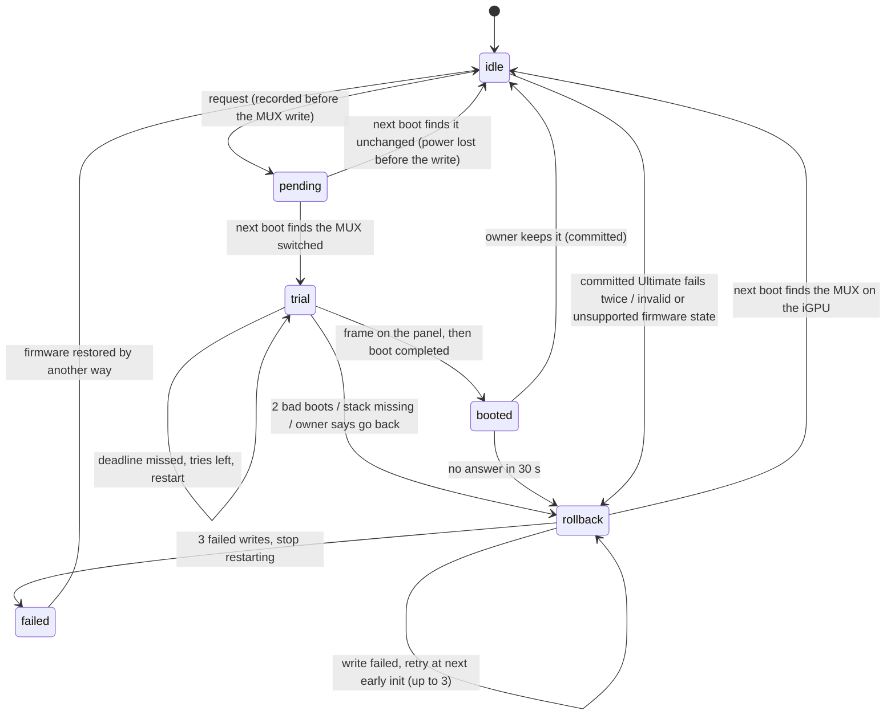

# Graphics modes on the Googlebook (Ruby) image: Eco, Hybrid and Ultimate, with automatic rollback (ANAL-241)

> **OpenBook, 2026-10-30 (ANAL-319):** this design and its phase-1 switcher now ship in OpenBook's own G14 vendor
> layer too (the `openbook-gfx-mode` service in `device/anybook/common/gfx-mode/`, the selector in `anybook_gpu_probe`
> and the recovery entries in `openbook-bootsync`), identical to GoodBook's. The OpenBook Graphics app's source is
> there too, but only the Ruby image installs it. With firmware writes off, OpenBook's switcher reads the mode and
> keeps the graphics stack on the panel's GPU; it does not switch. On OpenBook, Hybrid also loads
> NVIDIA's open driver after boot, for runtime power management only ([`nvidia-open.md`](nvidia-open.md)). The text
> below is the Googlebook (Ruby) design record as approved; where it says "Ruby image", the vendor parts apply to both
> tracks. Firmware writes stay off on both.

Status, 2026-10-25: **approved by B Honey** on ANAL-241, with the recommendations in §11. **Phase 1 is built
(ANAL-246, §13):** the switcher, its SELinux domain and init steps, the selector in `anybook_gpu_probe` with the
composer and gralloc pinned, the recovery entries, the update interlock and the OpenBook Graphics app, tested on the
real Ruby image in QEMU. Nothing here has written the G14's firmware. The first real `gpu_mux_mode` or
`dgpu_disable` write still needs its own approval naming the image, the operation and the device (epic ANAL-237).

Labels:
- **CONFIRMED**: read in source we have, or seen in our own test output.
- **REPORTED**: third parties, not reproduced by us.
- **HYPOTHESIS**: not yet tested.

Release impact: the design itself none; its phase-1 implementation (ANAL-246, §13) is **Ruby**: vendor, and the
OpenBook layer of `system` for the app.

## Summary

- **Three modes plus one option.** Eco (dGPU off), Hybrid (today's state and the default), Ultimate (panel and HDMI
  on the NVIDIA GPU), and in Hybrid an optional "Linux GPU" that hands the dGPU to the Linux VM (ANAL-242/248).
- **The graphics stack follows the panel, not the request.** At each boot, early init reads the MUX, loads the
  matching KMS driver and picks the DRM card whose internal panel is connected. The Android stack, gralloc and the
  composer are pinned to that card.
- **A failed switch cannot strand the owner.** The defences, in order:
  1. Every MUX switch is recorded in `/metadata` before the firmware write.
  2. Every Ultimate boot is counted until the panel shows a frame and boot completes. After **two** bad boots,
     early init writes `gpu_mux_mode=1` and restarts, so the third boot is Hybrid.
  3. A new Ultimate must also be kept by the owner within 30 seconds, otherwise it goes back.
  4. If that is not enough, there is a "Restore Hybrid graphics" entry in the laptop's own boot menu and on the
     USB stick, then the firmware-level steps (§6).
- **Prototype: `openbook-gfx-mode`.** 25 scenarios pass in two places:
  - on the host, against a model of the kernel's rules;
  - in QEMU on the **G14's own 6.18 kernel**, whose real `asus-nb-wmi` driver is bound to a fake ASUS WMI device.
    That run made 82 guest boots, with real reboots and hard resets.

  The kernel's own guards appear in the guest's log. §10 has the details.
- **Owner decisions** are in §11: approve the design, two tries plus the keep dialog, automatic restore, the update
  interlock, and an optional look in the BIOS.

## 1. What the firmware gives us

| Switch | Values | Effect | Kernel rules (6.18 `asus-wmi.c`) | Label |
|---|---|---|---|---|
| `gpu_mux_mode` (`/sys/devices/platform/asus-nb-wmi/`) | 1 Optimus, 0 dGPU | Which GPU drives the panel. Takes effect at the next boot | <ul><li>Refused (`-ENODEV`) while `dgpu_disable=1` or `egpu_enable=1`.</li><li>The firmware's answer must be 1, otherwise `-EIO`.</li></ul> | CONFIRMED (source, and in our QEMU run) |
| `dgpu_disable` | 1 off | Saved by the firmware (commit `98829e84dc67`). Setting it ejects the dGPU through ACPI | <ul><li>Refused (`-ENODEV`) while the MUX is on the dGPU.</li><li>The driver notes that enabling may need a store, a PCI rescan and a second store.</li></ul> | Rules CONFIRMED; the ACPI eject REPORTED (GA403WM dump) |
| `egpu_enable` | — | XG Mobile | Not exposed on the GA403WR: its `asus-nb-wmi` lists only `dgpu_disable`, `gpu_mux_mode`, `panel_od` and `throttle_thermal_policy` (2026-10-16 inventory) | CONFIRMED |
| Newer kernels | — | The same switches move to `asus-armoury`, under `/sys/class/firmware-attributes/asus-armoury/attributes/<name>/current_value`. A MUX change sets `pending_reboot` | The same guards | REPORTED (upstream source); matters only for recovery from another Linux |

What we know about the G14 itself:
- **Today it is Hybrid** (`gpu_mux_mode=1`, `dgpu_disable=0`). CONFIRMED on Linux on 2026-10-16 and on Ruby on
  2026-10-22.
- **HDMI is wired to the dGPU.** The iGPU has eDP and eight DP connectors, but no HDMI. CONFIRMED.
- **Whether the iGPU stays enumerated with the MUX on the dGPU is UNKNOWN.** The issue called it "reported". I found
  no G14 `lspci` in that mode (search, 2026-10-25). The design does not depend on the answer, and the prototype tests
  both cases.
- **HYPOTHESIS:** amdgpu then reports its eDP as disconnected, because its HPD pin is muxed away (amdgpu's DC
  detects eDP through the HPD GPIO). If both GPUs ever claim a connected panel, the selector follows the MUX and
  logs it.

## 2. The modes

| | **Eco** | **Hybrid** (default) | **Ultimate** |
|---|---|---|---|
| Firmware | `gpu_mux_mode=1`, `dgpu_disable=1` | `1`, `0` | `0`, `0` |
| Panel / HDMI | 890M / dark | 890M / dark until reverse PRIME (ANAL-249) | NVIDIA / NVIDIA |
| `ro.hardware.vulkan` / `egl` | `radv` / `angle` (today's) | same | `nouveau` (NVK) / `mesa` (Zink). ANGLE in AOSP 17 treats NVK as NVIDIA's own driver (`docs/nvidia.md` §4) |
| Gralloc | minigbm, amdgpu backend | minigbm pinned to the amdgpu render node. Linear GTT buffers for offloaded apps (ANAL-247) | minigbm with a nouveau backend that reports its modifiers (ANAL-244) |
| Composer | drm_hwcomposer, `vendor.hwc.drm.device` = the amdgpu card | same; it must not open the nouveau card | drm_hwcomposer on the nouveau card |
| RenderEngine | unchanged (Google's default on our stack) | unchanged | Skia on Vulkan (REPORTED working by project-churro on GB205) |
| nouveau | not loaded (no device) | today none, with the driverless D3cold hook. After ANAL-243's gates: loaded headless (`modeset=2`), runtime PM on | loaded with KMS (`modeset=1`); runtime PM irrelevant |
| dGPU power | not enumerated, about 0 W (REPORTED) | D3cold when idle (very likely today, ANAL-238) | always on: +5–7 W at idle with NVIDIA's driver (REPORTED); nouveau UNKNOWN. S0i3 not expected (HYPOTHESIS) |
| Use | longest battery | everyday | plugged in, HDMI, GPU-heavy work |

**Linux GPU** (a Hybrid option) changes no firmware. While the Linux VM runs, `vfio-pci` owns the dGPU; when the VM
stops, the dGPU returns to Hybrid's policy (ANAL-242 research, ANAL-248).

## 3. Choosing the stack at boot

**Rule: follow the panel, not the intent.** A stale record, a firmware change made outside OpenBook, or a wrong
guess about the hardware can then never start the Android stack on a GPU that is not driving the screen.

```
on early-init                                    # init.openbook.rc, in this order
    exec_start vendor.openbook.dlkm              # today: modules.load (amdgpu, asus_wmi, ...)
    exec_start vendor.openbook.gfx-boot          # openbook-gfx-mode boot: firmware, records, rollback, counter
    exec_start vendor.openbook.gfx-kms           # modprobe --all=/vendor/etc/gfx/kms.${vendor.openbook.gfx.kms}.load
    exec_start vendor.openbook.dgpu-pm           # unchanged: leaves a bound dGPU to its driver
# graphics-amd's early-init: the selector (folded into anybook_gpu_probe in ANAL-246), then
#     trigger vendor-anybook-gpu-${vendor.anybook.gpu.hal}  -> ro.hardware.*, vendor.hwc.drm.device, minigbm's node
```

1. **`boot`** reads `gpu_mux_mode` and `dgpu_disable`, reconciles them with the record in `/metadata/openbook/gfx`,
   and applies a deferred Eco step or a rollback (§5). It publishes `vendor.openbook.gfx.kms`: `nouveau` in
   Ultimate, `none` otherwise.
   - `/metadata` is a `first_stage_mount` partition (`fstab.openbook`), so it is readable at early init. CONFIRMED
     on the Ruby image in QEMU (ANAL-246), with one exception: the first boot after a fresh install, whose blank
     partition is formatted only at `fs`. That boot is in the mode the firmware has; it records nothing at early
     init (`STATE NOT SAVED`), and an Ultimate boot that cannot be recorded rolls back at once (below).
2. **The KMS driver for the mode** loads from a per-mode list, in the module loader's domain, as the lab's loads do
   today.
3. **`select`** picks the display card:

   | Mode | Choice, in order |
   |---|---|
   | Ultimate | nouveau's card with a connected `eDP`/`LVDS`/`DSI` connector; else amdgpu's card with a connected panel (logged `ultimate-but-panel-on-amdgpu`); else nouveau's card (the health check will fail and roll back) |
   | Eco, Hybrid | amdgpu's card with a connected panel; else nouveau's (logged); else any amdgpu card; else virtio-gpu (VMs) |

   It publishes:
   - `vendor.anybook.gpu.hal`, `display_card` and `render_node`;
   - `vendor.openbook.gfx.dgpu` (`absent`, `off` or `display`).

   Card numbers are never assumed: when the iGPU is gone, nouveau is `card0` (tested).
4. **Pinning.**
   - drm_hwcomposer already honours `vendor.hwc.drm.device`.
   - minigbm needs a small patch: take the render node from the property instead of the first node it can open
     (`docs/nvidia.md` §5).

   Both must be pinned **before** nouveau ever loads in Hybrid. Otherwise gralloc can silently move to the dGPU.

## 4. Switching

**The service.** `openbook-gfx-mode` is a vendor binary run by init as a oneshot, in its own SELinux domain
`openbook_gfx_mode`.
- It accepts exactly `eco`, `hybrid` and `ultimate`. Anything else exits 2 and writes nothing (tested).
- It refuses a request:
  - without the `asus-nb-wmi` switches;
  - on a board not listed in `/vendor/etc/openbook/gfx-stacks.conf` (today only `GA403WR`);
  - while a switch or rollback is open (except an iGPU mode after failed rollbacks);
  - against a lock;
  - with an A/B update pending (§5.4);
  - for Ultimate, unless the image's **nouveau stack is verified**.
- **"Verified" means** the release builder wrote `stack nouveau verified` into `gfx-stacks.conf`. It does that only
  when the release record carries ANAL-244's evidence for exactly these files. Each listed file must exist.
  dm-verity protects them together with the manifest.
- **Three stack states** (ANAL-246): `unverified`; `development`, for a dev image (ANAL-244's bring-up), which boots
  Ultimate like a verified stack but only through the lab's adb channel; and `verified`. **The app offers Ultimate
  only with `offer ultimate` as well**, which the release builder writes only once both slots and the stick carry
  this switcher (the interlock, §5.4).
- **Firmware writes stay off** until the image sets `ro.vendor.openbook.gfx.fw_writes=1`. Until then the service
  logs what it would write. That property is set only in a release the owner approved for this purpose.

**Order of writes**, chosen so that the kernel never has to refuse one:

| From → to | Steps |
|---|---|
| Hybrid → Ultimate | record "pending ultimate" (durable) → `gpu_mux_mode=0` → owner restarts |
| Eco → Ultimate | `dgpu_disable=0`, read back (store, PCI rescan, store again if needed) → record → `gpu_mux_mode=0` → restart |
| Ultimate → Hybrid | record → `gpu_mux_mode=1` → restart |
| Ultimate → Eco | record (with a deferred dGPU-off) → `gpu_mux_mode=1` → restart → early init writes `dgpu_disable=1`. The kernel refuses it before the MUX is back |
| Hybrid → Eco | `dgpu_disable=1` now, if no GPU driver is bound to the dGPU; otherwise deferred to the next early init, before drivers bind |
| Eco → Hybrid | `dgpu_disable=0` (with the rescan and second store if needed); the dGPU enumerates at the next boot |

**Records.** Each switch records the firmware state before and after (`fw_before`, `fw_after`). A bounded history
file in `/metadata/openbook/gfx/history` holds every event, and logcat gets the same lines. The app restarts the
laptop only after the owner confirms (§7); the service never restarts on a request. Only rollbacks restart by
themselves.

**Locking.**
- "Keep this mode" locks the current mode, and requests for other modes are refused.
- If the firmware is changed outside OpenBook (BIOS, another OS), the next boot restores a locked Eco or Hybrid.
- A lock never forces the laptop *into* Ultimate.

Tested in `lock-hybrid`.

**How the app reaches the service** (built in ANAL-246; the constraints are AOSP 17's `system/sepolicy`):
- A platform app may set **no** vendor property: `compatible_property_only` in `private/property.te` forbids every
  core domain except init to set one, `vendor_public_prop` included. The design's first idea (a vendor request
  property) was wrong; the compile of the image's policy refused nothing yet, the AOSP source did.
- A privileged app (`priv_app_all`) and an untrusted app may set **no property at all** (`private/priv_app_all.te`,
  `app_neverallows.te`). So OpenBook Graphics runs in an app domain of its own that is neither, as Google's own
  `traceur_app` does: a core app domain with the app API services and one property to set. Android still treats it
  as a privileged app for permissions (`/system/priv-app`, REBOOT).
- init accepts a property trigger in a vendor `.rc` file only on a property `vendor_init` can read (the first Ruby VM
  run logged `unexported property trigger found: openbook.gfx.request` and dropped the action).
- A vendor domain may set `sys.powerctl`, which is `system_public_prop` and not under the vendor neverallow.

So:

| Channel | Property | Who sets it | What happens |
|---|---|---|---|
| Requests | `openbook.gfx.request` = `VERB[:MODE]@SEQ`, a platform property (`openbook_gfx_request_prop`, restricted: vendor_init may read it) in the OpenBook layer | the OpenBook Graphics app's domain only | init starts the service with the value as its argument. `VERB` is `switch` (with a mode), `lock`, `unlock`, `keep`, `revert` or `shown` |
| Development over adb | `debug.openbook.gfx` = `VERB[@N]` | `shell` | `hybrid`, `restore`, `revert` and `status` always (the safe direction and a look); `eco`, `ultimate`, `keep`, `lock` and `unlock` only with the lab switch, `persist.vendor.openbook.lab=1` |
| State | `vendor.openbook.gfx.*` (`vendor_restricted_prop`), above all `vendor.openbook.gfx.summary` | the service | system apps read it (the vendor policy grants `appdomain` except untrusted, ephemeral and isolated apps); the shell too |

The summary is one line, so the app never reads half an update: `1 MODE PHASE TARGET LOCK WRITES ULTIMATE RESULT`,
for example `1 hybrid idle hybrid none off unverified 17342:done`. `ULTIMATE` is `unsupported`, `unverified`,
`development`, `verified` or `offered`; `RESULT` is the last answer, `SEQ:CODE`. The platform half of the policy is
appended to `plat_sepolicy.cil` and compiled against the image's own neverallows, as `openbook_update_app`'s was.
Values are capped at 91 characters.

## 5. Automatic rollback



- **Healthy** means three things:
  1. The composer presented a frame on a panel connector of the expected KMS driver. A small drm_hwcomposer patch
     reports its first successful atomic commit as `vendor.hwc.openbook.first_present=card1:eDP-1`, and init passes
     it to `openbook-gfx-mode frame` (ANAL-246; HYPOTHESIS that the commit path is the right hook).
  2. Then `sys.boot_completed=1`.
  3. For a **new** Ultimate, the owner taps **Keep**.

  The keep step catches the case project-churro hit on GB205: frames are composed, but the picture is squeezed
  because the GOP left DSC on.
- **Every Ultimate boot is guarded**, not only the first, so a later regression also returns to Hybrid.
  - Early init counts the boot before the stack starts, and the count is saved durably.
  - A healthy boot resets it.
  - With **N = 2**: two bad boots, and the third boot restores Hybrid in early init.
  - If an Ultimate boot cannot be recorded (`/metadata` broken), it rolls back at once.
- **Deadlines.** A watchdog service runs only in Ultimate:
  - the frame within 120 s of early init;
  - boot completion within 20 minutes, because the first boot after an update compiles apps;
  - the owner's answer within 30 s of the dialog.

  A missed deadline restarts (tries left) or rolls back.
- **Hard hangs.** If the kernel itself hangs (for example GSP firmware locks up), nothing restarts by itself: the
  owner holds the power button. The boot counter then does the rest.
  - Option: AMD's FCH watchdog (`sp5100_tco`) could reset a hung kernel on its own. It is not in our vendor today.
    HYPOTHESIS; ANAL-246 checks it.
- **Rollback is crash-ordered.**
  - The record "rollback" is written first, then `gpu_mux_mode=1`, then the restart.
  - A power cut at any point leaves either the old state (the next boot retries) or the new one.
  - A write the firmware refuses is tried again at each early init, three attempts in all. After that the phase is `failed`:
    no more automatic restarts, the app shows the recovery steps, and a manual Hybrid request is still accepted.
- **States OpenBook did not make are handled at boot:**

  | Found at boot | Response | Test |
  |---|---|---|
  | Ultimate set outside OpenBook, verified stack | treated as a trial | `outside-ultimate-verified` |
  | Ultimate set outside OpenBook, no verified stack | restore Hybrid | `outside-ultimate-unverified` |
  | `gpu_mux_mode=0` with `dgpu_disable=1`, which the kernel never makes | restore | `invalid-firmware-state` |
  | `/metadata` wiped (factory reset) | follow the firmware | `state-wiped-in-ultimate` |

### 5.4 The update interlock

This is the risk that remains, so it gets its own rule.
- **The problem.** An A/B update, or a fallback to the other slot, can boot an image whose vendor has no
  `openbook-gfx-mode` at all: every release before ANAL-246. In Ultimate that image starts amdgpu's stack on a panel
  that amdgpu cannot drive, and has nothing to restore the MUX. The result is a black screen until §6.
- **The rule.** OpenBook Update and `g14-ota.sh` install only in Eco or Hybrid. In Ultimate they ask to switch first.
- **Before Ultimate is offered at all:**
  - both slots and the USB stick carry a release with this service;
  - the stick has the recovery entry.
- An image *with* the service but without the nouveau stack restores Hybrid by itself (`older-image-in-ultimate`).
- **What this means for the order of work:** the switcher ships before Ultimate. The dev image used for ANAL-244's
  first MUX write already carries the service, and the stick carries the recovery entry (§12).

## 6. Recovery when the automatic path cannot run

| # | Way out | Needs a picture? | Label |
|---|---|---|---|
| 1 | Wait. Or hold the power button for 10 s, power on, and repeat once: the third boot is Hybrid | no | prototype-tested |
| 2 | Over Wi-Fi adb, when the system booted but the panel stays dark: `adb shell setprop debug.openbook.gfx hybrid`, then restart | no | design |
| 3 | **"Restore Hybrid graphics" in the laptop's boot menu.** Hold a key at power-on: the menu is hidden, and a held key shows it (`docs/installer.md`). The entry is a copy of the slot's entry with `openbook.gfx=restore-hybrid`. Early init writes `gpu_mux_mode=1` and restarts; no display is needed after the menu. bootsync writes the entry (ANAL-246) | the firmware's own menu | design; the kernel parameter is prototype-tested |
| 4 | **"Restore Hybrid graphics" on the USB stick.** It boots from the firmware's boot menu. `stick-entries.py` gains `openbook.gfx=restore-hybrid` on its allowlist. The stick's own system writes `gpu_mux_mode=1` at early init and restarts; the laptop's next boot from its disk finds Hybrid and closes the trial | the firmware's boot menu | prototype-tested (`recovery-entry-stick`) |
| 5 | Any Linux live USB: `echo 1 \| sudo tee /sys/devices/platform/asus-nb-wmi/gpu_mux_mode` (6.18 and older), or `…/asus-armoury/attributes/gpu_mux_mode/current_value` (newer), then reboot | the live system must show a picture, or be typed blind | CONFIRMED in source (6.18) |
| 6 | BIOS setup (F2, then F7 for Advanced). On some ROG models: **Display Mode: dGPU Only / Dynamic** | the firmware's own screens | REPORTED (ASUS FAQ 1049763, for 2023 M16/Scar 16/Flow X16); **unknown for the GA403WR** |
| 7 | EC reset: power off, charger in, hold the power button 30–40 s | — | REPORTED (ROG forum advice for black screens); its effect on the MUX is unknown |

**HYPOTHESIS:** the firmware's own screens (logo, F2 setup and the boot menu) show in either MUX position, because
the GOP drives whichever GPU owns the panel. project-churro saw the GOP leave DSC on the panel in discrete mode, which
fits (REPORTED). Ways 3, 4 and 6 depend on this; ways 1, 2 and 5 do not.

## 7. Inside Googlebook

Google's Settings cannot be changed. Our parts live where OpenBook Update already lives:
- **The app** is in the **OpenBook layer of `system`**: a privileged app, **OpenBook Graphics** (`org.openbook.graphics`,
  `/system/priv-app/OpenBookGraphics`). It is signed with the OpenBook app key and runs in its own app domain.
  `rebase-google-build.py` and `openbook-adapt` carry it to every Google build.
- **The service** is in OpenBook's **vendor**.

Entry points:
1. **The app**, in the launcher. This always works.
2. **A Settings entry** under Display, through Android's settings injection: an activity with
   `com.android.settings.action.EXTRA_SETTINGS`, which Settings shows only for system apps. HYPOTHESIS that
   Googlebook's Settings keeps this injection; check in the Ruby VM.
3. **A Quick Settings tile** (`TileService`). HYPOTHESIS that Googlebook's desktop panel lets the owner add it;
   check in the Ruby VM.

The screens:
- **Choosing a mode.** One card per mode, each with what it costs: battery, HDMI, a restart. Ultimate says: "Needs
  a restart. If the picture does not come back, the laptop returns to Hybrid by itself after two tries."
- **Confirmation.** "Switch to Ultimate and restart? Save your work first."
- **After the restart into a new Ultimate.** A full-screen dialog, "Keep Ultimate graphics?", with a 30-second
  countdown, *Keep* and *Go back*.
- **After a rollback.** A notification: "Ultimate graphics didn't start, so the laptop went back to Hybrid.
  Nothing was lost."
- **Lock.** A "Keep this mode" switch.

Only the owner (an admin user) can switch; other users see the mode. The app restarts the laptop through
`PowerManager.reboot`, its only privileged permission, as OpenBook Update does.

## 8. Security

- **SELinux (vendor policy, ANAL-246):**
  - `genfscon` labels `gpu_mux_mode`, `dgpu_disable` and `egpu_enable` as `sysfs_openbook_gfx_fw`;
  - a neverallow keeps every other domain from writing them;
  - `openbook_gfx_mode` gets those files, its `/metadata/openbook/gfx` label, the PCI rescan file,
    `powerctl_prop` and its own property types.

  Today `openbook_pc_setup` may write any plain `sysfs` file, these included. The new label takes that reach
  away.
- **Firmware safety (ANAL-251).** The new init script goes through `check-firmware-safety.py` like every other. If
  its patterns match, the script is reviewed at its hash.
- **Provenance.** No project-churro code. The prototype and the fake ACPI table are written from the kernel's
  `asus-wmi` interface and AOSP's patterns.

## 9. Failure modes

| # | Failure | Detected by | Automatic response | The owner sees | Manual way out | Test |
|---|---|---|---|---|---|---|
| 1 | Power lost after the request is recorded, before the MUX write | next boot: pending, MUX unchanged | close as "not applied" | Hybrid, as before | — | `power-cut-after-arm` |
| 2 | Power lost after the MUX write | next boot: pending, MUX switched | normal trial | the Ultimate trial | — | `power-cut-after-mux-write` |
| 3 | The kernel refuses a write (guard) | `-ENODEV` from sysfs | none: write order avoids it; refusal reported | "couldn't switch" | — | `kernel-guards` (control) |
| 4 | Firmware refuses or fails a MUX write | `-EIO` | request refused; the record is closed again | "couldn't switch" | — | `request-refused-by-firmware` |
| 5 | Enabling the dGPU is not saved at the first store | read-back | PCI rescan, second store, read back | nothing | — | `eco-to-ultimate-quirk` |
| 6 | nouveau does not load or bind | no nouveau card, no frame | retry once, then roll back | black for ≤ 2 boots, then Hybrid | §6 | `ultimate-no-nouveau` |
| 7 | nouveau binds but the panel stays dark (link training, DSC) | no connected panel, no frame | same | same | §6 | `ultimate-transient-no-panel` (recovers on the 2nd boot) |
| 8 | Frames composed but the picture is wrong | no Keep within 30 s | roll back now | a wrong picture for ≤ 30 s | *Go back* | `ultimate-not-kept` |
| 9 | Owner prefers to go back | *Go back* | roll back | Hybrid after a restart | — | `ultimate-revert` |
| 10 | SurfaceFlinger or HWC crash loop | deadline | retry, then roll back | ≤ 2 boots | §6 | `ultimate-no-nouveau` (same path) |
| 11 | Kernel hard hang | nothing until a power cycle | counted at the next early init | black until the owner holds power, twice | holding power ×2 | `ultimate-hang` |
| 12 | Power lost during a rollback | next boot: rollback, MUX still dGPU | write again | one more restart | — | `power-cut-in-rollback` |
| 13 | The restore write keeps failing | 3 failures | stop restarting (`failed`); best-effort boot | the app's recovery steps, if visible | §6 ways 3–7 | `rollback-write-fails` |
| 14 | Ultimate set outside OpenBook, verified stack | boot reconciliation | trial | Keep dialog | — | `outside-ultimate-verified` |
| 15 | Ultimate set outside OpenBook, no verified stack | same | restore Hybrid | a restart | — | `outside-ultimate-unverified` |
| 16 | `gpu_mux_mode=0` with `dgpu_disable=1` | same | `gpu_mux_mode=1` | a restart, then Eco | — | `invalid-firmware-state` |
| 17 | `/metadata` wiped in Ultimate (factory reset) | no record | follow the firmware: trial | Keep dialog | — | `state-wiped-in-ultimate` |
| 18 | `/metadata` unwritable in Ultimate | save fails | roll back now | a restart | — | host unit check |
| 19 | Slot fallback or update to an image **with** the service but no stack | stack check at boot | roll back | a restart | — | `older-image-in-ultimate` |
| 20 | Slot fallback or update to an image **without** the service | — | none possible | black screen | §6 | prevented by §5.4 |
| 21 | The iGPU disappears in Ultimate | no amdgpu card | nouveau is card0; nothing special | — | — | `igpu-hidden-in-ultimate` |
| 22 | Unknown board or no `asus-wmi` | manifest or sysfs | no writes; stack chosen from the panel | the mode choice is not offered | — | `refuse-unknown-board` |
| 23 | Unverified stack | manifest | Ultimate refused | "not available on this version" | — | `refuse-unverified-stack` |
| 24 | Eco requested while a driver drives the dGPU | bound driver | deferred to the next early init | "restart to finish" | — | `eco-deferred-while-driven` |
| 25 | Lock bypassed from the BIOS or another OS | boot reconciliation | restored towards the iGPU modes only | a note | — | `lock-hybrid` |
| 26 | Sleep in Ultimate (dGPU always on) | — | not this design: ANAL-244 must pass an s2idle gate before Ultimate ships | — | — | ANAL-244 |

## 10. Prototype and evidence

**Code:**
- `device/anybook/common/gfx-mode/`: `gfx_mode.{h,cpp}` and `main.cpp`. C++17 with no Android libraries, so the same
  source builds statically for the QEMU guest and later as a vendor `cc_binary` (logcat and properties under
  `__ANDROID__`). It has no `Android.bp` yet, so nothing is built into an image; ANAL-246 adds it.
- Commands:
  - `boot` and `select` (early init);
  - `frame`, `booted`, `keep`, `revert` and `deadline` (health);
  - `request`, `lock`, `unlock`, `restore` and `status`.
- Test-only power cuts (`OPENBOOK_GFX_TEST_CRASH`) exist only when built with `-DOPENBOOK_GFX_TEST_HOOKS`.

**Tests:**
- **`scripts/googlebook/gfx-mode-scenarios.txt`**: 25 scenarios, one line per boot, with expectations.
- **`scripts/googlebook/gfx-mode-test.py`** runs them on the host, against fake sysfs trees and a model of the 6.18
  `asus-wmi` guards. Every firmware write the binary makes is replayed against the guards, and a write the kernel
  would refuse fails the test. It also has unit checks: refused mode names, a corrupt record, and dry-run. It runs
  in CI (`scripts/ci/unit-tests.sh`).
- **`scripts/googlebook/gfx-mode-qemu.sh`** runs the same scenarios in QEMU/KVM. The kernel is the G14 kernel dist
  `anybook-g14-gbos-16302624-anal257` (6.18.21, bzImage `d8590aee…`), with its own `wmi`, `asus-wmi` and
  `asus-nb-wmi` modules.
  - The modules bind to `gfx-mode-qemu/fake-asus-wmi.asl`. It keeps the two switches in CMOS, which survives guest
    resets as firmware settings do, and it can inject a refused MUX write and the "store twice" behaviour.
  - `/metadata` is an ext4 virtio disk.
  - Power cuts and hangs are SysRq resets (no sync, no unmount).
  - `--judge` checks the serial log against the same expectations.

**Results, 2026-10-25:**
- Host: 25 of 25 scenarios and all unit checks pass.
- QEMU: 25 of 25 scenarios, 82 guest boots, about 1–5 s per scenario. The guest's kernel log shows the real
  driver at work:
  - `asus_wmi: Can not switch MUX to dGPU mode when dGPU is disabled: -19`;
  - `asus_wmi: Can not disable dGPU when the MUX is in dGPU mode: -19`;
  - `asus-nb-wmi: Failed to set GPU MUX mode (result): 0x0`: once for a refused request, and three times while a
    rollback retried a refused write.
- Logs and hashes are in the evidence store, `~/anybook/evidence/goodbook/2026-10-25-anal241-gfx-modes/`, and on the
  issue.

**Not covered by the prototype:**
- the Android side: init, SELinux, the HWC hook, the app (built and tested since in ANAL-246, §13);
- nouveau KMS on the G14 (ANAL-244);
- the real firmware's timing, for example whether `gpu_mux_mode` reads back the new value before the restart. The
  fake answers like the driver expects; HYPOTHESIS for the G14;
- whether the iGPU stays enumerated;
- any write to the G14.

## 11. Decisions

B Honey approved the design on ANAL-241 on 2026-10-25, with recommendations 2 to 4.

1. **The design: approved.** ANAL-246 starts. Any real MUX or `dgpu_disable` write still needs its own approval
   naming the image, the operation and the device.
2. **Two tries, plus Keep for a new Ultimate: approved.** The rejected alternative was one try and no dialog.
3. **Automatic restore of firmware states OpenBook cannot drive: approved.** These are Ultimate without a verified
   stack, and the MUX on the dGPU while the dGPU is disabled.
4. **The update interlock: approved.** Updates install only in Eco or Hybrid, and Ultimate is offered only once both
   slots and the stick carry the service.
5. **Open (optional, read-only):** at the laptop, press F2 at power-on, then F7, and say whether a "Display Mode" or
   GPU option exists, changing nothing. If it exists, it is the strongest manual way out.

## 12. Implementation order

Decision 4 puts the switcher before Ultimate: the image used for the first MUX write must already carry it.

1. **ANAL-246 phase 1, built 2026-10-25 (§13).** Everything that needs no nouveau:
   - the service in the vendor, with its SELinux domain and init steps; firmware writes stay off until a release
     turns them on;
   - the selector folded into `anybook_gpu_probe`, and minigbm and the composer pinned to the display card;
   - the recovery entries (the laptop's boot menu and the stick) and the update interlock;
   - the OpenBook Graphics app with Eco and Hybrid, and Ultimate shown as not available;
   - tests in the Ruby VM with the fake ASUS WMI device, including the Ultimate rollback path with a test-only stack.

   The first real Eco or Hybrid write on the G14 needs the owner's approval for that write.
2. **ANAL-243 and ANAL-244.** The Hybrid gates, then Ultimate bring-up on a dev image that carries phase 1. The first
   MUX write needs its own approval.
3. **ANAL-246 phase 2.** Ultimate enabled through a verified stack manifest; switching and a real rollback on the
   G14.
4. **ANAL-250.** The release. Both slots and the stick carry the switcher before Ultimate is offered.

## 13. Phase 1 as built (ANAL-246)

Release impact: **Ruby** (vendor; the OpenBook layer of `system` for the app). No boot-chain, partition-layout or
data change; the stick gains one boot entry. Firmware writes are **off**: the image does not set
`ro.vendor.openbook.gfx.fw_writes`, so the switcher shows and logs what it would write, and the app says that
switching is not turned on yet. A release turns them on only with the owner's approval for the first real switch.

### What is in the image

| Part | Where | What it does |
|---|---|---|
| `openbook-gfx-mode` | vendor `/bin`, domain `openbook_gfx_mode` (`device/anybook/common/gfx-mode`) | the prototype's state machine, plus the app's and adb's channels (§4), the summary property, stack states, and the Ultimate watchdog (frame 120 s, boot completion 20 min, Keep 30 s after the dialog; `ro.vendor.openbook.gfx.*_deadline_s` for VMs) |
| init steps | `openbook-gfx-mode.rc`; `init.openbook.rc` runs the early-init ones | after the modules load: `boot`, then the mode's KMS list (`gfx-kms.none.load` / `gfx-kms.nouveau.load`), then dgpu-pm; the selector runs after both. The frame report, boot completion, the app's and adb's requests start their commands |
| Stack manifest | `/vendor/etc/openbook/gfx-stacks.conf` (`device/anybook/g14/gfx-stacks.conf`) | `board GA403WR`, `stack nouveau unverified`: Eco and Hybrid only |
| The selector | `anybook_gpu_probe`, with `gfx_select.{h,cpp}` shared with the switcher | follows the connected panel and the MUX (§3); every earlier fixture decides as before, and seven G14 fixtures cover the MUX states |
| The pins | `anybook_gpu_probe --pin` after each HAL event | `vendor.hwc.drm.device` (drm_hwcomposer opens only that card) and `vendor.minigbm.render_node` (minigbm tries it first: `aosp/patches/external/minigbm/0002`) |
| The frame report | `aosp/patches/external/drm_hwcomposer/0002` | the first frame on an internal display: `vendor.hwc.openbook.first_present=cardN:CONNECTOR` |
| "Restore Hybrid graphics" | `openbook-bootsync` on the laptop; `config/stick-entries/restore-hybrid.json` and `stick-entries.py` for the stick | §6 ways 3 and 4 ([`installer.md`](installer.md) §2.5) |
| The update interlock | `openbook-bootsync activate`; `g14-ota.sh` | no slot switch while the panel is on the dGPU or a switch is under way (§5.4) |
| OpenBook Graphics | `/system/priv-app/OpenBookGraphics-v1`, domain `openbook_graphics_app` (`device/anybook/common/gfx-mode/app`) | §7: Eco and Hybrid, Ultimate "not available on this version", the lock, the restart, the keep dialog, a notification after a rollback; a Settings entry under Display and a Quick Settings tile |
| SELinux | `device/anybook/common/gfx-mode/sepolicy/vendor`, `graphics-amd/sepolicy`; for Ruby `gfx-mode/ruby/` | §8 as designed, with the corrections in §4. `gpu_mux_mode`, `dgpu_disable`, `egpu_enable` and the PCI rescan are `sysfs_openbook_gfx_fw`, which only `openbook_gfx_mode` (and init's own rules) may write; the lab helper and the selector read them |

**How it reaches a Ruby release.** The Ruby vendor's policy is not the AOSP build's, so
`build-gfx-mode-candidate.py` appends this change's vendor policy (`gfx-mode/ruby/vendor-sepolicy.cil`, made by
`vendor-policy-delta.py` from two builds of the same tree) to the base's own, adds the AOSP-built files pinned in
`gfx-mode/ruby/pins.json`, and compiles the new platform and vendor halves together with every neverallow. It
refuses a base whose replaced files are not RB-20261025-01's originals. [`BUILD.md`](BUILD.md) has the commands.

### Corrections the build found

- **The app's channel** (§4): a vendor request property is impossible for any platform app; a privileged app may
  set no property at all; init needs `vendor_init` to read a property a vendor trigger names.
- **Early-init logs:** init's `stdio_to_kmsg` writes through `/dev/kmsg_debug` on a userdebug vendor, which Ruby's
  user system leaves unlabelled (the base's own services hit the same denial). The switcher writes `/dev/kmsg`
  itself; the selector, as user `system`, may not, so its pin step repeats the early decision in logcat.
- **The composer's device name** came from sysfs, which the composer may not read; it now comes from the fd's minor.
- **`/metadata` at early init:** mounted at first stage, except on the first boot after a fresh install (§3).

### Tested (2026-10-25)

- **Host:**
  - `gfx-mode-test.py`: 25/25 scenarios, plus checks of the channels, the summary, stack states, the watchdog and the
    selector;
  - `gfx-mode-qemu.sh`: the same 25 scenarios in 82 boots of the G14's 6.18 kernel with its own `asus-nb-wmi`;
  - `anybook_gpu_probe_test`: 3/3 over 16 fixtures; `bootsync-gfx-test.py` 5/5; `stick-entries-test.py` 5/5;
  - the app: 9/9 unit tests, lint clean, and a second release build byte-identical to the first.
- **The candidate:** `build-gfx-mode-candidate.py` on RB-20261025-01's candidate compiles the platform and vendor
  policy together with every neverallow and checks 31 rules with `sepolicy-analyze` (for example: only
  `openbook_gfx_mode` writes the switches; the shell may not set `openbook.gfx.request`); checkseapp and checkfc pass.
- **The Ruby VM** (`gfx-mode-vm.sh`: the real image under TCG, the fake ASUS WMI device, restarts in place; the judge
  passed all 39 checks):
  - Hybrid: the selector takes virtio and pins its card and render node; the composer's first frame reaches the
    switcher. The app switches to Eco and back through `asus-nb-wmi`, asks to restart for Hybrid, locks and unlocks.
    The shell may not set the app's property, and adb may not ask for Eco without the lab switch.
  - Ultimate on the VM's development stack, through adb and the lab switch, then the app's own restart. Trial 1/2
    loads nouveau's KMS list; with no frame after 120 s the watchdog restarts. Trial 2/2 rolls back
    (`gpu_mux_mode=1`). The next boot reports the rollback, and the app shows a notification and a note on its screen.
  - The restore entry: on Hybrid it changes nothing. After Ultimate is armed again, the owner's pick of "Restore
    Hybrid graphics" in the boot menu makes early init write `gpu_mux_mode=1` and restart before Android starts.
    `mark-good` makes the slot's entry the default again, so the restore entry is only ever a choice in the menu.
  - No new SELinux denials in the switcher's, the app's, the selector's, the composer's, the allocator's or boot
    control's domains.
  - The Quick Settings tile opens the app. The Settings entry under Display is unconfirmed: it was not on the
    page's first screen, and the check does not scroll.
  - Every restart was an orderly one, except once: an earlier session B's first boot (Hybrid, the watchdog not
    armed) reset during system_server's start with no kernel restart or panic line. The cause is UNEXPLAINED (TCG is
    the HYPOTHESIS), and it did not recur in the rerun. The judge now fails a session on such a reset.
- **What the VM cannot show:** nouveau driving a panel, the G14's firmware and its timing.

### The adapter (R4, 2026-10-26)

R4's first build stopped at its layer re-embed (ANAL-295). R2's `openbook-adapt` (`40d2c16c`) derived only the
first OpenBook section of the platform policy's tail again, OpenBook Update's, and dropped the rest. The rest is
OpenBook Graphics' section, so the laptop would have held every later Google release. The adapter now carries
every section, each with its own derived block, and holds on a tail no builder writes. `rebase-google-build.py`
does the same. R4 is R3's candidate, then the graphics-mode step, then `build-adapter-candidate.py`, which
installs the pinned adapter (`52a3b7d1`). With it, R2's, R3's and R4's layers each give their release's
`system` and `vbmeta` back from Google's build (`adapter-fixed-point.sh`).

### Not in phase 1

- **Ultimate itself**: nouveau KMS (`modeset=1`; vendor_dlkm's `modules.options` gives `modeset=2` today), the NVK
  stack and its verified manifest are phase 2 (ANAL-243, ANAL-244). The selector already picks nouveau's card in
  Ultimate; no HAL event sets a stack for `hal=nouveau` yet, so such a boot fails its health check and rolls back.
- **OpenBook Update's own "switch to Hybrid first" screen.** Phase 1 enforces the interlock in boot control, which
  every update path goes through, and in `g14-ota.sh`; OpenBook Update would report a held install as failed.
  Ultimate cannot be reached on a phase-1 image, so the friendlier screen comes with phase 2, in a new OpenBook
  Update release.
- **The G14 itself**: nothing here ran on the laptop or wrote its firmware.

## Sources (read 2026-10-25)

- **Kernel:**
  - our 6.18.21 tree, `drivers/platform/x86/asus-wmi.c` (`gpu_mux_mode_store`, `dgpu_disable_store`) and
    `include/linux/platform_data/x86/asus-wmi.h`;
  - upstream `asus-armoury.c` (gbmc mirror): https://gbmc.googlesource.com/linux/+/refs/heads/master/drivers/platform/x86/asus-armoury.c
- **AOSP 17 sepolicy:** `system/sepolicy/private/property.te` (the vendor-property neverallows) and
  `public/property.te` (`powerctl_prop`). Init: `system/core/init/action_parser.cpp` (property triggers from vendor
  scripts).
- **ASUS FAQ 1049763**, BIOS Display Mode (updated 2024-06-20): https://www.asus.com/us/support/faq/1049763/
- **ROG forum and iFixit** reports on Ultimate-mode black screens (REPORTED):
  - https://rog-forum.asus.com/t5/rog-zephyrus-series/black-screen-after-rog-logo-on-boot-zephyrus-g16-2025-gu605cr/td-p/1124245
  - https://rog-forum.asus.com/t5/rog-zephyrus-series/screen-goes-black-when-booting-up-a-game/m-p/1094427
- **Our earlier work:**
  - `docs/nvidia.md` (§1, §4, §5) and `docs/nvidia-googlebook.md` (project-churro review);
  - `docs/installer.md` (systemd-boot, hidden menu);
  - `docs/googlebook-on-device-updater.md` (the OpenBook layer, app domain, REBOOT);
  - `docs/ruby-firmware-safety.md`;
  - the 2026-10-16 GA403WR inventory.
