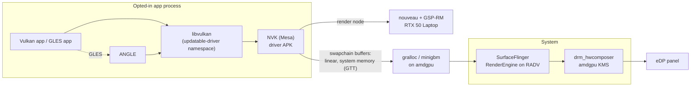

# NVIDIA dGPU on OpenBook: nouveau, NVK and PRIME offload for the G14's RTX 50 Laptop GPU (ANAL-187)

Status as of 2026-10-16. Labels:
- **CONFIRMED**: we read it in source code we have locally, in a primary source (kernel.org, freedesktop.org, android.googlesource.com, linux-firmware), or in our own test output.
- **REPORTED**: press, vendor marketing or user reports.
- **HYPOTHESIS**: our reasoning, not yet tested on the laptop.

Nothing in this document was run on the G14. It is research plus Linux-side reasoning, as the issue asked. Evidence is in `evidence/2026-10-16-nvidia/`.

**Which GPU:** the board is a GA403WR, which ASUS ships with the **RTX 5070 Ti Laptop (GB205)**, not the RTX 5070 Laptop (GB206) named in the issue title (§2). Everything below applies to both, because nouveau and linux-firmware treat them identically.

## Recommendation

1. **First OpenBook boot (ANAL-176): keep the dGPU off with `dgpu_disable=1`, set once from the G14's Linux after the owner confirms.** Without it the dGPU will most likely sit powered in D0 for the whole OpenBook session (§1). OpenBook should also carry a runtime-PM power-down as a second line of defence. `scripts/dgpu-power-check.sh` checks both, on Linux and on OpenBook. The cost: HDMI, which is wired to the dGPU, is unavailable while the flag is set.
2. **Using the dGPU on Android: no-go for M3–M8, conditional go for a research track (N1–N6) after M4.**
   - The open pieces exist:
     - nouveau with GSP-RM for GB20x since Linux 6.16, already in our 6.18 tree;
     - NVK, Vulkan 1.4 conformant on desktop Blackwell;
     - Zink;
     - Android's per-app driver switch.
   - Blockers today:
     - **NVK has no AHardwareBuffer support.** CDD 7.1.4.2 [C-3-1] requires it of any Vulkan driver, and ANGLE needs it to offer the EGL extension that 7.1.4.1 [C-2-2] requires.
     - **Android's graphics stack has no hybrid-GPU support.** It loads one Vulkan driver per process; gralloc and EGL each use one GPU.
     - **Runtime D3cold under nouveau is unproven on GB20x laptops.** Without it, loading the driver costs battery all day.
     - **The only RTX 5070 Laptop report shows about 5–10% of proprietary performance.**
3. **GSP firmware licence: redistributable in an OpenBook image** under `LICENCE.nvidia` §2.1.2 (OSI-licensed OS, unmodified binaries, licence text shipped alongside). There is no owner decision needed beyond the usual firmware-subset bookkeeping (§3).

## 1. Keeping the dGPU off on OpenBook's first boot

### What the inventory shows

- `dgpu_disable=0` and `gpu_mux_mode=1` (Optimus), read through both asus-armoury and asus-nb-wmi (`evidence/2026-10-16-ga403wr-inventory/asus-platform.txt`).
- The GPP bridge `00:03.1` has no device behind it, and no NVIDIA module is loaded (`lspci-nnk.txt`, `lsmod.txt`). `nvidia-smi` is installed but finds no device, so the NVIDIA driver package is on the laptop.
- **The OS removed the dGPU, not the firmware. The mechanism is CONFIRMED; that it is what happened on the owner's laptop is a HYPOTHESIS.**
  - Omarchy's `omarchy-toggle-hybrid-gpu` installs supergfxd with `"hotplug_type": "None"` and `"vfio_enable": true` (`evidence/2026-10-16-nvidia/omarchy-hybrid-gpu.txt`, read from the dev host's omarchy-dev 4.0.0).
  - In supergfxd (`src/actions.rs`, gitlab.com/asus-linux/supergfxctl, last commit 2025-11-08), Integrated mode always unbinds the dGPU and writes `1` to its sysfs `remove`. With `hotplug_type: None` it does nothing further; only `Asus` would set `dgpu_disable`. It also blacklists nouveau and nvidia in `/etc/modprobe.d/supergfxd.conf`.
  - A sysfs removal lasts until the next reboot. The firmware powers the dGPU at every power-on, and supergfxd removes it again about 5 s into Linux's boot.
  - Omarchy's own sleep hook adds that the G14 "will wake after suspend in Hybrid mode, even if the system was in Integrated mode before suspending". The same report exists as supergfxctl #165 (GA402XY, 2025-06) and Omarchy PR #4793 (G14 with RTX 5070 Ti, 2026-02).
  - `dgpu-power-check.sh` records `supergfxctl -g` and `/etc/supergfxd.conf` on its first Linux run, which settles this for the owner's laptop.

### Does the dGPU stay powered down when OpenBook boots with no NVIDIA driver?

**Most likely not (HYPOTHESIS, with each step CONFIRMED in our 6.18 source).** With `dgpu_disable=0`, the firmware powers and enumerates the dGPU before OpenBook starts, and nothing in OpenBook turns it off:

1. **No driver binds the GPU function.** The OpenBook kernel has `DRM_NOUVEAU`, `NOVA_CORE`, `DRM_NOVA` and `VFIO` all unset (`kernel-6.18-nouveau.txt`).
2. **The PCI core keeps an unbound device in D0.** Runtime PM is forbidden by default (`pm_runtime_forbid` in `pci_pm_init`). Even when userspace allows it, `pci_pm_runtime_suspend()` leaves an unbound device in D0; only the bridge above it can take it to D3cold (`kernel-6.18-pci-runtime-pm.txt`). Nothing in AOSP writes `power/control`; on Linux that is a udev or TLP job.
3. **The dGPU's HDMI-audio function keeps the link up.** `quirk_nvidia_hda` exposes function `.1`, and `snd_hda_intel` binds it (it is built as a module for the ALC285). NVIDIA HDA controllers only get runtime PM through vga_switcheroo (`init_vga_switcheroo()` sets `AZX_DCAPS_PM_RUNTIME`). The OpenBook kernel has `CONFIG_VGA_SWITCHEROO` unset and `CONFIG_SND_HDA_POWER_SAVE_DEFAULT=0`, so the controller never calls `pm_runtime_allow()`, and its codec never suspends. The bridge cannot suspend while one of its children is active. For comparison, the dev host's Arch kernel has `VGA_SWITCHEROO=y` and power_save=10, and there the RTX 4090's HDA function shows `power/control=auto`.
4. A side effect is an extra HDMI sound card from the dGPU that OpenBook's audio HAL could pick up.

So with `dgpu_disable=0`, OpenBook would run with the dGPU in D0 and no driver managing its clocks.

### Options compared

| | `dgpu_disable=1` (asus-wmi, firmware) | Runtime PM to D3cold with no driver | GPP bridge power resources directly |
|---|---|---|---|
| How | Write `1` to `/sys/devices/platform/asus-nb-wmi/dgpu_disable` (or asus-armoury's `dgpu_disable/current_value`) from Linux, then reboot | OpenBook init writes `auto` to `power/control` of every NVIDIA function and keeps `snd_hda_intel` off the HDA function, by unbinding it or by removing the functions as the Arch wiki's udev rule does. The root port then runtime-suspends, and ACPI `_PR3` turns the slot off | Call the bridge's `_OFF` methods by hand (acpi_call/bbswitch era) |
| Off during OpenBook's whole boot | Yes. The flag is saved by firmware (kernel commit `98829e84dc67`: "the WMI call saves the state of dGPU") and is the same flag as Armoury Crate's Eco mode. In a GA403WM ACPI dump (a sibling model, REPORTED), setting it ejects `\_SB.PCI0.GPP9.PEGP`, runs `PG00._OFF`, makes `PEGP._STA` return 0 and skips `PG00._ON`, so the GPU is never enumerated | Only after init runs; during early boot the GPU is in D0 | Only after the call |
| Depends on | ASUS firmware honouring the flag on GA403WR | The DSDT, our init hook, and the root port being allowed into D3 (`pci_bridge_d3_possible`). The GA403WM dump lists `PG00` in the root port's `_PR0`/`_PR2`/`_PR3`, with `_S0W` = 4 (D3cold), on GPP9 = 00:03.1, the same bridge as our inventory (REPORTED). Two caveats: `PG00._OFF` only cuts power when `EC0.VIUF == 0`, which is undocumented, and an ASUS ProArt PX13 with its dGPU on 00:03.1 fails to bring it back from D3cold after s2idle (lkml, 2026-04-03) | Knowing the DSDT method names; out-of-tree module |
| Persistence | Persists in firmware until set back to 0 (REPORTED). Affects Linux and Windows too | Per boot, undone by a reboot | Per boot |
| Risk | **The HDMI port goes dark**, because HDMI is wired to the dGPU (see below). The owner's Linux loses the dGPU until the flag is set back, and supergfxd with `hotplug_type: None` will not do that. If the owner already runs supergfxd in Integrated mode, Linux has neither today, so nothing changes. The 6.18 kernel refuses to combine the flag with dGPU-only MUX mode (`asus-wmi-6.18.txt`): "Can not switch MUX to dGPU mode when dGPU is disabled". The driver comment says re-enabling may need a second write after a PCI rescan | A config-space read (`lspci`) wakes the port. If `_PR3` is missing, the port only reaches D3hot and the GPU stays powered | Bypasses Linux PM bookkeeping: the kernel still believes the device is in D0. Known causes of hangs and AER errors |
| Who acts | The owner, or the device agent with the owner's explicit confirmation (a firmware setting) | OpenBook image (G14 product, ANAL-199), no owner action | — |

**Not recommended: calling the power resources directly.** Linux runtime PM already drives exactly those `_PR3` resources, and it keeps the kernel's view consistent.

### Battery cost if it stays on

No measurement exists for a driverless RTX 50 Laptop. The numbers below are REPORTED unless stated otherwise.

| State | dGPU draw | Source |
|---|---|---|
| D3cold / not enumerated | ≈ 0 W. The whole G14 2025 idles at 6.7–9.3 W (Notebookcheck, GA403WW, Windows, 2025-05-12). A GA403WM on Linux idles at about 7–8 W, and that guide treats more than about 12 W as a sign the dGPU is awake | Notebookcheck; community setup guide (2026-04) |
| D0, NVIDIA driver idle (P8) | 5–7 W. An RTX 5080 Laptop showed 7 W in `nvidia-smi`, and system draw fell from 35 to 29 W once it reached D3cold | asusctl #684 (2025-10); Arch forum #311985 (2026-02-04) |
| D0, no driver (OpenBook with `dgpu_disable=0` today) | Unknown for RTX 40/50. The only proxy is a 2018 GT 740M at +2.5 W. With no driver there is no idle clock policy. **HYPOTHESIS:** at least the P8 figure, so +5 W, and plausibly +10 W | kernel bugzilla 201465 |

What this means for OpenBook (HYPOTHESIS):
- The battery holds 4.063 Ah at about 15.9 V, so about 65 Wh (inventory `power-supply.txt`).
- At an 8 W idle that is about 8 h. Adding 5 W gives about 5 h (−38%); adding 10 W gives about 3.6 h (−56%). The GPU also adds heat and fan noise.
- Our own inventory sample, 16.3 V × 1.064 A = 17.4 W, was taken while the inventory script ran, not at idle.
- `dgpu-power-check.sh --sample 300` measures the real difference: run it once in each state, on battery.

### Default for ANAL-176

1. **Before the first OpenBook boot**, the device agent runs `scripts/dgpu-power-check.sh --sample 120` on the G14's Linux, on battery. This is read-only. It records:
   - the supergfxd mode;
   - whether the slot's ACPI power resources exist and whether they are off;
   - the battery draw.
2. **Owner decision (made 2026-10-16 on ANAL-187: keep the dGPU disabled for now):** set `dgpu_disable=1`, with `gpu_mux_mode` left at 1:
   ```bash
   cat /sys/devices/platform/asus-nb-wmi/gpu_mux_mode       # must print 1 (Optimus); never disable the dGPU in dGPU-only MUX mode
   echo 1 | sudo tee /sys/devices/platform/asus-nb-wmi/dgpu_disable
   sudo reboot
   ```
   Rollback: `echo 0 | sudo tee /sys/devices/platform/asus-nb-wmi/dgpu_disable`, then reboot. The kernel comment allows that a second write after a PCI rescan may be needed. On 6.19+ kernels the same attribute is under `/sys/class/firmware-attributes/asus-armoury/attributes/dgpu_disable/current_value`.
3. **After the reboot into Linux**, run the check again. It must report `absent-off` with `dgpu_disable=1`.
4. **First OpenBook boot:** the test hook runs `dgpu-power-check.sh --sample 120 --out /data/local/tmp/dgpu.json` and expects `PASS: absent-off`. A `FAIL: d0-no-driver` means the firmware flag did not hold. In that case run `--try auto` and then `--try remove` in the same session to measure the D0→D3cold saving.
5. **OpenBook keeps a fallback (for the G14 product, ANAL-199, to add):** an early-boot init hook that does what `--try auto` does whenever a `10de` device is enumerated. This needs no owner action and covers machines where nobody set the flag. It is only useful if the test shows the slot reaching D3cold.

If the owner prefers not to touch the firmware flag, use step 5 alone and accept a powered dGPU during early boot. The test then decides whether that is good enough: PASS means `d3cold` after the hook, and the `--sample` data gives the battery difference.

### The test (`scripts/dgpu-power-check.sh`)

- **Shells:** POSIX sh. It is tested under bash and under AOSP's own mksh R59 with toybox applets. Battery maths stays inside mksh's 32-bit arithmetic.
- **Read-only by default.** It only reads sysfs, and never runs `lspci` or reads PCI config space, because that would wake a suspended GPU. It never writes `dgpu_disable` or `gpu_mux_mode`.
- **Output:** one JSON object (`openbook.dgpu-power-check/1`) with:
  - the asus-wmi state and supergfxd mode;
  - every NVIDIA function with its driver, `power_state`, `runtime_status` and `control`;
  - the root port's PCI and ACPI power state, its `_PR0`/`_PR3` power resources with `resource_in_use`, and its ACPI children;
  - battery power, sampled when asked;
  - a verdict.
- **Exit codes:** 0 PASS (`absent-off`, `d3cold`), 1 FAIL (`d0-no-driver`, `absent-powered`), 2 WARN (`d3hot`, `d0-driver`, `absent-unknown`), 3 usage.
- **`--try auto|remove`** needs root and is volatile: a reboot undoes it. It then re-checks after 15 s.
- **Fixture tests:** `scripts/dgpu-power-check-test.sh` builds fake sysfs trees for nine cases, including "OpenBook today": GPU in D0, no driver, HDA bound. Results: `evidence/2026-10-16-nvidia/fixture-tests.txt`, 9/9 under bash and 9/9 under mksh. A run on the dev host's RTX 4090 is in `devhost-rtx4090-run.json`, which correctly reports `d0-driver`.

**The HDMI port is on the dGPU.** amdgpu exposes `eDP-1` and eight DP connectors (USB-C/USB4 alt mode) but no HDMI-A connector (`drm-connectors.txt`, CONFIRMED). Reports agree:
- Notebookcheck says only the left USB-C port of the G14 2025 runs from the iGPU (REPORTED).
- A CachyOS report says HDMI dies with `dgpu_disable=1` on a 2025 ROG (REPORTED).

So with the dGPU off, OpenBook drives external displays through USB-C only, and HDMI output would need nouveau display (§5, topology C).

## 2. Kernel: nouveau, Nova and GSP on GB20x (task 1)

### Which GPU

- **The GA403WR is the RTX 5070 Ti Laptop SKU, not the RTX 5070.**
  - ASUS's G14 2025 spec page lists the GA403WR with the RTX 5070 Ti Laptop (12 GB, 110 W) (CONFIRMED). Notebookcheck lists that GPU as GB205 (REPORTED).
  - The RTX 5070 Laptop (GB206, 8 GB, 90 W) is in the GA403WP (HX 370) and the GA403UP (Ryzen 9 270).
- The difference does not change this document. nouveau and linux-firmware treat GB205 and GB206 identically: both are linked to `gb202`, with the same GSP-RM 570.144 and the same display code.
- The exact PCI ID needs one Linux boot with the dGPU enabled.

### nouveau

| Area | State for GB20x | Label |
|---|---|---|
| Support | Since Linux 6.16: `53dac0623853` (GSP-RM 570.144), `284ad706ad2f` (GB20x), `6cc6e08d4542` (KMS). All three are in our 6.18.21 tree, together with `664ce10246ba` (correct GB20x modifiers, 6.18) | CONFIRMED (local git log) |
| GB206 device entry | `nv1b6_chipset`: FSP/FMC boot, GSP-RM 570.144, display through GSP-RM's `GB202_DISP` classes | CONFIRMED (`kernel-6.18-nouveau.txt`) |
| Firmware | linux-firmware ≥ 20250613: `nvidia/gb202/gsp/{bootloader,fmc}-570.144.bin`, and `gsp-570.144.bin` → the ga102 image (60.6 MB uncompressed, 49.4 MB as .zst). `gb205`/`gb206` → `gb202` | CONFIRMED (local linux-firmware `38c1a709`, Arch 20260916) |
| Display (KMS) | Works at a basic level. v7.3-rc2 adds five GB20x display fixes, marked for stable: vblank interrupts never re-armed, head state readback, HDMI AVMute offsets, HDMI vendor infoframes, DP stream-config size on r570. No GB20x eDP report found | Fixes REPORTED from upstream commits; eDP UNKNOWN |
| Render | Channels and VM_BIND through GSP-RM. NVK works on it. The uAPI NVK and Zink need (`VM_BIND`, `EXEC`, `HAS_VMA_TILEMODE`) is in our 6.18 tree | CONFIRMED |
| Performance | Clocks are GSP-RM's job. The only RTX 5070 Laptop (GB206) report, nouveau #465 (Legion 7 G10, 6.18, 2025-12-03, open), says it boots and NVK works, but at "maybe 5 to 10%" of the proprietary driver, with fans staying low. Desktop Blackwell is reported at 40–50% | REPORTED |
| Stability | #479 (desktop RTX 5080/GB203): Xid 13 then a hang, on 6.16.7–6.19.8 (open) | REPORTED |
| Runtime PM (D3cold) | Code exists: the `runpm=-1` default enables it on Optimus, and GSP state is saved through `r535_gsp_fini(..., NVKM_RUNTIME_SUSPEND)`. Lyude Paul (2026-07-27): runtime PM "has been notoriously flakey since we started using the R570 GSP firmware". **Our 6.18.21 carries the stable backport `ef763b480a3d` of `8302d0afeaec`. Upstream reverted that in v7.3-rc4 because it "causes runtime PM to actually fail on many a laptop".** More fixes landed in 7.3-rc4 to rc7. All test hardware named is Ampere or Ada. GB20x laptop: UNKNOWN | Code CONFIRMED; behaviour REPORTED / UNKNOWN |
| System suspend (s2idle) | Same GSP save/restore path, reworked in 7.3-rc. NVIDIA's own driver has an open s2idle hang on a Framework 16 with an RTX 5070 Laptop on 7.0+ (open-gpu-kernel-modules #1117) | REPORTED |
| Platform power (NVPCF, `NVDA0820` on the G14) | No in-tree driver: 0 matches in our 6.18 tree. Only NVIDIA's out-of-tree driver and `nvidia-powerd` use it, for Dynamic Boost. Under nouveau the device stays unbound, and ASUS's 0xC0 notifications to it go unhandled | CONFIRMED for 6.18; the impact on power limits is a HYPOTHESIS |

### Nova

- **Not usable for OpenBook in 2026 (CONFIRMED).**
- nova-core boots GSP on Hopper/Blackwell from 7.2. The author's test card was a GB202.
- nova-drm's uAPI is GETPARAM, GEM_CREATE and GEM_INFO only: no command submission, no VM_BIND, no display.
- There is no userspace, and NVK only runs on nouveau.
- From 7.3 Nova wants unversioned `gsp.tlv` firmware files that linux-firmware does not have yet.
- Upstream's stated plan is for Nova to supersede nouveau on GSP GPUs. That is a long-term risk for any nouveau investment. Today, though, nouveau is where Blackwell fixes land.

### GKI

- **nouveau is not in GKI.** The x86_64 `gki_defconfig` (android17-6.18 and android-mainline) has no `DRM_NOUVEAU`, so it has to be a vendor module, built the way ANAL-171 built amdgpu.
- The GKI ABI lacks `drm_exec`, `drm_gpuvm`, `drm_sched`, the DP/display helpers, `drm_buddy`, `i2c_bit_add_bus`, `acpi_video_register`, WMI/MXM and `vga_switcheroo`.
- **CONFIRMED:** amdgpu already brought most of these in as OpenBook vendor modules: `drm_exec`, `gpu-sched`, `drm_buddy`, `drm_display_helper`, `drm_ttm_helper`, `drm_suballoc_helper`, `i2c-algo-bit`, `video` and `wmi`. nouveau's Kconfig adds only `DRM_GPUVM` and `MXM_WMI`, plus nouveau itself. vga_switcheroo is optional for nouveau.
- **HYPOTHESIS:** the extra KMI work is small next to amdgpu's 129 symbols.

## 3. GSP firmware licence (task 2)

**CONFIRMED** from linux-firmware `38c1a709` (2026-10-16), whose `LICENSES/LICENCE.nvidia` is byte-identical to Arch's 20260916 copy (sha256 `bc5225a5…`):
- WHENCE lists `nvidia/gb202/gsp/*` and the `gb205`/`gb206` links under `Licence: Redistributable. See LICENCE.nvidia for details` (`SPDX: LicenseRef-LICENCE.nvidia`).
- Upstream git history (our local clone is shallow) shows two commits: the original add in 2015 (`c91690d6`) and a pure rename into `LICENSES/` in 2026 (`1221848f`, first in release 20260622). So the text has not changed since 2015.

What it allows and requires:
- **§2.1.2 Open Source Exception.** The firmware "may be copied and redistributed solely for use on operating systems distributed under the terms of an OSI-approved open source license", provided the binaries are not modified and a copy of the licence ships with them.
- **Track A (OpenBook, AOSP-based).** Apache-2.0 userspace plus a GPL-2.0 kernel is an OSI-licensed OS, so OpenBook images may include the files. Conditions:
  - ship them unmodified;
  - ship `LICENCE.nvidia` next to them;
  - list them in the firmware subset with their WHENCE licence, as `docs/kernel.md` already does for amdgpu, MediaTek and Cirrus.

  Re-compressing them (.zst or .xz) or stripping them changes the files the user receives. **HYPOTHESIS:** shipping them uncompressed is the safest reading. That costs 61 MB in `vendor`, because the OpenBook kernel has `FW_LOADER_COMPRESS` off anyway.
- **Track B (Google's proprietary image).** It is not an OSI-licensed OS, so §2.1.2 does not obviously cover redistribution inside it. Track B ships scripts only, so users would install linux-firmware's files on their own machine. Treat this as part of the open Track B licensing decision.
- **Other clauses.**
  - No reverse engineering.
  - Use only on NVIDIA processors.
  - No translation.
  - Defensive suspension if the licensee sues NVIDIA.

  None of these limits OpenBook as a distributor of unmodified files.
- **Owner decision: none needed for Track A.** This licence is weaker than Apache-2.0, so the image's licence notices must list it separately.

## 4. Userspace: NVK, Zink and ANGLE against Android's requirements (task 3)

| Question | Answer | Label |
|---|---|---|
| NVK on Blackwell | Added in Mesa 25.2.0 ("nvk Blackwell support"). Mesa 26.2.5 reports conformance version 1.4.3 for `BLACKWELL_B` (`0xCE97`, the GB20x class), as it does for Kepler–Ada. Mesa's docs call NVK "a conformant Vulkan 1.4 implementation for all officially supported GPUs". Khronos submission #935 (2025-08-01) lists desktop RTX 5060–5090 and RTX PRO Blackwell, **but no Laptop GPU**. Upstream CI has no Blackwell machine (GA106 and AD106 only). There is no ray tracing, and video decode is experimental | CONFIRMED (Mesa 26.2.5 source and docs, Khronos list) |
| NVK on Android | Builds with `-Dplatforms=android`, which adds `nvk_android.c`. It exposes `VK_ANDROID_native_buffer` when a gralloc is found. `QueueSignalReleaseImageANDROID` waits for the queue to go idle and returns no fence, as a workaround "to workaround nouveau not supporting native_fence_fd cap". Shipped since Mesa 25.0 (MR !30833, Mauro Rossi). Android build steps for NVK are in docs.mesa3d.org/android.html (aarch64 examples). **No AHardwareBuffer support (`VK_ANDROID_external_memory_android_hardware_buffer`): 0 files in `src/nouveau/vulkan/` mention it, while RADV has it** | CONFIRMED (source, Mesa docs) |
| Building NVK | Needs Rust: NAK, the shader compiler, is in Rust. Mesa needs rustc ≥ 1.85 and meson ≥ 1.7. Our ANAL-173 build has no Rust and builds only `radeonsi` and `amd` | CONFIRMED |
| GL on nouveau | Zink is the default on Turing+ from Mesa 25.1 and the only option on Blackwell (`nouveau_zink_predicate`: chipset ≥ 0x1a0 forces Zink). NVK+Zink is a conformant OpenGL 4.6 | CONFIRMED (Mesa source and docs) |
| Zink on Android | Mesa's Android EGL can load Zink. Zink then goes through Android's `libvulkan`, which holds a single driver, so NVK would have to be that process's Vulkan driver. Mesa's Android EGL also picks one GPU per process (`drm.gpu.vendor_name` or the first that works). There is no Zink-on-Android documentation or CI upstream, and no Blackwell Zink conformance entry | CONFIRMED (source); maturity UNKNOWN |
| ANGLE on NVK | ANGLE's Vulkan backend needs only a conformant Vulkan driver, but the AOSP 17 snapshot does not recognise NVK. It sees vendor `0x10de` and applies the proprietary NVIDIA path, including its driver-version parser (`android17-graphics-loading.txt`). On Android, ANGLE offers `EGL_ANDROID_image_native_buffer` only when the Vulkan driver has the AHB extension and `VK_EXT_queue_family_foreign` (`supportsAndroidHardwareBuffer`), and NVK has no AHB. Upstream ANGLE main (2026-10-16) also has no NVK handling | CONFIRMED (source); impact of misapplied NVIDIA workarounds is a HYPOTHESIS |
| What Android 17 requires (CDD, updated 2026-08-31) | **7.1.4.1 GLES:**<ul><li>[C-1-1]: GLES 1.1–3.1 MUST; 3.2 SHOULD.</li><li>[C-2-2]: required EGL extensions include `EGL_ANDROID_image_native_buffer` and `EGL_ANDROID_get_native_client_buffer`.</li></ul>**7.1.4.2 Vulkan:**<ul><li>Vulkan 1.3 is STRONGLY RECOMMENDED.</li><li>[C-1-7] (new in 17): present-wait/present-id and related WSI extensions are MUST.</li><li>**[C-3-1]: a Vulkan 1.1 device MUST expose SYNC_FD and `VK_ANDROID_external_memory_android_hardware_buffer`.**</li><li>Android Baseline 2022 is STRONGLY RECOMMENDED; the handheld section requires Baseline 2021.</li></ul>No laptop device type; no ANGLE mandate yet. Google's developer docs say GLES will "ultimately" be available only through ANGLE, and Android 17 adds a per-app `prefer_angle` manifest flag | CONFIRMED (source.android.com, developer.android.com) |

**Viability:**
- **Vulkan through NVK is not Android-compliant today.**
  - It meets the API version: 1.4 against a 1.1 MUST and a 1.3 recommendation.
  - It fails [C-3-1], because it has no AHB support.
  - It also stalls the CPU on every present.
  - **Adding AHB support to NVK is the first piece of real work**, and an upstreamable one.
- **GLES has two routes, ANGLE on NVK and Mesa EGL with Zink. Neither works yet.**
  - **ANGLE on NVK** is the route Android itself is moving to. It cannot offer `EGL_ANDROID_image_native_buffer` until NVK has AHB, so it cannot be a compliant system GLES today. ANGLE also needs to recognise NVK.
  - **Zink** has no Android track record at all.
  - Both sit on NVK, so both inherit its AHB gap and its missing present fence.
- **Prior art is thin.**
  - NVK on Android-x86 (Android 11) with an RTX 2060 passed 568,820 of 568,899 dEQP-VK tests (MR !30833, CONFIRMED).
  - Bliss OS enables NVK when it detects nouveau. It also has a `minigbm_nouveau` gralloc (Android-Generic's minigbm, "need more testing", 2026-03).
  - Neither project has published Blackwell or hybrid-laptop results.
  - ChromeOS Flex picks one GPU and calls NVIDIA "likely to be unstable".

## 5. PRIME render offload on Android: what exists, what to build

### What Android 17 does today (CONFIRMED in the cp2a tree, `android17-graphics-loading.txt`)

- **One Vulkan driver per process.** `libvulkan` loads the per-app updatable driver if one is set for the app. Otherwise it loads the built-in `vulkan.<ro.hardware.vulkan>.so`. It never enumerates two drivers, so there is no Khronos-loader-style multi-ICD, no `DRI_PRIME` and no device-select layer.
- **The per-app switch already exists.** `ro.gfx.driver.0` names a driver APK. The Global settings `updatable_driver_production_opt_in_apps`, `updatable_driver_all_apps` and the ANGLE per-app lists choose which processes load it. Settings has a "Graphics Driver Preferences" page under Developer options (`development/graphicsdriver/`). The EGL loader honours the same namespace. If an app is opted in and per-app ANGLE is not selected, the APK must also provide GLES, or EGL aborts.
- **One gralloc device.** minigbm opens the first `/dev/dri/renderD*` that matches a backend, with no property to choose. Its nouveau backend is a dumb-buffer (CPU/KMS) backend only. A full nouveau backend, by Faith Ekstrand, lives only in Android-Generic's minigbm (REPORTED).
- **One EGL GPU.** Mesa's Android EGL picks a single GPU per process.
- **HWC opens every card.** drm_hwcomposer opens every `/dev/dri/card%` unless `vendor.hwc.drm.device` pins one.
- **SurfaceFlinger uses the system driver.** Its RenderEngine runs on the system GLES/Vulkan driver, in the same process model as apps.

**Consequence: with today's code, loading nouveau can silently move the whole system's gralloc to the NVIDIA GPU.** That happens whenever nouveau's render node gets the lower minor number. So any NVIDIA work must first pin minigbm and drm_hwcomposer to amdgpu.

### Three topologies

| | A: per-app offload (recommended target) | B: whole system on the dGPU, iGPU scanout | C: dGPU-only MUX |
|---|---|---|---|
| Who renders | System UI and most apps on the 890M (RADV, ANGLE on RADV). Opted-in apps on the dGPU (NVK, ANGLE on NVK) | Everything on the dGPU | Everything on the dGPU |
| Who scans out | amdgpu (eDP), as today | amdgpu | nouveau KMS (eDP and HDMI) |
| dGPU power | Off unless an opted-in app runs, if nouveau runtime D3cold works | Always on | Always on |
| Android changes | NVK AHB support and sync-fd fix, a driver APK with NVK (+ANGLE), gralloc linear/GTT allocation for cross-GPU swapchains, device pinning | Gralloc on amdgpu with linear GTT for every buffer, or a copy per frame; ro.hardware.* on NVK | minigbm needs a real nouveau/gbm backend (gbm_mesa); HWC on nouveau |
| Battery | Good if D3cold works | Poor | Poor; also needs a MUX change and a reboot (firmware setting) |
| Use | Games and GPU compute on demand | Plugged-in "performance mode" | Demo or plugged-in mode. HDMI output needs nouveau display in any topology, because HDMI is wired to the dGPU |

### Topology A in detail



What exists and what must be built:

| Piece | Exists today | To build or verify |
|---|---|---|
| Per-app driver selection, settings UI | Yes, AOSP 17 (`GraphicsEnvironment`, Settings "Graphics Driver Preferences") | Package NVK as a driver APK (`ro.gfx.driver.0`). The library must be named `vulkan.<ro.hardware.vulkan>.so` inside the APK. Ship ANGLE in the same APK, or force per-app ANGLE for those apps |
| NVK on Android | Builds with `-Dplatforms=android`. `nvk_android.c` implements `VK_ANDROID_native_buffer` (Mesa 26.2.5) | **AHardwareBuffer support (`VK_ANDROID_external_memory_android_hardware_buffer`)**, which the CDD requires and apps rely on for camera, video and AHB interop. A Rust cross-toolchain for `x86_64-linux-android` in our Mesa build (NAK is Rust; Mesa needs rustc ≥ 1.85, bindgen ≥ 0.71.1 and meson ≥ 1.7). Make `vkGetSwapchainGrallocUsage4ANDROID` ask for linear, system-memory buffers when the display GPU differs. Replace the `QueueWaitIdle` + fence −1 workaround in `QueueSignalReleaseImageANDROID` with a real sync-file export, or every frame stalls the CPU |
| Gralloc | minigbm amdgpu backend (tiled + linear) | Map that usage to linear GTT on amdgpu. Pin minigbm to amdgpu (small patch: choose by driver name, not by first render node) |
| Display | drm_hwcomposer on amdgpu | Set `vendor.hwc.drm.device` to the amdgpu card. NVK renders straight into a linear colour buffer when its address and row stride are 128-byte aligned; otherwise it renders to a tiled shadow and copies (`nvk_rendering_linear()`, CONFIRMED). amdgpu's 256-byte linear pitch satisfies that, so a gralloc-allocated linear buffer needs no extra copy (HYPOTHESIS until measured) |
| Cross-device buffer sharing | dma-buf PRIME between nouveau and amdgpu in system memory (standard on Linux) | Test nouveau importing amdgpu GTT dma-bufs as render targets on Blackwell |
| ANGLE on NVK | ANGLE's Vulkan backend runs on any conformant driver | ANGLE (AOSP 17 snapshot `1f4500d390`) classifies any `0x10de` device as the proprietary NVIDIA driver: it applies NVIDIA workarounds and parses NVK's Mesa version with the NVIDIA parser (`android17-graphics-loading.txt`). Needs an NVK driver-ID check upstream, or our patch, and NVK AHB support before ANGLE will offer `EGL_ANDROID_image_native_buffer`. Run dEQP-GLES on it |
| Kernel | nouveau with GB20x GSP-RM support is in our 6.18 tree | Build nouveau as a vendor module (new KMI symbols, as for amdgpu). Ship GSP firmware (61 MB uncompressed). Prove runtime D3cold and s2idle with GSP |
| SELinux/ueventd | `gpu_device` labels for render nodes | Label the second render node; let the driver APK's namespace open it |

**HYPOTHESIS: topology A needs no change to SurfaceFlinger, the HWC HAL interface or app-facing APIs.** It is all driver-side work (NVK AHB and fences, packaging) plus small gralloc and minigbm patches.

The cost is a PCIe-bound present path: the dGPU writes the final image to system memory. At 2880×1800×4 B×120 Hz that is about 2.5 GB/s. That is well inside a PCIe 4.0 ×8 link, but it is extra traffic. Two ways to avoid it if it hurts:
- render to VRAM and copy once at present;
- topology B.

Mesa's desktop "prime blit" path (`wsi_common_drm.c`) does exactly this on Linux, but on Android the platform loader owns the swapchain, so that code is not used.

## 6. Go / no-go and milestones

**No-go for M3–M8.** OpenBook's first releases ship with the dGPU off (§1). Nothing NVIDIA-related goes into the bring-up image except the power-down hook.

**Conditional go for an NVIDIA research track under ANAL-186, starting after M4** (AMD graphics working on the G14). Each milestone is small, has a verification artifact, and passes a gate before the next one starts.

| # | Milestone | Done when (evidence) | Gate / owner action |
|---|---|---|---|
| N0 | dGPU off by default (this issue → ANAL-176) | `dgpu-power-check.sh` reports PASS on Linux and on the first OpenBook boot (`absent-off`) | Owner confirms `dgpu_disable=1` |
| N1 | OpenBook power-down hook for an enumerated dGPU | Init hook in the `device/anybook` product; on the G14 with `dgpu_disable=0`, the check reports `d3cold` and `--sample` shows the saving | Needs `_PR3` in the DSDT, which the N0 run tells us |
| N2 | nouveau as a vendor module on the OpenBook kernel | 1. `nouveau.ko` plus `drm_gpuvm`, `mxm-wmi` etc. build against the OpenBook KMI. 2. On the G14 (`dgpu_disable=0`, Optimus) dmesg shows GSP-RM 570.144 booting on GB205/GB206. 3. 20 runtime D3cold↔D0 cycles and 20 s2idle cycles with the dGPU suspended, all logged. **First on the G14's Linux (stock 7.3+ nouveau)**, then on OpenBook | Owner: temporarily stop supergfxd removing the dGPU and blacklist nvidia on Linux for the test. **Go/no-go: if runtime D3cold is not reliable, stop here.** Without it the dGPU costs battery whenever nouveau is loaded |
| N3 | NVK headless on OpenBook, then AHB | 1. Mesa built with `-Dvulkan-drivers=amd,nouveau` plus a Rust Android toolchain. 2. `vulkaninfo` and a dEQP-VK subset on the NVK render node; no display involved. 3. AHB support in NVK, written to go upstream, passing `dEQP-VK.api.external.memory.android_hardware_buffer.*` | The Mesa libelf licensing decision (already open) covers NVK as well |
| N4 | Per-app offload prototype (topology A, §5) | `vkcube`, then one Vulkan game, rendered on NVK and presented on amdgpu. fps compared with RADV on the 890M; dGPU runtime-suspends after the app exits | minigbm and drm_hwcomposer pinned to amdgpu first |
| N5 | GLES apps on the dGPU via ANGLE on NVK | dEQP-GLES 3.2 subset on ANGLE-on-NVK; ANGLE's NVIDIA-vendor workarounds checked against NVK | ANGLE patch or upstream fix for NVK detection |
| N6 (optional) | Plugged-in performance or HDMI mode | Topology B, or C (dGPU MUX). Only if N2–N5 hold and the owner wants it | MUX change is a firmware setting: owner confirmation |

## 7. Risks (ranked)

1. **Runtime PM on r570 GSP firmware is unproven on GB20x laptops.** It has been reworked upstream through 7.3-rc7, and our 6.18 tree carries a backport that upstream later reverted. If it does not work, loading nouveau keeps the dGPU on.
2. **Performance.** The one GB206 report is 5–10% of the proprietary driver, with fans staying low. A dGPU that slow is not worth enabling. N4 must measure it against the 890M before any further work.
3. **Android has no hybrid-GPU plumbing.** minigbm takes the first render node and drm_hwcomposer opens every card, so nouveau must be hidden from both. Topology A needs Mesa, gralloc and ANGLE changes that nobody upstream has made for Android.
4. **NVK on Android is thin.**
   - The only Android code is the WSI glue, with a "wait idle, return no fence" workaround, and there is no AHB support. That makes it non-compliant with CDD 7.1.4.2 [C-3-1].
   - The only Android users are Android-x86 and Bliss OS on Turing, and there is no upstream Android CI for it.
   - Blackwell has no upstream test machine, and Khronos conformance covers desktop RTX 50 cards only.
5. **Nova may replace nouveau** for GSP GPUs. Work on nouveau-specific kernel glue could become throwaway. The NVK, Android and gralloc work would carry over.
6. **Size.** 61 MB of GSP firmware in `vendor`, plus NVK, NAK and Zink libraries.
7. **Firmware state on the owner's laptop.** `dgpu_disable` and the MUX persist across operating systems. Every change needs the owner's confirmation, and the rollback steps must be written down before it happens.

## Sources (all read 2026-10-16 unless dated otherwise)

**Local, CONFIRMED** (excerpts in `evidence/2026-10-16-nvidia/`):
- **OpenBook kernel:** `~/anybook/kernel/src/common` (android17-6.18, 6.18.21, `44a90255c95f`) and its config `~/anybook/kernel/amd/cfg/device.config`.
- **Mesa:** 26.2.5 (`~/anybook/mesa/src/upstream`), including `docs/drivers/nvk.rst` and `docs/relnotes/25.2.0.rst`.
- **AOSP 17 cp2a tree:** `frameworks/native/vulkan/libvulkan/driver.cpp`, `frameworks/native/opengl/libs/EGL/Loader.cpp`, `frameworks/base/core/java/android/os/GraphicsEnvironment.java`, `packages/apps/Settings/.../graphicsdriver/`, `external/minigbm`, `external/drm_hwcomposer`, and `external/angle` (`1f4500d390`, 2026-05-07).
- **linux-firmware:** `38c1a709` (2026-10-16) WHENCE and `LICENSES/LICENCE.nvidia`, and the Arch `linux-firmware-nvidia 20260916`.
- **Omarchy:** omarchy-dev 4.0.0 (`/usr/bin/omarchy-toggle-hybrid-gpu`, `default/systemd/system-sleep/force-igpu`).

**Upstream, primary:**
- Linux commits `284ad706ad2f`, `6cc6e08d4542` and `53dac0623853` (GB20x and GSP-RM 570.144, 6.16), `664ce10246ba` (6.18) and `8302d0afeaec` (6.19, reverted in v7.3-rc4 by `a5c41fa7f925`). GB20x display fixes in v7.3-rc2: `5bb489b33323`, `9421dfe912e5`, `764deff8450c`, `92f09dcb4e84`, `39fd4b742720`. Runtime-PM fixes in v7.3-rc4 to rc7: `12f6eff11ccf`, `24fbd6d4bcf3`, `bbb9293c9bb7`, `cb4c7603678c`, `82f4394bbe22`, `adb87c20081e`, `4d0e27041185`. asus-wmi `98829e84dc67` (2021).
- **Nova:** `Documentation/gpu/nova/index.rst`. The Blackwell series v9 cover letter (2026-03-25): https://lkml.iu.edu/hypermail/linux/kernel/2603.3/04968.html.
- **Lyude Paul on r570 runtime PM** (2026-07-27): https://ratatoskr.run/lkml/2026/07/17325314/t.
- **linux-firmware WHENCE:** https://gitlab.com/kernel-firmware/linux-firmware/-/raw/main/WHENCE. GB20x files first appeared in release 20250613.
- **Mesa:**
  - https://docs.mesa3d.org/drivers/nvk.html
  - https://docs.mesa3d.org/android.html
  - https://docs.mesa3d.org/relnotes/25.2.0.html
  - MR !30833 (NVK Android, Mesa 25.0)
- **Khronos Vulkan conformance #935** (2025-08-01): https://www.khronos.org/conformance/adopters/conformant-products#submission_935.
- **Android:**
  - Android 17 CDD (2026-08-31): https://source.android.com/docs/compatibility/17/android-17-cdd
  - https://developer.android.com/games/develop/vulkan/overview (2026-10-08)
  - https://source.android.com/docs/core/graphics/implement-vulkan
- **supergfxctl** `src/actions.rs` and `src/config.rs`: https://gitlab.com/asus-linux/supergfxctl (2025-11-08).
- **ASUS:**
  - G14 2025 spec: https://rog.asus.com/us/laptops/rog-zephyrus/rog-zephyrus-g14-2025/spec/
  - Eco mode FAQ (2026-10-13): https://www.asus.com/support/faq/1043747/
- **NVIDIA RTD3 README** (580.95.05): https://download.nvidia.com/XFree86/Linux-x86_64/580.95.05/README/dynamicpowermanagement.html.
- **ChromeOS Flex:** https://support.google.com/chromeosflex/answer/12017159 and https://support.google.com/chromeosflex/answer/11541806.

**Reports (REPORTED):**
- **nouveau tracker:**
  - #465 (RTX 5070 Laptop, 2025-12-03): https://gitlab.freedesktop.org/drm/nouveau/-/work_items/465
  - #479 (RTX 5080, 2026-03-23)
  - #428 (G14 GA401QM runtime suspend, 2025-05-15)
- **NVIDIA open-gpu-kernel-modules:** #1117 (Framework 16 s2idle, 2026-04-22) and #1283 (G16 GU605CX, 2026-08).
- **supergfxctl #165** (2025-06), Omarchy PR #4793 (2026-02), asusctl #684 (2025-10), Arch forum #311985 (2026-02-04), kernel bugzilla 201465.
- **GA403WM ACPI dump** (2026-10-12): https://github.com/thanhnndev/ga403wm-hackintosh/tree/main/abi/acpi/ga403wm/20261012. G14 2025 Linux guide (2026-04): https://github.com/rawritude/zephyrus-g14-2025-ubuntu-2604-setup.
- **Notebookcheck** G14 2025 review (2025-05-12). Phoronix "Linux 7.0 nouveau" (2026-03), a secondary source.
- **Bliss OS / Android-Generic:** NVK enablement `c7a3b723be` (2024-09-20) and `minigbm_nouveau` (2026-03).
