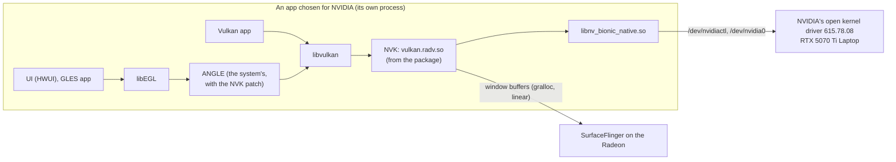

# NVIDIA GPU for apps on OpenBook: OpenBook NVK (ANAL-327)

On the G14 in Hybrid, the RTX can render for chosen apps while the Radeon runs the desktop. This document describes
how OpenBook does that: the driver, the package that carries it, how apps are chosen, and how it is built and tested.

**Status (2026-11-02):** built and tested on the build host and in QEMU. Not yet run on the G14: that is the next
step, from the OpenBook stick (ANAL-326). Every claim below about the G14 is a hypothesis until then.

## 1. What the user gets

- **NVIDIA GPU for apps, on or off.** A switch in OpenBook Graphics, on its main screen and on Apps on the NVIDIA
  GPU. Off keeps every app on the Radeon.
- **Games on the NVIDIA GPU.** Apps that Android lists as games use the RTX automatically (the games rule, ANAL-312).
- **A choice per app.** Automatic, NVIDIA or Radeon. A choice applies the next time the app starts.
- **Vulkan and OpenGL ES.** An app chosen for the RTX gets NVK for Vulkan and ANGLE on NVK for OpenGL ES. Android's
  UI toolkit renders through OpenGL ES, so the whole app, its UI included, renders on the RTX.
- **Battery:** the RTX stays powered off (D3cold) until an app that uses it starts, and powers off again afterwards
  (as measured on the G14 for the driver itself, ANAL-331; with apps: ANAL-326).

## 2. How Android picks the driver (AOSP 17)

Android has one Vulkan driver and one GLES driver per process. An app can get an *updatable graphics driver* instead
of the system's (CONFIRMED in the AOSP 17 source on the build host):

- `ro.gfx.driver.0` names the driver package. `GraphicsEnvironment.chooseDriver` uses it only for an app that is not a
  privileged or never-updated built-in app, and looks the package up with `MATCH_SYSTEM_ONLY`: only a system package
  can be a driver, so an `adb install`ed one is ignored.
- `updatable_driver_all_apps` (Settings.Global): 0 lets the lists below decide, 1 is every app, 3 is no app.
  `updatable_driver_production_opt_in_apps` / `_opt_out_apps` are the per-app choices and
  `updatable_driver_production_allowlist` the games rule's games.
- The app's process gets a linker namespace on `<package>!/lib/x86_64`, linked to the LLNDK libraries and the
  former VNDK-SP set (`libz`, `libhardware`, `libc++`, …).
- **Vulkan:** `libvulkan` loads `vulkan.<ro.hardware.vulkan>.so` from that namespace. On the G14 that name is
  `vulkan.radv.so`. A process whose package lacks it aborts.
- **GLES:** on OpenBook, ANGLE is the system's GLES driver (`ro.hardware.egl=angle`). Android then gives every app,
  this one included, the **system ANGLE** first (`GraphicsEnvironment.setupAngle`, CONFIRMED in QEMU: the backtrace
  runs through `/system/lib64/libGLESv2_angle.so`). ANGLE loads Vulkan through `libvulkan`, which loads the package's
  NVK, so GLES runs on NVK. The system ANGLE carries OpenBook's NVK patch (§4).
- The package also carries ANGLE's own APK libraries as `lib{EGL,GLESv1_CM,GLESv2}_angle.so`. `libEGL` loads those
  only when an app's ANGLE choice is "native" (Developer options). Without them, such an app would abort, because a
  driver package without GLES libraries is fatal to `libEGL`.



**ARM-only apps** run through the native bridge in an x86_64 process, so they get the same x86_64 driver
(HYPOTHESIS until an ARM app is checked on the G14).

## 3. The package: org.openbook.nvk

| In `lib/x86_64` | What | SHA-256 |
|---|---|---|
| `vulkan.radv.so` | NVK, Mesa 26.2.5 + 41 patches (`vulkan.nouveau.so` of the `nvk-rm-clean` build) | `7bb60cfe…` |
| `libnv_bionic_native.so` | NVK's backend for NVIDIA's open kernel driver | `0f6c604b…` |
| `libdrm.so`, `libelf_mesa.so` | the build's own libdrm 2.4.133 and elfutils libelf (NVK needs both) | `ccf9766c…`, `5f491b5d…` |
| `libEGL_angle.so`, `libGLESv1_CM_angle.so`, `libGLESv2_angle.so` | ANGLE's own APK build (`external/angle`), with OpenBook's NVK patch (§4); used only for an app whose ANGLE choice is "native" (§2) | per build |

- **Where:** `/vendor/app/OpenBookNvk/OpenBookNvk.apk`, a system package with no code (`android:hasCode="false"`). Its
  libraries are stored uncompressed and page-aligned, and Android loads them straight from the APK.
- **Visible to every app** (`android:forceQueryable`): each app's process looks the package up itself, and Android
  shows apps a system package only if it is platform-signed or force-queryable (`AppsFilterImpl`). Without the flag
  apps saw "package not installed" (found in QEMU).
- **Every dependency resolves in the driver namespace:** 34 edges, each in the package, an LLNDK library, or a former
  VNDK-SP library present in `/vendor/lib64` (`libhardware`, `libz`). Checked against the image (evidence on ANAL-327).
- **Signed** with the build's default key. The package runs no code of its own and asks for no permission, so it
  needs no other key. No key is in this repository.
- **Built:** `scripts/nvk-stage.sh` stages the four driver libraries into the AOSP tree (`vendor/anybook/nvk`, never
  committed) and generates the module there. The G14 product includes it (`device/anybook/common/nvk/nvk.mk`). The
  stage takes only the bytes in `device/anybook/common/nvk/tested-bytes.txt`.
- **Offered** by `openbook-pc-setup dgpu-driver boot` once NVIDIA's driver drives the RTX, and only if the APK is in the
  image and `ro.hardware.vulkan` is `radv`. Then init sets `ro.gfx.driver.0=org.openbook.nvk`. Before ANAL-327 the
  offer came without a package (found on the G14 on 2026-11-02, ANAL-331).
- **SELinux:** apps may map `vendor_app_file` (AOSP's `app.te`), and the device nodes are `gpu_device`
  (`pc/sepolicy/vendor/file_contexts`). The boot step's stat of the APK is the one new rule.

## 4. ANGLE on NVK

NVK reports NVIDIA's vendor ID. ANGLE at the AOSP 17 pin took every such device for NVIDIA's closed-source driver.
It read NVK's Mesa version (26.2.5) with NVIDIA's version parser, so NVK looked like an NVIDIA release older than 421
and got every workaround for those releases. `aosp/patches/external/angle/0001` identifies NVK by `VkDriverId`, as
ANGLE does for PanVK, and reads its version as Mesa's:

| Feature | Before (NVK seen as an old NVIDIA release) | With the patch |
|---|---|---|
| `clampPointSize`, `forceWaitForSubmissionToCompleteForQueryResult`, `externallySynchronizePipelineCacheAccess` | on | off |
| `supportsSPIRV14` | off | on (if NVK has the extension) |
| `skipPipelineCacheSerialization` | on (a Windows cache-size issue) | off: compiled pipelines are kept across app starts |
| graphics pipeline libraries | off | off, until measured (ANAL-332) |
| hardware conditions (immediate-mode GPU, `clampFragDepth`, `doubleDepthBiasConstantFactor`, …) | NVIDIA's | unchanged |

Every other GPU is unaffected: each change is behind the NVIDIA vendor check. The system ANGLE carries the patch: it
runs on the Radeon for every app, and on NVK for the apps chosen for the RTX (§2). The patch was written from ANGLE's own source. It does not use ANAL-311's ANGLE
work: that issue is on the clean room's exclusion list.

## 5. Provenance

- **The driver** is ANAL-324's clean-room tree at commit `77608ebf`, unchanged: ANAL-330's clean-side tree, which ANAL-326
  tested on the RTX 4090 (§6), plus one Android fix from ANAL-349's clean-side run (patch `0027`), one performance fix
  from ANAL-351's (patch `0028`) and thread-safe once-guards for two log lines from ANAL-353's (patch `0029`). ANAL-330's run wrote
  the parts that had no public source. `mesa/nvk-rm-clean/README.md` and its
  `PROVENANCE.md` give every file's origin.
- **The gate:** `scripts/nvk-provenance-check.sh` runs the clean room's scanner on every path of NVIDIA app support
  and must report 0 hits. It also checks every file from the commit against its git blob. The build and the stage
  refuse to run otherwise.
- **This issue's own code** (the build tree, the package, the offer, the switch, the ANGLE patch) was written by a
  clean-side run from public sources (AOSP 17, ANGLE, Mesa) and OpenBook.
- **Not legal advice:** NVIDIA's licence for its closed driver restricts how anyone may study it. Rebuilding every
  fact from MIT sources is the strongest position we can document (ANAL-324). The owner may want a lawyer to look before an
  image with this package is published. Development images stay private, as do images with NVIDIA's firmware.

## 6. Build and test

```bash
scripts/nvk-provenance-check.sh
scripts/mesa-android-build.sh fetch deps clc rm setup build install verify -- nvk-rm-clean
scripts/nvk-stage.sh                                  # needs the bytes in device/anybook/common/nvk/tested-bytes.txt
flock ~/anybook/aosp/.lane.lock bash -c 'BUILD_NUMBER=<id> scripts/aosp-docker.sh -d anybook-aosp-build \
  /repo/scripts/aosp-build.sh anybook_g14_x86_64-cp2a-userdebug && docker wait anybook-aosp-build'
scripts/graphics/nvk-package-hosttest.sh              # the image's package on this host's NVIDIA GPU
```

- **On the build host's RTX 4090** (`scripts/graphics/nvk-package-hosttest.sh`): the libraries are taken out of the
  image's APK and checked (stored, page-aligned, the tested bytes). They then run as stage 2b ran them: vulkaninfo, the
  943-case multi-queue list and the 66,226-case dEQP-VK list through NVK's own HAL entry, with the image's own bionic
  and system libraries. Every case is compared with stage 2b's result, and the kernel log is read for Xid and NVRM
  lines.
- **In QEMU** (no NVIDIA GPU): the package and its labels, nothing offered without NVIDIA, the app's screens and switch,
  the standard G14 check (the Radeon path), and the loading path with the package forced on for a test app. QEMU's
  Vulkan name is `pastel`, so there libvulkan asks the package for `vulkan.pastel.so` and the test app aborts. That is
  why init offers the package only with `radv`. QEMU shows the selection, the namespace and the GLES path; NVK
  itself loading in an app is for the G14.
- **On the G14** (ANAL-326, from the stick): the hardware tests, dEQP, apps on the RTX through Vulkan and GLES, the
  switch, the per-app choice, D3cold afterwards, a 30-minute soak. Performance: ANAL-332.

## 7. Limits

- **No compute-only queue family** (ANAL-328): dEQP's compute-queue and multi-queue cases report "not supported".
- **Image compression is off** (clean-room item S5), and barriers are upstream Mesa's.
- **Graphics pipeline libraries** stay off in ANGLE for NVK until measured.
- **Eco ↔ Hybrid** (the RTX fully off) needs firmware writes, off in this image unless the owner approves them.
- **HDMI** is wired to the RTX and stays dark (ANAL-249).
- **The present copy** (ANAL-351): in Hybrid, every frame an app on the RTX presents is copied over the PCIe 4.0 x8 link
  into its window buffer in system memory, which the Radeon scans out; with patch `0028` the copy engine does it, at
  13 GB/s or more. A light, uncapped scene is bound by that copy (glmark2 `build`, 2073×1224 RGB565: 2,558 fps against
  the Radeon's 4,684); a heavy one is not (glmark2 `terrain`: 1,124 fps against 306). The cost grows with the window's
  size and pixel format.
- **G14 coverage so far:** the RTX renders into the Radeon's linear window buffers at a steady 120 Hz for the workloads
  ANAL-336, ANAL-349 and ANAL-351 ran (glmark2, Sascha Willems' n-body, Shattered Pixel Dungeon). Patch `0028`'s copy is
  checked only with RGB565 window buffers (glmark2); other formats wait for the release's G14 smoke test. GB205 stability
  under other apps stays open (ANAL-304).

## 8. Sources (read 2026-11-02, on the build host)

- AOSP 17 (`android17-release`): `frameworks/base/core/java/android/os/GraphicsEnvironment.java`,
  `frameworks/native/libs/graphicsenv/GraphicsEnv.cpp`, `frameworks/native/vulkan/libvulkan/driver.cpp`,
  `frameworks/native/opengl/libs/EGL/Loader.cpp`, `system/sepolicy/private/app.te`, `build/soong/java/app.go`.
- ANGLE at the AOSP pin `1f4500d3906c24de59eec5b9cda17a2ad2a8ba2d`: `src/libANGLE/renderer/vulkan/vk_renderer.cpp`,
  `Android.bp`.
- Mesa 26.2.5: `src/nouveau/vulkan/nvk_device.c`.
- ANAL-324 (the inventory and path A), ANAL-326 (the 4090 results), ANAL-331 (the stick and the G14 finding).
