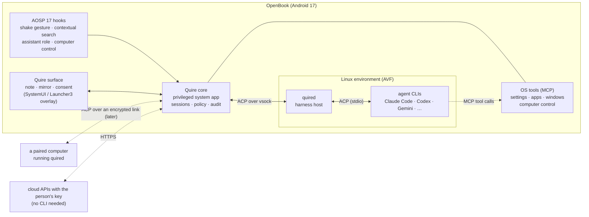

# Quire: the agent layer of OpenBook (ANAL-214)

As of 2026-10-18. Labels: **C** = confirmed (we read it in a primary source or in our AOSP 17 tree, or ran it ourselves), **R** = reported (press or third party), **HYPOTHESIS** = not yet tested. Evidence for what is built is in [`evidence/2026-10-18-quire/`](../evidence/2026-10-18-quire/).

## Summary

- **Quire connects OpenBook to the AI agents a person already has.** That includes Claude Code, Codex, Copilot, Cursor, Gemini CLI, Grok, opencode and Kimi, and any agent that speaks the open Agent Client Protocol. A person calls it from anywhere: shake the pointer, press a key, hold the mic key and talk. A note flies out from the pointer, the agent works in it in plain sight, and the note folds away when the work is done. The agent can drive the system: change a setting, open an app, carry out a task in an app. It does that only with the person's consent, on a separate display they can watch, and they can take control at any moment.
- **Googlebook does one agent, Gemini, with Google's closed apps** (Magic Pointer, Create your Widget). Quire does any agent, in the open. **AOSP 17 already contains the platform hooks Googlebook uses**, under Apache-2.0: the pointer-shake gesture, contextual search, the assistant role and **computer control**, a framework API that lets an agent operate apps on a virtual display with consent and hand-over (§2). Quire plugs into those hooks rather than hacking around them.
- **Two open protocols, no lock-in.** Agents talk to Quire over **ACP** (Agent Client Protocol, Apache-2.0, v1), the protocol Zed and others use for editors. Quire gives its OS tools to agents over **MCP** (Model Context Protocol). An agent that speaks ACP works with Quire with no Quire-specific code. For agents that don't, `quired` adapts them.
- **Built today: `quired`, the harness host.** It finds the agent CLIs on a machine, runs them, and gives every one of them the same ACP interface. On this host it opened real ACP sessions with opencode, Copilot and omp. Through its Claude Code adapter it ran real turns in which the person's "allow" or "deny" decided whether a file was written. It has 17 unit tests that pass with the race detector (§6).
- **How we learned from Multica (reviewed, not copied).** Multica's daemon detects agent CLIs and drives each through its own output format. Its licence adds conditions on commercial embedding. Quire takes the idea of detecting and running the agents a person has, and builds it on open protocols with its own code. No Multica code is used (§3).

## 1. The experience

What a person sees. Atelier owns the visual and motion design (ANAL-215); this is the brief.

1. **Call it.** From anywhere, by any of:
   - shaking the pointer (AOSP 17's own contextual-cursor gesture, §2.2);
   - a key (Meta+Space, and the keyboard's assistant or Copilot key if it has one);
   - the Quire button on the taskbar;
   - holding the mic key, or a hold-to-talk key, and speaking;
   - selecting text or an image and choosing "Ask Quire".

   Quire takes in what is under the pointer: the screenshot region, the selected text, the app's name. It never reads a window marked secure.
2. **The note.** A card grows out of the pointer, not out of a corner, and settles beside it. It shows which agent is answering ("Claude Code · on this laptop"). The answer streams in. Each step the agent takes shows as a line that ticks: "Reading Wi-Fi settings ✓", "Turning on Battery saver…".
3. **Consent, inline.** When the agent wants to change something, the step stops and offers **Allow**, **Allow for this task** and **Don't allow**. The step names exactly what will change. Nothing that changes the system happens without this, unless the person has given standing permission for that tool.
4. **Driving the system.** When the agent needs to operate an app, the app runs on a separate virtual display (computer control, §2.4). The note expands into a live mirror of that display, with the agent's pointer and highlights drawn on it. The person can watch, pause, or press **Take over**, which moves the app onto their own screen. Apps being automated show an indicator in the taskbar. AOSP 17 has `enable_app_automation_indicator` for this.
5. **Done.** The note shows the result and folds back into the pointer, or into the taskbar button if the work is still running. Finished and running tasks live behind the taskbar button.
6. **Settings help.** "Make my screen easier to read at night" → Quire shows the two or three settings it would change, with their current and new values, then applies them on Allow. It can always undo: every change Quire makes is listed with an undo.

Motion principles for the brief: the note is anchored to where the person's attention already is; it moves with spring physics, not linear easing; it respects "Remove animations"; and everything in it is reachable by keyboard and screen reader.

## 2. What Googlebook does, and what AOSP 17 already provides

### 2.1 Googlebook (R, except where marked)

- **Magic Pointer** (built with Google DeepMind): "Just wiggle your cursor and watch it come alive with Gemini". It offers help based on what the pointer is over, for example turning a date in an email into a meeting. Source: Google, "Introducing Googlebook", 2026-05-12.
- **Create your Widget:** Gemini builds a desktop dashboard from a prompt, and can draw on the web, Gmail and Calendar. Same source.
- **Rambler:** cleaned-up dictation (R, secondary report of a Google post, 2026-09-21).
- **On the image (C, `docs/googlebook-ui.md` §2):**
  - gPointer (Magic Pointer, 224 MB);
  - Desktop System Intelligence (`alai`);
  - Gemini and the Gemini shell;
  - the Glowbar.

  All of them are proprietary and signed with Google's keys, so **none can ship on OpenBook**, and Quire does not imitate their branding.

### 2.2 The pointer-shake gesture (C)

`frameworks/base/packages/SystemUI/src/com/android/systemui/contextualcursor/`:

- `GestureDetectionInteractor` detects a shake from cursor positions, with a range threshold in dp and a cooldown.
- `ContextualCursorInteractor` listens only once the user is set up, provisioned and past the lock screen. On a shake it calls `LauncherProxy.invokeContextualSearch(ENTRYPOINT_SYSTEM_ACTION)`.
- The code carries a TODO: it "temporarily invoke[s] contextual search before the actual launch method is landed".
- The flag is `com.android.hardware.input.enable_contextual_cursor_desktop_entrypoints`. ANAL-204 skipped it as an "AI service OpenBook does not have"; Q2 turns it on (`release/openbook/`).
- **Keys, as Q2 found them (C):**
  - **Meta+G** is the contextual cursor's shortcut (same flag). SystemUI maps it to contextual search too, for now (TODO b/484184229).
  - **Meta+A** is the contextual search shortcut (`enable_contextual_search_desktop_entrypoints`, already enabled in cp2a).
  - **Meta+Space is not contextual search:** `InputGestureManager` maps it to `KEY_GESTURE_TYPE_LAUNCH_ASSISTANT`, like the Copilot key's sequence and the assist key. All three go to the assistant role holder, so they reach Quire through its `VoiceInteractionService` (§2.3).
- **The shake detector reads an `InputMonitor`** and only takes `SOURCE_MOUSE` or `SOURCE_TOUCHPAD` events: at least 3 left-right direction changes within 500 ms, inside a 100 dp box, then a 3 s cooldown. A shake goes SystemUI → `LauncherProxy.invokeContextualSearch(ENTRYPOINT_SYSTEM_ACTION)` → Launcher3's `ContextualSearchInvoker`.

### 2.3 Contextual search and the assistant role (C)

- `ContextualSearchManager` starts the activity of the package named in `config_defaultContextualSearchPackageName` with `ACTION_LAUNCH_CONTEXTUAL_SEARCH`. It passes:
  - `EXTRA_SCREENSHOT`;
  - `EXTRA_VISIBLE_PACKAGE_NAMES`;
  - `EXTRA_FLAG_SECURE_FOUND`;
  - `EXTRA_IS_AUDIO_PLAYING`;
  - `EXTRA_ENTRYPOINT`;
  - a token.

  The overlay value is empty in AOSP, so **Quire can be the contextual search app** by setting one string.
- **What else contextual search needs (C, Q2):**
  - Launcher3 refuses to invoke it unless the device declares the feature `com.google.android.feature.CONTEXTUAL_SEARCH` (`ContextualSearchManager.FEATURE_CONTEXTUAL_SEARCH`; AOSP's own name) and its activity resolves for Launcher3. Quire's image declares the feature, and its activity is exported but protected by `ACCESS_CONTEXTUAL_SEARCH`.
  - On a `FEATURE_PC` device the service returns no package unless `enable_contextual_search_desktop_entrypoints` is on. It is, in cp2a.
  - The screenshot leaves out `FLAG_SECURE` layers and reports them (`EXTRA_FLAG_SECURE_FOUND`). Screenshot and visible packages are withheld when assist data is not allowed.
  - **The service also hands the app a `MediaProjection`** (`EXTRA_MEDIA_PROJECTION`, created for the contextual search package). Quire never uses it.
- **The assist key and Meta+Space reach Quire's assistant session, not contextual search.** Quire's session hands each one to contextual search itself (`ContextualSearchManager.startContextualSearch`, which needs `ACCESS_CONTEXTUAL_SEARCH`, signature|privileged). Every way of calling Quire therefore arrives the same way, with the same screenshot rules. Contextual search has no entry point for the assist key, so Quire passes `ENTRYPOINT_KEYBOARD_SHORTCUT` and adds its own `trigger` extra (`assist_key`, `assistant_shortcut`).
- The legacy route where a session asks the voice interaction service for contextual search (`showSessionFromSession` with `config_defaultContextualSearchKey`) is disabled in `trunk_staging` (`disable_starting_contextual_search_via_vims`), so Quire doesn't use it.
- Holding the assistant role makes the assistant's recognition service the system's speech recognizer. Quire's says "not available" until Q7.
- The assistant role (`ROLE_ASSISTANT`, a `VoiceInteractionService`) gives the assist key, long-press gestures and voice. Computer control requires the agent to hold it (`computer_control_role_assistant_requirement`, enabled in cp2a).

### 2.4 Computer control (C)

`android.companion.virtual.computercontrol` in AOSP 17 (`ComputerControlSession`, `ComputerControlSessionParams`, `InteractiveMirror`, `ComputerControlConsentManager`; service side in `services/companion/.../computercontrol/`):

- A **session** is a trusted virtual display with input devices. The agent can:
  - launch the apps it was granted (`setTargetPackageNames`);
  - inject taps and input;
  - take screenshots (`requestScreenshot`);
  - go back.
- **Safety is built in:**
  - the session blocks on secure content (`BLOCK_REASON_SECURE_CONTENT`), on disallowed activity launches and on biometric prompts;
  - the user can close it or take over;
  - `handOverApplications()` moves the automated apps to the user's display;
  - sessions time out.
- `InteractiveMirror` gives the controlling app a surface mirroring the session display, which can be made interactive. That is the live view in §1.4.
- **Consent:**
  - `RequestComputerControlAccessActivity` in `frameworks/base/packages/VirtualDeviceManager` asks the user;
  - a per-agent list of automatable apps is kept (`MANAGE_COMPUTER_CONTROL_CONSENT`, signature);
  - a notification shows while automation runs.
- **Permission:** `ACCESS_COMPUTER_CONTROL` is `internal|privileged`. OpenBook builds its own image, so Quire can be a privileged system app with an allowlist entry.
- **Flags:**
  - `computer_control_access` and `computer_control_support_v5` are **not enabled in cp2a**, our release config. They are enabled in `trunk_staging`.
  - `_role_assistant_requirement` and `_managed_profiles` are enabled in cp2a. cp2a also carries values for `computer_control_consent`, `_activity_policy_strict`, `_user_restriction` and `_config_change_override`, but **AOSP 17 declares none of those four** (no `.aconfig` entry, not in `aflags list`; checked in Q2), so the code they would gate is either unconditional (the consent dialog) or absent.
  - Launcher3's `enable_app_automation_indicator` is enabled.
  - **Q2 turns on `computer_control_access` and `computer_control_support_v5`** in OpenBook's own value set (`device/anybook/common/desktop/release/openbook/cp2a/`). It leaves `_per_app_consent`, `_typing`, `_cross_device` and `notification_flag_computer_control` off; they are in `trunk_staging` only (§8).
- **The API is `@hide`** (no `system-current.txt` entry). A platform app built in-tree, as Quire's core will be, can use it. Third-party apps can't. (AOSP also has a public extension library, `frameworks/base/libs/computercontrol`, `com.android.extensions.computercontrol`, with a ready `MirrorView`; Quire uses the framework API directly.)
- **What a session needs, as Q2 found it (C):**
  - **An allowlist entry.** `ComputerControlAllowlistController` lets a package own a session only if it is in DeviceConfig `computer_control/allowed_session_owner_apps` (package and signing-certificate SHA-256, upper-case hex), and lets it automate only apps in `allowed_automatable_apps` (`PREINSTALLED` matches the system image's copy; the permission controller and approved agents never match). The last valid DeviceConfig value is persisted in `/data/system/computercontrol/`. **A device without a configuration server has neither, so no agent can ever own a session.** OpenBook adds a third source, read only when both are empty: the image's own lists in `/system_ext/etc/computercontrol/` (`aosp/patches/frameworks/base/0005`). Nothing else changes: the permission, the role, the consent, the lock screen and the block reasons are checked as before. "Super agents" (`config_computerControlKnownSuperAgents`) bypass the allowlists on debuggable builds only; Quire doesn't use them.
  - **Version 5** (`computer_control_support_v5`): `VirtualDeviceManager.COMPUTER_CONTROL_VERSION` becomes 5. A version 5 request must carry a promotable notification (ongoing, titled, `setRequestPromotedOngoing`), which the platform posts for the agent and makes undismissable, and an `AppInteractionAttribution` (`enable_app_interaction_api` is on in cp2a). It may name at most six apps, and the agent must have a visible window.
  - **One session at a time** (`MAXIMUM_CONCURRENT_SESSIONS = 1`), each with a name unique to the agent; 60 minutes at most.
  - **Consent.** The app op `COMPUTER_CONTROL` defaults to `MODE_DEFAULT`, so every request without "Always allow" opens `RequestComputerControlAccessActivity`: "Only this time", "Always allow" (sets the op to allowed) or "Don't allow". Three denials in a row set the op to ignored, and later requests fail at once. Without `computer_control_per_app_consent` (`trunk_staging` only) the consent is for the agent as a whole, not per app.
  - **The lock screen** is checked when the session is created (`ERROR_DEVICE_LOCKED`); the session display itself is always unlocked.
  - **`handOverApplications()`** moves the session's tasks to the main display and closes the session (`CLOSE_REASON_SESSION_EMPTY`).
  - The flag `computer_control_access` also turns on safety paths outside the session: a warning when the user launches an app that is being automated, the session notification's no-clear flags, and Settings' "Screen automation" special access page.

### 2.5 What OpenBook changes in AOSP 17 for Quire (Q2, ANAL-216)

The hooks exist, but four of them do not work on a device like OpenBook's out of the box (C, found in Cuttlefish).
Each change is the smallest that makes the hook work, and none relaxes a safety check:

| Change | Why |
|---|---|
| `aosp/patches/frameworks/base/0005`: computer control's allowlists fall back to `/system_ext/etc/computercontrol/` | The allowlists come only from DeviceConfig (server-pushed) or a persisted copy of it, so on a device with no configuration server no agent can ever own a session. The image's own list is read only when both are empty; DeviceConfig still wins. Unit tests added (not run: they need the VirtualDeviceServicesTests suite on a device) |
| `aosp/patches/frameworks/base/0006`: SystemUI arms the shake detector without a headless system user | It armed only when logout is enabled, which the system user never is. Googlebook runs in headless system user mode; OpenBook's person is user 0. SystemUI unit test updated (not run) |
| `aosp/patches/frameworks/base/0007`: `ComputerControlSession` creates its accessibility proxy before `initialize()` | AOSP registered the proxy before creating it (an NPE that Binder swallowed), so an agent could never read the apps it automates |
| `aosp/patches/packages/apps/Launcher3/0002` and a privapp entry: Launcher3 requests `ACCESS_CONTEXTUAL_SEARCH` | Launcher3 starts contextual search for the shake, Meta+A and Meta+G, and was denied every time |
| `RELEASE_PACKAGE_COMPUTER_CONTROL=true` (`device/anybook/common/desktop/release/flag_values/cp2a/`) | Installs VirtualDeviceManager, which holds the platform's consent dialog. Without it every request that needs consent fails |
| The flags `computer_control_access`, `computer_control_support_v5`, `enable_contextual_cursor_desktop_entrypoints` | §2.2, §2.4 |
| The feature `com.google.android.feature.CONTEXTUAL_SEARCH` | Launcher3 checks it (§2.3) |

## 3. How Multica runs agents, and what Quire does instead

Reviewed from Multica's public README, its CLI's help, and its observable behaviour on this host (`multica` 0.6.3). We read none of Multica's source code and copied none.

| | Multica | Quire |
|---|---|---|
| Where agents run | A daemon on a computer the person owns. It detects agent CLIs on `PATH`; on this host it reports 11 runtimes | `quired` on the laptop's Linux environment (AVF Terminal), or on a computer the person pairs. It detects the same way: a catalog of known CLIs, resolved on `PATH` and asked for `--version` |
| How it talks to agents | Each provider's own headless mode and output format | **ACP** wherever the agent has it. Today that is opencode, Copilot, Cursor, Kimi, Hermes and omp, and Gemini CLI by its docs. Adapters exist only for agents without ACP: Claude Code today; Codex, Grok and Antigravity planned |
| What drives the work | Issues and comments on a server | The person, live: a gesture, a key or their voice, on their own laptop |
| Tools the agent gets | The `multica` CLI, through a task token | OpenBook's OS tools as an **MCP server** (settings, apps, windows, computer control), passed in ACP `session/new` |
| Permissions | The agent's own setting; Multica runs agents unattended | Every agent tool call that needs consent becomes an ACP `session/request_permission`, which the note shows inline. For Claude Code, `quired` serves Claude's `--permission-prompt-tool` over MCP and forwards each question (§6) |
| Licence | Multica License: Apache-2.0 text plus extra conditions on hosted services, commercial embedding and branding | OpenBook's own code. ACP and its SDKs are Apache-2.0. We don't use Multica code, which also keeps the embedding conditions out of the picture |

## 4. Architecture



- **Quire core** (`dev.openbook.quire`, built in-tree, privileged):
  - holds `ROLE_ASSISTANT` and is the contextual search package;
  - holds `ACCESS_COMPUTER_CONTROL`;
  - runs sessions and permission policy;
  - keeps the audit log of every change it made, with undo where possible.
  - It is an ACP **client**, so it can talk to any ACP agent anywhere.
- **Quire surface:** the note, the mirror and the inline consent, drawn above apps in SystemUI's or Launcher3's layer. Atelier designs it (ANAL-215).
- **OS tools:** an MCP server the core passes to every agent in `session/new`, in three tiers.
  - **Observe:** read settings, list apps and windows, read the selection, take a screenshot of non-secure windows.
  - **Act, with consent each time or for the task:** change a setting from an allowlist; open, move or close windows; start a computer-control session for named apps.
  - **Never:** read secure windows; touch other apps' data; change security settings (lock screen, verified boot, developer options); install apps; send messages or make payments without the person doing it.
- **`quired`:** finds and runs the agent CLIs, adapts the ones without ACP, and confines file access to the session's folder. It runs where the agents can run. Agent CLIs are Linux (glibc) programs, so on the laptop that means the **Linux environment**: AOSP 17's AVF Terminal, whose Debian guest is built for x86_64 too (`packages/modules/Virtualization/build/debian/`, `TerminalApp` has `assets-x86_64`; C). OpenBook doesn't ship AVF yet, and the G14 kernel needs KVM on AMD for it. HYPOTHESIS until Q4.
- **Connectors**, in order:
  1. local ACP agents through `quired`;
  2. a paired computer's `quired`, for people whose agents live on another machine;
  3. direct cloud APIs with the person's own key, through a small agent loop in the core, for people with no CLI at all.

## 5. Security and privacy

- **Everything is opt-in:** no agent is connected until the person connects it, and every agent is shown by name in every note.
- **No secrets pass through Quire.**
  - Agents keep their own sign-in.
  - `quired` passes the environment through and never logs it.
  - Evidence is redacted of home paths.
  - Cloud keys stay in the core, in Android Keystore.
- **Consent is enforced by the system, not requested of the agent:**
  - every tool call that changes something goes through `session/request_permission` (ACP) or Claude's permission tool;
  - computer control adds the platform's own consent dialog and a running notification.
- **Secure content stays dark.** Windows with `FLAG_SECURE` are excluded from screenshots, and computer-control sessions block on them (platform behaviour, §2.4).
- **File access is confined.** When `quired` serves ACP file reads and writes, it refuses paths outside the session's folder, including through symlinks (tested, §6).
- **What we will not do:** bypass Play Integrity, DRM or licence checks; use Google's Gemini apps or Magic Pointer code; send screen contents anywhere the person didn't choose.

## 6. Built: `quired` 0.1 (Q1)

Code: [`quire/quired/`](../quire/quired/). Go, standard library only, static binary. Check: [`scripts/quire/live-check.sh`](../scripts/quire/live-check.sh).

```text
quired agents [--json]                       list the agents installed here
quired probe [--json] (--all | AGENT...)     start agents and open a session, without prompting
quired run [flags] AGENT PROMPT...           run one turn (--approve ask|read|all|none, --json, --cwd, --agent-arg)
```

- **`internal/acp`:** ACP v1 types, plus a JSON-RPC 2.0 connection over newline-delimited JSON.
  - Notifications arrive in order.
  - Requests run concurrently, so a person can take their time on a permission prompt.
  - It has no line-length limit and survives non-JSON output.
  - Method names and enums were checked against the ACP SDK inside Cursor Agent 2026.10.14 and against the spec repository.
- **`internal/agents`:** a catalog of 12 agents, each with the CLI version we last checked and its protocol, and discovery.
- **`internal/harness`:**
  - `acpagent.go` runs an ACP agent as a subprocess in its own process group. It:
    - serves `session/request_permission`, `fs/read_text_file` and `fs/write_text_file` (confined);
    - cancels with `session/cancel`, and answers any open permission request "cancelled", as ACP requires;
    - reports the agent's stderr when it fails.
  - `claude.go` adapts Claude Code's `-p --output-format stream-json --include-partial-messages` to ACP updates:
    - text and thinking deltas become message chunks;
    - `tool_use` and `tool_result` become `tool_call` and `tool_call_update`, with readable titles ("Read note.txt", "Run make test");
    - `TodoWrite` becomes an ACP `plan`;
    - a new message starts a new paragraph;
    - each session uses `--session-id` on the first turn and `--resume` after that.
  - Permissions use Claude's `--permission-prompt-tool`. `quired permission-mcp` is a one-tool MCP server on stdio that forwards each question to the running `quired` over a private unix socket (in a 0700 folder). "Allow for this session" is remembered per tool.

**Results on this host (C), Arch Linux, 2026-10-18** (`evidence/2026-10-18-quire/`):

| Check | Result |
|---|---|
| Unit tests (`go test -race`) | **17/17 pass.** They cover the protocol, discovery, the ACP agent and the Claude adapter. The fake ACP agent and fake Claude Code are the test binary itself; the fake Claude really starts `quired permission-mcp` and calls it over MCP. One test replays a real Claude Code 2.1.301 stream |
| `quired agents` | 11 of the 12 catalog agents installed. **7 run through quired:** Claude Code (adapter), and opencode, Copilot, Cursor, Kimi, Hermes and omp (ACP). 4 are not yet supported, each with the reason: Grok (no ACP server), Codex (its own app-server protocol), Antigravity (stream-json, adapter planned) and Pi (nothing machine-readable) |
| `quired probe --all` (ACP `initialize` + `session/new`, no prompt, no cost) | **opencode, Copilot and omp:** a real ACP v1 session each, in 1.3–2.4 s. **Cursor and Kimi:** `-32000 Authentication required`, because they are not signed in for ACP on this host. **Hermes:** `-32603`, with no model provider configured (its stderr says so). Claude goes through the adapter, so its row only shows the session it created |
| `quired run claude --approve all` (haiku) | Claude chose `Bash printf … > hello.txt`. The permission bridge asked and was allowed, and **hello.txt = "Hello from Quire"**. `end_turn` in 6.0 s |
| `quired run claude --approve none` | Bash was denied, then Write was denied. **No file was written.** Claude stopped, said why, and "didn't try any other way to write it". `end_turn` in 12.2 s |
| `quired run opencode --approve read` | "QUIRE OK" over native ACP, `end_turn` in 8.9 s (3.1 s in an earlier run). The stream had thoughts, available commands and a usage update |

**Not done yet:**

- `quired serve`, the transport to Quire core;
- the Codex, Grok and Antigravity adapters;
- the `authenticate` flow;
- passing Quire's OS-tools MCP server, which is Q3.

## 7. Milestones

Each one is a sub-issue of ANAL-214 with its own acceptance checks. "G14" means checked on the laptop through the owner's stick, as with every other OpenBook milestone.

| # | Milestone | Owner | Done when |
|---|---|---|---|
| Q1 | **`quired` harness host** (ANAL-214) | Porter | Built and checked on this host (§6), this PR |
| Q2 | **Platform hooks in the image** (ANAL-216). Quire core skeleton as a privileged system app: `ROLE_ASSISTANT`, contextual search package, `ACCESS_COMPUTER_CONTROL` allowlist, the shake flag and the computer-control flags in OpenBook's flag set | Porter | In Cuttlefish: a shake and Meta+Space open Quire with a screenshot and the visible packages; a computer-control session on Settings shows in an `InteractiveMirror`; no new SELinux denials; the release flags diff reviewed |
| Q3 | **Interaction and motion design** (ANAL-215) | Atelier | Invocation, the note's states (asking, streaming, steps, consent, mirror, done, error), motion specs and a clickable prototype; the visual language matches OpenBook's look |
| Q4 | **The Linux environment and `quired serve`** (ANAL-218). AVF Terminal in OpenBook, KVM on AMD, `quired` in the Debian guest, ACP over vsock to the core, pairing for a second computer | Porter | An agent installed in the Linux environment answers a prompt from Quire core in Cuttlefish, then on the G14 |
| Q5 | **The surface** (ANAL-219). The note, steps, consent and mirror, built to Q3's spec | Porter with Atelier | Q3's states, in a recorded Cuttlefish session; 60 fps on the G14; works with TalkBack and keyboard only |
| Q6 | **OS tools over MCP** (ANAL-220). Settings (allowlisted, with undo), apps and windows, computer control | Porter | A scripted matrix: "turn on dark theme", "make text bigger", "open Files and show Downloads", each with the right consent, plus refusals for the never-tier |
| Q7 | **Voice** (ANAL-221). Hold to talk, on-device speech-to-text (open models only), and the note reading back | Porter | Works offline on the G14; the mic indicator is always shown |
| Q8 | **Review and verification** (ANAL-217) | Checker | A security and privacy review of each PR against §5, and the G14 checklist results recorded |

The order is Q1, then Q2 and Q3 in parallel, then Q4 and Q5, then Q6 and Q7. Q8 runs alongside all of them.

## 8. Risks and open questions

1. **Computer control is `@hide` and partly flagged off in cp2a** (C). Turning on `computer_control_access` and `_support_v5` may pull in code paths Google tested only on its own builds. Q2 checks this in Cuttlefish before anything else depends on it.
2. **The AVF Terminal on AMD** (HYPOTHESIS). It needs KVM in our GKI build plus the Terminal's x86_64 Debian image. If it can't run, `quired` runs on a paired computer and Quire uses cloud connectors on the laptop.
3. **Agent CLIs change often.** The catalog records the version each entry was checked against, and adapters are only needed for agents without ACP. The industry is moving to ACP: 6 of the 11 CLIs on this host have it.
4. **Sign-in.** Cursor and Kimi need an ACP `authenticate` step on this host. Quire will show each agent's `authMethods` in its connect screen.
5. **The shake gesture is "early"** (its own TODO). We may tune the threshold for touchpads.
6. **Naming:** "Quire" needs the same trademark check as "OpenBook" before any public image (`docs/STATUS.md`).

## Sources

- Google, "Introducing Googlebook, designed for Gemini Intelligence", 2026-05-12: https://blog.google/products-and-platforms/platforms/android/meet-googlebook/
- Agent Client Protocol, spec and SDKs (Apache-2.0, protocol version 1): https://github.com/agentclientprotocol/agent-client-protocol · https://agentclientprotocol.com
- Multica README and licence: https://github.com/multica-ai/multica
- AOSP 17 (`android-latest-release`, our pinned tree; paths as cited above): `frameworks/base/core/java/android/companion/virtual/computercontrol/`, `frameworks/base/packages/SystemUI/src/com/android/systemui/contextualcursor/`, `frameworks/base/core/java/android/app/contextualsearch/ContextualSearchManager.java`, `frameworks/base/packages/VirtualDeviceManager/`, `build/release/aconfig/{cp2a,trunk_staging}/`, `packages/modules/Virtualization/`
- Rambler: secondary report of Google's 2026-09-21 post (R): https://letsdatascience.com/news/google-details-magic-pointer-and-rambler-features-for-google-978edf8d
