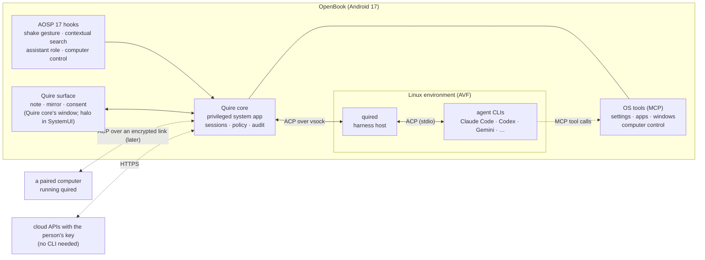

# Quire: the agent layer of OpenBook (ANAL-214)

Quire connects OpenBook to the AI agents a person already has and lets them work on the laptop in plain sight. This
doc covers how it works: the AOSP 17 hooks it uses, its architecture and security model, what is built, and how it is
checked. Using it: [`quire-howto.md`](quire-howto.md). The note's design: [`quire-design.md`](quire-design.md).
Pairing a second computer: [`quire-pairing.md`](quire-pairing.md).

As of 2026-10-19. Labels: **C** = confirmed (we read it in a primary source or in our AOSP 17 tree, or ran it
ourselves), **R** = reported (press or third party), **HYPOTHESIS** = not yet tested.

## Summary

- **What it does.** Quire works with Claude Code, Codex, Copilot, Cursor, Gemini CLI, Grok, opencode, Kimi and any
  agent that speaks the open Agent Client Protocol. A person calls it from anywhere: shake the pointer, press a key,
  select text. A note opens at the pointer, the agent works in it in plain sight, and the note folds away when the
  work is done. The agent can drive the system: change a setting, open an app, carry out a task in an app on a separate
  display the person can watch and take over.
- **Why not Googlebook's.** Googlebook's announced agent features run on Gemini, with Google's closed apps (Magic
  Pointer, Create your Widget). None of them can ship on OpenBook. AOSP 17 has platform hooks that fit those features,
  under Apache-2.0: the pointer-shake gesture, contextual search, the assistant role and **computer control**, a
  framework API that lets an agent operate apps on a virtual display with consent and hand-over (§2). Quire plugs into
  them instead of working around them. Whether Googlebook's shipping image uses these exact hooks is unverified.
- **Two open protocols, no lock-in.** Agents talk to Quire over **ACP** (Agent Client Protocol, Apache-2.0, v1), the
  protocol Zed and others use for editors. Quire gives its OS tools to agents over **MCP** (Model Context Protocol). An
  agent that speaks ACP works with Quire with no Quire-specific code. For agents that don't, `quired` adapts them.
- **The pieces.** Quire core, a privileged system app in the image (§4). `quired`, the harness host that finds and runs
  agent CLIs (§6). The Linux environment, AVF and its Debian guest, where `quired` and the agents run on the laptop
  (§4.1). The note, Quire's surface (§9). OpenBook's skill and 37 OS tools that every agent gets (§10).
- **Consent (owner's rule, ANAL-225, 2026-10-19).** Quire reads, reviews and changes OpenBook freely, with an undo for
  every setting it changes, and asks only before something destructive (§4.2). Computer control always goes through
  the platform's own consent dialog, per app (§2.4).
- **State.** Q1 to Q6 are done, and Quire ships in OpenBook 0.1.0-preview.2 (`docs/STATUS.md`). Voice (Q7) and
  pairing a second computer are not built (§7). Not every agent in the list runs through Quire yet (§6).
- **Learned from Multica, nothing copied.** Quire takes the idea of detecting and running the agents a person has, and
  builds it on open protocols with its own code (§3).

## 1. The experience

What a person sees. This is the brief; [`quire-design.md`](quire-design.md) is the design that implements it.

1. **Call it.** From anywhere, by any of:
   - shaking the pointer (AOSP 17's own contextual-cursor gesture, §2.2);
   - a key (Meta+Space, and the keyboard's assistant or Copilot key if it has one);
   - the Quire button on the taskbar (not built yet, §9);
   - holding the mic key, or a hold-to-talk key, and speaking (Q7, not built yet);
   - selecting text and choosing "Ask Quire".

   Quire takes in what is under the pointer: the screenshot region, the selected text, the app's name. It never reads
   a window marked secure.
2. **The note.** A card grows out of the pointer, not out of a corner, and settles beside it. It shows which agent is
   answering. The answer streams in. Each step the agent takes shows as a line that ticks: "Reading Wi-Fi settings ✓",
   "Turning on Battery saver…".
3. **Asking, inline.** Quire changes settings, opens apps and works with files without asking; each change shows as a
   step with an undo. Before anything destructive (deleting a file, a tap that sends, pays or buys, developer
   settings) the step stops and offers **Allow** and **Don't allow**, and names exactly what will happen (§4.2).
4. **Driving the system.** When the agent needs to operate an app, the app runs on a separate virtual display
   (computer control, §2.4). The note expands into a live mirror of that display, with the agent's pointer and
   highlights drawn on it. The person can watch, pause, or press **Take over**, which moves the app onto their own
   screen. Apps being automated show an indicator in the taskbar; AOSP 17 has `enable_app_automation_indicator` for
   this.
5. **Done.** The note shows the result and folds back into the pointer, or into the taskbar button if the work is
   still running. Finished and running tasks live behind the taskbar button.
6. **Settings help.** "Make my screen easier to read at night" → Quire changes the two or three settings that do it
   and lists each with its old and new value and an undo. Every setting Quire changes can be undone for 24 hours.

Motion principles: the note is anchored to where the person's attention already is; it moves with spring physics, not
linear easing; it respects "Remove animations"; and everything in it is reachable by keyboard and screen reader.

## 2. What Googlebook does, and what AOSP 17 already provides

### 2.1 Googlebook (R, except where marked)

- **Magic Pointer** (built with Google DeepMind): "Just wiggle your cursor and watch it come alive with Gemini". It
  offers help based on what the pointer is over, for example turning a date in an email into a meeting. Source:
  Google, "Introducing Googlebook", 2026-05-12.
- **Create your Widget:** Gemini builds a desktop dashboard from a prompt, and can draw on the web, Gmail and
  Calendar. Same source.
- **Rambler:** cleaned-up dictation (R, secondary report of a Google post, 2026-09-21).
- **On the image (C, `docs/googlebook-ui.md` §2):**
  - gPointer (Magic Pointer, 224 MB);
  - Desktop System Intelligence (`alai`);
  - Gemini and the Gemini shell;
  - the Glowbar.

  All of them are proprietary and signed with Google's keys, so **none can ship on OpenBook**, and Quire does not
  imitate their branding.

### 2.2 The pointer-shake gesture (C)

`frameworks/base/packages/SystemUI/src/com/android/systemui/contextualcursor/`:

- `GestureDetectionInteractor` detects a shake from cursor positions, with a range threshold in dp and a cooldown.
- `ContextualCursorInteractor` listens only once the user is set up, provisioned and past the lock screen. On a shake
  it calls `LauncherProxy.invokeContextualSearch(ENTRYPOINT_SYSTEM_ACTION)`.
- The code carries a TODO: it "temporarily invoke[s] contextual search before the actual launch method is landed".
- The flag is `com.android.hardware.input.enable_contextual_cursor_desktop_entrypoints`. OpenBook turns it on
  (`release/openbook/`).
- **Keys (C):**
  - **Meta+G** is the contextual cursor's shortcut (same flag). SystemUI maps it to contextual search too, for now
    (TODO b/484184229).
  - **Meta+A** is the contextual search shortcut (`enable_contextual_search_desktop_entrypoints`, already enabled in
    cp2a).
  - **Meta+Space is not contextual search:** `InputGestureManager` maps it to `KEY_GESTURE_TYPE_LAUNCH_ASSISTANT`,
    like the Copilot key's sequence and the assist key. All three go to the assistant role holder, so they reach Quire
    through its `VoiceInteractionService` (§2.3).
- **The shake detector reads an `InputMonitor`** and only takes `SOURCE_MOUSE` or `SOURCE_TOUCHPAD` events: at least 3
  left-right direction changes within 500 ms, inside a 100 dp box, then a 3 s cooldown. A shake goes SystemUI →
  `LauncherProxy.invokeContextualSearch(ENTRYPOINT_SYSTEM_ACTION)` → Launcher3's `ContextualSearchInvoker`.

### 2.3 Contextual search and the assistant role (C)

- `ContextualSearchManager` starts the activity of the package named in `config_defaultContextualSearchPackageName`
  with `ACTION_LAUNCH_CONTEXTUAL_SEARCH`. It passes:
  - `EXTRA_SCREENSHOT`;
  - `EXTRA_VISIBLE_PACKAGE_NAMES`;
  - `EXTRA_FLAG_SECURE_FOUND`;
  - `EXTRA_IS_AUDIO_PLAYING`;
  - `EXTRA_ENTRYPOINT`;
  - a token.

  The overlay value is empty in AOSP. Setting it to Quire is necessary but not enough: the package needs an activity
  that resolves `ACTION_LAUNCH_CONTEXTUAL_SEARCH` (`ContextualSearchManagerService.getResolvedLaunchIntent`), and the
  extras are conditional. The screenshot comes only when the capture worked and assist data is allowed, and the audio
  extra only with `Flags.includeAudioPlayingStatus()`.
- **What else contextual search needs (C):**
  - Launcher3 refuses to invoke it unless the device declares the feature
    `com.google.android.feature.CONTEXTUAL_SEARCH` (`ContextualSearchManager.FEATURE_CONTEXTUAL_SEARCH`; AOSP's own
    name) and its activity resolves for Launcher3. Quire's image declares the feature, and its activity is exported but
    protected by `ACCESS_CONTEXTUAL_SEARCH`.
  - On a `FEATURE_PC` device the service returns no package unless `enable_contextual_search_desktop_entrypoints` is
    on. It is, in cp2a.
  - The screenshot leaves out `FLAG_SECURE` layers and reports them (`EXTRA_FLAG_SECURE_FOUND`). Screenshot and visible
    packages are withheld when assist data is not allowed.
  - **The service also hands the app a `MediaProjection`** (`EXTRA_MEDIA_PROJECTION`, created for the contextual
    search package). Quire never uses it.
- **The assist key and Meta+Space reach Quire's assistant session, not contextual search.** Quire's session hands each
  one to contextual search itself (`ContextualSearchManager.startContextualSearch`, which needs
  `ACCESS_CONTEXTUAL_SEARCH`, signature|privileged). Every way of calling Quire therefore arrives the same way, with
  the same screenshot rules. Contextual search has no entry point for the assist key, so Quire passes
  `ENTRYPOINT_KEYBOARD_SHORTCUT` and adds its own `trigger` extra (`assist_key`, `assistant_shortcut`).
- The legacy route where a session asks the voice interaction service for contextual search (`showSessionFromSession`
  with `config_defaultContextualSearchKey`) is disabled in `trunk_staging`
  (`disable_starting_contextual_search_via_vims`), so Quire doesn't use it.
- Holding the assistant role makes the assistant's recognition service the system's speech recognizer. Quire's says
  "not available" until Q7.
- The assistant role (`ROLE_ASSISTANT`, a `VoiceInteractionService`) gives the assist key, long-press gestures and
  voice. Computer control requires the agent to hold it (`computer_control_role_assistant_requirement`, enabled in
  cp2a).

### 2.4 Computer control (C)

`android.companion.virtual.computercontrol` in AOSP 17 (`ComputerControlSession`, `ComputerControlSessionParams`,
`InteractiveMirror`, `ComputerControlConsentManager`; service side in `services/companion/.../computercontrol/`):

- A **session** is a trusted virtual display with input devices. The agent can:
  - launch the apps it was granted (`setTargetPackageNames`);
  - inject taps and input;
  - take screenshots (`requestScreenshot`);
  - go back.
- **Safety is built in:**
  - the session blocks on secure content (`BLOCK_REASON_SECURE_CONTENT`), on disallowed activity launches and on
    biometric prompts;
  - the user can close it or take over;
  - `handOverApplications()` moves the automated apps to the user's display;
  - sessions time out.
- `InteractiveMirror` gives the controlling app a surface mirroring the session display, which can be made
  interactive. That is the live view in §1.4.
- **Consent:**
  - `RequestComputerControlAccessActivity` in `frameworks/base/packages/VirtualDeviceManager` asks the user;
  - per-app consent, where the person approves each target app for each agent (`MANAGE_COMPUTER_CONTROL_CONSENT`,
    signature), exists only behind `computer_control_per_app_consent`, which is enabled in `trunk_staging` and **not
    in cp2a**;
  - a notification shows while automation runs.
- **Who may create a session** (`ComputerControlAllowlistController.isPackageAllowedToCreateSession`, frameworks/base
  `8f5dedd3edc3`):
  - `ACCESS_COMPUTER_CONTROL` (`internal|privileged`) and `POST_NOTIFICATIONS`;
  - the assistant role, while `_role_assistant_requirement` is on;
  - an entry in the session-owner allowlist that matches the package name **and its signing certificate**
    (`session_owner_allowlist.txt`, or the `allowed_session_owner_apps` DeviceConfig key).

  OpenBook builds its own image, so Quire is a privileged system app with that allowlist entry. Debuggable builds also
  have a "super agent" list that skips all of these checks. A session that works that way is not evidence that the
  ordinary path is safe.
- **Flags:**
  - `computer_control_access`, `computer_control_support_v5` and `computer_control_per_app_consent` are **not enabled
    in cp2a**, our release config. They are enabled in `trunk_staging`. OpenBook turns all three on (below).
  - `_role_assistant_requirement` and `_managed_profiles` are enabled in cp2a. cp2a also carries values for
    `computer_control_consent`, `_activity_policy_strict`, `_user_restriction` and `_config_change_override`, but
    **AOSP 17 declares none of those four** (no `.aconfig` entry, not in `aflags list`), so the code they would gate is
    either unconditional (the consent dialog) or absent.
  - Launcher3's `enable_app_automation_indicator` is enabled.
  - OpenBook's own value set (`device/anybook/common/desktop/release/openbook/cp2a/`) turns on
    `computer_control_access`, `computer_control_support_v5` and `computer_control_per_app_consent`. It leaves
    `_typing`, `_cross_device` and `notification_flag_computer_control` off; they are in `trunk_staging` only (§8).
- **The API is `@hide`** (no `system-current.txt` entry). A platform app built in-tree, as Quire core is, can use it.
  Third-party apps can't. AOSP also has a public extension library, `frameworks/base/libs/computercontrol`
  (`com.android.extensions.computercontrol`, with a ready `MirrorView`); Quire uses the framework API directly.
- **What a session needs (C):**
  - **An allowlist entry.** `ComputerControlAllowlistController` lets a package own a session only if it is in
    DeviceConfig `computer_control/allowed_session_owner_apps` (package and signing-certificate SHA-256, upper-case
    hex), and lets it automate only apps in `allowed_automatable_apps` (`PREINSTALLED` matches the system image's copy;
    the permission controller and approved agents never match). The last valid DeviceConfig value is persisted in
    `/data/system/computercontrol/`. **A device without a configuration server has neither, so no agent can ever own a
    session.** OpenBook adds a third source, read only when both are empty: the image's own lists in
    `/system_ext/etc/computercontrol/` (`aosp/patches/frameworks/base/0005`). Nothing else changes: the permission, the
    role, the consent, the lock screen and the block reasons are checked as before. "Super agents"
    (`config_computerControlKnownSuperAgents`) bypass the allowlists on debuggable builds only; Quire doesn't use them.
  - **Version 5** (`computer_control_support_v5`): `VirtualDeviceManager.COMPUTER_CONTROL_VERSION` becomes 5. A version
    5 request must carry a promotable notification (ongoing, titled, `setRequestPromotedOngoing`), which the platform
    posts for the agent and makes undismissable, and an `AppInteractionAttribution` (`enable_app_interaction_api` is on
    in cp2a). It may name at most six apps, and the agent must have a visible window.
  - **One session at a time** (`MAXIMUM_CONCURRENT_SESSIONS = 1`), each with a name unique to the agent; 60 minutes at
    most.
  - **Consent.** The app op `COMPUTER_CONTROL` defaults to `MODE_DEFAULT`, so every request without "Always allow"
    opens `RequestComputerControlAccessActivity`: "Only this time", "Always allow" (sets the op to allowed) or "Don't
    allow". Three denials in a row set the op to ignored, and later requests fail at once. Without
    `computer_control_per_app_consent` the consent is for the agent as a whole. With it on, as in OpenBook, the dialog
    names each app ("Allow Quire to use screen automation with Settings?"), "Always allow" covers that app only (the
    platform keeps the list in `/data/system_de/0/`), and any app the person has not approved asks again, by itself.
  - **The lock screen** is checked when the session is created (`ERROR_DEVICE_LOCKED`); the session display itself is
    always unlocked.
  - **`handOverApplications()`** moves the session's tasks to the main display and closes the session
    (`CLOSE_REASON_SESSION_EMPTY`).
  - The flag `computer_control_access` also turns on safety paths outside the session: a warning when the user
    launches an app that is being automated, the session notification's no-clear flags, and Settings' "Screen
    automation" special access page.

### 2.5 What OpenBook changes in AOSP 17 for Quire (Q2, ANAL-216)

The hooks exist, but four of them do not work on a device like OpenBook's out of the box (C, found in Cuttlefish).
Each change is the smallest that makes the hook work, and none relaxes a safety check:

| Change | Why |
|---|---|
| `aosp/patches/frameworks/base/0005`: computer control's allowlists fall back to `/system_ext/etc/computercontrol/` | The allowlists come only from DeviceConfig (server-pushed) or a persisted copy of it, so on a device with no configuration server no agent can ever own a session. The image's own list is read only when both are empty; DeviceConfig still wins. Unit tests added (not run: they need the VirtualDeviceServicesTests suite on a device) |
| `aosp/patches/frameworks/base/0006`: SystemUI arms the shake detector without a headless system user | It armed only when logout is enabled, which the system user never is. Googlebook runs in headless system user mode; OpenBook's person is user 0. SystemUI unit test updated (not run) |
| `aosp/patches/frameworks/base/0007`: `ComputerControlSession` creates its accessibility proxy before `initialize()` | AOSP registered the proxy before creating it (an NPE that Binder swallowed), so an agent could never read the apps it automates |
| OpenBook Launcher commit `4e28a548` and a privapp entry: Launcher3 requests `ACCESS_CONTEXTUAL_SEARCH` | Launcher3 starts contextual search for the shake, Meta+A and Meta+G, and was denied every time |
| `RELEASE_PACKAGE_COMPUTER_CONTROL=true` (`device/anybook/common/desktop/release/flag_values/cp2a/`) | Installs VirtualDeviceManager, which holds the platform's consent dialog. Without it every request that needs consent fails |
| The flags `computer_control_access`, `computer_control_support_v5`, `computer_control_per_app_consent`, `enable_contextual_cursor_desktop_entrypoints` | §2.2, §2.4 |
| The feature `com.google.android.feature.CONTEXTUAL_SEARCH` | Launcher3 checks it (§2.3) |

### 2.6 What is verified in Cuttlefish (C)

`scripts/quire/q2-cf-check.py` runs these checks on a fresh Cuttlefish device (`anybook_cf_x86_64_pc`, per-app consent
on). All 69 passed on 2026-10-18 (ANAL-216).

- **Invocation.** A pointer shake (a virtual USB mouse), Meta+Space and the assist key each open Quire's note. The
  shake arrives as `ENTRYPOINT_SYSTEM_ACTION` through SystemUI and Launcher3; the two keys arrive through Quire's
  assistant session as `ENTRYPOINT_KEYBOARD_SHORTCUT`, with Quire's trigger `assistant_shortcut` or `assist_key`. Each
  carries the visible packages, `EXTRA_FLAG_SECURE_FOUND`, and a screenshot in which a secure window is black.
- **Computer control,** through the ordinary allowlist path (no debug super agent). A version 5 session for Settings:
  fresh consent in the platform's dialog, Settings on the session display, Quire's mirror of it, the undismissable
  "Quire is using Settings" notification, session screenshots, a tap found through the session's accessibility tree,
  and `handOverApplications()` moving Settings to the main display and closing the session.
- **Refusals,** each from the platform:

  | Case | Result |
  |---|---|
  | "Don't allow" | `ERROR_PERMISSION_DENIED` |
  | The lock screen | `ERROR_DEVICE_LOCKED` |
  | A secure window on the session display | `BLOCK_REASON_SECURE_CONTENT`; the platform refuses Quire's taps and the mirror goes black |
  | An app outside the allowlist | `IllegalArgumentException` |

- **Per-app consent:** after "Always allow" for Settings, the next request for Settings needs no dialog. A request that
  adds a second, unapproved app asks again for that app alone, and "Don't allow" refuses the whole session.
- **No SELinux policy needed:** Quire runs as `platform_app`, and every service it uses is an `app_api_service`. The
  check sees no crash, ANR, SystemUI restart or new denial (Cuttlefish always has three denials of its own).
- **Not run:** the unit tests added in the patches (§2.5).

## 3. How Multica runs agents, and what Quire does instead

Reviewed from Multica's public README, its CLI's help, and its observable behaviour (`multica` 0.6.3, 2026-10-18). We
read none of Multica's source code and copied none.

| | Multica | Quire |
|---|---|---|
| Where agents run | A daemon on a computer the person owns. It detects agent CLIs on `PATH` | `quired` in the laptop's Linux environment (AVF Terminal), or on a computer the person pairs. It detects the same way: a catalog of known CLIs, resolved on `PATH` and asked for `--version` |
| How it talks to agents | Each provider's own headless mode and output format | **ACP** wherever the agent has it: opencode, Copilot, Cursor, Kimi, Hermes and omp, and Gemini CLI by its docs (2026-10-18). Adapters exist only for agents without ACP: Claude Code today; Codex, Grok and Antigravity planned |
| What drives the work | Issues and comments on a server | The person, live: a gesture, a key or their voice, on their own laptop |
| Tools the agent gets | The `multica` CLI, through a task token | OpenBook's OS tools as an **MCP server** (§10) |
| Permissions | The agent's own setting; Multica runs agents unattended | Quire core authorizes every OS-tool call, whatever the agent asks (§4.2). The agent's own questions (ACP `session/request_permission`, optional in ACP) show inline in the note. For Claude Code, `quired` serves Claude's `--permission-prompt-tool` over MCP and forwards each question Claude's settings send it (§6) |
| Licence | Multica License: Apache-2.0 text plus extra conditions on hosted services, commercial embedding and branding | OpenBook's own code. ACP and its SDKs are Apache-2.0. Using no Multica code keeps the embedding conditions out of the picture |

## 4. Architecture



- **Quire core** (`dev.openbook.quire`, built in-tree, privileged):
  - holds `ROLE_ASSISTANT` and is the contextual search package;
  - holds `ACCESS_COMPUTER_CONTROL`;
  - runs sessions and permission policy;
  - keeps the audit log of every change it made, with undo where possible.
  - It is an ACP **client**, so it can talk to any ACP agent anywhere.
- **Quire surface:** the note, the mirror and the inline consent, designed in `docs/quire-design.md` and built in §9.
  The note is a window of Quire core, because the computer-control session owner must have a visible window of its
  own. SystemUI draws the halo and the intake outline. The taskbar button is Launcher3's (not built yet).
- **OS tools:** an MCP server in every session, relayed by `quired` to the core, which decides each call (§4.2, §10).
- **`quired`:** finds and runs the agent CLIs, adapts the ones without ACP, and confines the ACP file reads and writes
  it serves to the session's folder. It is not a sandbox: agents run as the person's user (§5.2). It runs where the
  agents can run. Agent CLIs are Linux (glibc) programs, so on the laptop that means the **Linux environment**: AOSP
  17's AVF Terminal and its Debian guest (§4.1).
- **Connectors**, in order:
  1. local ACP agents through `quired` in the Linux environment (§4.1);
  2. a paired computer's `quired`, for people whose agents live on another machine, or whose laptop can't run the
     Linux environment. Designed and under review, not built: [`docs/quire-pairing.md`](quire-pairing.md);
  3. direct cloud APIs with the person's own key, through a small agent loop in the core, for people with no CLI at all
     (not built).

  Quire tries them in order and says why each one can't be used: no AVF in the image, no KVM, the Linux environment
  off, not installed, stopped or failing, nothing paired (`agents/Connectors.kt`). It never fails silently.

### 4.1 The Linux environment and `quired serve` (Q4, ANAL-218)

```text
Quire core (platform_app)                 Terminal app (vmlauncher_app)              Debian guest (crosvm, KVM)
  AgentHost: ACP client  --socket pair-->  AgentBridgeProvider  --------vsock------->  quired serve :7690 -> agents
  ContentResolver.openFileDescriptor(       relays bytes both ways, half-closes too   peer must be CID 2 (Android)
   content://…agentbridge/vsock/7690)       only port 7690 is offered
```

- **AVF in both products.** AOSP's generic system product carries the `com.android.virt` APEX, but builds it without
  AVF (no crosvm, virtmgr or Terminal app) unless the product inherits AVF's `product_packages.mk`; the phone
  Cuttlefish products do, the PC one did not (C). `device/anybook/common/linux-env/linux-env.mk` does, from
  `desktop.mk`. cp2a already enables the AVF release flags (custom VMs with paravirtualized devices, networking). The
  Terminal app ships disabled, as in AOSP: the person turns on **Developer options › Linux development environment**.
- **KVM.** Cuttlefish's launcher sets `ro.boot.hypervisor.vm.supported=1` on x86 (C). On a PC nothing did, so the PC
  product's `init.openbook.rc` runs `openbook-pc-setup kvm` at `post-fs`, which reads whether KVM registered its
  device (sysfs: only crosvm and ueventd may stat `/dev/kvm`), and sets the `ro.boot.hypervisor.*` properties only
  then. A laptop with SVM off in its firmware is not offered a Linux environment that can't start; Quire says "no
  hardware virtualization" and names the fallback.
- **The guest image is built here** (`scripts/quire/linux-env-image.sh`), with AOSP's own builder
  (`packages/modules/Virtualization/build/debian/`) and OpenBook's patch (`quire/linux-env/image/build-debian.patch`):
  Debian 13's own cloud kernel and initrd instead of a kernel downloaded from Google's CI, `quired` installed as a
  `.deb` with a systemd unit (user `droid`, vsock port 7690), and `socat`, which AOSP's ttyd bridge needs but its
  builder doesn't install. A test image may carry a pinned, checksummed agent (opencode, MIT); a product image ships
  none. The guest image is about 800 MB.
- **Installing the guest.** Quire setup does it (`docs/quire-setup.md`, ANAL-393): the Terminal app installs
  OpenBook's image named by `/product/etc/openbook/linux-env.json`, verified against its pinned SHA-256 before anything
  is extracted, and never Google's image on an OpenBook build. On a debuggable build a copy at
  `/sdcard/linux/images.tar.gz` comes first; `scripts/quire/linux-env-adb.sh push` puts it there over adb and checks
  its sha256 on the device. It refuses while a Linux environment is installed, because replacing one deletes the
  guest's files; the person does that in the Terminal app's Recovery settings. `linux-env-adb.sh check` then runs the
  on-device check (`q4-device-check.sh`) and pulls its results.
- **Building it.** The builder works in its own folder (`WORK/work`, its `-W`). While it runs,
  `scripts/quire/unmount-build-loops.sh` undoes a desktop automounter's mounts of that folder's two loop-backed files,
  and of nothing else (test: `tests/quire/unmount-build-loops-test.sh`). The guest's `cidata.iso` (its guest agent and
  cloud-init files) is AOSP's checked-in one (`TerminalApp/assets-x86_64`, build 15101902); building it from source
  needs a musl host build (open).
- **How Quire core reaches `quired`.** Only a VM's owner may have a vsock to it: AVF's policy forbids creating vsock
  sockets outside AVF's own domains and the Terminal app (`domain.te`), and lets other apps only read and write
  sockets their own `virtmgr` made (`virtualizationservice_use`; C). So the Terminal app, which owns the VM, connects
  to the guest's port 7690 itself, as its ttyd bridge (`AndroidToVmBridge`) does, and relays the connection to one end
  of a socket pair; Quire core gets the other end through a content provider
  (`aosp/patches/packages/modules/Virtualization/0001`). It does not use `virtmgr`'s `VirtualMachine.connectVsock`:
  the owner may only read and write that socket, and passing on Quire's hang-up as a half-close needs `shutdown`
  (SELinux denies it). A passed, connected unix socket between apps needs no new SELinux policy
  (`binder_call(appdomain, appdomain)`, `appdomain:unix_stream_socket` read/write; C, no denial in Cuttlefish).
- **`quired serve`** is one ACP agent towards Quire core that routes each session to an agent installed in the guest
  (`session/new` with `_meta.quire.agent`), and lists and describes them with two extension methods, `_quire/agents`
  and `_quire/describe`, as ACP's extensibility rules allow (C, agentclientprotocol.com/protocol/extensibility).
  `authenticate` is passed to the agent, and an `auth_required` error from `session/new` carries the agent's
  `authMethods`, so Quire can show each agent's sign-in. Terminal-type methods (run the agent's own login
  interactively) are never sent through `authenticate`, as ACP requires: the person signs in from the Terminal app.
- **Network.** The guest's network is Android's, through AVF's tethering, so the laptop needs a network connection for
  cloud agents.

### 4.2 OS tools and the broker (Q6, ANAL-220)

Every session gets one MCP server, `openbook`, relayed by `quired` to Quire core (§10.2). Quire core's broker decides
each call, whatever the agent asks or claims. The owner's rule (ANAL-225, 2026-10-19) is that Quire reads, reviews and
changes OpenBook freely, and asks only before something destructive. It replaced Q1's "consent for every change"
because the owner asked for Quire to be effortless; every setting change still carries an undo. The tiers:

- **Observe** and **Act** run at once, as steps in the note: read the screen, list and open apps and web pages, change
  a setting (with an undo), work with files and windows, the clipboard, notifications and media, and operate an app by
  computer control in the mirror.
- **Confirm:** destructive actions ask in the note first, saying exactly what will happen, with Allow and Don't allow:
  deleting or replacing files; adb and developer settings; in computer control, a tap on a control that deletes,
  uninstalls, disables, clears, resets, sends, pays or buys, and any step on security, account, developer or reset
  pages. Uninstalling apps, clearing app data, factory reset, sending messages and purchases have no tool of their own:
  they can only happen through computer control, where these rules catch them.
- **Never:** no tool reads secure windows (the platform leaves them out) or other apps' private files (`Android/` is
  refused), types into a password field, or turns a protection off silently.

The tool list and how each tier is enforced are in §10.3. The `quired` side is `quire/quired/internal/serve/tools.go`;
the broker is `device/anybook/common/quire/app/src/dev/openbook/quire/tools/`.

## 5. Security and privacy

`quired` is a harness for **trusted local agents**. This section separates what is enforced from what is not, and
states the rules for acting on the system.

### 5.1 What is enforced (C, tested)

- **Mediated file access stays in the session's folder.** When `quired` serves ACP `fs/read_text_file` and
  `fs/write_text_file`, every open and create goes through a handle on that folder (Go's `os.Root`), and so does
  creating parent folders. `..`, symlinks (dangling ones included) and a component swapped after the check cannot lead
  outside it. Only regular files are read or written.
- **Questions an agent asks reach the person, and fail closed.** `session/request_permission` and Claude's permission
  tool go to the person. The answer is "deny" or "cancelled" when nobody can be asked (no terminal, or no note owns
  the session), when the turn is cancelled, and when the bridge can't be reached.
- **A session belongs to the connection it was opened on.** In Quire core, updates, permission requests, cancels,
  releases and disconnects reach only the task that owns that connection's session, even when two agents use the same
  session ID (`note/SessionRoutes.kt`).
- **Cancel is bounded.** Sending `session/cancel` and waiting for the agent to stop share one deadline, so an agent
  that stops reading can't stall it. An agent that hasn't stopped by then is stopped with its process group (SIGTERM,
  then SIGKILL) and reaped.
- **The permission bridge is private:** a 0600 socket in a 0700 folder. Ending the turn closes every connection on it,
  half-sent ones included.

### 5.2 What is not enforced

- **Agents run with the person's full access.** Agent CLIs run as the person's user, with `quired`'s environment and
  the person's files, commands and network. They can use all of that without asking `quired`.
- **Asking is the agent's choice.** In ACP v1 the agent MAY call `session/request_permission` before a tool call;
  nothing requires it. `quired` serves `fs/write_text_file` without asking the person, because the agent's own policy
  is what asks. A synthetic agent can write a file with no question asked (ANAL-217).
- **Claude's bridge sees only what Claude sends it.** A tool that Claude Code's own settings already allow runs
  without a question.

### 5.3 Rules for acting on the system

- **Opt-in:** no agent is connected until the person connects it, and every note names the agent answering.
- **The broker authorizes every privileged call.** Quire core checks each OS-tool call when it is made, independent of
  the agent. An agent cannot grant itself anything. Deny, cancel, a timeout and an unreachable person all mean no.
- **The never tier is enforced by mechanism, not by asking.** In a computer-control session the agent injects
  arbitrary input into an approved app, so in a mail app it could send, in a wallet pay, and in Settings change
  security options. The first design kept targets to a Quire allowlist. Since the owner asked Quire to drive the whole
  laptop (ANAL-220), every launchable app is a target, and three things carry the weight: the broker recognises those
  steps by label and asks first, OpenBook's denylist keeps the most sensitive system screens out of reach, and the
  platform asks the person for each app (§10.3). Recognition by label is English-only, so the Checker's review of that
  boundary matters more than before (§10.5). Deny, cancel and each never-tier operation are tested at the broker and
  must fail.
- **Observe is disclosure.** Screenshots, the selection and window lists can contain messages, names and documents.
  Each disclosure has an explicit scope (the window or region the person invoked Quire on) and destination (the named
  agent, and whether it runs locally or in the cloud). Quire takes in a window only when SystemUI said which one (§9).
- **Secure content stays dark.** Windows with `FLAG_SECURE` are excluded from screenshots, and computer-control
  sessions block on them (platform behaviour, §2.4).

### 5.4 The vsock boundary (Q4, C, tested)

- **Who can reach `quired` in the guest.** Only Android: `quired serve` refuses vsock peers other than CID 2, so a
  process in the guest (vsock loopback) or another VM gets nothing. On Android, only AVF's domains can open a vsock,
  and only the VM's owner, the Terminal app, gets one to this VM. It offers it on to callers holding
  `ACCESS_AGENT_BRIDGE` (signature|privileged, granted to Quire by its privapp allowlist), and only for port 7690: ttyd
  and the guest agent stay the Terminal app's own.
- **What Quire core can ask of `quired`.** Sessions run in folders inside `--root` (the guest user's home); a `cwd`
  outside it, or reached through a symlink out of it, is refused. A `session/new` without `cwd` gets a new folder under
  `Root/Quire`. The real path of `Quire` must be inside Root too, and the folder is created through a handle on Root
  (`os.Root`), so a `Quire` that links out of Root is refused before anything is created. MCP servers named by the
  client are refused: a stdio MCP server is a command line `quired` would run. Quire's OS tools come through
  `quired`'s own shim (§10.2).
- **Permission answers.** A request the client can't answer (gone, timed out) is refused with the agent's own reject
  option; an answer that isn't one of the agent's options is refused too. Quire core answers with the person's choice
  among the agent's own options, or by a fixed policy in the scripted checks; with nobody to ask, it refuses.
- **Lifetime.** When Quire core's connection ends, `quired` cancels every running turn and stops every agent it started
  for it, including one that was still starting. `Serve` returns only once they have all stopped.
- **Still the trusted-agent contract (§5.2).** Agents in the guest run as `droid` with that user's full access,
  including `sudo` without a password in AOSP's image. The guest is the boundary towards Android, not towards the
  agents.

### 5.5 Credentials and logs

- `quired` does not store, ask for or proxy agent credentials. Agents keep their own sign-in.
- `quired` is not a secret boundary:
  - It passes its whole environment to agents, so API keys in that environment reach them.
  - It relays raw tool inputs, message text, tool output and the agent's stderr to the client. `quired run --json`
    output and saved check results keep them verbatim, so a secret an agent reads or prints can end up there.
- `quired` never logs its own environment. Check output is redacted of home paths only, which is not secret
  redaction, so scan it for credential patterns before sharing it (a bounded check, not proof).
- Cloud keys for the direct connectors will stay in the core, in Android Keystore (design; not built).

### 5.6 What we will not do

Bypass Play Integrity, DRM or licence checks; use Google's Gemini apps or Magic Pointer code; send screen contents
anywhere the person didn't choose.

## 6. `quired` (Q1)

Code: [`quire/quired/`](../quire/quired/). Go, standard library only, static binary. Build and test commands are in
`docs/BUILD.md`; the live check against the agents installed on a machine is
[`scripts/quire/live-check.sh`](../scripts/quire/live-check.sh).

```text
quired agents [--json]                       list the agents installed here
quired probe [--json] (--all | AGENT...)     start agents and open a session, without prompting
quired run [flags] AGENT PROMPT...           run one turn (--approve ask|read|all|none, --json, --cwd, --agent-arg)
```

- **`internal/acp`:** ACP v1 types, plus a JSON-RPC 2.0 connection over newline-delimited JSON.
  - Notifications arrive in order.
  - Requests run concurrently, so a person can take their time on a permission prompt.
  - It has no line-length limit and survives non-JSON output.
  - One goroutine does the writing, and every send waits for it with a context. A peer that stops reading can't hold a
    caller past its deadline, and closing the pipe ends the connection and fails pending calls.
  - Method names and enums were checked against the ACP SDK inside Cursor Agent 2026.10.14 and against the spec
    repository.
- **`internal/agents`:** a catalog of 12 agents, each with the CLI version last checked and its protocol, and
  discovery.
- **`internal/harness`:**
  - `acpagent.go` runs an ACP agent as a subprocess in its own process group. It:
    - refuses an agent that chooses an ACP version other than 1;
    - serves `session/request_permission`, and serves `fs/read_text_file` and `fs/write_text_file` confined through
      `os.Root` (§5.1);
    - cancels with `session/cancel`, and answers any open permission request "cancelled", as ACP requires. Sending the
      cancel and the agent stopping share one 15 s deadline. Past it, the agent's process group gets SIGTERM, then
      SIGKILL 3 s later, and is reaped;
    - reports the agent's stderr when it fails.
  - `claude.go` adapts Claude Code's `-p --output-format stream-json --include-partial-messages` to ACP updates:
    - text and thinking deltas become message chunks;
    - `tool_use` and `tool_result` become `tool_call` and `tool_call_update`, with readable titles ("Read note.txt",
      "Run make test");
    - `TodoWrite` becomes an ACP `plan`;
    - a new message starts a new paragraph;
    - each session uses `--session-id` on the first turn and `--resume` after that.
  - Permissions use Claude's `--permission-prompt-tool`. `quired permission-mcp` is a one-tool MCP server on stdio that
    forwards each question to the running `quired` over a private unix socket (0600, in a 0700 folder). Ending the turn
    closes every connection on the socket, and the MCP side gives up when Claude Code goes away; either way the answer
    is "deny". "Allow for this session" is remembered per tool.
- **Tests** (`go test -race ./...`): the protocol, discovery, the ACP agent and the Claude adapter. The fake ACP agent
  and fake Claude Code are the test binary itself; the fake Claude really starts `quired permission-mcp` and calls it
  over MCP. One test replays a real Claude Code 2.1.301 stream. Regressions from the ANAL-217 review: writes through
  dangling symlinks, symlinked folders, `..` links and FIFOs; a symlinked session folder; a peer that stops reading;
  an agent that ignores `session/cancel`, and one that stops reading and ignores SIGTERM; half-sent and unanswered
  bridge questions; an unsupported ACP version.

**Agents (C, `quired agents` and `quired probe`, 2026-10-18):**

| Agent | How `quired` runs it | State |
|---|---|---|
| Claude Code | Adapter (`claude.go`) | Works. The person's answer decides: allowed, Claude's write happens; denied, Bash and Write are both refused and no file is written |
| opencode, Copilot, omp | ACP | Work: a real ACP v1 session opens in about 2 s |
| Cursor, Kimi | ACP | Need ACP sign-in first (`-32000 Authentication required` until then; §8 item 5) |
| Hermes | ACP | Needs a model provider configured (`-32603` without one) |
| Gemini CLI | ACP, by its docs | Not yet run |
| Codex | Not yet | Its own app-server protocol; adapter planned |
| Grok | Not yet | No ACP server; adapter planned |
| Antigravity | Not yet | stream-json; adapter planned |
| Pi | Not supported | Nothing machine-readable |

### 6.1 `quired serve` (Q4)

```text
quired serve [--vsock PORT | --unix PATH | --stdio] [--root DIR] [--max-conns N]
quired agents --connect ADDR                 list the agents of a quired serve (vsock:CID:PORT or unix:PATH)
quired run --connect ADDR [flags] AGENT PROMPT...
```

- **`internal/serve`:** the router (one ACP connection, many agents and sessions), and `Remote`, the same client in Go
  that `--connect` uses and that Quire core's `AgentHost` mirrors in Kotlin. Updates an agent sends about a session
  before `session/new` has returned are held and delivered in order on both sides.
- **`internal/vsock`:** `AF_VSOCK` with the standard library only. `syscall` can't decode a vsock address, so bind,
  connect and `accept4` are raw system calls on non-blocking sockets in Go's poller.
- **Guest packaging:** `quire/linux-env/` (`build-deb.sh`, `quired.service`). On an installed system the image goes in
  over adb: `scripts/quire/linux-env-adb.sh` (§4.1).
- **Updates:** since 0.4.0 (ANAL-393), Quire core carries the `quired` package that matches it and, when the guest's
  is older, hands it to the guest's admin worker, which installs it in a unit of its own and keeps the guest's files
  (`docs/quire-setup.md` §4.3). A guest with 0.3.0 has no worker; it is updated only by a new image, which replaces its
  files.

## 7. Milestones

Each one is a sub-issue of ANAL-214 with its own acceptance checks. Quire's next work (voice) is part of OpenBook's
M3, experience parity (`docs/PLAN.md`).

| # | Milestone | State (2026-10-19) |
|---|---|---|
| Q1 | **`quired` harness host** (ANAL-214) | Built (§6) |
| Q2 | **Platform hooks in the image** (ANAL-216): Quire core as a privileged system app, `ROLE_ASSISTANT`, the contextual search package, the computer-control allowlist and flags | Built; checked in Cuttlefish (§2.6) |
| Q3 | **Interaction and motion design** (ANAL-215, revised by ANAL-227) | Done: `docs/quire-design.md` and its prototype |
| Q4 | **The Linux environment and `quired serve`** (ANAL-218): AVF Terminal, KVM on AMD, `quired` in the Debian guest, ACP over vsock to the core | Built; checked in Cuttlefish with and without KVM, and installed over adb (§4.1). Pairing a second computer: design under review |
| Q5 | **The surface** (ANAL-219): the note, steps, consent and mirror | Built (§9). Open: 60 fps on the G14, TalkBack, the taskbar button |
| Q6 | **Every agent knows it is OpenBook's assistant and can drive the laptop** (ANAL-220): OpenBook's skill and 37 OS tools over MCP; only destructive actions ask | Built; checked in the rehearsal VM with opencode (§10.4). Open: §10.5 |
| Q7 | **Voice** (ANAL-221): hold to talk, on-device speech to text (open models only), the note reading back | Not built. Done when it works offline on the G14 and the mic indicator is always shown |
| Q8 | **Review and verification** (ANAL-217) | The Checker reviews each PR against §5 |

## 8. Risks and open questions

In the order the ANAL-217 review ranked them.

1. **Policy enforcement and confinement.** `quired`'s file confinement, cancel bounds and bridge shutdown are fixed and
   tested (§5.1, §6). The broker authorizes every call, and destructive steps ask (§4.2, §10.3). No OS tool ships
   without deny, cancel and never-tier tests at the broker.
2. **Computer control is `@hide` and partly flagged off in cp2a** (C). OpenBook turns on `computer_control_access`,
   `_support_v5` and `_per_app_consent`. Sessions, consent, the lock-screen and secure-content refusals, the mirror,
   screenshots, taps and hand-over work through the ordinary allowlist path (§2.6). Out of the box, the allowlists need
   a configuration server, the consent dialog is not installed, and the session's accessibility tree never worked (an
   AOSP bug); each is fixed in §2.5. Still open:
   - **An app that is already running on the person's display has no accessibility tree in the session** (C: 0 windows
     in four tries, 2 windows whenever Settings started fresh on the session display). Cause: HYPOTHESIS, the running
     process is not tied to the virtual device's accessibility clients. Quire's checks start the app fresh. It should
     be reported upstream.
   - **Release keys.** The session owner allowlist pins Quire's certificate, today AOSP's test platform key. An image
     signed with release keys needs its own digest in `session_owner_allowlist.txt`, or computer control stays off (it
     fails closed). `automatable_app_denylist.txt` names its apps by the same digest and needs the release digests
     too.
   - **Debuggable builds keep the last five invocation screenshots and session screenshots** in Quire's private
     storage, for the checks. User builds keep none.
   - **After Pause and Resume the session's accessibility windows are gone** (C): `getAccessibilityWindows()` throws a
     NullPointerException from system_server (`ProxyAccessibilityServiceConnection.getWindows()` dereferences a null
     list) for at least 3 s after `requestUnblock()`. On block, `ComputerControlSession` unregisters its accessibility
     display proxy and re-registers it on active; HYPOTHESIS: the re-registered connection lacks the window-retrieval
     capability the first registration had. Quire catches it and says so in the note (§9). An agent can't continue
     reading the app after a pause until the platform is fixed.
3. **The pointer shake and Meta+A/Meta+G were dead in AOSP 17 on a device like ours** (C): Launcher3 lacked
   `ACCESS_CONTEXTUAL_SEARCH`, and SystemUI armed the shake only for users who can log out (headless system user mode,
   which Googlebook runs and OpenBook does not). Both are patched (§2.5); the patches are small enough to send
   upstream.
4. **AVF on AMD.** In Cuttlefish (C): `kvm_amd` nested, crosvm on `/dev/kvm`, the non-protected Debian guest, vsock
   both ways, no denial for OpenBook code. AOSP's PC product compiled AVF out; `virtmgr`'s vsock can't be half-closed
   by its owner; and without KVM, AVF and the Terminal app keep calling a dead VM running. Each is handled in §4.1. On
   the G14, a read-only adb check (2026-10-18) found `/dev/kvm`, SVM on and `kvm_amd` loaded; as of that date AVF and
   the guest had not yet run there. `scripts/quire/linux-env-adb.sh check` runs the device check: KVM, `kvm_amd`, the
   guest's boot time and a prompt.
5. **Protocol compatibility and sign-in.** `quired` refuses ACP versions other than 1. Cursor and Kimi need an ACP
   `authenticate` step. `quired serve` passes `authenticate` through and attaches each agent's `authMethods` to
   `auth_required`; the note's sign-in card shows them. Agents whose only method is `terminal` (run the agent's own
   login) are signed in from the Terminal app.
6. **Agent CLIs change often.** The catalog records the version each entry was checked against, and adapters are only
   needed for agents without ACP. The industry is moving to ACP: 6 of the 11 CLIs installed on our dev host had it
   (2026-10-18).
7. **The shake gesture is "early"** (its own TODO). We may tune the threshold for touchpads. In Cuttlefish a mouse
   shake of 8 strokes, 15 counts each, 50 ms apart, fires it on the first try.
8. **Contextual search also hands Quire a `MediaProjection`** (§2.3). Quire never uses it; a review should confirm it is
   never started.
9. **Naming:** "Quire" needs the same trademark check as "OpenBook" before any public image.
10. **Where the note may show** (C, 2026-10-19). AOSP lets a system application overlay stay visible over windows that
    hide overlays (`SYSTEM_APPLICATION_OVERLAY`: "overlays that will stay visible, even if another window is requesting
    overlays to be hidden"). The Checker asked that the note's ordinary content honour those windows instead
    (ANAL-217). It does, except in the three cases in §9. The cost: Settings, Files and the permission screens hide
    overlays on every page, so the note does not show over the apps Quire most often helps with. Calling Quire over
    them opens a note nobody sees (the intake and the agent still work), and an answer the agent gives after opening
    Files isn't seen until that window goes. Ways forward, for the owner and the Checker to choose:
    - keep this;
    - put the note in the assistant's own window (`VoiceInteractionSession`, `TYPE_VOICE_INTERACTION`, which AOSP never
      hides);
    - a frameworks/base change: system application overlays hide for windows that hide overlays through the public
      permission (`HIDE_OVERLAY_WINDOWS`, normal: any installed app, such as a bank, and also Files), and stay for
      windows of apps holding `HIDE_NON_SYSTEM_OVERLAY_WINDOWS` (signature|preinstalled: Settings, the permission
      controller, the package installer).

    The platform's computer-control consent dialog asks to hide overlays, but VirtualDeviceManager holds neither
    permission, so its request does not count (C: only Settings' windows were hiding overlays while the dialog was
    up). The note steps aside from that dialog by itself, and Quire's waiting activity sits beneath it.

## 9. The Quire surface (Q5, ANAL-219)

Code: `device/anybook/common/quire/app/src/dev/openbook/quire/` (`note/`, `acp/`, `ui/`, `invocation/`), and
frameworks/base patch `0008` for SystemUI. The design is `docs/quire-design.md`; "design §N" below points into it.

**The window (C)**

- **The note is a window of Quire core,** because the platform creates a computer-control session only for an owner
  with a visible window of its own (§2.4). It is an application overlay of Quire's uid, marked as a trusted overlay
  (`note/NoteWindow.kt`). It covers the display and never moves, and its touchable region is the card, so clicks beside
  the card still reach the apps below (input's untrusted-occlusion rule doesn't apply to a trusted overlay). Why: a
  window as small as the card, moved and resized as the card grew, made the note jump about 225 px for a frame,
  because the system showed new content at the window's old position.
- **It hides whenever a window on screen asks the system to hide overlays** (`Window.setHideOverlayWindows`, or the
  system flag `SYSTEM_FLAG_HIDE_NON_SYSTEM_OVERLAY_WINDOWS`). The tray does too. Being a trusted overlay doesn't change
  that: the rule is about system application overlays.
- **It becomes a system application overlay** (`SYSTEM_APPLICATION_OVERLAY`, signature), which stays visible over
  those windows, in three cases, each only while that task is the one shown (`NoteWindow.systemFor`):
  - the task that owns a live computer-control session. The app being driven may hide overlays (Settings does on every
    page, even on the session display), and an ordinary overlay would then hide the live mirror, Pause and Stop for
    the whole run;
  - a task waiting for the person's answer to a confirmation (§10.3);
  - a task whose agent reads the screen, for the moment of the read (§10.3).

  Any other task shown in the window is ordinary, also while the session's own task runs hidden, and so is a task once
  its run ends. It is decided per task each time a task is shown, and again when a session starts or ends. WM decides
  whether to hide a window only when it is added, so the window is added again at each change. The Checker accepted
  this scope (ANAL-217) after a recheck found that a first version leaked the exemption to other tasks.
- **Consent:** Quire asks for a computer-control session from `note/ConsentWaitActivity.kt`, an inert, transparent
  activity of its own, which no overlay rule hides. The platform checks for a visible owner window when Quire asks and
  again after Allow. The activity starts the platform's dialog, so the dialog opens above it and stays above it. Before
  the dialog starts, the activity shows a still of the note at the note's place, without its composer. Then the note
  steps aside, so the only change on screen is the dialog's scrim (Atelier's ruling, 2026-10-19). Nothing of Quire's
  covers the dialog, at any display size.

**Drawing**

- **One card for every state** of design §3.2, laid out at its final size and revealed with `spring.settle`; the mirror
  grows with `spring.expand`; the note unfolds from and folds to its anchor (design §5.2). Springs are the design's
  stiffness and damping, integrated like the prototype's; with Remove animations every spring cuts and every loop is
  still (design §5.3). Colours are the system's `system_*` roles (design §7.3); type is Google Sans Text; Google Sans
  Code and a 14 KB Material Symbols subset ship in Quire (`fonts/README.md`).
- **Blur:** the system's background blur at the shade's radius. Around the mirror the blur is drawn in four pieces,
  because the mirror's surface sits below the window and a blur over it would blur the live view.
- **Glass and ink** (ANAL-227, design §4):
  - **Glass:** the note's colour at 80 % over the system's blur, a bloom from the top-left, a specular top edge, a
    white inner outline, and the holographic rim in the halo's hues. The rim's light turns once every 12 s while the
    agent works and rests at 200° otherwise. With the platform's blur off, the note is 96 % paper and the loops stop
    (`isCrossWindowBlurEnabled` and its listener).
  - **Paper and ink:** cards and the field are translucent paper with a lit top edge. Soft ink is `onSurface` at 85 %
    over the note. Text buttons are ink.
  - **The first moment:** no header and no suggestions. The field is one pill with the leaf, the mic and send. The
    quiet line is the last line of every state: the agent, the intake, the state, Esc and ×.
  - **The pen:** the prompt is written in ink with its rule drawn under it, new words of an answer arrive as ink
    (160 ms, at most six fades in flight), and steps carry the ink dot while running, then a tick or a cross drawn as a
    stroke.
  - **The destructive question:** a paper card rimmed in `error`, with the thing on its own row and Quire's own verbs
    ("Delete", "Keep it"). The verb sits on `errorContainer`; the safe choice is filled and focused first. In the
    mirror, Stop is on `errorContainer` and Pause on paper.
- **Long runs:** the steps show the latest five, under one line counting the earlier ones (click to see them all). In
  the mirror it is the latest three, and the mirror's pane shrinks so the note always fits the display; without that a
  run of about a hundred steps pushed Stop, Pause and Take over off the screen.

**Talking to agents**

- **An ACP v1 client** (`acp/`): JSON-RPC 2.0 over NDJSON, `initialize`, `session/new`, `session/prompt`,
  `session/cancel`, `authenticate`; it offers no file system and no terminal. Session updates become blocks (thought,
  answer with markdown and code, steps, plan, images); `session/request_permission` becomes the consent card with the
  agent's own option names, reject first; Esc answers `cancelled` and sends `session/cancel`. Stop reasons, errors,
  `-32000` (sign-in) and a dropped connection each have their state, and the copy after a stop or an error says what
  finished, what was interrupted, and that Quire can't undo the agent's own actions (design §3.3 rule 7). Agents are
  reached through `quired serve` over vsock (§4.1), or over loopback TCP on debuggable builds (through `adb reverse`,
  for the checks).
- **Agents' sessions** (`note/SessionRoutes.kt`): a session belongs to the connection it was opened on (§5.1).
- **Computer control in the note** (`note/ControlRun.kt`): the platform's consent with a still of the note beneath it,
  the live mirror zoomed 2× on the control in use with the agent's pointer, the tap ring and the focus ring, Pause
  (`notifyBlocked()`, the mirror becomes interactive, the run holds its input), Resume, Take over
  (`handOverApplications()`) and Stop, and the error copy of design §3.3 rule 5. Agents drive it through the
  `control_*` tools (§10.3); a debuggable build's lab command can drive it for the checks.

**Invocation**

- Contextual search hands every call to the note. "Ask Quire" on a selection is an `ACTION_PROCESS_TEXT` handler, and
  Quire is force-queryable.
- **SystemUI (frameworks/base 0008)** draws the halo and the intake outline on a shake, and passes contextual search
  the pointer's position and the app window under it: its bounds as `sourceBounds`, its package, and when SystemUI read
  them. The home task is never that window. Meta+Space and the assist key get the same when the pointer moved in the
  last 10 s, so the note opens beside the pointer. Without a recent pointer the note rises from the taskbar.
- **What Quire takes in** (`invocation/IntakePolicy.kt`): a window only when SystemUI said which one. That means a
  pointer inside non-empty bounds that are on the display, the window's package, bounds read at most 3 s earlier, and
  that package on the screenshot. The screenshot is cropped to those bounds and named after that package. Anything
  less, or the desktop, SystemUI or Quire under the pointer, and nothing is taken in. The whole display is never sent
  under a window's name.

**Also built:** the agent picker, the listening card (Q7 feeds it), the tray of hidden and finished tasks (drawn by
Quire above the taskbar), the broker's settings card with Quire's options, the change list with an undo on each
(§10.3), long output with Jump to latest and "Save as a file" (code too) through the Storage Access Framework, and the
note re-themes with the system's dark theme.

**Measured (C, Cuttlefish, 2026-10-18, before the glass-and-ink revision):** the keyboard paths of design §8.1 and
§8.2; a label on every control in the UI dumps (design §8.3); contrast on all eight wallpapers in both themes and on
the device's own palette, closest pair 5.07:1 against 4.5:1 at the Q5 glass of 92 %; Quire's frames, 1 janky in 1194
with p99 8 ms on a quiet host (Cuttlefish frame stats are only a proxy for the G14).

**Open**

- **The G14:** 60 fps for open, stream, consent and fold, and the blur within its budget (design §4.5), measured on the
  laptop.
- **TalkBack** is not part of AOSP. The labels, roles and live regions are checked from UI dumps; a TalkBack
  walkthrough needs TalkBack installed.
- **The taskbar button** (Launcher3: the leaf after All apps, the progress ring, the badge, the breathing while an app
  is driven): not built. Launcher3's `TaskbarView` counts its static views in many places, so it is its own change.
- **Motion details:** the sheet's unroll clip; the halo does not follow the pointer while the note opens; the turning
  halo label; the keys' halo uses the same label for Meta+Space and the Copilot key.
- **The note over Settings and Files** (§8 item 10).

## 10. OpenBook's skill and OS tools (Q6, ANAL-220)

Code: `quire/quired/internal/serve/tools.go` (`quired` 0.3.0), `device/anybook/common/quire/app/src/dev/openbook/quire/tools/`,
and the note's side in `note/Task.kt`, `note/ControlRun.kt` (agent mode) and `note/TaskControl.kt`.

### 10.1 What every agent is told

- **OpenBook's skill** (`tools/Skill.kt`): you are Quire, the assistant built into this laptop; "the computer", the
  screen, apps, settings and files mean OpenBook, not the Linux environment you run in; never install apps into Linux
  or use adb for the laptop; which tool for which request ("open Chrome and go to fox news" is `open_url` with
  `https://www.foxnews.com` and Chrome); the consent rules; answer briefly in the person's language. Quire core sends it
  in `session/new` (`_meta.quire.skill`) and `quired` writes it into the session's new folder as `AGENTS.md`,
  `CLAUDE.md` and `GEMINI.md`, never over a file that is there. The `openbook` MCP server gives the same rules as its
  `instructions`.
- **A context block on every prompt** (`tools/WindowTools.kt`, `LiveContext`), labelled as Quire's: the time and time
  zone, the person's language, and the apps on screen by name (no window titles: they can hold a subject line). The
  first prompt of a session also carries the skill's preface.

### 10.2 How a call travels

```text
agent (guest) --stdio MCP--> quired tools-mcp --unix socket 0600--> quired serve --ACP _quire/tools/call--> Quire core
                                                                                  (the vsock link of §4.1)
```

- Quire core asks for the tools in `session/new` (`_meta.quire.tools`); `quired` adds one MCP server, `openbook`, to
  the session. Claude Code runs its tools without its own question (`--allowedTools mcp__openbook`); for other agents,
  Quire answers their own permission question about an `openbook` tool itself, since the broker decides the call.
- A call is relayed only while a turn runs in its session, and ends with the turn. Listing is allowed any time.
- Each call is one step in the note; when the agent also announces it, the two lines become one, with Quire's title
  ("Opening foxnews.com in Chrome").

### 10.3 The tools and the tiers (`tools/`)

| Area | Tools | Tier |
|---|---|---|
| Apps and the web | `list_apps`, `open_app`, `open_url` (a named browser, else the person's) | observe, act |
| The screen | `read_screen` (the assist structure of the visible windows), `take_screenshot` | observe |
| Settings | `list_settings`, `change_setting` (19: dark theme, text size, bold text, Battery Saver, brightness, three volumes, Bluetooth, Wi-Fi, airplane mode, Night Light, screen timeout, location, color inversion, high contrast text, remove animations; developer options, USB and wireless debugging ask first), `undo_change`, `open_settings` | act |
| Files (shared storage) | `list_files`, `search_files`, `read_file`, `open_file`, `open_folder`, `write_file` (replacing asks), `make_folder`, `copy_file`, `move_file`, `delete_file` (asks) | observe, act, confirm |
| Windows | `list_windows`, `focus_window`, `move_window`, `maximize_window`, `close_window` | act |
| Computer control | `control_start`, `control_read`, `control_tap`, `control_type`, `control_scroll`, `control_back`, `control_screenshot`, `control_end` | act; destructive taps ask |
| Also | `clipboard_read`, `clipboard_write`, `notifications_list`, `notification_dismiss`, `media_control` | observe, act |

- **Settings** use each one's own platform API, as Settings does, and every change goes into a 24-hour change log
  (`tools/ChangeLog.kt`). The note lists the task's changes with an Undo on each.
- **What asks before dispatch:** agent-requested submission (`control_type` with `submit=true`) and taps without an
  identifiable target. Ordinary typing and identified non-sensitive taps stay automatic. An agent-requested Undo of
  adb or developer settings confirms the exact entry before writing; the person's own Undo button stays a direct
  action. Host regressions: `python3 device/anybook/common/quire/tools/policy-test.py` (boundary fakes, not a device).
- **Confirmations** are Quire's own card (Don't allow, Allow) naming what will happen. Stop, Esc, the end of the turn
  and 30 minutes without an answer all mean no; Don't allow tells the agent not to try another way.
- **The note is a system overlay while it holds a question** (`NoteWindow.systemFor`): Files and Settings hide
  overlays, and a confirmation nobody can see would hold the request or invite an answer given blind. It is ordinary
  again once answered. It is also held on screen for the moment of a screen read (below).
- **Computer control** is the surface's run (§9) in agent mode: the platform's consent (per app, "Always allow"
  remembered by the platform), the mirror with the agent's pointer, Pause (the agent's step waits), Take over and Stop.
  The run closes with the agent's turn.
  - Every launchable app can be driven (`automatable_app_allowlist.txt` is `*`), except the platform's own refusals
    (the permission controller, approved agents) and OpenBook's denylist (`automatable_app_denylist.txt`: the package
    installer, certificates and credentials, VPN dialogs, provisioning, the shell and the Terminal). The platform
    still asks the person per app.
  - A refused app gets a plain answer telling the agent to open it instead of retrying; `open_url` opens store links
    (`market://`) in the person's store app; `control_start` takes a window's number.
  - **Android's own prompts during a run:** an app being driven can make Android ask the person on their own display,
    not in the mirror (for example `CONFIRM_INSTALL` when a store app installs an app). Quire notices it, steps the note
    aside so it can be answered, holds the agent's next step until the person answers, and tells the agent not to
    repeat the action that asked.
  - Destructive-control recognition is by label, and English only.
- **Screen reading follows three platform rules (C):** AOSP 17 strips assist data unless the assistant declares
  `usesAssistData`, `usesAssistScreenshots` and `usesAssistStructureScreenContent`; the assistant's "Use text from
  screen" is now an app op (`READ_SCREEN_CONTEXT`) that starts off, so `read_screen` asks the person once with the
  platform's own dialog (`VoiceInteractionManager.createRequestReadScreenContextIntent`; the note steps aside); and an
  assistant that starts its own session gets screen data only while its window is visible (`isSelfTriggerAllowed`).
- **Never tier, enforced:** secure windows stay dark (assist leaves them out, screenshots black them); `Android/` and
  anything outside shared storage are refused; `control_type` refuses a password field; no tool turns a protection
  off.
- **Battery Saver** can't turn on while the laptop is plugged in: Android allows it only on battery
  (`PowerManagerService.setLowPowerModeInternal`), and the tool says so.
- **Permissions** (`AndroidManifest.xml`): Quire is platform-signed, so the signature permissions these APIs need are
  granted; the privileged ones are listed in its privapp file. Notification access comes from the image's default
  (`config_defaultListenerAccessPackages`), granted once on an install that predates it, and never again if the person
  turns it off.
- **Related launcher fix:** Launcher3 put every newly installed app on the second desktop page, keeping the first for
  a phone's search bar, which OpenBook's desktop doesn't have; so apps an agent installed seemed to vanish.
  OpenBook Launcher commit `8a3b90fa` looks for space from the first page.

### 10.4 The owner's prompts (C, rehearsal VM, 2026-10-19)

The acceptance for Q6 is the owner's prompts, word for word, in a new note with no hints. In the rehearsal VM (the
G14's installed image in QEMU, with the Linux environment and opencode 1.19.3's free model), each did what it asked:

| Prompt | Tool the agent used |
|---|---|
| "open chrome and go to fox news" | `open_url` with Chrome. Where Chrome isn't installed, the result lists the browsers there and the agent picks one |
| "turn on dark theme" | `change_setting`, with an Undo in the note |
| "make the text bigger" | `change_setting`: text size up one step |
| "turn on battery saver" | `change_setting` (on battery power only) |
| "open Files and show my Downloads" | `open_folder` |
| "what's on my screen?" | `read_screen`, after the platform's one-time consent |

Through the broker directly: Undo from the note puts Dark theme back; a delete over Files shows its card above Files,
Don't allow keeps the file and Allow deletes it; `Android/data/…` and `../../data` are refused; computer control on
Settings goes through the platform's consent and the mirror, and taps a control found by its text.

### 10.5 Open

- **The G14:** the owner's prompts on the laptop (ANAL-220).
- **A second agent** the owner signs in to (Claude Code, Gemini, Copilot…), for the matrix's second column.
- **The note over Settings and Files** (§8 item 10): outside a question, the note still hides there.
- **Reviews:** the Checker's review of the tool boundary, which is much wider now that every launchable app can be
  driven, and Atelier's review of the note as built to the glass-and-ink design (ANAL-227).
- **`quired` updates** without replacing the guest's files: a self-update from Quire core (§6.1).

## 11. Checks

| Check | What it covers | Where it runs |
|---|---|---|
| `go test -race ./...` in `quire/quired` | `quired`: protocol, discovery, harness, adapter, serve, vsock | Host |
| `scripts/quire/live-check.sh` | `quired` against the agents installed on a machine: discovery, probes, two Claude Code turns | Host |
| `scripts/quire/linux-env-qemu.sh` | The guest image boots on its own kernel, `quired` serves on vsock, a prompt comes back | Host QEMU |
| `scripts/quire/q2-cf-check.py` | The AOSP 17 hooks (§2.6) | Cuttlefish |
| `scripts/quire/q4-cf-check.py` | The Linux environment, with and without KVM (§4.1) | Cuttlefish |
| `scripts/quire/linux-env-adb.sh check` (`q4-device-check.sh`) | The same on an installed OpenBook over adb | Device |
| `scripts/quire/q5-cf-check.py` (with `q5-acp-agent.py`) | Every design state in light and dark, invocation, consent, mirror, keyboard paths, labels, Remove animations, contrast, frame stats | Cuttlefish |
| `scripts/quire/q5-safety-check.py` | Protected windows, the consent dialog at 1920×1080 and 1280×800, two agents with colliding session IDs, the payload an agent receives | Cuttlefish |
| `scripts/quire/g14-quire-check.py` | Q2, Q4 and Q5 together, the way a person meets them | Installed OpenBook or the update rehearsal VM |
| `device/anybook/common/quire/tools/unit-test.sh` | Quire core's host tests | Host |
| `device/anybook/common/quire/tools/policy-test.py` | The broker's confirmation rules (§10.3) | Host |

Results go on the issue, not in the repository (`CONTRIBUTING.md`).

## Sources

- Google, "Introducing Googlebook, designed for Gemini Intelligence", 2026-05-12: https://blog.google/products-and-platforms/platforms/android/meet-googlebook/
- Agent Client Protocol, spec and SDKs (Apache-2.0, protocol version 1): https://github.com/agentclientprotocol/agent-client-protocol · https://agentclientprotocol.com. Permission requests are optional for the agent ("the Agent MAY request permission"), and cancel obligations: https://agentclientprotocol.com/protocol/v1/prompt-turn. Version negotiation: https://agentclientprotocol.com/protocol/v1/initialization. Both accessed 2026-10-18.
- Agent Client Protocol, extensibility (`_meta`, `_`-prefixed extension methods) and authentication (`authMethods`, `authenticate`, terminal methods): https://agentclientprotocol.com/protocol/extensibility · https://agentclientprotocol.com/protocol/v1/authentication, accessed 2026-10-18.
- Multica README and licence: https://github.com/multica-ai/multica
- Kernel: `common` at `fbfdd65b0fd1`, `arch/x86/configs/gki_defconfig`.
- AVF in AOSP 17, our pinned tree (Virtualization `22f1c9ee92b1`): `apex/product_packages.mk` (`PRODUCT_AVF_ENABLED`), `build/apex/Android.bp` (the AVF-disabled APEX variant), `android/TerminalApp/` (`ImageArchive.kt` and `InstalledImage.kt` for the local image and its build id, `new2/core/VmController.kt`, `AndroidToVmBridge.kt`), `libs/framework-virtualization/.../VirtualMachine.java` (`connectVsock`), `build/debian/`; `system/sepolicy/private/te_macros` (`virtualizationservice_use`), `domain.te` (the vsock neverallow), `crosvm.te` (`/dev/kvm`), `app.te`; `device/google/cuttlefish/host/commands/assemble_cvd/bootconfig_args.cpp` (the hypervisor properties).
- AOSP 17 (`android-latest-release`, our pinned tree: frameworks/base `8f5dedd3edc3`, Virtualization `22f1c9ee92b1`; paths as cited above): `frameworks/base/core/java/android/companion/virtual/computercontrol/`, `frameworks/base/packages/SystemUI/src/com/android/systemui/contextualcursor/`, `frameworks/base/core/java/android/app/contextualsearch/ContextualSearchManager.java`, `frameworks/base/services/contextualsearch/`, `frameworks/base/services/companion/java/com/android/server/companion/virtual/computercontrol/ComputerControlAllowlistController.java`, `frameworks/base/packages/VirtualDeviceManager/`, `build/release/aconfig/{cp2a,trunk_staging}/`, `packages/modules/Virtualization/`
- Rambler: secondary report of Google's 2026-09-21 post (R): https://letsdatascience.com/news/google-details-magic-pointer-and-rambler-features-for-google-978edf8d
